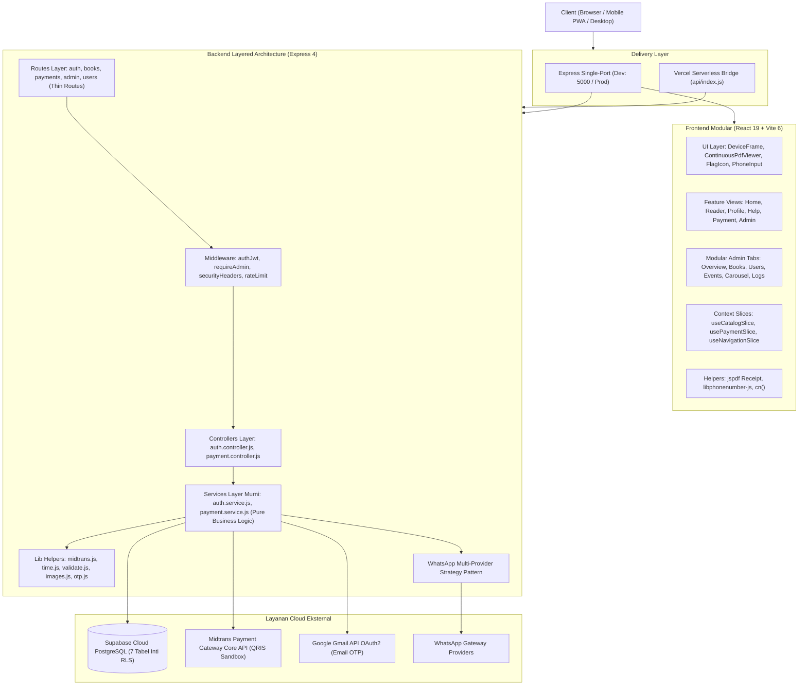

# 🏛️ Architecture & Engineering Guidelines — Wahidiyah Book

> **Dokumen Arsitektur & Standar Rekayasa Perangkat Lunak Terpadu**  
> *Versi 2.0.0 — Terakhir Diperbarui: 27 Oktober 2026*  
> *Single Source of Truth Utama: [`Master_Memory_Workflow.md`](./Master_Memory_Workflow.md)*

---

## 1. Ringkasan Eksekutif & Karakteristik Sistem

Aplikasi **Wahidiyah Book** dibangun menggunakan arsitektur **Modular Layered Monolith** yang memadukan frontend Single Page Application (SPA) modern dan backend RESTful API terpadu (Unified Single-Port / Vercel Serverless Ready).

### 1.1 Technology Stack
| Lapisan | Teknologi | Catatan Teknis |
| :--- | :--- | :--- |
| **Frontend Framework** | React 19 (`^19.3.1`) | Pure JSX, Context + Slices pattern, Headless UI, Sonner |
| **Build Tool & Bundler** | Vite 6 (`^6.1.0`) | HMR terpadu, chunking modular (`pdfjs`, `exceljs`, `recharts`) |
| **Styling & Design System** | Tailwind CSS 4 (`@tailwindcss/vite`) | 3-Color Key semantik (60-30-10) & 17 pasangan kontras WCAG AA $\ge 4.5:1$ |
| **Document Reader** | Mozilla PDF.js (`pdfjs-dist@^4.10.38`) | Continuous Vertical Scroll Canvas, Scroll-Spy, fixed-aspect, anchor zoom |
| **Receipt Generator** | `jspdf` (`^4.2.1`) | Ekspor kwitansi A4 resmi langsung di peramban (client-side) tanpa print fisik |
| **Backend Runtime** | Node.js 24 (`>=24`) | ES Module murni, native fetch, async/await |
| **Web Server Framework** | Express.js 4 (`^4.21.2`) | Single-port dev middleware & serverless bridge (`api/index.js`) |
| **Database & BaaS** | Supabase Cloud (PostgreSQL 15) | Service Role Client (Backend) & Row Level Security (RLS) fail-closed |
| **Payment Gateway** | Midtrans Core API (`midtrans-client`) | QRIS Gopay acquirer, webhook notification listener idempoten |
| **WhatsApp Notifications** | Multi-Provider Gateway Pattern | Fonnte, Wablas, Whacenter, Twilio, Webhook, Demo |
| **Email Gateway** | Google APIs (`google-auth-library`) | Gmail API HTTPS OAuth2 Service Token |
| **Testing Harness** | Vitest 5 (`^5.0.5`) | 102 automated unit tests (membership, payment, auth, sanitize) |

---

## 2. Diagram Arsitektur Sistem (Modular Layered Monolith)



---

## 3. Pemisahan Tanggung Jawab Lapisan (Layer Responsibilities)

Pemisahan lapisan (*Separation of Concerns*) dilakukan secara ketat untuk menjamin *loose coupling*, *high cohesion*, dan kemampuan uji unit (*testability*):

1. **Routes Layer (`server/routes/`):**
   - Hanya mengurusi pendefinisian rute URL, metode HTTP (`GET`, `POST`, `PUT`, `DELETE`), dan penyematan middleware (`requireAuth`, `requireAdmin`, `rateLimiter`).
   - Tidak memuat logika bisnis maupun query SQL langsung.
2. **Controllers Layer (`server/controllers/`):**
   - Mengambil data dari objek request Express (`req.body`, `req.params`, `req.user`).
   - Memvalidasi struktur data menggunakan skema `zod`.
   - Meneruskan data ke Service Layer.
   - Mengembalikan HTTP Response seragam (`res.status().json()`).
3. **Services Layer Murni (`server/services/`):**
   - Menampung seluruh aturan bisnis (*business rules*), misalnya: kalkulasi masa aktif Pro, pola klaim status transaksi QRIS secara idempoten, dan penerbitan kode OTP.
   - **Bebas dari objek `req` dan `res` Express** sehingga 100% testable secara unit tanpa perlu mock server HTTP.
4. **Helper & Utility Layer (`server/lib/`):**
   - Modul pembantu murni: integrasi klien Midtrans Core API (`midtrans.js`), penanggalan WIB terstandarisasi (`time.js`), sanitasi gambar WebP (`images.js`), pembungkus respons HTTP (`http.js`), dan manajemen OTP (`otp.js`).
5. **Database Layer (`server/db.js` & Supabase Cloud):**
   - Menggunakan klien terautentikasi `supabaseServer` dengan perlindungan *Row Level Security (RLS)* fail-closed.
   - Hanya 7 tabel inti aktif: `users`, `books`, `events`, `subscriptions`, `transactions`, `email_verifications`, dan `carousel_slides`.

---

## 4. Evaluasi 30 Prinsip Kualitas Perangkat Lunak (Software Quality)

Sistem dirancang dengan berpatokan pada 3 tingkatan prioritas (*Tiers*):

### Tier 1: Pondasi Kritis & Mutlak (P1)
1. **Separation of Concerns (SoC):** Pemisahan tegas antara Route, Controller, Service, dan Database.
2. **Idempotency (Operasi Bayar & Webhook):** Webhook Midtrans dan aktivasi keanggotaan menggunakan klaim UPDATE bersyarat untuk mencegah aktivasi berulang (*double fulfillment*).
3. **Security by Design:** Row Level Security fail-closed, parameter query anti-SQLi, enkripsi kata sandi `bcryptjs` 12 rounds, rate limiting berlapis, dan proteksi hak cipta konten e-reader.
4. **Testability:** Seluruh logika bisnis dapat diuji secara otomatis melalui test runner Vitest tanpa mock HTTP server.
5. **KISS (Keep It Simple, Stupid) & YAGNI:** Menghindari abstraksi berlebih, tanpa microservices, tanpa distributed broker, dan tanpa database terdistribusi yang tidak diperlukan skripsi.
6. **High Cohesion & Loose Coupling:** Modul mandiri yang hanya berkomunikasi lewat antarmuka fungsi yang jelas.

### Tier 2: Standar Clean Code & Operasional (P2)
7. **Maintainability & Readability:** Penamaan fungsi deklaratif, konsistensi ES Module, dan dokumentasi single source of truth.
8. **DRY (Don't Repeat Yourself):** Penggunaan helper bersama (`http.js`, `time.js`, `validate.js`, `cn()`).
9. **Extensibility (Strategy Pattern):** WhatsApp Gateway menggunakan pola strategi multi-provider yang mudah diperluas (Fonnte, Wablas, Twilio, Webhook).
10. **Robustness & Fault Tolerance:** Polling QRIS tetap berjalan aman meskipun terjadi gangguan jaringan sesaat; error handler global mencegah proses server crash.
11. **Performance & Lazy Loading:** Pemisahan bundel manual (*manual chunks*) pada Vite untuk library berat (`pdfjs`, `exceljs`, `recharts`).
12. **Observability & Structured Logging:** Logger performa tinggi berbasis `picocolors` dengan penanda waktu WIB dan prefix modul.

### Tier 3: Anti-Pattern yang Dihindari (P3)
- ❌ **Microservices:** Diabaikan karena overhead jaringan dan orkestrasi berlebihan untuk skala aplikasi perpustakaan.
- ❌ **Event Sourcing & CQRS:** Diabaikan karena query model PostgreSQL Supabase sudah mencukupi kebutuhan transaksional.
- ❌ **Distributed Message Broker (Kafka/RabbitMQ):** Diabaikan karena beban webhook dapat ditangani langsung secara asinkron oleh Express.

---

## 5. Arsitektur Komponen Frontend & UX

1. **Continuous Vertical Scroll PDF Viewer (`ContinuousPdfViewer.jsx`):**
   - Render multi-halaman berbasis kanvas HTML5 via Mozilla PDF.js.
   - Fixed-aspect ratio sheet container mencegah lonjakan layout saat proses render asinkron.
   - Auto Scroll-Spy mendeteksi posisi viewport dan memperbarui nomor halaman aktif secara instan.
   - Reading anchor menahan posisi baris teks saat pengguna melakukan perbesaran (zoom in/out).
2. **Cupertino Inset Grouped Profile Hub (`EditProfileScreen.jsx`):**
   - Tata letak terpadu ala Apple Cupertino dengan kartu identitas taktil di bagian atas.
   - Pengelompokan logis: Data Akun, Pengaturan Tampilan (Switch Slider Tema), dan Akses Navigasi Cepat.
   - Mengintegrasikan halaman sekunder (`/about`, `/help`, `/riwayat`) ke dalam Hub Profil Akun.
3. **Universal Sticky Back Button Header (`DeviceFrame.jsx`):**
   - Menghadirkan header navigasi kembali (`← [Judul]`) seragam di **Desktop, Tablet, dan Mobile**.
   - Posisi sticky dengan penyesuaian margin dinamis terhadap sidebar desktop (`md:ml-[218px]` terbuka, `md:ml-[68px]` tertutup).
   - Smart fallback: kembali ke riwayat peramban atau otomatis mengarahkan ke halaman profil/beranda.
4. **Impeccable Client-Side Receipt Engine (`jspdf`):**
   - Pembuatan bukti pembayaran resmi A4 langsung di memori peramban tanpa membebani server.
   - Tata letak dua kolom profesional ber-branding hijau zamrud dengan stempel verifikasi digital.

---

## 6. Standar Pengujian & Verifikasi Kualitas (Quality Harness)

Sebelum setiap perubahan digabungkan ke repositori, sistem wajib lulus 4 gerbang verifikasi via perintah:

```bash
npm test
```

Pipeline verifikasi mencakup:
1. `node scripts/check-syntax.js`: Validasi AST rekursif seluruh 62 berkas JavaScript (0 syntax error).
2. `node scripts/check-colors.js`: Audit 80 berkas `src/` memastikan 0 palet warna Tailwind mentah non-token.
3. `node scripts/check-contrast.js`: Audit rasio kontras 17 pasangan warna WCAG AA ($\ge 4.5:1$ teks, $\ge 3:1$ non-teks).
4. `vitest run`: Eksekusi 102 unit test otomatis pada 5 test file (`auth_service.test.js`, `payment_service.test.js`, `membership.test.js`, `midtrans_parsing.test.js`, `sanitize.test.js`).

---

## 7. Rujukan Dokumentasi Lengkap

Dokumentasi arsitektur di atas merupakan ikhtisar terstruktur. Untuk naskah akademis, spesifikasi REST API rinci, skema DDL SQL, dan alur pembayaran QRIS, selalu rujuk berkas master tunggal:

👉 [**Master_Memory_Workflow.md**](./Master_Memory_Workflow.md)
