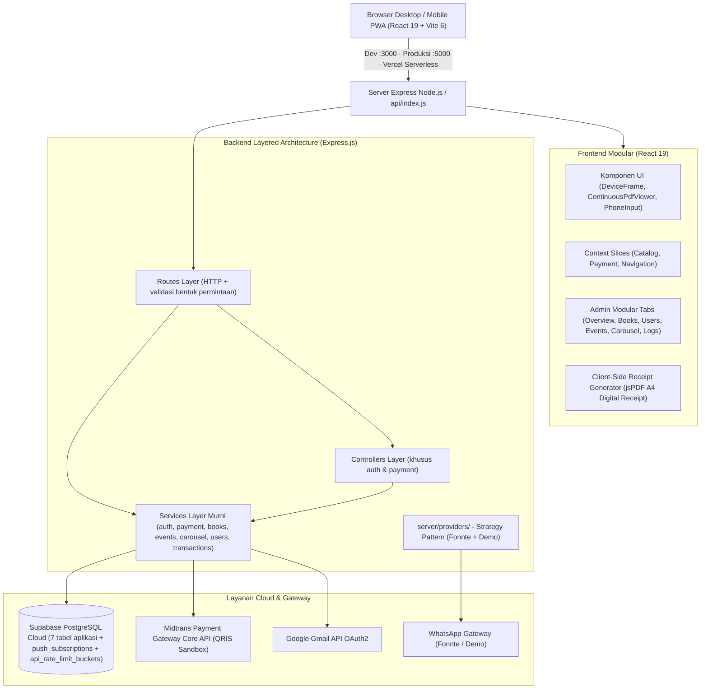

# 📖 Wahidiyah Book — Digital Library, Real Midtrans QRIS & WhatsApp Authenticator
## 🧠 Master Memory Workflow & Dokumentasi Teknis Sistem Terpadu (Single Source of Truth)

[](https://nodejs.org/)
[](https://react.dev/)
[](https://expressjs.com/)
[](https://vitejs.dev/)
[](https://tailwindcss.com/)
[-emerald.svg)](https://supabase.com/)
[-0052cc.svg)](https://midtrans.com/)
[](https://whatsapp.com/)
[](https://vercel.com/)

> 🎯 **FUNGSI UTAMA BERKAS INI:** 
> Berkas ini adalah **SATU-SATUNYA SUMBER KEBENARAN (Single Source of Truth / Memory Tunggal)** untuk seluruh arsitektur, spesifikasi REST API, alur pembayaran Midtrans QRIS, gateway autentikasi WhatsApp, integrasi database Supabase Cloud, panduan developer, naskah akademik/Zotero, standar keamanan siber, dan riwayat rilis aplikasi **Wahidiyah Book**.
>
> 
> Ini satu-satunya **memory teknis utama**. `README.md` hanya pintu masuk; `ARCHITECTURE.md`, `DESIGN.md`, dan `docs/ARCHITECTURE_AND_ENGINEERING_GUIDELINES.md` hanya pengarah ke bagian terkait di sini. Panduan operasional khusus, seperti panduan upload admin, tetap berdiri sendiri. Jika dokumentasi berbeda dengan kode aktif atau `full_setup.sql`, kode dan skema aktif menjadi acuan lalu memory ini diperbarui.

---

## 📑 Daftar Isi
1. [Ringkasan Eksekutif & Tech Stack](#1-ringkasan-eksekutif--tech-stack)
2. [Fitur Unggulan Sistem](#2-fitur-unggulan-sistem)
3. [Arsitektur Sistem & Rekayasa Perangkat Lunak (Modular Layered Monolith)](#3-arsitektur-sistem--rekayasa-perangkat-lunak-modular-layered-monolith)
4. [Spesifikasi Lengkap Design System & Standar Visual UI](#4-spesifikasi-lengkap-design-system--standar-visual-ui)
5. [Spesifikasi Lengkap REST API (/api/*)](#5-spesifikasi-lengkap-rest-api-api)
6. [Mekanisme & Alur Pembayaran Real Midtrans QRIS](#6-mekanisme--alur-pembayaran-real-midtrans-qris)
7. [Arsitektur Provider WhatsApp Gateway](#7-arsitektur-provider-whatsapp-gateway)
8. [Panduan Setup & Skema Database Supabase Cloud](#8-panduan-setup--skema-database-supabase-cloud)
9. [Standar Keamanan Sistem (30 Indikator Software Quality & Security Hardening)](#9-standar-keamanan-sistem-30-indikator-software-quality--security-hardening)
10. [Panduan Pengembangan & Penambahan Fitur Baru](#10-panduan-pengembangan--penambahan-fitur-baru)
11. [Panduan Akademik & Integrasi Sitasi Zotero SINTA](#11-panduan-akademik--integrasi-sitasi-zotero-sinta)
12. [Prasyarat & Konfigurasi Lingkungan (.env)](#12-prasyarat--konfigurasi-lingkungan-env)
13. [Panduan Instalasi & Katalog NPM Scripts](#13-panduan-instalasi--katalog-npm-scripts)
14. [Struktur Direktori Repositori Terpadu](#14-struktur-direktori-repositori-terpadu)
15. [Riwayat singkat](#15-riwayat-singkat)
16. [Roadmap & Rencana Pengembangan Mendatang](#16-roadmap--rencana-pengembangan-mendatang)
17. [Informasi Pengembang & Identitas Skripsi](#17-informasi-pengembang--identitas-skripsi)

---

## 1. Ringkasan Eksekutif & Tech Stack

Aplikasi **Wahidiyah Book** dibangun menggunakan arsitektur **Modular Layered Monolith (Murni React 19 JSX + Node.js Express)** dengan integrasi Service Layer decoupled dan Single-Port delivery:

* **Frontend:** React 19 (`.jsx` dan `.js`), Vite 6, React Router v7, Tailwind CSS 4, Headless UI, Lucide Icons, Sonner.
* **Document Engine:** Mozilla PDF.js Canvas (`ContinuousPdfViewer.jsx` Continuous Vertical Scroll, Retina HD scaling, scroll-spy otomatis, anchor pelacak zoom tanpa geser teks) dan Mammoth (.docx ke HTML semantik terproteksi).
* **Receipt Engine:** `jspdf` untuk ekspor kwitansi digital A4 resmi instan di peramban (client-side) tanpa dialog print fisik.
* **Backend:** Node.js 24.x (`engines` di `package.json`) dan Express.js 4 (ES Module), dengan Service Layer dan adapter serverless Vercel (`api/index.js`).
* **Database & BaaS:** Supabase Cloud (PostgreSQL 17 dengan *Row Level Security* fail-closed dan zona waktu `Asia/Jakarta`).
* **Payment Gateway:** Midtrans Core API QRIS. Server menyimpan payload EMVCo `qr_string` dan URL gambar resmi Midtrans; UI menampilkan gambar resmi (diproksikan server), dengan fallback QR SVG dari `qr_string`, lalu webhook idempoten.
* **WhatsApp Gateway (Fonnte):** Berbasis *Strategy Pattern* di `server/providers/` dengan Fonnte sebagai satu-satunya gateway nyata dan Demo lokal untuk pengembangan.
* **Image Processing:** Sharp (kompresi & sanitasi otomatis gambar sampul ke format WebP).
* **Email & Notifikasi:** Google OAuth2 API (Gmail API HTTPS untuk OTP email registrasi & verifikasi) dan Web Push VAPID untuk pengingat agenda.
* **Quality Harness:** `npm run build` (Vite), `npm run format:check` (Prettier `printWidth: 100`), dan `npm run health` (6 pemeriksaan konfigurasi). Tidak ada suite unit test aktif; status lulus terakhir harus dicatat bersama perubahan yang diverifikasi.

---

## 2. Fitur Unggulan Sistem

### 2.1. Katalog Buku & Universal Document Reader (Read-Only)
- **Katalog Interaktif Minimalis:** Desain elegan ala e-reader (Moco-style) yang menonjolkan sampul jilid dan judul kitab tanpa teks penulis generik, dilengkapi pencarian katalog instan dan badge akses (*locked* vs *free*).
- **Universal Document Reader (PDF & Word DOCX):**
  - **Dukungan Berkas PDF Continuous Vertical Scroll:** Dirender interaktif via Mozilla PDF.js Canvas dengan gulir vertikal mulus (*continuous scroll*), auto scroll-spy sinkronisasi halaman, kanvas berasio aspek tetap (*fixed-aspect ratio*), pelacak zoom persentase real-time, dan titik jangkar baca (*reading anchor*) yang menjaga posisi teks tidak melompat saat zoom in/out. Tombol kontrol zoom diletakkan ringkas berdampingan dengan tombol layar penuh (*fullscreen*).
  - **Dukungan Naskah Word DOCX:** Dikonversi langsung di sisi server via pustaka `mammoth` menjadi HTML semantik (`GET /api/books/:id/html`) dengan sanitasi anti-XSS (`DOMPurify`), disajikan secara responsif di peramban tanpa memerlukan Microsoft Word fisik.
  - **Proteksi Hak Cipta:** Tanda air (*watermark*) identitas dinamis (nama pembaca & ID transaksi) dibakar di kanvas, proteksi klik kanan (`onContextMenu preventDefault`), larangan seleksi teks (`select-none`), dan pengiriman konten via HTTP header `inline` berotorisasi JWT.
- **Last Read Tracker (Ingat Posisi Terakhir):** Otomatis menyimpan posisi halaman baca pengguna ke `localStorage` peramban (tanpa beban latensi database) dan menampilkan dialog resume *"Lanjut membaca dari Halaman X?"*.
- **Mode Tema Pembaca:** Pilihan latar belakang **Terang**, **Sepia (Hangat Lembut)**, dan **Malam (Gelap Elegan)** untuk kenyamanan membaca dalam waktu lama.

### 2.2. Autentikasi Pengguna & WhatsApp Gateway Fonnte (R61–R67)
- **Registrasi & Verifikasi Dual-Channel Terkendali:**
  - **Registrasi Akun:** 100% menggunakan verifikasi OTP via **Email (Gmail API OAuth2)** bebas biaya API dan anti-flooding (*OTP Flooding Protection*). `RegisterScreen.jsx` mengunci `deliveryMethod = 'email'`; tombol pendaftaran berlabel bersih *"Daftar"*.
  - Kanal WhatsApp untuk nomor Indonesia dialokasikan sebagai opsi pemulihan sekunder (*Secondary Fallback Account Recovery*) pada fitur Lupa Password dan kirim ulang kode.
- **Nomor WhatsApp Indonesia Saja (Tanpa Bendera):**
  - Tidak ada lencana bendera atau pemilih negara: `PhoneInput.jsx` hanya menerima nomor Indonesia dan `src/lib/phone.js` menjaga dua bentuk — `62xx` untuk disimpan, `0xx` tanpa spasi untuk ditampilkan.
  - Parsing nomor memakai helper lokal `src/lib/phone.js` (`normalizePhone`, `displayPhone`, `isValidPhone`), bukan pustaka luar.
  - Nomor wajib diisi saat registrasi (`registerSchema` di `server/lib/validate.js`); Fonnte selalu mengirim `countryCode: '62'`.
  - Pembuangan otomatis angka nol di awal nomor lokal (`0812...` ➔ `62812...`).
- **Login Akun Google:** Integrasi resmi Google OAuth 2.0 (*Direct Authorization Code Flow*) dengan verifikasi token ID dan pembuatan sesi JWT aman.
- **Sesi Aman & Proteksi Hak Akses:** Penyimpanan kata sandi dengan salt hashing `bcryptjs` (12 rounds), sesi berbasis token `jsonwebtoken` (JWT), dan mitigasi celah *self-demotion* (admin tidak dapat mencabut hak admin dirinya sendiri).

### 2.3. Sistem Keanggotaan Pro & Pembayaran Real Midtrans QRIS
- **Paket Pro Tunggal Terstandarisasi:** Skema keanggotaan Pro tunggal `monthly` dengan tarif Rp 25.000/bulan ditambah biaya administrasi Rp 3.000 (`server/lib/constants.js`), sehingga total tagihan Rp 28.000.
- **Integrasi Midtrans Core API Sandbox Eksklusif:** Charge QRIS dibuat langsung dari backend server dengan payload EMVCo dinamis (bebas dari manipulasi harga di sisi klien). Seluruh metode manual non-QRIS telah dieliminasi demi otomasi 100%.
- **Bantuan Pengujian Sandbox:** Kotak *"Simulator QRIS Midtrans"* menyediakan tautan QR yang dapat disalin (`qrMidtransUrl` pada sandbox, atau URL proxy gambar) untuk ditempel ke kolom **"QR Code Image Url"** simulator. Tidak ada tautan keluar otomatis maupun tombol pembayaran simulasi di aplikasi.
- **Simpan QRIS ke Galeri Ponsel:** Gambar QR (SVG/PNG) digambar ulang ke `<canvas>` berukuran 320 px dengan kop hijau dan keterangan e-wallet, lalu diunduh sebagai PNG agar dapat dipindai dari galeri (DANA, GoPay, BCA, OVO, ShopeePay).
- **Batalkan & Buat Ulang:** Tombol batal memanggil `POST /api/payments/qris/:orderId/cancel`, mematikan order di Midtrans bila didukung (QRIS sering menolak dengan 412), lalu membuat order baru. Bila Midtrans menolak, server menjelaskan bahwa QR lama masih berlaku sampai kedaluwarsa.
- **Polling & Webhook Idempoten:** Pengecekan otomatis status transaksi setiap 3 detik dan verifikasi *SHA512 Signature Key* pada endpoint webhook notifikasi. Logika berada di `server/services/payment_service.js` dengan mekanisme klaim bersyarat (*conditional claim*) untuk mencegah aktivasi membership ganda.
- **Faktur Kwitansi Pembayaran Resmi & Unduh PDF Instan:**
  - Format kwitansi A4 resmi dengan desain profesional, branding hijau zamrud tua, metadata dua kolom rapi, rincian biaya transparan, dan stempel verifikasi resmi Wahidiyah Book.
  - Unduh langsung ke format PDF di sisi klien menggunakan pustaka `jspdf` — cepat, tanpa dialog `window.print()` peramban, dan terhindar dari pemotongan halaman fisik.
  - Riwayat langganan dilengkapi fallback otomatis ke tabel `transactions` sehingga histori transaksi selalu tampil lengkap.

### 2.4. Panel Administrasi Komprehensif (Modular Sub-Tabs)
- **Arsitektur Sub-Tab Terisolasi:** `AdminDashboard.jsx` hanya menyusun tab dan hook; enam panel mandiri berada langsung di `src/features/admin/`, dengan sub-komponen agenda di `events/` dan hook data di `hooks/`:
  1. `OverviewTab.jsx`: tiga kartu KPI (Total pengguna, Koleksi aktif, Langganan aktif), donut *Status langganan* (Pro vs Reguler) via `recharts`, kartu pendapatan tervalidasi, riwayat 10 transaksi terakhir, dan tombol ekspor laporan lengkap `.xlsx`.
  2. `BooksTab.jsx` + `BookModal.jsx`: manajemen katalog buku, formulir tambah/edit, unggah naskah ke Supabase Storage via tanda unggah, kompresi sampul WebP via `sharp`, dan kelola visibilitas Pro.
  3. `UsersTab.jsx`: manajemen anggota, pencarian pengguna, penugasan role admin, dan toggle Pro.
  4. `EventsTab.jsx`: orkestrator kalender agenda; panel dipecah menjadi `EventCalendarPanel`, `SelectedDateAgenda`, `AllAgendaPanel`, `EventFormPanel`, dan `PushStatusBanner`, dengan state di `useAdminEventEditor`.
  5. `CarouselTab.jsx`: pengelolaan banner carousel beranda dinamis (termasuk unggah gambar).
  6. `LogsTab.jsx`: pemantauan log aktivitas sistem (langganan + pengguna) dengan tombol refresh di samping filter.
- **Hook Komposisi:** `useAdminDashboardData` memuat statistik, pengguna, transaksi, agenda, dan carousel; `useAdminBookEditor` mengelola unggah sampul/naskah; `useAdminEventEditor` mengelola agenda terpilih.
- **Ekspor Laporan 1-Klik:** Unduh riwayat transaksi, data pengguna, dan katalog buku langsung ke format Microsoft Excel (`.xlsx`) via library `exceljs` yang dimuat secara dinamis.

### 2.5. Antarmuka Pengguna & Navigasi Terpadu (Mobile, Tablet, Desktop)
- **Cupertino Inset Grouped Profile Hub:** Halaman profil (`EditProfileScreen.jsx`) didesain ulang dengan gaya modern iOS/Cupertino inset grouped card. Bagian **Data Akun** ditempatkan di paling atas dengan kartu profil taktil yang elegan, tombol ubah kata sandi, dan toggle mode gelap/terang dalam bentuk switch slider.
- **Konsolidasi Halaman Sekunder:** Halaman Tentang Aplikasi (`/about`), Pusat Bantuan (`/help`), dan Riwayat Langganan (`/riwayat`) disatukan ke dalam Hub Akun Profil. Sidebar desktop dibersihkan dari menu redundan dan tombol badge EB yang mengganggu telah dihilangkan.
- **Universal Sticky Back Button Header (`DeviceFrame.jsx`):**
  - Hadir seragam di **Desktop, Tablet, dan Ponsel Mobile** untuk seluruh sub-halaman (`/about`, `/help`, `/riwayat`, `/profile`).
  - Posisi *sticky* di bagian atas konten dengan margin responsif yang pas terhadap sidebar (`md:ml-[218px]` terbuka, `md:ml-[68px]` ciut).
  - Mekanisme navigasi pintar: menggunakan `window.history.back()` jika ada riwayat jelajah, atau fallback otomatis ke halaman profil/beranda.
- **Tampilan Bersih & Minimalis:**
  - Halaman Pusat Bantuan dibersihkan dari judul dan ikon ganda yang redundan.
  - Halaman Tentang Aplikasi dibersihkan dari logo besar yang mengganggu agar fokus pada teks informasi.
- **Tema Tampilan Menyeluruh (Terang & Malam):** Seluruh antarmuka mendukung palet gelap sadar-tema dengan CSS variable Tailwind berstandar 3 Color Key (60-30-10) dan 17 pasangan kontras WCAG AA $\ge 4.5:1$.
- **Progressive Web App (PWA):** Terintegrasi Web App Manifest & Service Worker untuk instalasi ke Layar Utama (*Home Screen*).

---

## 3. Arsitektur Sistem & Rekayasa Perangkat Lunak (Modular Layered Monolith)

Aplikasi dibangun menggunakan prinsip **Modular Layered Monolith (Unified Single-Port & Service-Decoupled Architecture)**:



### 3.1 Konvensi Kode & Pembagian Tanggung Jawab 4 Lapisan:
Pemisahan lapisan (*Separation of Concerns*) dilakukan secara ketat untuk menjamin *loose coupling*, *high cohesion*, dan kemampuan uji unit (*testability*):
1. **Routes Layer (`server/routes/`):**
   - Tipis (*thin routes*): mendefinisikan URL, metode HTTP (`GET`, `POST`, `PUT`, `DELETE`), menyematkan middleware terkait (`requireAuth`, `requireAdmin`, `authRateLimiter`, `paymentRateLimiter`), lalu memetakan hasil service menjadi respons HTTP.
   - Boleh memvalidasi bentuk permintaan yang dangkal (mis. `isOneOf(action, ['approve', 'reject'])`), tetapi **tidak memuat aturan bisnis**.
   - Status migrasi per Oktober 2026: modul **books, users, transactions, events, carousel, auth, dan payments** sudah 0 referensi `supabaseServer` di berkas rutenya. Tiga rute masih memanggil Supabase langsung sebagai pengecualian yang diketahui: `subscriptions_routes.js` (riwayat + fallback transaksi), `admin_routes.js` (log aktivitas), dan `health_routes.js` (`/health`, `/stats`).
2. **Controllers Layer (`server/controllers/`):**
   - Bukan lapisan wajib untuk semua modul. Hanya alur autentikasi dan pembayaran QRIS yang membutuhkannya karena memerlukan skema `zod`, ekstraksi `req`, dan amplop respons khusus.
   - Modul lain (buku, agenda, carousel, pengguna, transaksi) melompat langsung dari route ke service; satu lapisan tambahan di sana hanya memindahkan kode tanpa menambah kejelasan. Nama berkas memakai garis bawah: `auth_controller.js`, `payment_controller.js`, `auth_service.js`, `payment_service.js`.
3. **Services Layer Murni (`server/services/`):**
   - Menampung seluruh aturan bisnis (*business rules*) dan query Supabase: `auth_service`, `payment_service`, `books_service`, `events_service`, `carousel_service`, `users_service`, `transactions_service`.
   - **Bebas mutlak dari objek `req` dan `res` Express** sehingga aturan bisnis dapat diverifikasi tanpa menjalankan HTTP server.
   - Hasil bisnis yang wajar (bukan galat) dikembalikan sebagai objek `outcome`; kegagalan aturan bisnis dilempar melalui `createServiceError(pesan, { statusCode, code, extra })` dari `server/lib/errors.js`.
4. **Helper & Database Layer (`server/lib/` & `server/db.js`):**
   - `errors.js`: `createServiceError` — satu-satunya cara service menyatakan status HTTP yang diusulkan.
   - `midtrans.js`: Integrasi API Midtrans Core (charge QRIS, status polling, pembatalan/expire, verifikasi signature SHA512, unwrap payload, `isTransactionSettled`).
   - `time.js`: Penanggalan WIB tunggal terstandarisasi dengan `dayjs` (zona waktu `Asia/Jakarta`).
   - `validate.js`: Skema validasi terstruktur dengan `zod` dan penjepit nilai query (`toBoundedInt`).
   - `images.js`: Pengolahan kompresi gambar WebP dengan `sharp`.
   - `http.js`: Helper pembungkus respons HTTP (`wrap`, `fail`, `badRequest`/`notFound`/`conflict`). `fail` menerjemahkan `error.statusCode` dari service menjadi respons 4xx/5xx yang seragam.
   - `otp.js` + `oneTimeCode.js`: Manajemen pembuatan kode OTP terenkripsi, cooldown kirim ulang, dan kode sesi sekali-pakai.
   - `membership.js` + `constants.js`: Aturan aktivasi Pro, klaim transaksi bersyarat, dan harga paket (Rp 25.000 + Rp 3.000).
   - `storage.js` + `sniff.js`: Penanda `storage://buku/...`, URL bertanda, serta deteksi MIME dari magic bytes.
   - `origin.js`, `pushEndpoint.js`, `webpush.js`, `eventReminder.js`: Validasi origin OAuth, whitelist endpoint push, pengiriman Web Push, dan pengingat agenda H-1.
   - `sanitizeHtml.js`: Re-export `shared/sanitizeHtml.js` untuk konversi DOCX.
   - `db.js`: Klien `supabaseServer` ber-role service dengan Row Level Security fail-closed.

### 3.2 Evaluasi Kritis 30 Prinsip Kualitas Perangkat Lunak (Software Quality):
Sistem dirancang dan dievaluasi berpatokan pada 3 tingkatan prioritas (*Tiers*):
- **Tier 1: Pondasi Kritis & Mutlak (P1)**
  1. *Separation of Concerns (SoC):* Pemisahan tegas Routes $\rightarrow$ Controllers (auth & payment) $\rightarrow$ Services $\rightarrow$ Database; modul CRUD lain langsung Routes $\rightarrow$ Services.
  2. *Idempotency (Operasi Bayar & Webhook):* Webhook Midtrans dan aktivasi keanggotaan menggunakan klaim UPDATE bersyarat atomik untuk mencegah aktivasi ganda (*prevent double fulfillment*).
  3. *Security by Design:* Row Level Security fail-closed, parameter query anti-SQLi, enkripsi kata sandi `bcryptjs` 12 rounds, rate limiting pada endpoint pembayaran, dan proteksi hak cipta e-reader.
  4. *Testability:* Logika autentikasi, pembayaran, membership, parsing Midtrans, dan sanitasi berada di service layer murni sehingga dapat diperiksa tanpa mock HTTP. Repo tidak lagi memuat suite unit test; verifikasi rilis dilakukan manual lewat `npm run format:check`, `node --check`, `npm run build`, dan `npm run health`.
  5. *KISS & YAGNI:* Menghindari abstraksi dinamis berlebih yang tidak dibutuhkan skripsi.
  6. *High Cohesion & Loose Coupling:* Modul mandiri yang hanya berkomunikasi via antarmuka fungsi terdefinisi.
- **Tier 2: Standar Clean Code & Operasional (P2)**
  7. *Maintainability & Readability:* Penamaan fungsi deklaratif, konsistensi ES Module, Prettier `printWidth: 100`, dan dokumentasi single source of truth.
  8. *DRY (Don't Repeat Yourself):* Penggunaan helper terpusat (`http.js`, `time.js`, `validate.js`, `cn()`).
  9. *Extensibility (Strategy Pattern):* WhatsApp Gateway memakai kontrak `BaseWhatsAppProvider` dengan implementasi Fonnte dan Demo; provider baru cukup menambah satu kelas dan mendaftarkannya di registry.
  10. *Robustness & Fault Tolerance:* Polling status QRIS tetap berjalan aman meskipun ada fluktuasi jaringan; global error handler mencegah crash proses server.
  11. *Performance & Lazy Loading:* Pemisahan bundel manual (*manual chunks*) pada Vite untuk library berat (`pdfjs`, `exceljs`, `recharts`).
  12. *Observability & Structured Logging:* Logger performa tinggi berbasis `picocolors` dengan penanda waktu WIB dan prefix modul.
- **Tier 3: Anti-Pattern yang Dihindari (P3)**
  - ❌ *Microservices:* Diabaikan karena overhead latensi dan kompleksitas deployment tidak proporsional untuk sistem perpustakaan.
  - ❌ *Event Sourcing & CQRS:* Diabaikan karena integritas transaksional PostgreSQL Supabase sudah mencukupi.
  - ❌ *Distributed Message Broker (Kafka/RabbitMQ):* Diabaikan karena volume antrean webhook dapat ditangani secara asinkron oleh Express.

### 3.3 Dukungan Lingkungan & Vercel Serverless:
- **Development:** `npm run dev` menyalakan Express dengan middleware Vite HMR dalam satu port di `http://localhost:3000` (`VITE_PORT`, default 3000). `PORT=5000` hanya dipakai mode API/Produksi.
- **Vercel Serverless (`api/index.js` + `vercel.json`):** Server Express dibungkus menjadi serverless handler yang kompatibel dengan runtime Node 24 Vercel, dengan rewrite `/api/(.*)` ke serverless function dan aset statis disajikan via CDN edge Vercel. Node dipatok `24.x` lewat `engines` di `package.json`.
- **Region function:** `regions: ["sin1"]` dipasang di `vercel.json`. Tanpa itu Vercel memakai `iad1` (Virginia) sehingga setiap panggilan API menyeberangi Samudra Pasifik meski pembaca berada di Indonesia; terukur pada `GET /api/health` turun dari 1,2–1,8 detik menjadi 0,13–0,77 detik setelah dipindah ke Singapura. Paket Hobby hanya boleh satu region, jadi `sin1` tidak bisa digabung dengan region lain.
- **Naskah di Supabase Storage:** Vercel menolak body request maupun response di atas 4,5 MB dengan `413 FUNCTION_PAYLOAD_TOO_LARGE` sebelum kode Express berjalan, sehingga naskah buku tidak boleh lewat function. Berkas dikirim peramban langsung ke bucket privat `buku` memakai tanda unggah dari `POST /api/books/upload-intent`, dan kolom `content_url` hanya menyimpan penanda `storage://buku/<path>` (`server/lib/storage.js`). `server/middleware/uploads.js` kini hanya menampung sampul (5 MB). Bucket `buku` dibuat oleh blok **PATCH Naskah di Storage** di `supabase_database/full_setup.sql`, sehingga project Supabase yang dibuat ulang tinggal menjalankan blok itu.
- **Atribusi IP klien:** `TRUST_PROXY` harus diisi jumlah hop proxy di depan Express. Di Vercel nilainya `1`. Tanpa nilai ini `req.ip` jatuh ke alamat antarmuka dalam (`127.0.0.1` di Vercel), sehingga pembatasan berbasis IP dihitung sebagai satu ember global untuk seluruh pengguna. Verifikasi lewat log permintaan: kolom IP pada baris `REQ [HTTP]` harus menampilkan IP publik pengirim, bukan `127.0.0.1`. Tepi Vercel menimpa `x-forwarded-for` dengan alamat peer-nya (terverifikasi: kiriman header palsu tetap tercatat IP asli), sehingga `TRUST_PROXY: true` tidak diperlukan dan hop tambahan tidak perlu dihitung. Bila kelak dipasang Cloudflare di depan Vercel, yang terlihat justru IP egress Cloudflare — menaikkan jumlah hop tidak memulihkan IP klien; solusinya memercayai `cf-connecting-ip` dan hanya saat traffic memang lewat Cloudflare.
- **Rate limit:** Endpoint sensitif (`qris-status`, `payment`, `qris-image`, `push-subscription`) memakai store in-memory bawaan `express-rate-limit` per proses. Store bersama lintas-instance berbasis Supabase (`server/lib/supabaseRateLimitStore.js`) sudah dilepas dari kode karena `SHARED_RATE_LIMITS` tidak pernah diaktifkan; fungsi RPC dan tabel `api_rate_limit_buckets` masih ada di `supabase_database/full_setup.sql` dan di database cloud sampai diputuskan menjatuhkannya.
- **Login Google lintas-instance:** Kode sesi acak sekali-pakai disimpan dalam bentuk hash di `email_verifications`, kedaluwarsa setelah 60 detik, dan dihapus atomik saat ditukar. Tabel yang sudah ada dipakai kembali.
- **Pemeliharaan terjadwal:** Vercel menjalankan `/api/cron/daily-maintenance` sekali sehari pada `01:00 UTC` (sekitar `08:00–08:59 WIB` di paket Hobby). Handler memverifikasi `CRON_SECRET` sebelum mengirim pengingat agenda dan menyapu langganan kedaluwarsa. Isi `CRON_SECRET` di Production Environment Variables Vercel dengan nilai acak minimal 16 karakter.

---

## 4. Spesifikasi Lengkap Design System & Standar Visual UI

### 4.1 Visual Atmosphere & Design POV
Wahidiyah Book adalah platform perpustakaan digital dan komunitas spiritual untuk pengamal Sholawat Wahidiyah. Antarmukanya mencerminkan nilai-nilai:
* **Berwibawa & Teduh (Sacred & Serene):** Tidak berisik seperti SaaS modern generik, melainkan memiliki ketenangan manuskrip klasik dan kehangatan ruang baca perpustakaan pesantren.
* **Presisi Akademis (Academic Rigor):** Tipografi teks dan sitasi yang rapi, layout hierarkis terstruktur, keterbacaan tinggi untuk membaca PDF kitab tebal berjam-jam tanpa kelelahan mata.
* **Kepercayaan Transaksi Finansial (Midtrans Trust):** Alur checkout QRIS dan keanggotaan Pro yang transparan, aman, responsif, dan memberikan umpan balik instan.

### 4.2 Tiga Dial Desain (Core Configuration)
* **`DESIGN_VARIANCE: 6`** — Keseimbangan antara keteraturan editorial katalog buku dan dinamika kartu asimetris pada hero section.
* **`MOTION_INTENSITY: 4`** — Gerakan halus, berpijak pada spring physics alami (`stiffness: 120, damping: 20`). Tanpa animasi berulang yang mengganggu kekhusyukan membaca.
* **`VISUAL_DENSITY: 5`** — Ruang bernapas yang cukup pada halaman bacaan dan katalog, namun ringkas dan efisien pada tabel administrasi dan data transaksi.

### 4.3 3 Color Key & Prinsip 60-30-10 (Wajib Semua Route)
Seluruh rute antarmuka wajib menerapkan TIGA color key dari Tema 1 "Editorial Elegan" dengan proporsi **60-30-10**:

| Peran | Proporsi | Warna | Token Tailwind | Pemakaian |
|---|---|---|---|---|
| **Dominan** | ±60% | Krem Hangat `#FBF8F3` | `cream-*`, `ui-bg/surface/card`, `ink-*` | Latar kanvas, kartu, panel, teks, border |
| **Sekunder** | ±30% | Hijau Zamrud Tua `#14523A` | `brand-*`, `primary` | Sidebar, tombol aksi, header, ikon, state aktif |
| **Aksen** | ±10% | Emas Antik `#B8860B` | `gold-*`, `accent-gold` | Lencana PRO, highlight, ornamen, detail premium |

**Aturan Penerapan:**
1. **Status Fungsional:** Menggunakan token semantik `semantic-success/warning/danger/info` (bukan warna dekoratif, tidak dihitung dalam 60-30-10).
2. **Larangan Palet Mentah:** Dilarang keras memakai kelas warna Tailwind mentah (`slate-*`, `gray-*`, `zinc-*`, `indigo-*`, `rose-*`, `emerald-*`, dll.) untuk elemen struktural. Seluruh warna wajib melalui CSS variable token.
3. **Pengecualian Resmi:** Logo Google multicolor pada tombol OAuth, logo resmi QRIS di `public/payments/` (`qris.svg` dan `qris-putih.svg`), serta token merah resmi QRIS `qris-600/700` (`#E30613`/`#C00511` — kemasan merah baku QRIS Indonesia). Logo satu warna seperti wordmark QRIS diberi penanda `mono: true` di katalog metode pembayaran lalu dibalik lewat `dark:invert` — bukan memakai pelat putih, karena pelat menciptakan kotak putih yang tidak menyatu dengan kartu di mode gelap.
4. **Mode Malam (Dark Mode):** Tetap mengikuti proporsi 60-30-10 via CSS variable (charcoal hangat menggantikan krem, zamrud dinaikkan terangnya agar terbaca kontras).

### 4.4 Palet Tunggal "Editorial Elegan" (Terang & Malam)
Sumber kebenaran warna ada di `component.json` (`colors`) dan disuntikkan ke CSS variables oleh `src/theme/themeInjector.js`. Hanya ada **satu palet** dengan dua mode, bukan kumpulan tema yang bisa dipilih:

| Peran | Mode Terang | Mode Malam | Token |
|---|---|---|---|
| **Brand / Sekunder** | Hijau Zamrud Tua `#14523A` (brand-700), hover `#0E3D2C` | Zamrud diterangkan `rgb(111 196 155)` / `#6FC49B` | `brand-*` |
| **Latar Dominan** | Krem Hangat `#FBF8F3`, surface `#F7F2E9`, card `#FFFDFA` | Charcoal hangat `#14130F`, surface `#1B1A14`, card `#201E17` | `cream-*`, `ui-*` |
| **Teks / Ink** | Tinta Arang `#1D1B17`, sekunder `#5A554E`, muted `#7C766E` | Off-white hangat `#F4EFE3`, sekunder `#C0B7A4`, muted `#948B79` | `ink-*`, `ui-text-*` |
| **Aksen** | Emas Antik `#B8860B` (gold-500), highlight `#D4AF4F` | Emas lebih terang `rgb(217 180 74)` | `gold-*`, `accent-gold` |
| **Border** | `#E4D9C6` | `#443E33` | `ui-border`, `cream-300` |

Pemilihan mode dilakukan `ThemeProvider` (`src/theme/themeMode.js`) dengan tiga preferensi: `light`, `dark`, dan `system` (mengikuti `prefers-color-scheme`). Pilihan disimpan di `localStorage` dengan kunci `wb_theme`; skrip pra-cat di `index.html` mencegah kedipan tema. Mode malam bukan inversi putih/hitam: latar tetap hangat dan nilai solid tombol dipisahkan (`--night-solid-*`) agar `bg-brand-700` tetap pekat sementara `text-brand-700` tetap terbaca.

### 4.5 Tipografi & Hirarki Skala
* **Display / Judul:** *Fraunces* (serif variabel dengan sumbu optik), fallback *Newsreader* → Georgia. Dipakai lewat `font-display`.
* **Body / Teks Bacaan:** *Plus Jakarta Sans* (400–800), `line-height: 1.65`, batas maksimal paragraf `65ch`.
* **Ayat & Kaligrafi Arab:** *Amiri* (400/700) lewat `.font-arabic`, ukuran proporsional lebih besar dengan ruang harakat yang lapang.
* **Angka Finansial & Kode:** `font-mono` bawaan sistem untuk nominal QRIS dan nomor referensi; tidak ada font monospace kustom yang diunduh.

### 4.6 Arsitektur Navigasi Terpadu (Responsive Design)
* **Desktop Sidebar (Ramping & Fokus):**
  - Lebar Terbuka: `218px` (proporsional dengan kanvas konten)
  - Lebar Ciut (Collapsed): `68px` (ikon + tooltip cerdas)
  - Menu Pengguna — Utama: Beranda, Kalender, Pro. Akun: Profil, Log Out. (Riwayat Langganan, Pusat Bantuan, dan Tentang dijangkau dari Hub Profil.)
  - Menu Admin: saat pengguna ber-role admin, sidebar hanya menampilkan section **Administrasi** berisi Beranda (overview), Koleksi, Pengguna, Agenda, Carousel, Log Aktivitas, dan Log Out — menu pengguna digantikan.
  - Label mengikuti `src/components/layout/navigationConfig.jsx`; tombol badge EB yang mengganggu telah dihilangkan.
* **Universal Sticky Top Back Button Header (`DeviceFrame.jsx`):**
  - Hadir seragam di **Desktop, Tablet, dan Mobile** (`← [Judul]`) untuk sub-halaman: `/about` (Tentang Aplikasi), `/help` (Pusat Bantuan), `/riwayat` (Riwayat Langganan), dan `/profile` (Profil).
  - Margin dinamis terhadap sidebar desktop (`md:ml-[218px]` saat terbuka, `md:ml-[68px]` saat ciut) sehingga tidak saling bertumpuk.
  - *Smart Fallback Navigation:* Mengutamakan `window.history.back()`, jika riwayat kosong otomatis kembali ke Hub Profil atau Beranda.
* **Mobile Bottom Dock Bar:**
  - Bar melayang di bagian bawah dengan radius `20px` dan bayangan lembut.
  - Pengguna: 4 tombol — Beranda, Kalender, Pro (lencana bintang emas), Profil. Admin: Ringkasan, Koleksi, Pengguna, Agenda, dan tombol **Menu**.
  - Target sentuh minimal `44px × 44px` memenuhi standar aksesibilitas mobile WCAG.

### 4.7 Spesifikasi Wireframe & Layout Layar Inti
1. **Katalog & Beranda (Home):**
   - Hero Carousel banner dinamis tanpa tombol navigasi yang berisik.
   - Kartu buku minimalis Moco-style (sampul jilid dominan, judul kitab tegas, tanpa nama penulis generik, badge status Pro emas).
   - Pencarian instan dan filter akses (Semua / Gratis / Pro).
2. **Universal Document Reader (Continuous Vertical Scroll):**
   - Penampil PDF multi-halaman berbasis canvas Mozilla PDF.js murni (`ContinuousPdfViewer.jsx`).
   - Auto scroll-spy untuk sinkronisasi halaman aktif secara otomatis saat digulir.
   - Kanvas berasio aspek tetap (*fixed-aspect*) dan *reading anchor* penahan posisi teks saat perbesaran zoom in/out.
   - Tombol kontrol zoom diletakkan ringkas berdampingan dengan tombol layar penuh (*fullscreen*).
   - Pembaca Word DOCX berbasis HTML semantik terproteksi via Mammoth engine dan sanitasi anti-XSS (`DOMPurify`).
   - Proteksi hak cipta: tanda air dinamis identitas pembaca, pelarangan klik kanan (`contextmenu`), dan larangan seleksi teks (`select-none`).
3. **Membership Pro & Real Midtrans QRIS:**
   - Paket Pro tunggal terstandarisasi Rp 25.000/bulan + biaya administrasi Rp 3.000.
   - Tampilan QRIS: gambar QR resmi Midtrans yang diproksikan `GET /api/payments/qris/:orderId/qr.png`, fallback `QRCodeSVG` dari `qrString` bila gambar gagal dimuat. Timer 15 menit, tombol simpan PNG, tombol **Salin Kode QR** (menyalin tautan gambar untuk kolom *QR Code Image Url* simulator), dan tombol **Batalkan & Buat Kode Baru**.
   - Tidak ada tombol pembayaran simulasi maupun flag `ALLOW_PAYMENT_SIMULATION`; pelunasan hanya terjadi lewat Midtrans (scan asli atau simulator sandbox).
   - **Faktur Kwitansi Digital Resmi A4 (jsPDF):** Dibuat instan di sisi klien via pustaka `jspdf` tanpa dialog print peramban, memuat kop hijau zamrud resmi, 2 kolom metadata, rincian biaya, dan stempel verifikasi digital. Riwayat langganan terhubung otomatis ke tabel transaksi agar histori pembayaran tidak pernah kosong.
4. **Kalender Kegiatan Mujahadah:**
   - Matriks kalender bulanan interaktif dengan zona waktu `Asia/Jakarta`.
   - Pemisahan jelas antara teks nama lokasi dan tombol navigasi rute presisi Google Maps.
5. **Admin Management Dashboard (6 Sub-Tabs Modular):**
   - `OverviewTab.jsx`: tiga kartu KPI, donut status langganan, pendapatan tervalidasi, riwayat transaksi, ekspor Excel.
   - `BooksTab.jsx` + `BookModal.jsx`: Manajemen katalog buku, unggah naskah, dan kompresi WebP otomatis.
   - `UsersTab.jsx`: Manajemen akun anggota dan penugasan peran admin.
   - `EventsTab.jsx` + `events/*`: Manajemen jadwal majelis mujahadah.
   - `CarouselTab.jsx`: Pengelolaan banner beranda dinamis.
   - `LogsTab.jsx`: Pemantauan log aktivitas sistem dengan tombol refresh di samping filter.
6. **Cupertino Inset Grouped Profile Hub (`EditProfileScreen.jsx`):**
   - Desain modern iOS Cupertino inset grouped card dengan Data Akun di posisi paling atas dan kartu profil taktil yang elegan.
   - Tombol ganti kata sandi dan switch slider tema gelap/terang.
   - Menu sub-halaman terintegrasi: Riwayat Langganan, Pusat Bantuan (bersih tanpa judul ganda), dan Tentang Aplikasi (bersih tanpa logo besar).
   - Tombol logout dengan label yang jelas dan penanganan sesi aman.
7. **Autentikasi Pengguna:**
   - Formulir login, pendaftaran, dan pemulihan kata sandi yang bersih dan proporsional.
   - Tombol registrasi sederhana dengan label tunggal *"Daftar"*.
   - Verifikasi OTP registrasi via email terverifikasi, serta alokasi WhatsApp sebagai fallback pemulihan lupa sandi.

### 4.8 Anti-Patterns & Banned Clichés
* **DILARANG:** Gradien ungu-neon atau biru AI (`linear-gradient(to right, #8B5CF6, #EC4899)`).
* **DILARANG:** Hitam pekat murni `#000000` atau putih silau `#FFFFFF` sebagai kanvas utama.
* **DILARANG:** Baris 3 kartu identik tanpa ritme komposisi.
* **DILARANG:** Teks placeholder generik seperti *Lorem Ipsum*, nama palsu *John Doe* atau *Acme Corp*.
* **DILARANG:** Animasi tak beralasan yang memakan beban prosesor.
* **DILARANG:** Kelas warna palet Tailwind mentah di luar token design system.
* **WAJIB:** Rasio kontras teks minimal 4.5:1 untuk teks normal dan 3:1 untuk teks besar (17 pasangan WCAG AA lulus).
* **WAJIB:** Penggunaan tripel RGB CSS variables yang kompatibel langsung dengan Tailwind CSS `rgb(var(--brand-700) / <alpha>)`.

---

## 5. Spesifikasi Lengkap REST API (`/api/*`)

* **Base URL:** `http://localhost:3000/api` saat `npm run dev` (satu port Vite middleware). Mode Produksi `http://localhost:5000/api` atau `/api` di Vercel. `npm run dev:frontend` memakai proxy Vite ke `http://localhost:5000`.
* **Format Request/Response:** `application/json` (kecuali upload multipart). Sukses selalu `{ "success": true, ...data }`; kegagalan `{ "success": false, "message": "..." }`.
* **Otentikasi:** Header `Authorization: Bearer <JWT_TOKEN>` untuk rute terproteksi. Rute admin menambah `requireAdmin` (verifikasi role langsung ke database).
* **Kegagalan service:** `createServiceError(pesan, { statusCode, code })` di `server/lib/errors.js`; `fail()` di `server/lib/http.js` menerjemahkan `statusCode` menjadi respons HTTP.

**Ringkasan 54 endpoint aktif:**

| Modul | Jumlah | Modul | Jumlah |
|---|---:|---|---:|
| Auth | 10 | Books | 10 |
| Payments | 5 | Users | 6 |
| Transactions | 3 | Subscriptions | 1 |
| Events | 5 | Carousel | 6 |
| Notifications | 4 | Health & Stats | 2 |
| Admin logs | 1 | Cron | 1 |

### 5.1. Otentikasi (`/api/auth`)

| Metode | Path | Akses | Body utama |
|---|---|---|---|
| POST | `/login` | Publik | `{ identifier \| email, password }` |
| POST | `/register` | Publik | `{ name, email, phone, password }` |
| POST | `/verify-registration` | Publik | `{ identifier \| email \| phone, code }` |
| POST | `/request-password-reset` | Publik | `{ method: 'email' \| 'whatsapp', email \| phone }` |
| POST | `/reset-password` | Publik | `{ method, identifier \| email \| phone, code, password }` |
| POST | `/resend-verification` | Publik | `{ method, identifier, purpose: 'register' \| 'reset' }` |
| POST | `/google-supabase` | Publik | `{ accessToken, googleName?, googleEmail? }` |
| GET | `/google/callback` | Publik | Redirect OAuth (query `code`) |
| POST | `/exchange` | Publik | `{ code }` — kode sesi sekali-pakai, berlaku 60 detik |
| GET | `/me` | Bearer | — |

#### `POST /api/auth/login`
Masuk dengan kredensial email dan password.
* **Body:**
  ```json
  {
    "identifier": "user@email.com",
    "password": "password123"
  }
  ```
* **Response (200 OK):**
  ```json
  {
    "success": true,
    "message": "Login berhasil",
    "token": "eyJhbGciOi...",
    "user": {
      "id": "usr-12345678",
      "name": "Nama User",
      "email": "user@email.com",
      "role": "user",
      "isPro": false
    }
  }
  ```

#### `POST /api/auth/register`
Mendaftarkan akun baru. Registrasi **selalu** mengirim OTP ke email (`deliveryMethod` dikunci `email` di server), dengan proteksi cooldown dan anti-flooding.
* **Body:**
  ```json
  {
    "name": "Nama Lengkap",
    "email": "user@email.com",
    "phone": "6281234567890",
    "password": "password123"
  }
  ```
  *(Catatan: `phone` wajib dan dinormalisasi ke format `62xxx` tanpa tanda plus.)*
* **Response (202 Accepted):**
  ```json
  {
    "success": true,
    "message": "Kode verifikasi telah dikirim ke email user@email.com dan berlaku 10 menit.",
    "email": "user@email.com",
    "phone": "6281234567890",
    "identifier": "user@email.com",
    "deliveryMethod": "email",
    "deliveredBy": "email"
  }
  ```
  *(Bila pengiriman gagal, mis. mode demo, `devOtp` hanya muncul saat `EXPOSE_DEV_OTP=1` di lingkungan non-produksi.)*

#### `POST /api/auth/verify-registration`
Memvalidasi kode OTP 6-digit untuk menyelesaikan pembuatan akun.
* **Body:**
  ```json
  {
    "identifier": "user@email.com",
    "code": "123456"
  }
  ```
* **Response (201 Created):**
  ```json
  {
    "success": true,
    "message": "Akun berhasil dibuat.",
    "token": "eyJhbGciOi...",
    "user": {
      "id": "usr-12345678",
      "name": "Nama Lengkap",
      "email": "user@email.com",
      "phone": "6281234567890",
      "role": "user",
      "isPro": false
    }
  }
  ```

#### `POST /api/auth/resend-verification`
Meminta pengiriman ulang kode verifikasi pendaftaran atau reset password dengan proteksi cooldown 60 detik.
* **Body:**
  ```json
  {
    "method": "email",
    "identifier": "user@email.com",
    "purpose": "register"
  }
  ```
  *(Pilihan `method`: `"email"` atau `"whatsapp"`; `purpose`: `"register"` atau `"reset"`)*
* **Response (200 OK):**
  ```json
  {
    "success": true,
    "message": "Kode OTP baru telah dikirimkan."
  }
  ```

#### `POST /api/auth/request-password-reset`
Meminta OTP reset password ke email atau nomor WhatsApp terdaftar. Respons selalu seragam untuk mencegah enumerasi akun.
* **Body:** `{ "method": "whatsapp", "phone": "6281234567890" }`
* **Response (200 OK):** `{ "success": true, "message": "Jika data cocok, kode reset password telah dikirim." }`

#### `POST /api/auth/reset-password`
Mereset password dengan OTP yang valid.
* **Body:** `{ "method": "email", "identifier": "user@email.com", "code": "123456", "password": "newpassword123" }`
* **Response (200 OK):** `{ "success": true, "message": "Password berhasil diperbarui." }`

#### `GET /api/auth/me`
Mengambil data profil pengguna yang sedang login.
* **Header:** `Authorization: Bearer <TOKEN>`
* **Response (200 OK):** Mengembalikan objek `user` aktif.

---

### 5.2. Katalog Buku (`/api/books`)

| Metode | Path | Akses | Keterangan |
|---|---|---|---|
| GET | `/books` | Publik | Query `search`, `sort` |
| GET | `/books/:id` | Publik | Detail metadata buku |
| GET | `/books/:id/thumbnail` | Publik | Data URL WebP atau `302` ke Storage |
| GET | `/books/:id/html` | Bearer | HTML DOCX ter-sanitasi; paywall Pro berlaku |
| GET | `/books/:id/content` | Bearer | PDF inline / DOCX-TXT attachment; Pro wajib untuk `is_locked` |
| POST | `/books` | Admin | Metadata saja `{ title, pages, is_locked, cover_url }` |
| POST | `/books/upload-intent` | Admin | Tanda unggah sekali-pakai ke bucket `buku` |
| POST | `/books/upload` | Admin | Multipart: metadata + `content_path` + `thumbnail` (≤5 MB) |
| PUT | `/books/:id` | Admin | Perbarui metadata / sampul / naskah |
| DELETE | `/books/:id` | Admin | Hapus buku beserta objek penyimpanannya |

#### `GET /api/books`
Mengambil daftar buku (terbuka untuk publik).
* **Response (200 OK):**
  ```json
  {
    "success": true,
    "books": [
      {
        "id": "buku-123",
        "title": "Buku Wahidiyah",
        "author": "Penyusun",
        "category": "Umum",
        "pages": 120,
        "is_locked": true,
        "has_thumbnail": true,
        "has_content": true
      }
    ]
  }
  ```

#### `POST /api/books/upload-intent`
Minta tanda unggah sekali-pakai agar berkas naskah dikirim peramban langsung ke Supabase Storage.
* **Header:** `Authorization: Bearer <ADMIN_TOKEN>`, `Content-Type: application/json`
* **Body:** `{ "filename": "terjemah-al-hikam.pdf" }` — ekstensi harus termasuk `CONTENT_EXTENSIONS`
* **Response (200):** `{ "success": true, "bucket": "buku", "path": "naskah/tmp-<hex>/<nama-aman>.pdf", "token": "<sekali-pakai>", "maxBytes": 52428800 }`
* Peramban melanjutkan `uploadToSignedUrl(path, token, berkas)` dengan kunci anonim; byte tidak pernah melewati function.

#### `POST /api/books/upload`
Mencatat buku baru setelah naskahnya ada di penyimpanan.
* **Header:** `Authorization: Bearer <ADMIN_TOKEN>`
* **Content-Type:** `multipart/form-data`
* **Fields:** `title`, `pages`, `is_locked`, `content_path` (hasil intent), `content_name` (nama asli untuk tampilan)
* **Files:** `thumbnail` saja (gambar max 5 MB, dikompres ke WebP 600 px dan disimpan sebagai data URL)
* **Pemeriksaan:** path harus cocok `naskah/<id>/<berkas>`, ukuran dibaca dari penyimpanan (maks 50 MB), dan beberapa byte pertama diuji magic byte terhadap ekstensinya (VULN-11).
* **Response (201 Created):** `{ "success": true, "message": "Buku berhasil diunggah", "bookId": "buku-..." }`

#### `GET /api/books/:id/content`
Membaca/mengunduh isi buku.
* **Header:** `Authorization: Bearer <TOKEN>`
* **Rules:** Pengguna biasa hanya dapat mengakses buku yang `is_locked: false`. Buku `is_locked: true` membutuhkan akun Pro atau role Admin (403 jika tidak Pro).
* **Response:** buku lama berupa data URL dialirkan langsung (`200`, `Content-Disposition: inline`); buku di penyimpanan dialihkan `302` ke URL bertanda berumur pendek dengan `Cache-Control: no-store` agar alamat itu tidak ikut tersimpan di tepi CDN.

---

### 5.3. Pembayaran QRIS Midtrans (`/api/payments`)

| Metode | Path | Akses | Pembatas |
|---|---|---|---|
| POST | `/qris/charge` | Bearer | 20 / 5 menit |
| GET | `/qris/:orderId/status` | Bearer | 150 / 5 menit per akun |
| POST | `/qris/:orderId/cancel` | Bearer | 20 / 5 menit |
| GET | `/qris/:orderId/qr.png` | Bearer | 60 / menit |
| POST | `/midtrans/notification` | Publik | Verifikasi signature SHA512 |

#### `POST /api/payments/qris/charge`
Membuat invoice pembayaran QRIS ke Midtrans Core API.
* **Header:** `Authorization: Bearer <TOKEN>`
* **Body:** `{ "planId": "monthly", "phone": "6281234567890" }`
* **Response (201 Created):**
  ```json
  {
    "success": true,
    "orderId": "tx-123456",
    "refNo": "000012345678",
    "qrString": "00020101021226600016ID.CO.GOPAY.WWW0118...",
    "qrImageUrl": "/api/payments/qris/tx-123456/qr.png",
    "qrMidtransUrl": "https://api.sandbox.midtrans.com/v2/qris/.../qr-code",
    "planName": "Paket Bulanan",
    "amount": 25000,
    "adminFee": 3000,
    "totalPaid": 28000,
    "status": "pending",
    "expiredAt": "2026-10-07T22:30:00.000Z"
  }
  ```
  *(Bila ada order pending yang masih valid untuk paket sama, respons `200` memuat `reused: true`. Bila pengguna sudah Pro, respons `200` memuat `alreadyPro: true`.)*

#### `GET /api/payments/qris/:orderId/status`
Mengecek status pembayaran (polling berkala tiap 3 detik).
* **Header:** `Authorization: Bearer <TOKEN>`
* **Response (200 OK):**
  ```json
  {
    "success": true,
    "orderId": "tx-123456",
    "status": "settlement",
    "isPaid": true,
    "totalPaid": 28000,
    "expiredAt": "2026-10-07T22:30:00.000Z"
  }
  ```

#### `POST /api/payments/qris/:orderId/cancel`
Membatalkan order aktif di Midtrans (expire lalu cancel) dan menandai baris lokal. Bila Midtrans menolak pembatalan QRIS, server hanya menghentikan order lokal dan mengembalikan `warning` agar pengguna tidak membayar QR lama.
* **Header:** `Authorization: Bearer <TOKEN>`
* **Response (200 OK):** `{ "success": true, "cancelled": true, "voidedByMidtrans": true, "orderId": "tx-123456" }`

#### `GET /api/payments/qris/:orderId/qr.png`
Proxy gambar QR resmi Midtrans (PNG).
* **Header:** `Authorization: Bearer <TOKEN>`
* **Proteksi:** Anti-SSRF whitelist domain `*.midtrans.com` dan protokol HTTPS; `404` bila transaksi hanya punya `qr_string`.

#### `POST /api/payments/midtrans/notification`
Webhook endpoint untuk menerima HTTP Notification dari server Midtrans.
* **Header:** `Content-Type: application/json`
* **Keamanan:** Verifikasi `signature_key = SHA512(order_id + status_code + gross_amount + ServerKey)`.
* **Response (200 OK):** `{ "success": true, "alreadyProcessed": false }`

---

### 5.4. Layanan Pendukung

**Pengguna (`/api/users`):**
| Metode | Path | Akses | Keterangan |
|---|---|---|---|
| PUT | `/users/profile` | Bearer | Ubah nama profil sendiri |
| GET | `/users` | Admin | Daftar seluruh pengguna |
| PUT | `/users/:id/role` | Admin | `{ role: 'user' \| 'admin' }`; menolak self-demotion |
| PUT | `/users/:id/pro` | Admin | `{ isPro: boolean }` |
| POST | `/users` | Admin | Buat akun manual + password sementara |
| DELETE | `/users/:id` | Admin | Hapus akun; menolak self-delete |

**Transaksi (`/api/transactions`):**
| Metode | Path | Akses | Keterangan |
|---|---|---|---|
| GET | `/transactions` | Admin | `?limit=` 1–200, default 50 |
| PUT | `/transactions/:id/verify` | Admin | `{ action: 'approve' \| 'reject' }`, aktivasi/rollback |
| POST | `/transactions` | Bearer + rate limit | Transaksi transfer manual; harga dihitung server |

**Langganan:** `GET /api/subscriptions/my` (Bearer) — riwayat langganan; fallback ke `transactions` bila tabel kosong.

**Agenda (`/api/events`):**
| Metode | Path | Akses |
|---|---|---|
| GET | `/events` | Publik |
| POST | `/events` | Admin |
| PUT | `/events/:id` | Admin |
| DELETE | `/events/:id` | Admin |
| POST | `/events/:id/send-reminder` | Admin |

**Carousel (`/api/carousel`):**
| Metode | Path | Akses |
|---|---|---|
| GET | `/carousel` | Publik (hanya slide aktif) |
| GET | `/carousel/all` | Admin |
| POST | `/carousel` | Admin |
| PUT | `/carousel/:id` | Admin |
| DELETE | `/carousel/:id` | Admin |
| POST | `/carousel/:id/image` | Admin (multipart gambar) |

**Notifikasi Web Push (`/api/notifications`, publik dengan rate limit 20 / 15 menit):**
| Metode | Path | Keterangan |
|---|---|---|
| GET | `/notifications/public-key` | Kunci VAPID publik; `null` bila push nonaktif |
| POST | `/notifications/subscribe` | Simpan endpoint + kunci perangkat |
| POST | `/notifications/unsubscribe` | Hapus langganan |
| GET | `/notifications/status` | Jumlah pelanggan aktif |

**Kesehatan, statistik, log, dan cron:**
| Metode | Path | Akses | Keterangan |
|---|---|---|---|
| GET | `/health` | Publik | Status server + koneksi database |
| GET | `/stats` | Admin | KPI dashboard + 5 transaksi terbaru |
| GET | `/admin/logs` | Admin | `?limit` ≤ 200, default 50 |
| GET | `/cron/daily-maintenance` | `Authorization: Bearer CRON_SECRET` | Kirim pengingat agenda + sapu langganan kedaluwarsa (Vercel cron 01:00 UTC) |

---

## 6. Mekanisme & Alur Pembayaran Real Midtrans QRIS

### 6.1. Alur Transaksi Lengkap
```
Pengguna (non-Pro)
  │ pilih paket
  ▼
PaymentConfirmScreen
  │ panggil hook useQrisPayment
  ▼
POST /api/payments/qris/charge        ──► server hitung harga dari SUBSCRIPTION_PLANS
  │                                        server charge ke Midtrans Core API (payment_type: qris)
  ▼                                        simpan transaksi status = pending
Midtrans balas qr_string + actions[]   simpan payload QR + URL gambar resmi + waktu kedaluwarsa
  │
  ▼
   ──► gambar QR resmi Midtrans (proxy server)
  │                                                 fallback: <QRCodeSVG value={qrString}>
  │
  │  pengguna memindai QR / membayar lewat simulator sandbox
  ▼
Polling tiap 3 detik: GET /api/payments/qris/:orderId/status
  │  server menanyakan status langsung ke Midtrans
  ▼
isTransactionSettled(transaction_status, fraud_status) == true
(transaction_status = settlement, fraud_status kosong pada QRIS/GoPay atau accept pada CC)
  │
  ▼
server mengaktifkan membership Pro (activatePaidMembership) — SEKALI SAJA (IDEMPOTEN)
```

**Satu-satunya sumber kebenaran adalah Midtrans.** Frontend tidak pernah boleh menyatakan "lunas"; ia hanya menerima `isPaid: true` dari server. Tombol batal memanggil endpoint `cancel`; bila Midtrans menolak membatalkan QRIS, UI menampilkan peringatan bahwa QR lama masih berlaku sampai kedaluwarsa.

### 6.2. 8 Prinsip Ketahanan Transaksi Midtrans QRIS
1. **Insert Pending Sebelum Charge:** Transaksi status `pending` dicatat ke database sebelum request HTTP charge dikirim ke Midtrans. Jika charge gagal, transaksi segera ditandai `rejected`.
2. **Idempotensi Aktivasi Pro:** Klaim status transaksi memakai perubahan bersyarat agar webhook/polling ulang tidak mengaktifkan paket dua kali. Jika aktivasi gagal, server mencoba mengembalikan status transaksi ke `pending`. Pembaruan pengguna dan penyisipan langganan masih dua operasi Supabase terpisah, jadi belum atomik; gunakan satu fungsi SQL/RPC sebagai tindak lanjut sebelum mengandalkan jaminan transaksi penuh.
3. **Pembatasan Laju (Rate Limiting):** `POST /qris/charge` dan `POST /qris/:orderId/cancel` dibatasi 20 permintaan / 5 menit; polling status 150 / 5 menit per akun; proxy gambar QR 60 permintaan / menit.
4. **Proteksi Anti-SSRF pada Proxy QR:** Pengambilan gambar QR Midtrans dibatasi ketat ke host `*.midtrans.com`, protokol wajib HTTPS, penanganan redirect manual, dan batas waktu respons (timeout) 10 detik.
5. **Validasi Waktu Kedaluwarsa (15 Menit):** Server memeriksa `expires_at` saat polling status. Jika waktu lewat, transaksi otomatis ditandai `rejected` dan status `expire` dikembalikan ke klien.
6. **Pencegahan Akumulasi Order (Pending Reuse):** Saat pengguna membuka ulang layar pembayaran untuk paket yang sama dan masih memiliki transaksi `pending` yang valid/belum kedaluwarsa, sistem otomatis menggunakan kembali order tersebut (`reused: true`) tanpa menumpuk baris baru.
7. **Penyembunyian URL Internal Merchant:** Properti internal `qrMidtransUrl` hanya dikirimkan pada mode Sandbox (`MIDTRANS_IS_PRODUCTION=false`).
8. **Pembatalan yang Tidak Menelan Uang:** Order hanya ditutup ke `rejected` bila Midtrans benar-benar mematikan order. Bila QRIS menolak pembatalan (umumnya 412), baris lokal hanya kehilangan `expires_at`; pembayaran yang terlanjur masuk tetap bisa menyelesaikan langganan lewat polling/webhook.

### 6.3. Panduan Pengujian di Sandbox Midtrans
1. Login sebagai pengguna yang **belum Pro**.
2. Masuk ke halaman berlangganan → pilih paket Pro → lanjut ke pembayaran.
3. Gambar QR resmi Midtrans akan muncul (proxy `/api/payments/qris/:orderId/qr.png`).
4. Buka simulator: **https://simulator.sandbox.midtrans.com/v2/qris/index**
5. Klik **Salin Kode QR** di kotak *"Simulator QRIS Midtrans"*, lalu tempel tautan itu ke kolom **"QR Code Image Url"** simulator dan klik **Bayar**.
6. Tunggu maksimal ~3 detik. Polling otomatis mendeteksi `settlement` dan akun menjadi Pro seketika.

#### Simulasi Pengujian Webhook via cURL:
```bash
# signature_key = SHA512(order_id + status_code + gross_amount + ServerKey)
ORDER_ID=tx-test123
STATUS_CODE=200
GROSS=28000.00
SERVER_KEY=SB-Mid-server-xxxxxxxx
SIG=$(printf "%s%s%s%s" "$ORDER_ID" "$STATUS_CODE" "$GROSS" "$SERVER_KEY" | sha512sum | cut -d' ' -f1)

curl -X POST http://localhost:3000/api/payments/midtrans/notification \
  -H 'Content-Type: application/json' \
  -d "{\"order_id\":\"$ORDER_ID\",\"status_code\":\"$STATUS_CODE\",\"gross_amount\":\"$GROSS\",\"transaction_status\":\"settlement\",\"fraud_status\":\"accept\",\"signature_key\":\"$SIG\"}"
```
*Catatan: Kirim dua kali berturut-turut — respons harus tetap sukses dan masa aktif Pro **tidak bertambah ganda** (bukti idempoten).*

### 6.4. Troubleshooting Pembayaran Midtrans
| Gejala | Kemungkinan Penyebab | Tindakan Perbaikan |
|---|---|---|
| "Payment gateway Midtrans belum dikonfigurasi" (503) | `MIDTRANS_SERVER_KEY` / `MIDTRANS_CLIENT_KEY` masih kosong di `.env` | Isi kredensial sandbox dari Dashboard Midtrans ke `.env`. |
| "Midtrans tidak mengembalikan kode QR" (502) | Respons charge tidak berisi `qr_string` maupun `actions[]` | Periksa koneksi internet server dan log konsol Express. |
| QR blank / `qrString` null | Migrasi SQL belum lengkap sehingga kolom `midtrans_qr_string` belum ada | Jalankan ulang migrasi skema `supabase_database/full_setup.sql`. |
| Gambar QR gagal dimuat | Proxy `qr.png` menerima 404/502 atau koneksi ke Midtrans terganggu | UI otomatis jatuh ke `QRCodeSVG` dari `qrString`; periksa log `MIDTRANS`. |
| QR muncul tapi tidak pernah lunas | Pembayaran belum dieksekusi di simulator sandbox atau QR kedaluwarsa | Buka simulator sandbox, tempel tautan gambar QR, lalu bayar. |
| Tombol batal memberi peringatan "QR lama masih berlaku" | Midtrans menolak pembatalan order QRIS (umumnya 412) | Jangan bayar QR lama; tunggu kedaluwarsa atau gunakan order baru. |
| Webhook Notifikasi ditolak 401 | `signature_key` salah | Pastikan urutan hash persis: `order_id + status_code + gross_amount + ServerKey`. |
| Webhook Notifikasi 400 | Nominal `gross_amount` tidak sama dengan `total_paid` yang tersimpan | Pastikan nominal yang dikirim sama dengan database (Rp 28.000). |

---

## 7. Arsitektur Provider WhatsApp Gateway

Gateway WhatsApp menggunakan arsitektur **Strategy / Provider Pattern** di folder `server/providers/`:

```
server/providers/
├── base.js         # BaseWhatsAppProvider (kontrak kelas abstrak & format pesan)
├── fonnte.js       # FonnteProvider (Fonnte API - default)
├── demo.js         # DemoProvider (Terminal console fallback untuk dev lokal)
└── index.js        # Provider Registry & Singleton Factory
```

### 7.1. Provider yang Didukung:
1. **`fonnte` (Fonnte API - Default)**:
   * `.env`: `WHATSAPP_PROVIDER=fonnte`, `FONNTE_TOKEN=...`
   * Endpoint: `https://api.fonnte.com/send` dengan `countryCode: '62'` (hanya nomor Indonesia).
2. **`demo` (Local Terminal Fallback)**:
   * Otomatis aktif jika `FONNTE_TOKEN` kosong atau disetel eksplisit `WHATSAPP_PROVIDER=demo`. Mencetak pesan dan kode OTP ke terminal pengembang secara jelas untuk debugging lokal.

### 7.2. Menambahkan Provider Baru:
1. Buat berkas baru di `server/providers/[nama_provider].js`.
2. Warisi kelas `BaseWhatsAppProvider`:
   ```javascript
   import { BaseWhatsAppProvider } from './base.js';

   export class CustomProvider extends BaseWhatsAppProvider {
     constructor() {
       super('custom', 'Custom Gateway');
     }
     async sendOtp(phone, otpCode, extra = {}) {
       const message = this.formatOtpMessage(otpCode, extra);
       // Panggil fetch() ke endpoint API gateway Anda
       return { success: true, messageId: '...' };
     }
   }
   ```
3. Daftarkan kelas provider baru tersebut di `server/providers/index.js`.

---

## 8. Panduan Setup & Skema Database Supabase Cloud

Informasi Project Database Supabase:
| Item | Nilai Resmi |
|---|---|
| **Project Name** | **Skripsi_Project** |
| **Project Ref** | `pdimjmbjutlzjdfjaqgt` |
| **URL** | `https://pdimjmbjutlzjdfjaqgt.supabase.co` |
| **Region** | Singapore |

> ⚠️ **Catatan Migrasi:** Project lama (`cfpmkwjkqfktagdkmlai`) sudah dihapus. Seluruh konfigurasi aplikasi aktif diarahkan ke project `pdimjmbjutlzjdfjaqgt` di atas.

### 8.1. Satu-satunya berkas SQL
Repositori hanya menyimpan `supabase_database/full_setup.sql` sebagai definisi setup database. Skrip ini untuk database baru atau reset yang memang disetujui; bagian awal menjalankan `DROP ... CASCADE` dan menghapus data tabel yang disebut di dalamnya. Jangan jalankan seluruh skrip pada database yang berisi data.

Perubahan untuk database yang sudah berjalan harus ditinjau dan diterapkan sebagai migrasi terkontrol setelah backup. Hardening VULN-02/VULN-16 tercatat sudah dijalankan pada project aktif pada 22 Oktober 2026; aturan grant akhirnya juga ada di setup ini. Skrip pembersihan dan penghapusan avatar tidak lagi disimpan terpisah. Kolom `users.avatar` **sengaja tidak ada** — dikonfirmasi oleh komentar DDL di `full_setup.sql` baris 38 dan tidak dibaca kode aplikasi.

### 8.2. Tabel pada `full_setup.sql`
Setup mendefinisikan **7 tabel aplikasi, 1 tabel Web Push, dan 1 tabel pembatas laju**:
| Tabel | Fungsi & Peran |
|---|---|
| `users` | Akun pengguna (email, nomor WhatsApp `phone`, password hash bcrypt, role `user`/`admin`, `is_pro`, masa aktif `subscription_expires_at`). Tidak ada kolom `avatar`. |
| `books` | Katalog buku (termasuk `category`), metadata berkas, dan status akses Pro. |
| `events` | Jadwal agenda & mujahadah Wahidiyah (judul, waktu WIB, lokasi, deskripsi). |
| `subscriptions` | Riwayat langganan keanggotaan Pro pengguna (`plan_name` seragam: `"Pro"`). |
| `transactions` | Transaksi pembayaran resmi (`midtrans_transaction_id`, `midtrans_qr_string`, `midtrans_qr_url`, status idempoten). |
| `email_verifications` | Kode OTP 6 digit untuk registrasi dan reset password (berlaku 10 menit, salt hash SHA-256), juga kode sesi OAuth sekali-pakai. |
| `carousel_slides` | Slide banner Hero Carousel di beranda (urutan, gambar, periode tampil, status aktif). |
| `push_subscriptions` | Endpoint dan kunci perangkat untuk pengingat agenda Web Push; hanya diakses server dengan service-role key. |
| `api_rate_limit_buckets` | Sisa infrastruktur pembatas laju bersama; tabel dan RPC `increment/decrement/reset_api_rate_limit` masih ada di cloud, tetapi store bersama sudah dilepas dari server. |

Tabel lama seperti `ads`, `password_resets`, `qris_transactions`, dan `user_bookmarks` tidak dibuat oleh setup baru. `push_subscriptions` **masih digunakan** oleh pengingat agenda dan tidak boleh dihapus. `reading_progress` disimpan di browser, bukan tabel database.

> ⚠️ **Status live 31 Oktober 2026:** saat server dijalankan, Supabase melaporkan `Could not find the table 'public.push_subscriptions' in the schema cache`, sehingga Web Push dilewati (fail-soft) dan hanya log peringatan yang muncul. Tabel itu belum terbaca oleh PostgREST — bisa belum dibuat atau cache skemanya belum diperbarui. Jalankan blok **PATCH Web Push** di bagian akhir `full_setup.sql` pada SQL Editor project `pdimjmbjutlzjdfjaqgt`, lalu restart server.

Di luar skema `public`, blok aditif **PATCH Naskah di Storage** di bagian akhir berkas membuat satu bucket Storage bernama `buku` (privat, batas 50 MB) secara idempoten. Bucket ini prasyarat unggah naskah buku. Ia sengaja tidak diberi kebijakan RLS: unggah berjalan lewat tanda unggah sekali-pakai dan pembacaan lewat peran layanan, sehingga kebijakan tambahan hanya akan membuka isi naskah berbayar.

### 8.3. Standar Zona Waktu Database
Seluruh kolom waktu memakai `TIMESTAMPTZ` dengan `NOW()` polos, dan timezone database di-set ke **`Asia/Jakarta` (WIB, UTC+7)**. Postgres menyimpan waktu dalam UTC secara internal lalu menampilkannya sesuai timezone sesi, sehingga waktu aplikasi selalu sinkron dengan waktu Indonesia bagian barat.

### 8.4. Kueri Verifikasi Database (Checklist SQL):
```sql
-- 1. Harus mengembalikan 9 tabel: 7 aplikasi + push_subscriptions + api_rate_limit_buckets
SELECT table_name FROM information_schema.tables WHERE table_schema = 'public' ORDER BY table_name;

-- 2. Harus 0 baris — tabel ads sudah tidak ada
SELECT table_name FROM information_schema.tables WHERE table_schema = 'public' AND table_name = 'ads';

-- 3. Harus 0 baris — kolom avatar sengaja tidak dibuat
SELECT column_name FROM information_schema.columns
WHERE table_schema = 'public' AND table_name = 'users' AND column_name = 'avatar';

-- 4. Harus rls_aktif = true pada tabel sensitif
SELECT relrowsecurity AS rls_aktif FROM pg_class WHERE relname = 'email_verifications';

-- 5. Timezone harus Asia/Jakarta
SHOW timezone;

-- 6. Hitung baris tabel utama
SELECT 
  (SELECT COUNT(*) FROM public.users) AS total_users,
  (SELECT COUNT(*) FROM public.books) AS total_books,
  (SELECT COUNT(*) FROM public.transactions) AS total_transactions;
```

---

## 9. Standar Keamanan Sistem (30 Indikator Software Quality & Security Hardening)

Sistem telah diaudit dan mengimplementasikan **30 Indikator Standar Kualitas Perangkat Lunak & Keamanan Siber**:

| # | Indikator Keamanan & Kualitas | Implementasi & Mitigasi | Status |
| :---: | :--- | :--- | :--- |
| 1 | **Hashing Password** | `bcryptjs` salt cost 12 rounds pada registrasi & ganti password. | ✅ Lulus |
| 2 | **Stateless JWT** | Token ditandatangani `JWT_SECRET` berkekuatan tinggi (expiry 12 jam). | ✅ Lulus |
| 3 | **Supabase RLS Fail-Closed** | RLS aktif pada 7 tabel inti dan tabel `push_subscriptions`; operasi data privat dilakukan server dengan service-role key. | ✅ Lulus |
| 4 | **Validasi Skema Request** | `zod` memvalidasi payload auth/payment di controller (`registerSchema`, dsb.) dan payload buku di service (`parseBookInput`); modul lain memakai helper `server/lib/validate.js`. | ✅ Lulus |
| 5 | **Rate Limiting Anti-Bruteforce** | `express-rate-limit` hanya pada pemicu charge pembayaran, status QRIS, gambar QR, dan langganan push. Endpoint auth sengaja tidak dibatasi atas keputusan pemilik proyek. | ⚠️ Auth tanpa pembatas |
| 6 | **HTTP Header Hardening** | `helmet` aktif untuk proteksi XSS, Clickjacking, dan MIME-sniffing. | ✅ Lulus |
| 7 | **Fail-Closed Webhook Guard** | Webhook menolak transaksi tanpa tanda tangan SHA512 yang valid dari Midtrans. | ✅ Lulus |
| 8 | **Proteksi Hak Cipta PDF** | Canvas PDF.js murni, `#toolbar=0`, `select-none`, larangan klik kanan, inline streaming JWT. | ✅ Lulus |
| 9 | **Paywall Buku Pro Server-Side** | PDF buku berstatus Pro mewajibkan validasi `is_pro` aktif sebelum di-stream. | ✅ Lulus |
| 10 | **Anti-SSRF pada Proxy Gambar** | Whitelist domain `*.midtrans.com` dan protokol HTTPS pada fetching gambar QR. | ✅ Lulus |
| 11 | **Idempotensi Transaksi & Webhook** | Klaim `pending` bersyarat mencegah aktivasi ganda; pemulihan status adalah kompensasi best-effort, belum satu transaksi PostgreSQL. | ⚠️ Belum atomik |
| 12 | **Otoritatif Harga di Server** | Nominal harga pesanan dikalkulasi dari konstanta backend, bukan input klien. | ✅ Lulus |
| 13 | **Pembersihan MIME Upload** | Validasi magic-bytes format raster dan konversi otomatis WebP via `sharp`. | ✅ Lulus |
| 14 | **Perlindungan OTP** | Hash SHA-256 kode OTP dengan masa berlaku ketat 10 menit. | ✅ Lulus |
| 15 | **Cooldown OTP 60 Detik** | Pembatasan frekuensi pengiriman ulang kode OTP untuk mencegah spam API. | ✅ Lulus |
| 16 | **Isolasi Role Admin** | Middleware `requireAdmin` memverifikasi peran secara langsung ke database. | ✅ Lulus |
| 17 | **CORS Whitelist Terbatas** | Hanya domain resmi / localhost terdaftar yang diizinkan melakukan request. | ✅ Lulus |
| 18 | **Penanganan Error Terpagar** | Detail stack trace internal hanya ditampilkan pada mode `development`. | ✅ Lulus |
| 19 | **Redaksi Kredensial Sensitif** | `.env` dilindungi `.gitignore` dan pembersihan riwayat git berisiko. | ✅ Lulus |
| 20 | **Audit Dependensi Rutin** | Pemeriksaan berkala via `npm audit --ignore-scripts --audit-level=high` (0 vulnerability). | ✅ Lulus |
| 21 | **Proteksi Self-Demotion Admin** | Mencegah administrator mencabut peran admin miliknya sendiri secara sengaja/tidak sengaja. | ✅ Lulus |
| 22 | **Sanitasi Anti-XSS Reader** | Sanitasi ketat naskah HTML Word hasil konversi Mammoth sebelum dirender di layar baca. | ✅ Lulus |
| 23 | **Validasi Kompleksitas Password** | Validasi ketat sandi akun baru dan reset password via skema Zod terpusat. | ✅ Lulus |
| 24 | **Rate Limiter Transaksi QRIS** | Pembatasan frekuensi request pembuatan charge QRIS per IP/pengguna untuk cegah spam order. | ✅ Lulus |
| 25 | **Separation of Concerns (SoC)** | Pemisahan tegas Routes → (Controllers hanya auth & payment) → Services → Supabase. Tiga rute pendukung (`subscriptions`, `admin/logs`, `health/stats`) masih query langsung dan dicatat sebagai pengecualian di §3.1. | ⚠️ 3 pengecualian |
| 26 | **Service Layer Murni** | Logika autentikasi, pembayaran, membership, parsing Midtrans, dan sanitasi berada di service layer tanpa objek `req`/`res`. Verifikasi dilakukan manual karena suite unit test sudah dihapus. | ✅ Lulus (manual) |
| 27 | **Kwitansi Digital Mandiri (jsPDF)** | Pembuatan berkas PDF kwitansi A4 di sisi klien tanpa latensi backend dan aman dari injection. | ✅ Lulus |
| 28 | **Single Source of Truth Waktu** | Standarisasi seluruh operasi tanggal/waktu ke zona `Asia/Jakarta` (WIB) via Day.js. | ✅ Lulus |
| 29 | **3 Color Key & WCAG AA** | Antarmuka memakai token 60-30-10 dan palet terang/malam. Skrip `check-contrast` sudah dihapus, sehingga status ini adalah konvensi terverifikasi manual, bukan guard otomatis. | ⚠️ Manual |
| 30 | **Vercel Serverless Isolation** | Dukungan deployment serverless terisolasi (`api/index.js`) dengan env runtime terkelola. | ✅ Lulus |

---

## 10. Panduan Pengembangan & Penambahan Fitur Baru

Alur wajib: **service → route tipis → slice → komponen**. Query Supabase dan aturan bisnis hanya boleh berada di `server/services/`, route hanya mendaftarkan URL + memanggil service, lalu UI memakai `apiJson` lewat slice context.

### Langkah 1: Tambahkan Fungsi di Service Layer (`server/services/`)
```javascript
// Contoh: server/services/books_service.js
import { supabaseServer } from '../db.js';

export async function listLatestBooks() {
  const { data, error } = await supabaseServer
    .from('books')
    .select(BOOK_FIELDS)
    .order('created_at', { ascending: false });

  if (error) throw error;
  return (data || []).map(toBookResponse);
}
```
Kegagalan yang merupakan bagian aturan bisnis (input salah, akses kurang, data tidak ada) dilempar dengan `createServiceError(pesan, { statusCode, code?, extra? })` dari `server/lib/errors.js`. Service tidak boleh menyentuh `req`/`res`.

### Langkah 2: Daftarkan Rute Tipis (`server/routes/`)
Tambahkan endpoint ke file rute modul yang sesuai dan bungkus handler dengan `wrap()` agar `fail()` di `server/lib/http.js` menerjemahkan `statusCode` menjadi respons:
```javascript
// server/routes/books_routes.js
import { wrap } from '../lib/http.js';
import { listLatestBooks } from '../services/books_service.js';

booksRouter.get(
  '/books/latest',
  wrap(async (req, res) => {
    const books = await listLatestBooks();
    res.json({ success: true, books });
  }),
);
```
Router terpasang lewat array `ROUTERS` di `server/routes/index.js` (`mountRoutes`) — file rute baru cukup ditambahkan di sana, tidak ada pendaftaran manual di `server/server.js`. Urutan penting: rute statis seperti `/books/latest` harus didaftarkan **sebelum** `/books/:id`, kalau tidak Express menganggap `latest` sebagai id.

### Langkah 3: Buat Slice Frontend (`src/context/slices/`)
Slice memegang state + pemanggilan HTTP memakai helper `apiJson` / `authHeaders` dari `src/lib/api.js`:
```javascript
// Contoh: src/context/slices/useLatestBooksSlice.js
import { useState, useCallback } from 'react';
import { apiJson } from '@lib/api';

export function useLatestBooksSlice() {
  const [latestBooks, setLatestBooks] = useState([]);

  const refreshLatest = useCallback(async () => {
    const payload = await apiJson('/api/books/latest');
    setLatestBooks(payload.books || []);
  }, []);

  return { latestBooks, refreshLatest };
}
```
Panggil slice di `AppProvider` (`src/context/AppContext.jsx`) dan sebarkan bidangnya ke objek `useMemo` yang dikembalikan `useApp()`.

### Langkah 4: Tampilkan di Komponen (`src/features/`)
```jsx
import { useEffect } from 'react';
import { useApp } from '../../context/AppContext';

export function LatestBookList() {
  const { latestBooks, refreshLatest } = useApp();

  useEffect(() => {
    refreshLatest();
  }, [refreshLatest]);

  return (
    <div className="space-y-2">
      {latestBooks.map((book) => (
        <div key={book.id} className="p-3 bg-cream-50 rounded-lg shadow-sm">
          {book.title}
        </div>
      ))}
    </div>
  );
}
```
Layar baru didaftarkan di `src/lib/navigation.js` (`SCREEN_TO_PATH` / `PATH_TO_SCREEN`) dan di `useNavigationSlice`, bukan dengan menambah cabang acak di `App.jsx`.

Terakhir verifikasi: `npm run format:check`, `node --check <berkas yang diubah>`, `npm run build`, dan `npm run health`.

---

## 11. Panduan Akademik & Integrasi Sitasi Zotero SINTA

### 11.1. Status Integrasi Zotero
* **Zotero Desktop**: Local API aktif di `127.0.0.1:23119`.
* **Plugin Word Add-in**: `Zotero.dotm` di `%APPDATA%\Microsoft\Word\STARTUP\`.
* **Library Zotero**: 18 artikel referensi SINTA telah dirapikan metadatanya (nama penulis terpisah dengan benar).

### 11.2. Daftar 18 Referensi SINTA Proposal Skripsi:
| No | Penulis (Tahun) | Zotero Item Key | DOI |
|:--:|---|:---:|---|
| 1 | Alexandro & Parhusip (2025) | `YQYRBJ46` | 10.33197/jitter.vol12.iss1.2025.3250 |
| 2 | Alfilaeni dkk. (2024) | `P3LP8SAD` | 10.22303/csrid-.16.3.2024.27-39 |
| 3 | Gustiegan & Painem (2022) | `C2VDTJXY` | 10.36080/bit.v19i1.1835 |
| 4 | Kusumaningrum dkk. (2023) | `C84SPDEX` | 10.30742/melekitjournal.v9i1.275 |
| 5 | Kusumo dkk. (2021) | `BLNBP7U2` | 10.51998/jsi.v10i2.422 |
| 6 | Minarni & Sigit (2023) | `IVJ4WUTW` | 10.32664/j-intech.v11i1.820 |
| 7 | Muhammad & Paputungan (2024) | `3YZ24G5G` | 10.20885/snati.v3.i2.35 |
| 8 | Mulyani & Hati (2021) | `C3CKIH7Z` | 10.51998/jsi.v9i1.413 |
| 9 | Muttaqin dkk. (2022) | `EUZYFPG3` | 10.33592/jutis.v10i2.2825 |
| 10 | Nariswari dkk. (2023) | `785NYGZN` | 10.30656/jsii.v10i2.8183 |
| 11 | Pudoli dkk. (2023) | `CUERWR7U` | 10.38101/ajcsr.v5i2.9410 |
| 12 | Putri (2022) | `TCKRY67T` | 10.32664/smatika.v12i01.682 |
| 13 | Rachman dkk. (2024) | `4JQGGM8Y` | 10.14421/ekbis.2024.8.1.2134 |
| 14 | Rezkiandra (2024) | `R27HFGQ5` | 10.18495/jsi.v16i2.2 |
| 15 | Richo dkk. (2021) | `X2YSDDRP` | 10.35889/jutisi.v10i2.657 |
| 16 | Suhardi (2023) | `SDSZ37PR` | 10.33395/sinkron.v8i1.11922 |
| 17 | Widya & Wakhidah (2022) | `AQPXGG6H` | 10.32764/newton.v1i3.2064 |
| 18 | Wijana & Prasetio (2023) | `7WPMDFWC` | 10.37424/informasi.v15i2.260 |

### 11.3. Ekspor Daftar Pustaka via Zotero CLI:
```bash
zotero-cli export \
  --item-keys "YQYRBJ46,P3LP8SAD,C2VDTJXY,C84SPDEX,BLNBP7U2,IVJ4WUTW,3YZ24G5G,C3CKIH7Z,EUZYFPG3,785NYGZN,CUERWR7U,TCKRY67T,4JQGGM8Y,R27HFGQ5,X2YSDDRP,SDSZ37PR,AQPXGG6H,7WPMDFWC" \
  --style apa --format bib
```

---

## 12. Prasyarat & Konfigurasi Lingkungan (.env)

### 12.1. Prasyarat Sistem
- **Node.js:** Versi `24.x` (tertulis di `engines` pada `package.json`; Vercel juga dipin ke 24.x).
- **NPM:** Versi `>= 10.0.0`
- **Akun Cloud:** Supabase PostgreSQL Cloud, Midtrans Sandbox, Google Cloud Console (Gmail API OAuth2).

### 12.2. Format File Tunggal `.env`
Konfigurasi lingkungan disimpan pada `.env` (dan `.env.local` untuk override lokal) di akar proyek:
```env
# Port & Lingkungan
PORT=5000                    # port API/produksi
VITE_PORT=3000               # port dev terpadu (Express + middleware Vite)
# VITE_MIDDLEWARE=1          # aktif otomatis lewat scripts/dev.js
# SERVE_STATIC=true          # produksi menyajikan dist/
# CORS_ORIGINS=http://localhost:3000,http://localhost:5000
# FRONTEND_ORIGIN=https://domain-anda.tld   # wajib di produksi (redirect OAuth)
# TRUST_PROXY=1              # jumlah hop proxy; kosong = 1 saat middleware Vite

# Konfigurasi Midtrans Sandbox
MIDTRANS_SERVER_KEY=SB-Mid-server-xxxxxxxxxxxxxxxxxxxx
MIDTRANS_CLIENT_KEY=SB-Mid-client-xxxxxxxxxxxxxxxxxxxx
MIDTRANS_IS_PRODUCTION=false
MIDTRANS_QRIS_ACQUIRER=gopay
MIDTRANS_QRIS_EXPIRY_MINUTES=15

# Konfigurasi Supabase Cloud
SUPABASE_URL=https://xxxxxxxxxxxxxxxx.supabase.co
SUPABASE_SECRET_KEY=eyJhbGciOi...          # atau SUPABASE_SERVICE_ROLE_KEY
SUPABASE_PUBLISHABLE_KEY=eyJhbGciOi...     # atau VITE_SUPABASE_ANON_KEY

# Keamanan Sesi JWT
JWT_SECRET=rahasia-kunci-jwt-anda-minimal-32-karakter
JWT_EXPIRES_IN=12h
CRON_SECRET=acak-minimal-16-karakter-untuk-vercel-cron

# Google OAuth & Gmail OTP API
GOOGLE_CLIENT_ID=xxxxxxxxxxxx.apps.googleusercontent.com
GOOGLE_CLIENT_SECRET=GOCSPX-xxxxxxxxxxxx
# GOOGLE_OAUTH_REDIRECT_URI=https://domain-anda.tld/api/auth/google/callback
GMAIL_SENDER=email-pengirim@gmail.com
GMAIL_SENDER_NAME=Buku Wahidiyah
GMAIL_REFRESH_TOKEN=1//04xxxxxxxxxxxx

# WhatsApp Gateway (fonnte | demo)
WHATSAPP_PROVIDER=fonnte
FONNTE_TOKEN=your_fonnte_token_here

# Web Push (pengingat agenda H-1) — buat lewat `npm run vapid:keys`
VAPID_PUBLIC_KEY=xxxxxxxxxxxxxxxxxxxxxxxxxxxxxxxxxxxxxxxxxxx
VAPID_PRIVATE_KEY=xxxxxxxxxxxxxxxxxxxxxxxxxxxxxxxxxxxxxxxxxxx
VAPID_SUBJECT=mailto:admin@domain-anda.tld
# PUSH_REMINDER_HOUR=08:00

# Pengembangan & CSP
# EXPOSE_DEV_OTP=1           # tampilkan OTP di layar hanya di non-produksi
# CSP_ENFORCE=1              # default report-only; nyalakan setelah konsol bersih
```
Bila kunci VAPID kosong, fitur push otomatis nonaktif tanpa menghentikan server.

---

## 13. Panduan Instalasi & Katalog NPM Scripts

### 13.1. Pemasangan Dependensi
```bash
npm install
```

### 13.2. Katalog Perintah NPM Scripts
| Perintah Terminal | Peran & Deskripsi Teknis |
| :--- | :--- |
| **`npm run dev`** | **Mode Pengembangan (Harian):** `scripts/dev.js` menyalakan Express dan memasang Vite sebagai middleware dalam **satu port** (`VITE_PORT`, default **3000**) dengan HMR. Server Node diawasi `--watch-path=server`. Port 3000/5000 yang macet dibebaskan otomatis di Windows. |
| **`npm start`** | **Mode Produksi Lokal:** `scripts/start.js` mem-build `dist/` bila belum ada, lalu menyalakan server produksi di `PORT` (default **5000**) dengan `SERVE_STATIC=true`. Flag: `--rebuild` (paksa build ulang) dan `--no-build` (wajib ada `dist/`). |
| **`npm run build`** | Mengompilasi React + Tailwind ke `dist/` lewat Vite (manual chunk: `charts`, `excel`, `pdfjs`, `supabase-sdk`, `vendor`, dll.). |
| **`npm run preview`** | Menyajikan hasil `dist/` lewat `vite preview` untuk inspeksi cepat aset hasil build. |
| **`npm run format`** | Merapikan seluruh berkas dengan Prettier (`printWidth: 100`, kutip tunggal, `endOfLine: lf`). `.prettierignore` mengecualikan `.md`, `docs/`, `document skripsi/`, `buku-siap-upload/`, `public/`, `supabase_database/`, `package-lock.json`, `dist/`, dan `.qoder/`. |
| **`npm run format:check`** | Memeriksa kepatuhan format tanpa mengubah berkas — dipakai sebelum commit. |
| **`npm run health`** | **Uji Kesehatan Sistem (6/6 Checklist):** Supabase, Midtrans, WhatsApp Gateway, serta tabel `users`, `books`, `transactions`. |
| **`npm run clean:ports`** | Membebaskan port 3000 / 5000 di Windows dari proses `node.exe` yang tertinggal. |
| **`npm run dev:frontend`** | Menjalankan Vite berdiri sendiri di port 3000 dengan proxy `/api` → `http://localhost:5000` (butuh `npm run dev:server` terpisah). |
| **`npm run dev:server`** / **`npm run server:dev`** | Menjalankan backend Express saja (`node --watch server/server.js`) di port `PORT` (default 5000), tanpa middleware Vite. |
| **`npm run server`** | Menjalankan backend Express tanpa watch; menyajikan `dist/` bila ada. |
| **`npm run gmail:token`** | Wizard interaktif mendapatkan refresh token Gmail API untuk OTP email. |
| **`npm run vapid:keys`** | Membuat pasangan kunci VAPID untuk Web Push pengingat agenda. |
| **`npm run audit:security`** | `npm audit --audit-level=high` untuk memeriksa celah dependensi (target 0 high/critical). |

---

## 14. Struktur Direktori Repositori Terpadu

```text
Wahidiyah Book + Real Midtrans Skripsi/
├── api/
│   └── index.js            # Entry serverless Vercel → Express
├── docs/
│   ├── ARCHITECTURE_AND_ENGINEERING_GUIDELINES.md
│   └── diagrams/           # wahidiyah_book_uml_all.drawio, sequence-*.json,
│                           # mermaid-v12.html, fig_*.png, visual-flows/
├── buku-siap-upload/       # Paket naskah + sampul siap unggah lewat panel admin
├── document skripsi/       # Naskah, generator .py, _refwork/ (tidak diformat Prettier)
├── public/
│   ├── payments/           # Hanya qris.svg & qris-putih.svg
│   ├── sw.js               # Service worker Web Push
│   ├── manifest.webmanifest
│   └── icon-192.png, icon-512.png, icon.svg
├── scripts/
│   ├── clean-ports.js      # Bebaskan port 3000/5000 di Windows
│   ├── dev.js              # Dev satu port :3000 (Express + middleware Vite)
│   ├── generate-vapid-keys.js
│   ├── get-gmail-token.js
│   ├── health-check.js     # 6 pemeriksaan lingkungan & tabel
│   └── start.js            # Produksi lokal :5000 (build + serve dist/)
├── server/
│   ├── controllers/        # auth_controller.js, payment_controller.js
│   ├── routes/             # 12 modul rute + index.js (array ROUTERS)
│   ├── services/           # 7 service: auth, books, carousel, events, payment, transactions, users
│   ├── lib/                # 15 helper: errors, http, midtrans, storage, sniff, validate, webpush, ...
│   ├── middleware/         # errors, requestLog, security, uploads
│   ├── providers/          # base.js, demo.js, fonnte.js, index.js
│   ├── auth.js             # JWT, bcrypt, helper status Pro
│   ├── config.js           # Port, CSP, Midtrans, VAPID, TRUST_PROXY
│   ├── db.js               # Klien Supabase server
│   ├── env.js              # Pemuat dotenv
│   ├── logger.js
│   ├── mailer.js           # Email OTP via Gmail API OAuth2
│   ├── otpStore.js
│   ├── whatsapp.js         # Delegator provider WhatsApp
│   └── server.js           # Titik masuk Express
├── shared/
│   └── sanitizeHtml.js     # Sanitizer dipakai server saat tulis & klien saat render
├── src/
│   ├── components/
│   │   ├── layout/         # Sidebar, MobileBottomNav, navigationConfig, LogoutConfirmDialog
│   │   └── ui/             # Field, PhoneInput, ThemeToggle, ErrorBoundary, Skeleton, ...
│   ├── context/
│   │   ├── AppContext.jsx
│   │   └── slices/         # useCatalogSlice, useNavigationSlice, usePaymentSlice
│   ├── data/mockData.js    # PAYMENT_METHODS & FAQ_ITEMS (masih dipakai)
│   ├── features/
│   │   ├── about/, auth/, calendar/, help/, home/, payment/, profile/, subscription/
│   │   ├── admin/          # AdminDashboard + tab Overview, Books, Users, Events, Carousel, Logs
│   │   │   ├── events/     # AllAgendaPanel, EventCalendarPanel, EventFormPanel, ...
│   │   │   └── hooks/      # useAdminDashboardData, useAdminBookEditor, useAdminEventEditor
│   │   └── reader/         # PdfReaderScreen, ContinuousPdfViewer, pinch zoom, pdfWorkerSetup
│   ├── lib/                # api, phone, date, excelExport, receiptPdf, navigation, normalizers, ...
│   ├── theme/              # ThemeProvider, themeInjector, themeMode
│   ├── App.jsx             # Router navigasi utama
│   ├── index.css           # Token Tailwind 4 + palet Editorial Elegan
│   └── main.jsx            # Entry point React DOM
├── supabase_database/
│   └── full_setup.sql      # Satu-satunya setup SQL; hanya database baru/reset yang disetujui
├── supabase/.temp/         # State lokal CLI Supabase (di-ignore Git)
├── .env / .env.local       # Konfigurasi lingkungan (tidak masuk Git)
├── .prettierrc.json        # printWidth 100, singleQuote, semi, trailingComma all, LF
├── .prettierignore         # Kecualikan md, docs, public, SQL, dist, package-lock
├── component.json          # Sumber token desain → disuntik themeInjector.js
├── jsconfig.json           # Alias @, @features, @ui, @lib, @data, @context, @theme
├── tailwind.config.js / postcss.config.js / vite.config.js
├── vercel.json             # Deployment serverless Vercel (Node 24.x)
├── package.json            # Manifest dependensi & skrip proyek
├── README.md               # Pintu masuk dan quick start
├── ARCHITECTURE.md         # Pengarah ke bagian arsitektur di master
├── DESIGN.md               # Pengarah ke bagian desain di master
└── Master_Memory_Workflow.md # SATU-SATUNYA MEMORY TEKNIS UTAMA
```

---

## 15. Riwayat singkat

| Periode | Perubahan utama |
|---|---|
| R40–R54 | Fondasi arsitektur, autentikasi, Midtrans QRIS, tema, dan integrasi Zotero. |
| R55–R60 | Web Push agenda, panel admin, utilitas bersama, dan pembersihan kode. |
| R61–R64 | Gateway WhatsApp Fonnte, OTP email, penyederhanaan skema, DOCX reader, dan pemangkasan kode mati. |
| R65–R67 | PDF reader berkelanjutan, service layer murni, hardening keamanan, serta dukungan Vercel. |
| R68–R70 | Penyegaran profil/navigasi, kwitansi PDF, dan konsolidasi dokumentasi. |
| R71 | Pemangkasan besar 30 Okt 2026 — lihat daftar 15.1. |
| R72 | Perapian 31 Okt 2026: Prettier, service layer 5 modul, dan pemecahan komponen admin — lihat 15.2. |

### 15.1 Yang sudah tidak ada lagi (R71, 30 Oktober 2026)

Dicatat agar tidak ada sesi berikutnya yang mencari atau menghidupkan kembali benda-benda ini:

| Yang dibuang | Alasan | Gantinya |
|---|---|---|
| `tests/` (8 berkas, 120 uji) + `vitest.config.js` + dependensi `vitest` | Diminta dipangkas; repo tetap ramping | Verifikasi manual + `npm run build` + `npm run health` |
| `scripts/check-syntax.js`, `check-colors.js`, `check-contrast.js` | Guard konvensi, bukan fungsi aplikasi | Aturan warna/kontras di `DESIGN.md` kini hanya konvensi — tidak ada yang menegakkannya |
| `scripts/seed-skripsi-data.js` | Masih memakai data URL base64, sudah tertinggal oleh model Supabase Storage (`c84f29b`) | Unggah naskah lewat panel admin |
| `server/providers/webhook.js`, `wablas.js`, `whacenter.js`, `twilio.js` | Hanya Fonnte yang dipakai | `server/providers/` berisi `base.js`, `demo.js`, `fonnte.js`, `index.js` |
| `server/lib/supabaseRateLimitStore.js` + wiring `store:` di 4 limiter | `SHARED_RATE_LIMITS` tidak pernah diaktifkan, jadi kode itu mati | Keempat limiter tetap ada dengan MemoryStore bawaan `express-rate-limit` |
| `Dockerfile`, `docker-compose.yml`, `.dockerignore` | Hosting di Vercel; tidak dirujuk skrip/dokumen mana pun | `vercel.json` + `npm start` lokal |
| `supabase/.temp/` dari pelacakan Git | State lokal CLI; `pooler-url` memuat endpoint database dan repo ini **public** | Tetap ada di disk, diabaikan lewat `.gitignore` |
| `public/flags/` (271 SVG, 2,4 MB) | Aplikasi hanya melayani nomor Indonesia, dan Fonnte selalu mengirim `countryCode: '62'` sehingga nomor non-62 tetap tidak terkirim | Nomor Indonesia ditulis langsung, tanpa bendera |
| `src/lib/countryCodes.js` (2.323 baris) | Dataset 240+ negara + dropdown pemilihan negara tidak ada gunanya untuk pengguna Indonesia | `src/lib/phone.js` — 34 baris: `normalizePhone`, `displayPhone`, `isValidPhone` |
| `src/components/ui/FlagIcon.jsx` + dependensi `libphonenumber-js` | Mengikuti pemangkasan di atas | Validitas nomor dicek regex Indonesia di `phone.js` |
| Skrip `npm test`, `test:unit`, `test:watch`, `check`, `check:colors`, `check:contrast` | Filenya sudah tidak ada | `npm run build` dan `npm run health` |

**Yang sengaja DIPERTAHANKAN walau terlihat bisa dibuang:**

- `shared/sanitizeHtml.js` — dipakai `PdfReaderScreen.jsx:177` (me-render HTML naskah ke semua pembaca) dan `books_service.js:275` (sanitasi saat menyajikan hasil konversi). Menghapusnya membuka stored XSS.
- `src/data/mockData.js` — namanya menyesatkan tapi isinya hidup: `PAYMENT_METHODS` dipakai `usePaymentSlice.js:29` + `PaymentMethodScreen.jsx:57`, `FAQ_ITEMS` dipakai `HelpCenterScreen.jsx:9`.
- `document skripsi/` dan `docs/diagrams/` — naskah Bab 1, generator gambar, dan figur UML; bukan bagian aplikasi tapi bukan sampah.
- `server/mailer.js` + `scripts/get-gmail-token.js` — jalur OTP email masih hidup di `server/lib/otp.js:2`/`:83` dan `sendGoogleAccountEmail` di `auth_service.js:350`.

### 15.2 Perubahan R72 (31 Oktober 2026)

| Perubahan | Rincian |
|---|---|
| Prettier | `.prettierrc.json` (`printWidth: 100`, `singleQuote`, `semi`, `trailingComma: all`, `endOfLine: lf`) + `.prettierignore`; skrip `format` & `format:check`. Seluruh kode JS/JSX/CSS diformat ulang. |
| Service layer | Query Supabase dan aturan bisnis dipindah dari `books`, `users`, `transactions`, `events`, dan `carousel` route ke `server/services/*_service.js`. Route kini hanya mendaftarkan URL, middleware, dan respons. |
| Error layanan | `server/lib/errors.js` (`createServiceError`) + `fail()`/`wrap()` di `server/lib/http.js` menerjemahkan `statusCode` menjadi respons JSON `{ success: false, message }`. |
| Komponen admin | `EventsTab.jsx` dipecah ke `src/features/admin/events/` (6 berkas) dan `AdminDashboard.jsx` memakai 3 hook di `src/features/admin/hooks/`. |
| Perbaikan skrip | `scripts/start.js` kini mengimpor `picocolors` yang sebelumnya hilang sehingga `npm start` gagal saat runtime. |

Riwayat detail berada di Git. Bagian ini hanya menyimpan konteks yang berguna untuk pengembangan berikutnya.

---
## 16. Roadmap & Rencana Pengembangan Mendatang

### 16.1. Rencana & Agenda Kerja Mendatang (Active & Future Milestones)
Fitur inti web sudah tersedia, tetapi kelulusan build, verifikasi manual, UAT, dan kesiapan produksi harus dicatat berdasarkan pemeriksaan terbaru. Fokus berikutnya adalah penyelesaian skripsi, uji pengguna, kesiapan produksi, dan menutup utang teknis atomisitas pembayaran:

1. **Penyusunan Naskah & Dokumentasi Skripsi Akademik:**
   - Menyusun Bab IV (Hasil Implementasi dan Pembahasan): Menyajikan data empiris integrasi payment gateway Midtrans QRIS, evaluasi proteksi hak cipta konten e-reader PDF, serta efektivitas delivery OTP dual-channel (Gmail API vs WhatsApp Gateway).
   - Menyusun Bab V (Kesimpulan dan Saran): Merumuskan kesimpulan penelitian rancang bangun sistem serta memberikan rekomendasi manajerial bagi yayasan.
   - Sinkronisasi lampiran naskah skripsi dengan diagram UML resmi di `docs/diagrams/`.
2. **Pengujian Pengguna (User Acceptance Testing / UAT):**
   - Melakukan uji coba langsung kepada perwakilan jamaah pengamal Wahidiyah dan admin pengelola buku perpustakaan.
   - Mengukur tingkat kepuasan dan ketergunaan antarmuka menggunakan kuesioner baku *System Usability Scale* (SUS).
3. **Kesiapan Rilis Produksi (Production Hardening & Go-Live):**
   - Mengajukan akun produksi Midtrans Merchant ID (`Mid-server-...`) dan mengaktifkan QRIS Production (`MIDTRANS_IS_PRODUCTION=true`).
   - Mendaftarkan nomor WhatsApp resmi lembaga ke provider Fonnte production untuk alokasi kuota OTP massal.
   - Pemasangan domain resmi publik (mis. `buku.wahidiyah.org`) dengan sertifikat SSL/TLS HTTPS otomatis.

---

### 16.2. Cetak Biru Pengembangan Aplikasi Mobile Native (React Native / Expo) — Fase Pasca-Skripsi

Rencana pengembangan aplikasi mobile mandiri difokuskan khusus pada keamanan naskah digital menggunakan ekosistem **React Native + Expo** (*Milestones* M1–M3):

1. **M1 — Proteksi Hak Cipta Konten (Web Layer) [✅ 100% SELESAI]:**
   - Tanda air dinamis identitas pembaca (nama pengguna & ID transaksi) dibakar langsung di kanvas.
   - Penonaktifan menu klik kanan (`onContextMenu preventDefault`) dan seleksi teks (`select-none`).
2. **M2 — Mobile Hardening & Anti-Screenshot / Screen Recording [⏳ Rencana Pasca-Skripsi]:**
   - **Android:** Mengaktifkan proteksi `FLAG_SECURE` via modul native Expo (`expo-screen-capture`) atau konfigurasi native Android (`getWindow().setFlags(WindowManager.LayoutParams.FLAG_SECURE, WindowManager.LayoutParams.FLAG_SECURE)`). Langkah ini memblokir tangkapan layar (screenshot), perekaman layar (screen recorder), dan menyamarkan tampilan aplikasi pada menu Recent Apps.
   - **iOS:** Menyembunyikan kanvas naskah saat aplikasi beralih ke background atau multitasking view guna mencegah pencurian konten.
3. **M3 — Native Document Viewer & Cache Terenkripsi Offline [⏳ Rencana Pasca-Skripsi]:**
   - **Penyimpanan Offline Terenkripsi:** Menggunakan `expo-file-system` dan `expo-secure-store` / SQLCipher dengan enkripsi simetris AES-256. Naskah kitab berbayar yang diunduh disimpan dalam bentuk byte terenkripsi yang hanya dapat didekripsi di dalam memori saat sesi aktif pengguna terverifikasi.
   - **Isolasi Naskah:** Menghindari penyimpanan PDF polos di galeri/file manager publik Android (`/Download` atau `/Documents`).

---

### 16.3. Tips Penting Untuk Pengembang / Mahasiswa Penerus:
1. **Menjalankan Proyek:** Jalankan `npm install`, pastikan `.env` terisi, lalu `npm run dev` dan buka `http://localhost:3000`. Mode produksi lokal: `npm start` (build + server di `http://localhost:5000`).
2. **Jika Port Terganjal di Windows:** `npm run clean:ports` membebaskan port 3000/5000 dari proses Node yang tertinggal. `npm run dev` juga sudah mencoba membebaskan port otomatis.
3. **Menguji Kode Sebelum Commit:** `npm run format:check` (Prettier) lalu `npm run build` (wajib 0 error). Tersedia juga `npm run format` untuk merapikan otomatis.
4. **Menguji Kesehatan Sistem:** `npm run health` memeriksa 6 checklist: Supabase, Midtrans, WhatsApp Gateway, serta tabel `users`, `books`, dan `transactions`.
5. **Provider WhatsApp:** Hanya `fonnte` yang didukung — isi `FONNTE_TOKEN` di `.env`. Untuk testing tanpa kuota, set `WHATSAPP_PROVIDER=demo`.

---

## 17. Informasi Pengembang & Identitas Skripsi

- **Nama Mahasiswa / Pengembang:** Ghazalah Ramadhan Daffa Firjatullah
- **NIM:** 20232210156
- **Program Studi:** Sistem Informasi / Informatika
- **Judul Skripsi:** Rancang Bangun Sistem Perpustakaan Digital Wahidiyah Berbasis Web dengan Pembaca PDF Terproteksi, Keanggotaan Pro, Pembayaran QRIS via Midtrans Core API, dan Autentikasi Multi-Channel WhatsApp
- **Repositori Resmi:** `daffa-789/Wahidiyah-Book-Midtrans`
- **Lisensi:** Private / Skripsi Project (Hak Cipta Dilindungi)
