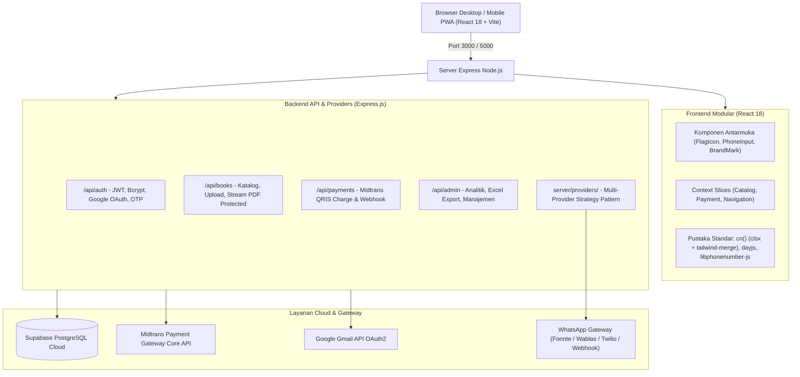

# 📖 Wahidiyah Book — Digital Library, Real Midtrans QRIS & WhatsApp Authenticator
## 🧠 Master Memory Workflow & Dokumentasi Teknis Sistem Terpadu (Single Source of Truth)

[](https://nodejs.org/)
[](https://react.dev/)
[](https://expressjs.com/)
[](https://vitejs.dev/)
[](https://tailwindcss.com/)
[-emerald.svg)](https://supabase.com/)
[](https://midtrans.com/)
[](https://whatsapp.com/)

> 🎯 **FUNGSI UTAMA BERKAS INI:** 
> Berkas ini adalah **SATU-SATUNYA SUMBER KEBENARAN (Single Source of Truth / Memory Tunggal)** untuk seluruh arsitektur, spesifikasi REST API, alur pembayaran Midtrans QRIS, gateway autentikasi WhatsApp, integrasi database Supabase Cloud, panduan developer, naskah akademik/Zotero, standar keamanan siber, dan riwayat rilis aplikasi **Wahidiyah Book**.
> 
> Seluruh dokumentasi terpisah (`README.md`, `docs/API_SPECIFICATION.md`, `docs/ARCHITECTURE.md`, `docs/DEVELOPER_GUIDE.md`, `docs/MIDTRANS_QRIS.md`, `supabase_database/README.md`, dan `PANDUAN_ZOTERO_WORD.md`) telah **DIPADATKAN DAN DISATUKAN SECARA TOTAL** ke dalam dokumen ini. Seluruh alur kerja (*workflow*) pengembangan selanjutnya **EKSKLUSIF BERPATOKAN PADA BERKAS INI**.

---

## 📑 Daftar Isi
1. [Ringkasan Eksekutif & Tech Stack](#1-ringkasan-eksekutif--tech-stack)
2. [Fitur Unggulan Sistem](#2-fitur-unggulan-sistem)
3. [Arsitektur Sistem (Unified Single-Port Architecture)](#3-arsitektur-sistem-unified-single-port-architecture)
4. [Spesifikasi Lengkap REST API (/api/*)](#4-spesifikasi-lengkap-rest-api-api)
5. [Mekanisme & Alur Pembayaran Real Midtrans QRIS](#5-mekanisme--alur-pembayaran-real-midtrans-qris)
6. [Arsitektur Multi-Provider WhatsApp Gateway](#6-arsitektur-multi-provider-whatsapp-gateway)
7. [Panduan Setup & Skema Database Supabase Cloud](#7-panduan-setup--skema-database-supabase-cloud)
8. [Standar Keamanan Sistem (20 Indikator Security Hardening)](#8-standar-keamanan-sistem-20-indikator-security-hardening)
9. [Panduan Pengembangan & Penambahan Fitur Baru](#9-panduan-pengembangan--penambahan-fitur-baru)
10. [Panduan Akademik & Integrasi Sitasi Zotero SINTA](#10-panduan-akademik--integrasi-sitasi-zotero-sinta)
11. [Prasyarat & Konfigurasi Lingkungan (.env)](#11-prasyarat--konfigurasi-lingkungan-env)
12. [Panduan Instalasi & Katalog NPM Scripts](#12-panduan-instalasi--katalog-npm-scripts)
13. [Struktur Direktori Repositori Terpadu](#13-struktur-direktori-repositori-terpadu)
14. [Histori Rilis & Rekam Jejak Kerja (R40–R61)](#14-histori-rilis--rekam-jejak-kerja-r40r61)
15. [Roadmap & Rencana Pengembangan Mendatang](#15-roadmap--rencana-pengembangan-mendatang)
16. [Informasi Pengembang & Identitas Skripsi](#16-informasi-pengembang--identitas-skripsi)

---

## 1. Ringkasan Eksekutif & Tech Stack

Aplikasi **Wahidiyah Book** dibangun menggunakan arsitektur **Client-Server Mandiri (Murni React 18 JSX + Node.js Express)** tanpa meta-framework berat (tidak menggunakan Angular, Next.js, atau TypeScript):

* **Frontend:** React 18 (`.jsx` dan `.js`), Vite 6, React Router v7, Tailwind CSS 3, Headless UI, Lucide Icons, Sonner.
* **Backend:** Node.js (v20+ / v22+), Express.js 4 (`.js` murni dengan sintaks ES Module).
* **Database & BaaS:** Supabase Cloud (PostgreSQL 15 dengan *Row Level Security* dan zona waktu `Asia/Jakarta`).
* **Payment Gateway:** Midtrans Core API (Mode QRIS Sandbox Real-time dengan payload EMVCo `qr_string`).
* **WhatsApp Multi-Provider:** Gateway berbasis *Strategy Pattern* (Fonnte, Wablas, WhaCenter, Twilio, Webhook, dan Demo lokal).
* **Image Processing:** Sharp (kompresi & sanitasi otomatis gambar sampul ke format WebP).
* **Email & Notifikasi:** Google OAuth2 API (Gmail API HTTPS untuk OTP email).
* **PWA & Web Push:** Service Worker native + VAPID Web Push (RFC 8291 `aes128gcm`) untuk pengingat agenda H-1.

---

## 2. Fitur Unggulan Sistem

### 2.1. Katalog Buku & Universal Document Reader (Read-Only)
- **Katalog Interaktif Minimalis:** Desain elegan ala e-reader (Moco-style) yang menonjolkan sampul jilid dan judul kitab tanpa teks penulis generik, dilengkapi pencarian katalog instan dan badge akses (*locked* vs *free*).
- **Universal Document Reader (PDF & Word DOCX):**
  - **Dukungan Berkas PDF:** Dirender interaktif via PDF.js dengan zoom in/out, navigasi halaman, dan isolasi kanvas.
  - **Dukungan Naskah Word DOCX:** Dikonversi langsung di sisi server via pustaka `mammoth` menjadi HTML semantik (`GET /api/books/:id/html`) dan disajikan secara responsif di peramban tanpa memerlukan Microsoft Word fisik.
  - **Proteksi Hak Cipta:** Tanda air (*watermark*) identitas dinamis (nama pembaca & ID transaksi) dibakar di kanvas, proteksi klik kanan (`onContextMenu preventDefault`), larangan seleksi teks (`select-none`), dan pengiriman konten via HTTP header `inline` berotorisasi JWT.
- **Last Read Tracker (Ingat Posisi Terakhir):** Otomatis menyimpan posisi halaman baca pengguna dan menampilkan dialog resume *"Lanjut membaca dari Halaman X?"*.
- **Mode Tema Pembaca:** Pilihan latar belakang **Terang**, **Sepia (Hangat Lembut)**, dan **Malam (Gelap Elegan)** untuk kenyamanan membaca dalam waktu lama.

### 2.2. Autentikasi Pengguna & WhatsApp Multi-Provider (R61)
- **Registrasi & Verifikasi Dual-Channel:** Pengguna dapat mendaftar dengan email dan nomor WhatsApp internasional. Kode OTP 6 digit dapat dikirim via **Gmail API OAuth2** maupun **WhatsApp resmi**.
- **Pemilih Kode Negara Sedunia (245 Negara):**
  - Menggunakan bendera vektor SVG resmi (disalin sekali dari set `flag-icons`) di `public/flags/[iso].svg` — tanpa dependensi npm saat runtime, sehingga tidak ada paket bendera yang ikut ke bundel (resolusi tajam di Windows, Linux, Android, iOS tanpa glitch rendering teks emoji).
  - Integrasi pustaka standar Google `libphonenumber-js` untuk parsing nomor E.164 internasional dan deteksi validitas.
  - Pencarian dwibahasa (dapat dicari dengan nama Indonesia *"Jepang"* atau Inggris *"Japan"*, dial code `+81`, atau ISO code `JP`).
  - Pembuangan otomatis angka nol di awal nomor lokal (`0812...` ➔ `812...` dengan dial `+62`).
- **Login Akun Google:** Integrasi resmi Google OAuth 2.0 (*Direct Authorization Code Flow*) dengan verifikasi token ID.
- **Sesi Aman:** Penyimpanan kata sandi dengan salt hashing `bcryptjs` (12 rounds) dan sesi berbasis token `jsonwebtoken` (JWT).

### 2.3. Sistem Keanggotaan Pro & Pembayaran Real Midtrans QRIS
- **Paket Pro Tunggal Terstandarisasi:** Skema keanggotaan Pro tunggal dengan tarif Rp 25.000/bulan (disertai penyesuaian biaya layanan resmi katalog server).
- **Integrasi Midtrans Core API Sandbox:** Charge QRIS dibuat langsung dari backend server dengan payload EMVCo dinamis (bebas dari manipulasi harga di sisi klien).
- **Simpan QRIS ke Galeri Ponsel:** Konversi SVG EMVCo QRIS ke gambar PNG beresolusi tinggi via HTML5 Canvas dengan `Blob` UTF-8 dan `URL.createObjectURL` agar dapat dipindai dari galeri e-wallet (DANA, GoPay, BCA, Livin, OVO).
- **Tombol Simulasi Pembayaran QRIS Sandbox:** Mode simulasi berpagar aman via flag `ALLOW_PAYMENT_SIMULATION=1` di `.env`, menghadirkan tombol *"▶ Bayar Sekarang (Mode Simulasi)"* langsung pada UI konfirmasi pembayaran (`PaymentConfirmScreen.jsx`) untuk keandalan demo pengujian sidang skripsi tanpa simulator eksternal.
- **Polling & Webhook Idempoten:** Pengecekan otomatis status transaksi setiap 3 detik dan verifikasi *SHA512 Signature Key* pada endpoint webhook notifikasi.
- **Faktur Kwitansi Pembayaran Resmi:** Tanda terima digital berlogo resmi Wahidiyah Book yang siap cetak / simpan ke format PDF.

### 2.4. Panel Administrasi Komprehensif
- **Manajemen Konten:** Unggah buku baru (thumbnail otomatis dikompresi ke format WebP via `sharp`), kelola kategori, dan deskripsi.
- **Dashboard Analitik (Visual Analytics):** Visualisasi tren pendapatan dan pertumbuhan pengguna baru menggunakan grafik kurva interaktif `recharts`.
- **Ekspor Laporan 1-Klik:** Unduh riwayat transaksi, data pengguna, dan katalog buku langsung ke format Microsoft Excel (`.xlsx`) via library `xlsx` (dimuat secara *lazy* untuk efisiensi bundle).
- **Hero Carousel & Kalender Event:** Manajemen banner beranda dinamis dan jadwal agenda majelis mujahadah.

### 2.5. Tema Tampilan Menyeluruh (Terang & Malam)
- **Mode Malam Aplikasi (Dark Mode):** Seluruh antarmuka mendukung palet gelap sadar-tema dengan CSS variable Tailwind.
- **Progressive Web App (PWA):** Terintegrasi Web App Manifest & Service Worker untuk instalasi ke Layar Utama (*Home Screen*).
- **Notifikasi Web Push:** Modul mandiri VAPID ES256 + enkripsi `aes128gcm` RFC 8291 untuk pengingat agenda H-1.

---

## 3. Arsitektur Sistem (Unified Single-Port Architecture)

Aplikasi dibangun menggunakan prinsip **Arsitektur Monolitik Terpadu (Unified Single-Port Architecture)**:



### Konvensi Kode & Pembagian Tanggung Jawab Modul:
1. **Rute Langsung (`server/routes/*.routes.js`):** Seluruh logika bisnis rute diletakkan langsung di dalam controller fungsi Express standar. Struktur `server/services/` dihilangkan untuk mencegah kerumitan berlebih (*over-engineering*).
2. **Helper Murni (`server/lib/`):**
   - `midtrans.js`: Integrasi API Midtrans Core (charge, status, verifikasi signature SHA512, unwrap payload, `isTransactionSettled`).
   - `time.js`: Penanggalan WIB tunggal terstandarisasi dengan `dayjs` (zona waktu `Asia/Jakarta`).
   - `validate.js`: Skema validasi terstruktur dengan `zod`.
   - `images.js`: Pengolahan kompresi gambar WebP dengan `sharp`.
   - `http.js`: Helper pembungkus respons HTTP (`wrap`, `fail`, `safeUrl`).
   - `otp.js`: Manajemen pembuatan kode OTP terenkripsi dan jeda cooldown kirim ulang.
3. **Frontend Modular (`src/context/slices/`):**
   - `useCatalogSlice.js`: Mengelola state buku, kategori, pencarian, dan katalog.
   - `usePaymentSlice.js`: Mengelola alur pembayaran QRIS, polling status, dan pembaharuan sesi Pro.
   - `useNavigationSlice.js`: Mengelola perutean, deep-linking, dan status sidebar/drawer.
4. **Utilitas Styling `cn(...inputs)` (`src/lib/utils.js`):** Menggabungkan `clsx` dan `tailwind-merge` untuk menangani conditional class dan resolusi konflik kelas Tailwind.

---

## 4. Spesifikasi Lengkap REST API (`/api/*`)

* **Base URL:** `http://localhost:5000/api` (Development) / `/api` (Production)
* **Format Request/Response:** `application/json` (kecuali upload multipart)
* **Otentikasi:** Header `Authorization: Bearer <JWT_TOKEN>` untuk rute yang terproteksi.

### 4.1. Otentikasi (`/api/auth`)

#### `POST /api/auth/login`
Masuk dengan kredensial email dan password.
* **Body:**
  ```json
  {
    "identifier": "user@email.com",
    "password": "password123"
  }
  ```
* **Response (200 OK):**
  ```json
  {
    "success": true,
    "message": "Login berhasil",
    "token": "eyJhbGciOi...",
    "user": {
      "id": "usr-12345678",
      "name": "Nama User",
      "email": "user@email.com",
      "role": "user",
      "isPro": false
    }
  }
  ```

#### `POST /api/auth/register`
Mendaftarkan akun baru dan meminta pengiriman OTP ke email serta WhatsApp (jika nomor HP diisi).
* **Body:**
  ```json
  {
    "name": "Nama Lengkap",
    "email": "user@email.com",
    "phone": "6281234567890",
    "password": "password123",
    "dob": "1995-08-17"
  }
  ```
  *(Catatan: `phone` bersifat opsional dan otomatis dinormalisasi ke format E.164 internasional tanpa tanda plus)*
* **Response (202 Accepted):**
  ```json
  {
    "success": true,
    "message": "Kode verifikasi telah dikirim ke email Anda dan WhatsApp (jika nomor terdaftar), berlaku 10 menit.",
    "email": "user@email.com"
  }
  ```

#### `POST /api/auth/verify-registration`
Memvalidasi kode OTP 6-digit untuk menyelesaikan pembuatan akun.
* **Body:**
  ```json
  {
    "email": "user@email.com",
    "code": "123456"
  }
  ```
* **Response (201 Created):**
  ```json
  {
    "success": true,
    "message": "Akun berhasil dibuat.",
    "token": "eyJhbGciOi...",
    "user": {
      "id": "usr-12345678",
      "name": "Nama Lengkap",
      "email": "user@email.com",
      "phone": "6281234567890",
      "role": "user",
      "isPro": false
    }
  }
  ```

#### `POST /api/auth/resend-otp`
Meminta pengiriman ulang kode verifikasi pendaftaran dengan proteksi cooldown 60 detik.
* **Body:**
  ```json
  {
    "email": "user@email.com",
    "deliveryMethod": "whatsapp"
  }
  ```
  *(Pilihan `deliveryMethod`: `"email"` atau `"whatsapp"`)*
* **Response (200 OK):**
  ```json
  {
    "success": true,
    "message": "Kode OTP baru telah dikirimkan."
  }
  ```

#### `POST /api/auth/request-password-reset`
Meminta OTP reset password ke email atau nomor WhatsApp terdaftar.
* **Body:** `{ "email": "user@email.com", "phone": "6281234567890" }`
* **Response (200 OK):** `{ "success": true, "message": "Kode reset password telah dikirim." }`

#### `POST /api/auth/reset-password`
Mereset password dengan OTP yang valid.
* **Body:** `{ "email": "user@email.com", "code": "123456", "password": "newpassword123" }`
* **Response (200 OK):** `{ "success": true, "message": "Password berhasil diperbarui." }`

#### `GET /api/auth/me`
Mengambil data profil pengguna yang sedang login.
* **Header:** `Authorization: Bearer <TOKEN>`
* **Response (200 OK):** Mengembalikan objek `user` aktif.

---

### 4.2. Katalog Buku (`/api/books`)

#### `GET /api/books`
Mengambil daftar buku (terbuka untuk publik).
* **Response (200 OK):**
  ```json
  {
    "success": true,
    "books": [
      {
        "id": "buku-123",
        "title": "Buku Wahidiyah",
        "author": "Penyusun",
        "category": "Umum",
        "pages": 120,
        "is_locked": true,
        "has_thumbnail": true,
        "has_content": true
      }
    ]
  }
  ```

#### `POST /api/books/upload`
Mengunggah buku baru beserta file thumbnail dan dokumen konten (PDF/EPUB).
* **Header:** `Authorization: Bearer <ADMIN_TOKEN>`
* **Content-Type:** `multipart/form-data`
* **Fields:** `title`, `author`, `category`, `pages`, `is_locked`, `description`
* **Files:** `thumbnail` (gambar max 5MB), `content` (dokumen max 25MB)
* **Response (201 Created):** `{ "success": true, "message": "Buku berhasil diunggah", "bookId": "buku-..." }`

#### `GET /api/books/:id/content`
Membaca/mengunduh isi buku.
* **Header:** `Authorization: Bearer <TOKEN>`
* **Rules:** Pengguna biasa hanya dapat mengakses buku yang `is_locked: false`. Buku `is_locked: true` membutuhkan akun Pro atau role Admin (403 jika tidak Pro).
* **Response:** Stream konten file PDF/dokumen (`Content-Disposition: inline`).

---

### 4.3. Pembayaran QRIS Midtrans (`/api/payments`)

#### `POST /api/payments/qris/charge`
Membuat invoice pembayaran QRIS ke Midtrans Core API.
* **Header:** `Authorization: Bearer <TOKEN>`
* **Body:** `{ "planId": "monthly", "phone": "6281234567890" }`
* **Response (201 Created):**
  ```json
  {
    "success": true,
    "orderId": "tx-123456",
    "refNo": "000012345678",
    "qrString": "00020101021226600016ID.CO.GOPAY.WWW0118...",
    "qrImageUrl": "/api/payments/qris/tx-123456/qr.png",
    "amount": 25000,
    "adminFee": 3000,
    "totalPaid": 28000,
    "status": "pending",
    "expiredAt": "2026-10-07T22:30:00.000Z"
  }
  ```

#### `GET /api/payments/qris/:orderId/status`
Mengecek status pembayaran (polling berkala tiap 3 detik).
* **Header:** `Authorization: Bearer <TOKEN>`
* **Response (200 OK):**
  ```json
  {
    "success": true,
    "orderId": "tx-123456",
    "status": "settlement",
    "isPaid": true,
    "totalPaid": 28000
  }
  ```

#### `GET /api/payments/qris/:orderId/qr.png`
Proxy gambar QR (PNG) — cadangan bila klien memerlukan URL gambar langsung.
* **Header:** `Authorization: Bearer <TOKEN>`
* **Proteksi:** Anti-SSRF whitelist domain `*.midtrans.com` dan protokol HTTPS.

#### `POST /api/payments/midtrans/notification`
Webhook endpoint untuk menerima HTTP Notification dari server Midtrans.
* **Header:** `Content-Type: application/json`
* **Keamanan:** Verifikasi `signature_key = SHA512(order_id + status_code + gross_amount + ServerKey)`.
* **Response (200 OK):** `{ "success": true, "alreadyProcessed": false }`

---

### 4.4. Layanan Pendukung
* `GET /api/subscriptions/my` — Mengambil riwayat paket langganan pengguna aktif.
* `GET /api/events` — Mengambil daftar agenda kegiatan Wahidiyah.
* `GET /api/carousel` — Mengambil daftar banner aktif di beranda.
* `GET /api/health` — Status kesehatan server dan koneksi database.

---

## 5. Mekanisme & Alur Pembayaran Real Midtrans QRIS

### 5.1. Alur Transaksi Lengkap
```
Pengguna (non-Pro)
  │ pilih paket
  ▼
PaymentConfirmScreen
  │ panggil hook useQrisPayment
  ▼
POST /api/payments/qris/charge        ──► server hitung harga dari SUBSCRIPTION_PLANS
  │                                        server charge ke Midtrans Core API (payment_type: qris)
  ▼                                        simpan transaksi status = pending
Midtrans balas qr_string + actions[]   simpan payload QR + URL gambar cadangan + waktu kedaluwarsa
  │
  ▼
<QRCodeSVG value={qrString}>            ──► QR digambar di klien (SVG tajam, tanpa request gambar)
  │                                        fallback: 
  │
  │  pengguna memindai QR / membayar lewat simulator sandbox
  ▼
Polling tiap 3 detik: GET /api/payments/qris/:orderId/status
  │  server menanyakan status langsung ke Midtrans
  ▼
isTransactionSettled(transaction_status, fraud_status) == true
(transaction_status = settlement, fraud_status kosong pada QRIS/GoPay atau accept pada CC)
  │
  ▼
server mengaktifkan membership Pro (activatePaidMembership) — SEKALI SAJA (IDEMPOTEN)
```

**Satu-satunya sumber kebenaran adalah Midtrans.** Frontend tidak pernah boleh menyatakan "lunas"; ia hanya menerima `isPaid: true` dari server.

### 5.2. 7 Prinsip Ketahanan Transaksi Midtrans QRIS
1. **Insert Pending Sebelum Charge:** Transaksi status `pending` dicatat ke database sebelum request HTTP charge dikirim ke Midtrans. Jika charge gagal, transaksi segera ditandai `rejected`.
2. **Atomisitas Aktivasi Pro:** Pembaruan status transaksi ke `success` dan perpanjangan langganan dibungkus blok try/catch. Bila aktivasi gagal, status dikembalikan ke `pending` agar polling berikutnya dapat mencoba ulang secara idempoten.
3. **Pembatasan Laju (Rate Limiting):** Endpoint `POST /api/payments/qris/charge` dibatasi 20 permintaan / 5 menit, dan `GET /api/payments/qris/:orderId/qr.png` dibatasi 60 permintaan / menit.
4. **Proteksi Anti-SSRF pada Proxy QR:** Pengambilan gambar QR Midtrans dibatasi ketat ke host `*.midtrans.com`, protokol wajib HTTPS, penanganan redirect manual, dan batas waktu respons (timeout) 10 detik.
5. **Validasi Waktu Kedaluwarsa (15 Menit):** Server memeriksa `expires_at` saat polling status. Jika waktu lewat, transaksi otomatis ditandai `rejected` dan status `expire` dikembalikan ke klien.
6. **Pencegahan Akumulasi Order (Pending Reuse):** Saat pengguna membuka ulang layar pembayaran untuk paket yang sama dan masih memiliki transaksi `pending` yang valid/belum kedaluwarsa, sistem otomatis menggunakan kembali order tersebut (`reused: true`) tanpa menumpuk baris baru.
7. **Penyembunyian URL Internal Merchant:** Properti internal `qrMidtransUrl` hanya dikirimkan pada mode Sandbox (`MIDTRANS_IS_PRODUCTION=false`).

### 5.3. Panduan Pengujian di Sandbox Midtrans
1. Login sebagai pengguna yang **belum Pro**.
2. Masuk ke halaman berlangganan → pilih paket Pro → lanjut ke pembayaran.
3. Kode QR akan muncul.
4. Buka simulator: **https://simulator.sandbox.midtrans.com/v2/qris/index**
5. Tempel nilai `qrMidtransUrl` dari respons charge, lalu klik **Bayar**.
6. Tunggu maksimal ~3 detik. Polling otomatis mendeteksi `settlement` dan akun menjadi Pro seketika.

#### Simulasi Pengujian Webhook via cURL:
```bash
# signature_key = SHA512(order_id + status_code + gross_amount + ServerKey)
ORDER_ID=tx-test123
STATUS_CODE=200
GROSS=28000.00
SERVER_KEY=SB-Mid-server-xxxxxxxx
SIG=$(printf "%s%s%s%s" "$ORDER_ID" "$STATUS_CODE" "$GROSS" "$SERVER_KEY" | sha512sum | cut -d' ' -f1)

curl -X POST http://localhost:5000/api/payments/midtrans/notification \
  -H 'Content-Type: application/json' \
  -d "{\"order_id\":\"$ORDER_ID\",\"status_code\":\"$STATUS_CODE\",\"gross_amount\":\"$GROSS\",\"transaction_status\":\"settlement\",\"fraud_status\":\"accept\",\"signature_key\":\"$SIG\"}"
```
*Catatan: Kirim dua kali berturut-turut — respons harus tetap sukses dan masa aktif Pro **tidak bertambah ganda** (bukti idempoten).*

### 5.4. Troubleshooting Pembayaran Midtrans
| Gejala | Kemungkinan Penyebab | Tindakan Perbaikan |
|---|---|---|
| "Payment gateway Midtrans belum dikonfigurasi" (503) | `MIDTRANS_SERVER_KEY` / `MIDTRANS_CLIENT_KEY` masih kosong di `.env` | Isi kredensial sandbox dari Dashboard Midtrans ke `.env`. |
| "Midtrans tidak mengembalikan kode QR" (502) | Respons charge tidak berisi `qr_string` maupun `actions[]` | Periksa koneksi internet server dan log konsol Express. |
| QR blank / `qrString` null | Migrasi SQL belum lengkap sehingga kolom `midtrans_qr_string` belum ada | Jalankan ulang migrasi skema `supabase_database/full_setup.sql`. |
| QR muncul tapi tidak pernah lunas | Pembayaran belum dieksekusi di simulator sandbox atau QR kedaluwarsa | Buka simulator sandbox Midtrans dan tempel URL QR untuk membayar. |
| Webhook Notifikasi ditolak 401 | `signature_key` salah | Pastikan urutan hash persis: `order_id + status_code + gross_amount + ServerKey`. |
| Webhook Notifikasi 400 | Nominal `gross_amount` tidak sama dengan `total_paid` yang tersimpan | Pastikan nominal yang dikirim sama dengan database (Rp 28.000). |

---

## 6. Arsitektur Multi-Provider WhatsApp Gateway

Gateway WhatsApp menggunakan arsitektur **Strategy / Provider Pattern** di folder `server/providers/`:

```
server/providers/
├── base.js         # BaseWhatsAppProvider (kontrak kelas abstrak & format pesan)
├── fonnte.js       # FonnteProvider (Fonnte API - default)
├── wablas.js       # WablasProvider (Wablas API)
├── whacenter.js    # WhacenterProvider (WhaCenter API)
├── twilio.js       # TwilioProvider (Twilio Programmable Messaging API)
├── webhook.js      # GenericWebhookProvider (Custom Webhook Gateway)
├── demo.js         # DemoProvider (Terminal console fallback untuk dev lokal)
└── index.js        # Provider Registry & Singleton Factory
```

### 6.1. Provider yang Didukung:
1. **`fonnte` (Fonnte API - Default)**:
   * `.env`: `WHATSAPP_PROVIDER=fonnte`, `FONNTE_TOKEN=...`
   * Endpoint: `https://api.fonnte.com/send`
2. **`wablas` (Wablas API)**:
   * `.env`: `WHATSAPP_PROVIDER=wablas`, `WABLAS_TOKEN=...`, `WABLAS_SERVER=https://...`
   * Endpoint: `${WABLAS_SERVER}/api/send-message`
3. **`whacenter` (WhaCenter API)**:
   * `.env`: `WHATSAPP_PROVIDER=whacenter`, `WHACENTER_DEVICE_ID=...`
   * Endpoint: `https://app.whacenter.com/api/send`
4. **`twilio` (Twilio WhatsApp Sandbox/Prod)**:
   * `.env`: `WHATSAPP_PROVIDER=twilio`, `TWILIO_ACCOUNT_SID=...`, `TWILIO_AUTH_TOKEN=...`, `TWILIO_WHATSAPP_NUMBER=...`
   * Endpoint: `https://api.twilio.com/2010-04-01/Accounts/${SID}/Messages.json`
5. **`webhook` (Custom Internal Gateway)**:
   * `.env`: `WHATSAPP_PROVIDER=webhook`, `WHATSAPP_WEBHOOK_URL=...`, `WHATSAPP_WEBHOOK_SECRET=...`
6. **`demo` (Local Terminal Fallback)**:
   * Otomatis aktif jika tidak ada token provider yang terisi atau disetel eksplisit `WHATSAPP_PROVIDER=demo`. Mencetak pesan dan kode OTP ke terminal pengembang secara jelas untuk debugging lokal.

### 6.2. Menambahkan Provider Baru:
1. Buat berkas baru di `server/providers/[nama_provider].js`.
2. Warisi kelas `BaseWhatsAppProvider`:
   ```javascript
   import { BaseWhatsAppProvider } from './base.js';

   export class CustomProvider extends BaseWhatsAppProvider {
     constructor() {
       super('custom', 'Custom Gateway');
     }
     async sendOtp(phone, otpCode, extra = {}) {
       const message = this.formatOtpMessage(otpCode, extra);
       // Panggil fetch() ke endpoint API gateway Anda
       return { success: true, messageId: '...' };
     }
   }
   ```
3. Daftarkan kelas provider baru tersebut di `server/providers/index.js`.

---

## 7. Panduan Setup & Skema Database Supabase Cloud

Informasi Project Database Supabase:
| Item | Nilai Resmi |
|---|---|
| **Project Name** | **Skripsi_Project** |
| **Project Ref** | `pdimjmbjutlzjdfjaqgt` |
| **URL** | `https://pdimjmbjutlzjdfjaqgt.supabase.co` |
| **Region** | Singapore |

> ⚠️ **Catatan Migrasi:** Project lama (`cfpmkwjkqfktagdkmlai`) sudah dihapus. Seluruh konfigurasi aplikasi aktif diarahkan ke project `pdimjmbjutlzjdfjaqgt` di atas.

### 7.1. Opsi Penggunaan Berkas SQL (`supabase_database/`):
* **Pilihan A: Setup Bersih Total (`supabase_database/full_setup.sql`)**
  Digunakan saat inisialisasi awal database baru atau reset total dari nol. Menghasilkan database kosong tanpa data demo yang 100% aman dan menghasilkan **0 warning** di Supabase Security Linter.
  > ⚠️ *Mengandung `DROP ... CASCADE`, jangan jalankan pada database yang sudah berisi data produksi.*
* **Pilihan B: Database Sudah Ada Data & Ingin Hilangkan 24 Warning Linter**
  Buka `full_setup.sql` bagian **9. PATCH PERBAIKAN LINTER & KEAMANAN UNTUK DATABASE AKTIF**, salin perintahnya, dan jalankan di SQL Editor Supabase.
* **Pilihan C: Menambah Tabel Baru Secara Idempoten (`supabase_database/carousel_slides.sql`)**
  Digunakan jika hanya ingin menambahkan tabel banner carousel tanpa menimpa data yang ada (hanya memuat `CREATE TABLE IF NOT EXISTS`).

### 7.2. Daftar 7 Tabel Inti Pasca-Pembersihan (Clean Core Schema):
| Tabel | Fungsi & Peran |
|---|---|
| `users` | Akun pengguna (email, nomor WhatsApp `phone`, password hash bcrypt, role `user`/`admin`, `is_pro`, masa aktif `subscription_expires_at`). |
| `books` | Katalog naskah murni 11 kolom (`id`, `title`, `pages`, `is_locked`, `cover_url`, `content_url`, `content_name`, `content_extension`, `content_size`, `created_at`, `updated_at`). Bebas dari kolom usang. |
| `events` | Jadwal agenda & mujahadah Wahidiyah (judul, waktu WIB, lokasi, deskripsi). |
| `subscriptions` | Riwayat langganan keanggotaan Pro pengguna (`plan_name` seragam: `"Pro"`). |
| `transactions` | Transaksi pembayaran resmi (`midtrans_transaction_id`, `midtrans_qr_string`, `midtrans_qr_url`, status idempoten). |
| `email_verifications` | Kode OTP 6 digit untuk registrasi dan reset password (berlaku 10 menit, salt hash SHA-256). |
| `carousel_slides` | Slide banner Hero Carousel di beranda (urutan, gambar, periode tampil, status aktif). |

> 🛡️ **Catatan Pembersihan Arsitektur:** 
> 6 tabel usang/redundant telah **DIPANGKAS & DIHAPUS TOTAL** dari Supabase: `ads`, `password_resets`, `qris_transactions`, `user_bookmarks`, `reading_progress`, dan `push_subscriptions`. Basis data kini murni 7 tabel inti dengan RLS fail-closed. 14 data transaksi uji sampah juga telah dibersihkan, menyisakan transaksi valid sukses.

### 7.3. Standar Zona Waktu Database
Seluruh kolom waktu memakai `TIMESTAMPTZ` dengan `NOW()` polos, dan timezone database di-set ke **`Asia/Jakarta` (WIB, UTC+7)**. Postgres menyimpan waktu dalam UTC secara internal lalu menampilkannya sesuai timezone sesi, sehingga waktu aplikasi selalu sinkron dengan waktu Indonesia bagian barat.

### 7.4. Kueri Verifikasi Database (Checklist SQL):
```sql
-- 1. Harus mengembalikan 7 tabel public aktif (books, carousel_slides, email_verifications, events, subscriptions, transactions, users)
SELECT table_name FROM information_schema.tables WHERE table_schema = 'public' ORDER BY table_name;

-- 2. Harus 0 baris — tabel ads sudah tidak ada
SELECT table_name FROM information_schema.tables WHERE table_schema = 'public' AND table_name = 'ads';

-- 3. Harus rls_aktif = true pada tabel sensitif
SELECT relrowsecurity AS rls_aktif FROM pg_class WHERE relname = 'email_verifications';

-- 4. Timezone harus Asia/Jakarta
SHOW timezone;

-- 5. Hitung baris tabel utama
SELECT 
  (SELECT COUNT(*) FROM public.users) AS total_users,
  (SELECT COUNT(*) FROM public.books) AS total_books,
  (SELECT COUNT(*) FROM public.transactions) AS total_transactions;
```

---

## 8. Standar Keamanan Sistem (20 Indikator Security Hardening)

Sistem telah diaudit berdasarkan **20 Indikator Pemeriksaan Keamanan Siber**:

| # | Indikator Keamanan | Implementasi & Mitigasi | Status |
| :---: | :--- | :--- | :--- |
| 1 | **Hashing Password** | `bcryptjs` salt cost 12 rounds pada registrasi & ganti password. | ✅ Lulus |
| 2 | **Stateless JWT** | Token ditandatangani `JWT_SECRET` berkekuatan tinggi (expiry 12 jam). | ✅ Lulus |
| 3 | **Supabase RLS** | Row Level Security pada tabel `users`, anonim tidak bisa membaca data sensitif. | ✅ Lulus |
| 4 | **Validasi Skema Request** | Menggunakan pustaka `zod` untuk memvalidasi seluruh payload request. | ✅ Lulus |
| 5 | **Rate Limiting Anti-Bruteforce** | `express-rate-limit` pada endpoint auth dan charge pembayaran. | ✅ Lulus |
| 6 | **HTTP Header Hardening** | `helmet` aktif untuk proteksi XSS, Clickjacking, dan MIME-sniffing. | ✅ Lulus |
| 7 | **Fail-Closed Webhook Guard** | Webhook menolak transaksi tanpa tanda tangan SHA512 yang valid. | ✅ Lulus |
| 8 | **Proteksi Hak Cipta PDF** | `#toolbar=0&navpanes=0`, `select-none`, larangan context menu, inline streaming. | ✅ Lulus |
| 9 | **Paywall Buku Pro Server-Side** | PDF buku berstatus Pro mewajibkan validasi `is_pro` aktif sebelum di-stream. | ✅ Lulus |
| 10 | **Anti-SSRF pada Proxy Gambar** | Whitelist domain `*.midtrans.com` dan protokol HTTPS pada fetching gambar QR. | ✅ Lulus |
| 11 | **Idempotensi Transaksi** | Pola claim status `pending` ➔ `settlement` untuk mencegah aktivasi ganda. | ✅ Lulus |
| 12 | **Otoritatif Harga di Server** | Nominal harga pesanan dikalkulasi dari konstanta backend, bukan input klien. | ✅ Lulus |
| 13 | **Pembersihan MIME Upload** | Validasi magic-bytes format raster dan konversi otomatis WebP via `sharp`. | ✅ Lulus |
| 14 | **Perlindungan OTP** | Hash SHA-256 kode OTP dengan masa berlaku ketat 10 menit. | ✅ Lulus |
| 15 | **Cooldown OTP 60 Detik** | Pembatasan frekuensi pengiriman ulang kode OTP untuk mencegah spam. | ✅ Lulus |
| 16 | **Isolasi Role Admin** | Middleware `requireAdmin` memverifikasi peran secara langsung ke database. | ✅ Lulus |
| 17 | **CORS Whitelist Terbatas** | Hanya domain resmi / localhost terdaftar yang diizinkan melakukan request. | ✅ Lulus |
| 18 | **Penanganan Error Terpagar** | Detail stack trace internal hanya ditampilkan pada mode `development`. | ✅ Lulus |
| 19 | **Redaksi Kredensial Sensitif** | `.env` dilindungi `.gitignore` dan pembersihan riwayat git berisiko. | ✅ Lulus |
| 20 | **Audit Dependensi Rutin** | Pemeriksaan berkala via `npm audit --ignore-scripts --audit-level=high`. | ✅ Lulus |

---

## 9. Panduan Pengembangan & Penambahan Fitur Baru

Untuk menambah fitur baru secara rapi mengikuti standar Express + React:

### Langkah 1: Daftarkan Rute di Express (`server/routes/`)
Buat file rute baru di `server/routes/` atau tambahkan endpoint ke file rute yang relevan:
```javascript
// Contoh: server/routes/bookmarks.routes.js
import { Router } from 'express';
import { supabaseServer } from '../db.js';
import { requireAuth } from '../auth.js';

export const bookmarksRouter = Router();

bookmarksRouter.get('/bookmarks', requireAuth, async (req, res) => {
  try {
    const { data, error } = await supabaseServer
      .from('user_bookmarks')
      .select('*')
      .eq('user_id', req.user.id);

    if (error) throw error;
    res.json({ success: true, bookmarks: data });
  } catch (err) {
    res.status(500).json({ success: false, message: err.message });
  }
});
```
Daftarkan router di `server/server.js`:
```javascript
app.use('/api', bookmarksRouter);
```

### Langkah 2: Buat State di Frontend Slice (`src/context/slices/`)
Buat custom hook untuk mengelola state fitur tersebut:
```javascript
// Contoh: src/context/slices/useBookmarkSlice.js
import { useState, useCallback } from 'react';
import { api } from '../../lib/api';

export function useBookmarkSlice(token) {
  const [bookmarks, setBookmarks] = useState([]);

  const fetchBookmarks = useCallback(async () => {
    if (!token) return;
    const res = await api.get('/api/bookmarks', token);
    if (res.success) setBookmarks(res.bookmarks);
  }, [token]);

  return { bookmarks, fetchBookmarks };
}
```
Lalu sambungkan slice ini di `src/context/AppContext.jsx` ke dalam objek `value` yang dikembalikan oleh `useApp()`.

### Langkah 3: Tampilkan di Komponen JSX (`src/features/`)
Gunakan hook `useApp()` di komponen React:
```jsx
import React, { useEffect } from 'react';
import { useApp } from '../../context/AppContext';

export function BookmarkList() {
  const { bookmarks, fetchBookmarks } = useApp();

  useEffect(() => {
    fetchBookmarks();
  }, [fetchBookmarks]);

  return (
    <div className="space-y-2">
      {bookmarks.map((item) => (
        <div key={item.id} className="p-3 bg-white rounded-lg shadow-sm">
          {item.title}
        </div>
      ))}
    </div>
  );
}
```

---

## 10. Panduan Akademik & Integrasi Sitasi Zotero SINTA

### 10.1. Status Integrasi Zotero
* **Zotero Desktop**: Local API aktif di `127.0.0.1:23119`.
* **Plugin Word Add-in**: `Zotero.dotm` di `%APPDATA%\Microsoft\Word\STARTUP\`.
* **Library Zotero**: 18 artikel referensi SINTA telah dirapikan metadatanya (nama penulis terpisah dengan benar).

### 10.2. Daftar 18 Referensi SINTA Proposal Skripsi:
| No | Penulis (Tahun) | Zotero Item Key | DOI |
|:--:|---|:---:|---|
| 1 | Alexandro & Parhusip (2025) | `YQYRBJ46` | 10.33197/jitter.vol12.iss1.2025.3250 |
| 2 | Alfilaeni dkk. (2024) | `P3LP8SAD` | 10.22303/csrid-.16.3.2024.27-39 |
| 3 | Gustiegan & Painem (2022) | `C2VDTJXY` | 10.36080/bit.v19i1.1835 |
| 4 | Kusumaningrum dkk. (2023) | `C84SPDEX` | 10.30742/melekitjournal.v9i1.275 |
| 5 | Kusumo dkk. (2021) | `BLNBP7U2` | 10.51998/jsi.v10i2.422 |
| 6 | Minarni & Sigit (2023) | `IVJ4WUTW` | 10.32664/j-intech.v11i1.820 |
| 7 | Muhammad & Paputungan (2024) | `3YZ24G5G` | 10.20885/snati.v3.i2.35 |
| 8 | Mulyani & Hati (2021) | `C3CKIH7Z` | 10.51998/jsi.v9i1.413 |
| 9 | Muttaqin dkk. (2022) | `EUZYFPG3` | 10.33592/jutis.v10i2.2825 |
| 10 | Nariswari dkk. (2023) | `785NYGZN` | 10.30656/jsii.v10i2.8183 |
| 11 | Pudoli dkk. (2023) | `CUERWR7U` | 10.38101/ajcsr.v5i2.9410 |
| 12 | Putri (2022) | `TCKRY67T` | 10.32664/smatika.v12i01.682 |
| 13 | Rachman dkk. (2024) | `4JQGGM8Y` | 10.14421/ekbis.2024.8.1.2134 |
| 14 | Rezkiandra (2024) | `R27HFGQ5` | 10.18495/jsi.v16i2.2 |
| 15 | Richo dkk. (2021) | `X2YSDDRP` | 10.35889/jutisi.v10i2.657 |
| 16 | Suhardi (2023) | `SDSZ37PR` | 10.33395/sinkron.v8i1.11922 |
| 17 | Widya & Wakhidah (2022) | `AQPXGG6H` | 10.32764/newton.v1i3.2064 |
| 18 | Wijana & Prasetio (2023) | `7WPMDFWC` | 10.37424/informasi.v15i2.260 |

### 10.3. Ekspor Daftar Pustaka via Zotero CLI:
```bash
zotero-cli export \
  --item-keys "YQYRBJ46,P3LP8SAD,C2VDTJXY,C84SPDEX,BLNBP7U2,IVJ4WUTW,3YZ24G5G,C3CKIH7Z,EUZYFPG3,785NYGZN,CUERWR7U,TCKRY67T,4JQGGM8Y,R27HFGQ5,X2YSDDRP,SDSZ37PR,AQPXGG6H,7WPMDFWC" \
  --style apa --format bib
```

---

## 11. Prasyarat & Konfigurasi Lingkungan (.env)

### 11.1. Prasyarat Sistem
- **Node.js:** Versi `>= 22.0.0`
- **NPM:** Versi `>= 10.0.0`
- **Akun Cloud:** Supabase PostgreSQL Cloud, Midtrans Sandbox, Google Cloud Console (Gmail API OAuth2).

### 11.2. Format File Tunggal `.env`
Konfigurasi lingkungan disimpan langsung pada berkas `.env` di akar proyek:
```env
# Port Server
PORT=5000
VITE_PORT=3000

# Konfigurasi Midtrans Sandbox
MIDTRANS_SERVER_KEY=SB-Mid-server-xxxxxxxxxxxxxxxxxxxx
MIDTRANS_CLIENT_KEY=SB-Mid-client-xxxxxxxxxxxxxxxxxxxx
MIDTRANS_IS_PRODUCTION=false
MIDTRANS_QRIS_ACQUIRER=gopay
MIDTRANS_QRIS_EXPIRY_MINUTES=15

# Konfigurasi Supabase Cloud
SUPABASE_URL=https://pdimjmbjutlzjdfjaqgt.supabase.co
SUPABASE_ANON_KEY=eyJhbGciOi...
SUPABASE_SERVICE_ROLE_KEY=eyJhbGciOi...

# Keamanan Sesi JWT
JWT_SECRET=rahasia-kunci-jwt-anda-minimal-32-karakter
JWT_EXPIRES_IN=12h

# Google OAuth & Gmail OTP API
GOOGLE_CLIENT_ID=xxxxxxxxxxxx.apps.googleusercontent.com
GOOGLE_CLIENT_SECRET=GOCSPX-xxxxxxxxxxxx
GMAIL_SENDER=email-pengirim@gmail.com
GMAIL_REFRESH_TOKEN=1//04xxxxxxxxxxxx

# WhatsApp Multi-Provider Gateway (fonnte | wablas | whacenter | twilio | webhook | demo)
WHATSAPP_PROVIDER=fonnte
FONNTE_TOKEN=your_fonnte_token_here

# Provider Opsional:
# WABLAS_TOKEN=your_wablas_token
# WABLAS_SERVER=https://kudus.wablas.com
# WHACENTER_DEVICE_ID=your_device_id
# TWILIO_ACCOUNT_SID=ACxxxxxxxxxxxx
# TWILIO_AUTH_TOKEN=your_auth_token
# TWILIO_WHATSAPP_NUMBER=+14155238886
```

---

## 12. Panduan Instalasi & Katalog NPM Scripts

### 12.1. Pemasangan Dependensi
```bash
npm install
```

### 12.2. Katalog Perintah NPM Scripts
| Perintah Terminal | Peran & Deskripsi Teknis |
| :--- | :--- |
| **`npm run dev`** | **Mode Pengembangan (Harian):** Menjalankan backend Express dan frontend Vite sekaligus dalam 1 port terpadu dengan Hot Module Replacement (HMR). Akses di `http://localhost:5000`. |
| **`npm start`** | **Mode Produksi (Siap Rilis):** Otomatis mem-build aset ke folder `dist/` lalu menyalakan server produksi di port 5000. |
| **`npm run health`** | **Uji Kesehatan Sistem (6/6 Checklist):** 1-klik periksa koneksi Cloud Supabase, WhatsApp Gateway, tabel-tabel utama, dan status payment gateway Midtrans. |
| **`npm run check`** | **Validasi Integritas Kode:** Memeriksa sintaks seluruh 50 berkas backend & skrip Node.js (`node scripts/check-syntax.js`) dan memastikan kompilasi bundle frontend 0 error (`vite build`). |
| **`npm run clean:ports`** | **Bebaskan Port Windows:** Menghentikan proses `node.exe` yang macet di port 3000 / 5000 jika terminal tertutup paksa. |
| **`npm run build`** | Mengompilasi kode sumber React menjadi berkas statis siap saji di folder `dist/`. |
| **`npm run gmail:token`** | Wizard interaktif untuk mendapatkan refresh token Gmail API guna pengiriman OTP. |
| **`npm run audit:security`** | Memindai seluruh dependensi paket terhadap potensi celah keamanan via `npm audit --ignore-scripts --audit-level=high`. |

---

## 13. Struktur Direktori Repositori Terpadu

```text
Wahidiyah Book + Real Midtrans Skripsi/
├── docs/                   # Visual & Diagram UML Sistem
│   └── diagrams/           # Berkas sumber .drawio & hasil render PNG resolusi tinggi
│       ├── visual-flows/   # Tangkapan alur visual UI & antarmuka
│       ├── wahidiyah_book_uml_all.drawio # Master UML multi-page
│       ├── activity_diagram_qris.drawio
│       ├── sequence_diagram_qris.drawio
│       ├── use_case_diagram.drawio
│       └── fig_*.png       # Aset grafis diagram arsitektur
├── document skripsi/       # Naskah & otomasi skripsi akademik
│   ├── build_proposal_v3.py# Generator skrip proposal penelitian (R&D)
│   ├── generate_drawio_diagrams.py # Generator diagram arsitektur ke docs/diagrams
│   ├── make_figures.py     # Generator gambar ilustrasi sistem
│   ├── render_uml_figures.py # Render visual UML ke format PNG
│   └── _refwork/           # Metadata referensi SINTA (BibTeX/JSON) & template logo
├── public/                 # Aset statis publik
│   └── flags/              # 271 vektor SVG bendera resmi seluruh negara dunia
├── scripts/                # Otomasi skrip pengembang
│   ├── check-syntax.js     # Validasi AST rekursif 50 berkas JavaScript
│   ├── clean-ports.js      # Pembebas port Windows 3000 & 5000
│   ├── dev.js              # Runner server mode development
│   ├── generate-vapid-keys.js # Generator kunci VAPID Web Push
│   ├── get-gmail-token.js  # Wizard OAuth2 token Gmail API
│   ├── health-check.js     # Runner uji kesehatan 6/6 layanan
│   └── start.js            # Runner server mode produksi
├── server/                 # Backend Node.js Express (ES Module)
│   ├── lib/                # Logika bisnis murni (midtrans, http, images, time, validate, otp)
│   ├── middleware/         # Middleware otentikasi JWT, role check, upload Multer
│   ├── providers/          # Multi-Provider WhatsApp Gateway (Strategy Pattern)
│   ├── routes/             # Rute modular Express (auth, books, payments, admin, users)
│   ├── auth.js             # Otentikasi JWT & Bcrypt
│   ├── config.js           # Konfigurasi sistem & konstanta lingkungan
│   ├── db.js               # Inisialisasi klien Supabase server
│   ├── logger.js           # Logger konsol performa tinggi via picocolors
│   ├── mailer.js           # Pengirim email OTP via Gmail API OAuth2
│   ├── whatsapp.js         # Delegator pengirim OTP WhatsApp
│   └── server.js           # Titik masuk utama server Express
├── src/                    # Frontend React 18 (Vite SPA)
│   ├── components/         # Komponen UI global (FlagIcon, PhoneInput, BrandMark, DeviceFrame)
│   ├── context/            # AppContext & Modular Slices (catalog, payment, nav)
│   ├── features/           # Halaman per fitur (home, reader, payment, admin, auth, profile)
│   ├── lib/                # Helper klien (api, countryCodes, utils/cn, date, normalizers)
│   ├── App.jsx             # Router navigasi utama
│   └── main.jsx            # Entry point React DOM
├── supabase_database/      # Skrip DDL & patch PostgreSQL Supabase
│   ├── full_setup.sql      # Skema lengkap database & patch keamanan Linter 0 warning
│   └── carousel_slides.sql # Skema idempoten tabel carousel
├── .env                    # Konfigurasi lingkungan tunggal & terproteksi
├── .gitignore              # Proteksi keamanan repositori Git
├── package.json            # Manifest dependensi & skrip proyek
└── Master_Memory_Workflow.md # SATU-SATUNYA MEMORY & SUMBER KEBENARAN DOKUMENTASI SISTEM
```

---

## 14. Histori Rilis & Rekam Jejak Kerja (R40–R61)

| Rilis | Tanggal | Ruang Lingkup & Pencapaian Utama | Status |
| :---: | :---: | :--- | :---: |
| **R40** | 30 Sep 2026 | Penyelesaian utang teknis R37, penanganan kegagalan GIS, dan konsolidasi dependensi atomik. | ✅ Selesai |
| **R41** | 30 Sep 2026 | Refaktor penanggalan WIB tunggal, pengingat jatuh tempo, dan eliminasi total seluruh fitur slot iklan. | ✅ Selesai |
| **R42** | 01 Okt 2026 | Arsitektur Single-Port (Vite middleware di dalam Express), sentralisasi SQL master, dan request timeout. | ✅ Selesai |
| **R43** | 01 Okt 2026 | Penataan panel admin, eliminasi tab statistik redundan, dan konfigurasi resmi pengirim email Gmail API OAuth2. | ✅ Selesai |
| **R44** | 02 Okt 2026 | Migrasi skrip `.mjs` ke `.js`, stabilisasi registrasi akun email baru, dan pembenahan header MIME anti-spam. | ✅ Selesai |
| **R45** | 03 Okt 2026 | Penutupan celah keamanan P0, pengetatan paywall buku Pro, dan isolasi akses konten PDF terproteksi. | ✅ Selesai |
| **R46** | 03 Okt 2026 | Penyegaran antarmuka otentikasi dan penambahan jeda cooldown kirim ulang kode OTP 60 detik. | ✅ Selesai |
| **R47** | 03 Okt 2026 | Integrasi autentikasi Google Sign-In via Supabase Auth redirect callback. | ✅ Selesai |
| **R48** | 03 Okt 2026 | Pemindahan alur Google OAuth langsung (*Direct OAuth 2.0 Authorization Code Flow*) demi independensi sistem. | ✅ Selesai |
| **R49** | 04 Okt 2026 | Pengecekan pre-launch komprehensif, fitur Hero Carousel banner dinamis, dan pembersihan kode mati. | ✅ Selesai |
| **R50** | 05 Okt 2026 | Audit keamanan RLS Supabase, redaksi kredensial git, standarisasi Pure React & Express, dekomposisi `AppContext` ke modular slices. | ✅ Selesai |
| **R51** | 06–07 Okt 2026 | Integrasi Real Midtrans Core API (Sandbox), koreksi EMVCo `qr_string` 244 karakter, migrasi kolom database, dan pengujian E2E 10/10 lulus. | ✅ Selesai |
| **R52** | 07–08 Okt 2026 | Pemanfaatan ekosistem pustaka NPM standar (`dayjs`, `zod`, `picocolors`), otomasi skrip CLI, proteksi PDF read-only (`#toolbar=0`), Last Read Tracker, tema pembaca 3 mode, simpan QRIS PNG galeri, dan kwitansi resmi. | ✅ Selesai |
| **R53** | 08 Okt 2026 | **Tema Malam (dark mode) menyeluruh.** Seluruh warna token Tailwind diubah menjadi CSS variable sadar-tema (`:root` Terang / `.dark` Malam); ditambah provider tema (Terang/Malam/Sistem); tema pembaca PDF diisolasi lewat `.theme-light-scope`. | ✅ Selesai |
| **R54** | 08–09 Okt 2026 | Skills terpusat + integrasi Zotero: 44 skill, MCP Zotero, filter referensi proposal, daftar pustaka APA 7th via Zotero CSL. | ✅ Selesai |
| **R55** | 09 Okt 2026 | **Web Push Notification (pengingat agenda H-1).** Modul push mandiri tanpa dependensi (VAPID ES256 + enkripsi `aes128gcm` RFC 8291); tabel `push_subscriptions` + kolom `reminder_sent_at`; penjadwal berkala 15 menit & pemicu saat agenda disimpan. | ✅ Selesai |
| **R56** | 10 Okt 2026 | Identitas visual resmi (`BrandMark` SVG inline), kompresi logo WebP, ekspor Excel lazy. | ✅ Selesai |
| **R57** | 09–10 Okt 2026 | Optimasi helper error server terpusat di `server/lib/http.js` dan toast klien `withToast`. | ✅ Selesai |
| **R58** | 10 Okt 2026 | Hapus kode mati dan satukan komponen bersama (`AuthStatus`, `AuthBrandHeader`, `AlreadySubscribedNotice`, `TxStatusBadge`). | ✅ Selesai |
| **R59** | 10 Okt 2026 | Diagram Use Case + 4 Activity Diagram resmi (draw.io) bebas tembusan untuk laporan skripsi. | ✅ Selesai |
| **R60** | 10 Okt 2026 | Pembersihan import, perbaikan namespace 3 layar auth, pengenalan `Field.jsx` dan `useSubmit.js`. | ✅ Selesai |
| **R61** | 13–18 Okt 2026 | **WhatsApp Authenticator Multi-Provider + Bendera Vektor Sedunia + Pemadatan Dokumentasi Tunggal.** Integrasi nomor HP internasional (`users.phone`), Multi-Provider WhatsApp Gateway (`Fonnte`, `Wablas`, `Whacenter`, `Twilio`, `Webhook`, `Demo`), komponen `FlagIcon` + `PhoneInput` 245 negara dunia, pustaka `libphonenumber-js`, `clsx`, `tailwind-merge` (`cn()`), pemadatan seluruh memori ke berkas tunggal `Master_Memory_Workflow.md`, dan penghapusan seluruh berkas `.md` serta `.docx` redundan. | ✅ Selesai |
| **R62** | 23–24 Okt 2026 | **Pembersihan Skema Supabase 7 Tabel Inti, Penampil Universal Word DOCX (Mammoth), Penyeragaman Paket Pro Tunggal, Tombol Simulasi QRIS Midtrans Sandbox, dan Pembersihan Transaksi Sampah.** Penyederhanaan tabel `books` murni 11 kolom, eliminasi default author *"Penyusun Wahidiyah"*, penambahan endpoint `GET /api/books/:id/html` berbasis `mammoth` untuk render naskah Word di browser, penyeragaman `plan_name: "Pro"` (Rp 25.000), penyediaan tombol bayar simulasi di UI via `ALLOW_PAYMENT_SIMULATION=1`, pembersihan 14 transaksi dummy pending/rejected, dan pemangkasan 6 tabel usang Supabase. | ✅ Selesai |
| **R63** | 24 Okt 2026 | **Pembaruan Kebijakan Notifikasi & Alur OTP: Registrasi 100% via Email Bebas Biaya WA API, WhatsApp Dialokasikan Sebagai Fallback Opsi Cadangan Lupa Password.** Memangkas biaya operasional bot WA hingga >95% dan memitigasi risiko serangan *OTP Flooding/Pumping Attack* pada form registrasi publik dengan mengunci OTP registrasi ke Email (Gmail API / SMTP). Kanal WhatsApp tetap dicatat di profil pengguna dan dialokasikan sebagai opsi pemulihan sekunder (*Secondary Fallback Account Recovery*) pada fitur Lupa Password. | ✅ Selesai |
| **R64** | 24 Okt 2026 | **Refactoring Arsitektur Bersih & Eliminasi Total Dead Code.** Unmount dan penghapusan rute usang `server/routes/reading.routes.js`, pemangkasan query kolom tak terpakai pada endpoint buku `server/routes/books.routes.js`, eliminasi berkas SQL tabel redundan, pembersihan panggilan siklus hidup mati `initTextScale()`, migrasi penyimpanan progres membaca ke `localStorage` peramban tanpa latensi jaringan, serta harmonisasi 100% token warna semantik WCAG AA pada pembaca e-reader. | ✅ Selesai |

---

## 15. Roadmap & Rencana Pengembangan Mendatang

### 15.1. Rencana & Agenda Kerja Mendatang (Active & Future Milestones)
Seluruh fitur inti aplikasi (Web frontend, Backend Express, Real Midtrans QRIS, WhatsApp Gateway 245 negara, Database Supabase, E-Reader read-only, PWA, sistem tema, keamanan CSP, aksesibilitas WCAG AA, skeleton loader, pencarian/filter katalog, penanda buku, progres membaca server, dan Mode Teks Besar untuk lansia) telah **100% selesai diimplementasikan dan terverifikasi penuh** (51/51 unit tests lulus, npm run check 100% hijau). Fokus pengembangan dan tugas saat ini diarahkan pada agenda penyelesaian skripsi akademik dan kesiapan produksi:

1. **Penyusunan Naskah & Dokumentasi Skripsi Akademik:**
   - Menyusun Bab IV (Hasil Implementasi dan Pembahasan): Menyajikan data empiris integrasi payment gateway Midtrans QRIS, evaluasi proteksi hak cipta konten e-reader PDF, serta efektivitas delivery OTP dual-channel (Gmail API vs WhatsApp Gateway).
   - Menyusun Bab V (Kesimpulan dan Saran): Merumuskan kesimpulan penelitian rancang bangun sistem serta memberikan rekomendasi manajerial bagi yayasan.
   - Sinkronisasi lampiran naskah skripsi dengan diagram UML resmi di `docs/diagrams/`.
2. **Pengujian Pengguna (User Acceptance Testing / UAT):**
   - Melakukan uji coba langsung kepada perwakilan jamaah pengamal Wahidiyah dan admin pengelola buku perpustakaan.
   - Mengukur tingkat kepuasan dan ketergunaan antarmuka menggunakan kuesioner baku *System Usability Scale* (SUS).
3. **Kesiapan Rilis Produksi (Production Hardening & Go-Live):**
   - Mengajukan akun produksi Midtrans Merchant ID (`Mid-server-...`) dan mengaktifkan QRIS Production (`MIDTRANS_IS_PRODUCTION=true`).
   - Mendaftarkan nomor WhatsApp resmi lembaga ke provider Fonnte/Wablas/Twilio production untuk alokasi kuota OTP massal.
   - Pemasangan domain resmi publik (mis. `buku.wahidiyah.org`) dengan sertifikat SSL/TLS HTTPS otomatis.
4. **Distribusi Aplikasi Mobile (TWA / Google Play Store):**
   - Memaketkan aplikasi PWA ke dalam berkas Android Application Bundle (`.aab`) menggunakan Bubblewrap CLI (Trusted Web Activity).
   - Mengunggah aplikasi ke Google Play Console untuk memudahkan akses jamaah Android di seluruh dunia.
5. **Optimalisasi Lanjutan E-Reader Offline:**
   - Mengimplementasikan caching offline cerdas via CacheStorage API agar bab atau kitab pilihan dapat dibaca tanpa kuota internet saat berada di majelis.

### 15.2. Tips Penting Untuk Pengembang / Mahasiswa Penerus:
1. **Menjalankan Proyek:** Cukup jalankan `npm install` dan pastikan file `.env` telah terisi di akar proyek. Jalankan `npm run dev` dan buka browser di `http://localhost:5000`.
2. **Jika Port Terganjal di Windows:** Jalankan `npm run clean:ports` di terminal, skrip akan otomatis membebaskan port 5000/3000.
3. **Menguji Kode Sebelum Commit:** Jalankan `npm run check`. Perintah ini menguji sintaks seluruh 50 berkas backend dan kompilasi bundling Vite sekaligus (wajib 0 error).
4. **Menguji Kesehatan Sistem:** Jalankan `npm run health`. Perintah ini menguji 6 checklist: Supabase, Midtrans, WhatsApp Gateway, dan tabel database.
5. **Mengubah Provider WhatsApp:** Cukup ubah nilai `WHATSAPP_PROVIDER` di file `.env`. Untuk testing tanpa kuota, gunakan `WHATSAPP_PROVIDER=demo`.

---

## 16. Informasi Pengembang & Identitas Skripsi

- **Nama Mahasiswa / Pengembang:** Ghazalah Ramadhan Daffa Firjatullah
- **NIM:** 20232210156
- **Program Studi:** Sistem Informasi / Informatika
- **Judul Skripsi:** Rancang Bangun Sistem Perpustakaan Digital Wahidiyah Berbasis Web dengan Pembaca PDF Terproteksi, Keanggotaan Pro, Pembayaran QRIS via Midtrans Core API, dan Autentikasi Multi-Channel WhatsApp
- **Repositori Resmi:** `daffa-789/Wahidiyah-Book-Midtrans`
- **Lisensi:** Private / Skripsi Project (Hak Cipta Dilindungi)
