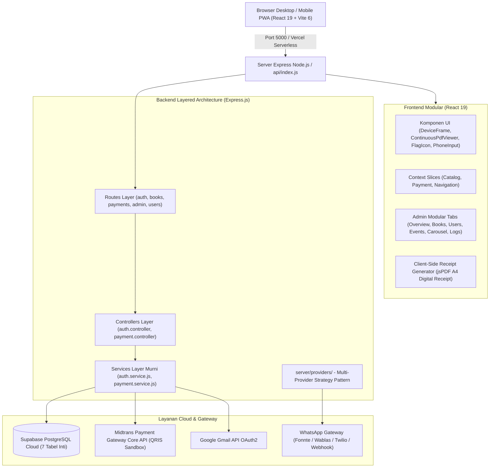

# 📖 Wahidiyah Book — Digital Library, Real Midtrans QRIS & WhatsApp Authenticator
## 🧠 Master Memory Workflow & Dokumentasi Teknis Sistem Terpadu (Single Source of Truth)

[](https://nodejs.org/)
[](https://react.dev/)
[](https://expressjs.com/)
[](https://vitejs.dev/)
[](https://tailwindcss.com/)
[-emerald.svg)](https://supabase.com/)
[-0052cc.svg)](https://midtrans.com/)
[](https://whatsapp.com/)
[](https://vercel.com/)

> 🎯 **FUNGSI UTAMA BERKAS INI:** 
> Berkas ini adalah **SATU-SATUNYA SUMBER KEBENARAN (Single Source of Truth / Memory Tunggal)** untuk seluruh arsitektur, spesifikasi REST API, alur pembayaran Midtrans QRIS, gateway autentikasi WhatsApp, integrasi database Supabase Cloud, panduan developer, naskah akademik/Zotero, standar keamanan siber, dan riwayat rilis aplikasi **Wahidiyah Book**.
>
> 
> Ini satu-satunya **memory teknis utama**. `README.md` hanya pintu masuk; `ARCHITECTURE.md`, `DESIGN.md`, dan `docs/ARCHITECTURE_AND_ENGINEERING_GUIDELINES.md` hanya pengarah ke bagian terkait di sini. Panduan operasional khusus, seperti panduan upload admin, tetap berdiri sendiri. Jika dokumentasi berbeda dengan kode aktif atau `full_setup.sql`, kode dan skema aktif menjadi acuan lalu memory ini diperbarui.

---

## 📑 Daftar Isi
1. [Ringkasan Eksekutif & Tech Stack](#1-ringkasan-eksekutif--tech-stack)
2. [Fitur Unggulan Sistem](#2-fitur-unggulan-sistem)
3. [Arsitektur Sistem & Rekayasa Perangkat Lunak (Modular Layered Monolith)](#3-arsitektur-sistem--rekayasa-perangkat-lunak-modular-layered-monolith)
4. [Spesifikasi Lengkap Design System & Standar Visual UI](#4-spesifikasi-lengkap-design-system--standar-visual-ui)
5. [Spesifikasi Lengkap REST API (/api/*)](#5-spesifikasi-lengkap-rest-api-api)
6. [Mekanisme & Alur Pembayaran Real Midtrans QRIS](#6-mekanisme--alur-pembayaran-real-midtrans-qris)
7. [Arsitektur Multi-Provider WhatsApp Gateway](#7-arsitektur-multi-provider-whatsapp-gateway)
8. [Panduan Setup & Skema Database Supabase Cloud](#8-panduan-setup--skema-database-supabase-cloud)
9. [Standar Keamanan Sistem (30 Indikator Software Quality & Security Hardening)](#9-standar-keamanan-sistem-30-indikator-software-quality--security-hardening)
10. [Panduan Pengembangan & Penambahan Fitur Baru](#10-panduan-pengembangan--penambahan-fitur-baru)
11. [Panduan Akademik & Integrasi Sitasi Zotero SINTA](#11-panduan-akademik--integrasi-sitasi-zotero-sinta)
12. [Prasyarat & Konfigurasi Lingkungan (.env)](#12-prasyarat--konfigurasi-lingkungan-env)
13. [Panduan Instalasi & Katalog NPM Scripts](#13-panduan-instalasi--katalog-npm-scripts)
14. [Struktur Direktori Repositori Terpadu](#14-struktur-direktori-repositori-terpadu)
15. [Riwayat singkat](#15-riwayat-singkat)
16. [Roadmap & Rencana Pengembangan Mendatang](#16-roadmap--rencana-pengembangan-mendatang)
17. [Informasi Pengembang & Identitas Skripsi](#17-informasi-pengembang--identitas-skripsi)

---

## 1. Ringkasan Eksekutif & Tech Stack

Aplikasi **Wahidiyah Book** dibangun menggunakan arsitektur **Modular Layered Monolith (Murni React 19 JSX + Node.js Express)** dengan integrasi Service Layer decoupled dan Single-Port delivery:

* **Frontend:** React 19 (`.jsx` dan `.js`), Vite 6, React Router v7, Tailwind CSS 4, Headless UI, Lucide Icons, Sonner.
* **Document Engine:** Mozilla PDF.js Canvas (`ContinuousPdfViewer.jsx` Continuous Vertical Scroll, Retina HD scaling, scroll-spy otomatis, anchor pelacak zoom tanpa geser teks) dan Mammoth (.docx ke HTML semantik terproteksi).
* **Receipt Engine:** `jspdf` untuk ekspor kwitansi digital A4 resmi instan di peramban (client-side) tanpa dialog print fisik.
* **Backend:** Node.js 24+ dan Express.js 4 (ES Module), dengan Service Layer dan adapter serverless Vercel (`api/index.js`).
* **Database & BaaS:** Supabase Cloud (PostgreSQL 15 dengan *Row Level Security* fail-closed dan zona waktu `Asia/Jakarta`).
* **Payment Gateway:** Midtrans Core API (Mode QRIS Sandbox Real-time dengan payload EMVCo `qr_string`, salin kode QR, link simulator sandbox, dan webhook idempoten).
* **WhatsApp Multi-Provider:** Gateway berbasis *Strategy Pattern* (Fonnte, Wablas, WhaCenter, Twilio, Webhook, dan Demo lokal) sebagai fallback pemulihan akun.
* **Image Processing:** Sharp (kompresi & sanitasi otomatis gambar sampul ke format WebP).
* **Email & Notifikasi:** Google OAuth2 API (Gmail API HTTPS untuk OTP email registrasi & verifikasi).
* **Quality Harness:** Vitest dan pemeriksaan sintaks, token warna, kontras WCAG, serta build Vite (`npm run check`). Status lulus terakhir harus dicatat bersama perubahan yang diverifikasi; jangan menganggap badge atau hitungan lama sebagai hasil terkini.

---

## 2. Fitur Unggulan Sistem

### 2.1. Katalog Buku & Universal Document Reader (Read-Only)
- **Katalog Interaktif Minimalis:** Desain elegan ala e-reader (Moco-style) yang menonjolkan sampul jilid dan judul kitab tanpa teks penulis generik, dilengkapi pencarian katalog instan dan badge akses (*locked* vs *free*).
- **Universal Document Reader (PDF & Word DOCX):**
  - **Dukungan Berkas PDF Continuous Vertical Scroll:** Dirender interaktif via Mozilla PDF.js Canvas dengan gulir vertikal mulus (*continuous scroll*), auto scroll-spy sinkronisasi halaman, kanvas berasio aspek tetap (*fixed-aspect ratio*), pelacak zoom persentase real-time, dan titik jangkar baca (*reading anchor*) yang menjaga posisi teks tidak melompat saat zoom in/out. Tombol kontrol zoom diletakkan ringkas berdampingan dengan tombol layar penuh (*fullscreen*).
  - **Dukungan Naskah Word DOCX:** Dikonversi langsung di sisi server via pustaka `mammoth` menjadi HTML semantik (`GET /api/books/:id/html`) dengan sanitasi anti-XSS (`DOMPurify`), disajikan secara responsif di peramban tanpa memerlukan Microsoft Word fisik.
  - **Proteksi Hak Cipta:** Tanda air (*watermark*) identitas dinamis (nama pembaca & ID transaksi) dibakar di kanvas, proteksi klik kanan (`onContextMenu preventDefault`), larangan seleksi teks (`select-none`), dan pengiriman konten via HTTP header `inline` berotorisasi JWT.
- **Last Read Tracker (Ingat Posisi Terakhir):** Otomatis menyimpan posisi halaman baca pengguna ke `localStorage` peramban (tanpa beban latensi database) dan menampilkan dialog resume *"Lanjut membaca dari Halaman X?"*.
- **Mode Tema Pembaca:** Pilihan latar belakang **Terang**, **Sepia (Hangat Lembut)**, dan **Malam (Gelap Elegan)** untuk kenyamanan membaca dalam waktu lama.

### 2.2. Autentikasi Pengguna & WhatsApp Multi-Provider (R61–R67)
- **Registrasi & Verifikasi Dual-Channel Terkendali:**
  - **Registrasi Akun:** 100% menggunakan verifikasi OTP via **Email (Gmail API OAuth2)** bebas biaya API dan anti-flooding (*OTP Flooding Protection*). Tombol pendaftaran disederhanakan dengan label bersih *"Daftar"*.
  - **WhatsApp Secondary Fallback:** Kanal WhatsApp internasional dialokasikan sebagai opsi pemulihan sekunder (*Secondary Fallback Account Recovery*) pada fitur Lupa Password.
- **Pemilih Kode Negara Sedunia (245 Negara):**
  - Menggunakan bendera vektor SVG resmi (disalin sekali dari set `flag-icons`) di `public/flags/[iso].svg` — tanpa dependensi npm saat runtime, sehingga tidak ada paket bendera yang ikut ke bundel (resolusi tajam di Windows, Linux, Android, iOS tanpa glitch rendering teks emoji).
  - Integrasi pustaka standar Google `libphonenumber-js` untuk parsing nomor E.164 internasional dan deteksi validitas.
  - Pencarian dwibahasa (dapat dicari dengan nama Indonesia *"Jepang"* atau Inggris *"Japan"*, dial code `+81`, atau ISO code `JP`).
  - Pembuangan otomatis angka nol di awal nomor lokal (`0812...` ➔ `812...` dengan dial `+62`).
- **Login Akun Google:** Integrasi resmi Google OAuth 2.0 (*Direct Authorization Code Flow*) dengan verifikasi token ID dan pembuatan sesi JWT aman.
- **Sesi Aman & Proteksi Hak Akses:** Penyimpanan kata sandi dengan salt hashing `bcryptjs` (12 rounds), sesi berbasis token `jsonwebtoken` (JWT), dan mitigasi celah *self-demotion* (admin tidak dapat mencabut hak admin dirinya sendiri).

### 2.3. Sistem Keanggotaan Pro & Pembayaran Real Midtrans QRIS
- **Paket Pro Tunggal Terstandarisasi:** Skema keanggotaan Pro tunggal dengan tarif Rp 25.000/bulan (disertai penyesuaian biaya layanan resmi katalog server).
- **Integrasi Midtrans Core API Sandbox Eksklusif:** Charge QRIS dibuat langsung dari backend server dengan payload EMVCo dinamis (bebas dari manipulasi harga di sisi klien). Seluruh metode manual non-QRIS telah dieliminasi demi otomasi 100%.
- **Bantuan Pengujian Sandbox:** Dilengkapi tombol *"Salin Kode QR String"* untuk pengujian via curl/simulator, tautan langsung ke *Midtrans QRIS Simulator*, dan tombol *"▶ Bayar Sekarang (Mode Simulasi)"* langsung pada UI konfirmasi pembayaran (`PaymentConfirmScreen.jsx`) jika flag `ALLOW_PAYMENT_SIMULATION=1` aktif di `.env`.
- **Simpan QRIS ke Galeri Ponsel:** Konversi SVG EMVCo QRIS ke gambar PNG beresolusi tinggi via HTML5 Canvas dengan `Blob` UTF-8 dan `URL.createObjectURL` agar dapat dipindai dari galeri e-wallet (DANA, GoPay, BCA, Livin, OVO).
- **Polling & Webhook Idempoten:** Pengecekan otomatis status transaksi setiap 3 detik dan verifikasi *SHA512 Signature Key* pada endpoint webhook notifikasi. Menggunakan Service Layer `payment.service.js` dengan mekanisme klaim bersyarat (*conditional claim*) untuk mencegah aktivasi membership ganda.
- **Faktur Kwitansi Pembayaran Resmi & Unduh PDF Instan:**
  - Format kwitansi A4 resmi dengan desain profesional, branding hijau zamrud tua, metadata dua kolom rapi, rincian biaya transparan, dan stempel verifikasi resmi Wahidiyah Book.
  - Unduh langsung ke format PDF di sisi klien menggunakan pustaka `jspdf` — cepat, tanpa dialog `window.print()` peramban, dan terhindar dari pemotongan halaman fisik.
  - Riwayat langganan dilengkapi fallback otomatis ke tabel `transactions` sehingga histori transaksi selalu tampil lengkap.

### 2.4. Panel Administrasi Komprehensif (Modular Sub-Tabs)
- **Arsitektur Sub-Tab Terisolasi:** Panel admin didekomposisi menjadi 6 komponen mandiri di `src/features/admin/tabs/`:
  1. `OverviewTab.jsx`: Metrik ringkasan 3+2 (Anggota Terdaftar, Total Pendapatan, Kitab Digital, Transaksi Sukses, Pembaca Aktif), grafik analitik pendapatan berbasis `recharts`, dan ekspor laporan Excel terpusat.
  2. `BooksTab.jsx`: Manajemen katalog buku, formulir tambah/edit buku, kompresi sampul WebP otomatis via `sharp`, dan kelola visibilitas Pro.
  3. `UsersTab.jsx`: Manajemen anggota, pencarian pengguna, dan penugasan role admin.
  4. `EventsTab.jsx`: Kalender agenda majelis mujahadah, pemisah nama lokasi & link presisi Google Maps.
  5. `CarouselTab.jsx`: Pengelolaan banner carousel beranda dinamis.
  6. `LogsTab.jsx`: Pemantauan log aktivitas sistem real-time dengan tombol refresh di samping filter.
- **Ekspor Laporan 1-Klik:** Unduh riwayat transaksi, data pengguna, dan katalog buku langsung ke format Microsoft Excel (`.xlsx`) via library `exceljs` yang dimuat secara dinamis.

### 2.5. Antarmuka Pengguna & Navigasi Terpadu (Mobile, Tablet, Desktop)
- **Cupertino Inset Grouped Profile Hub:** Halaman profil (`EditProfileScreen.jsx`) didesain ulang dengan gaya modern iOS/Cupertino inset grouped card. Bagian **Data Akun** ditempatkan di paling atas dengan kartu profil taktil yang elegan, tombol ubah kata sandi, dan toggle mode gelap/terang dalam bentuk switch slider.
- **Konsolidasi Halaman Sekunder:** Halaman Tentang Aplikasi (`/about`), Pusat Bantuan (`/help`), dan Riwayat Langganan (`/riwayat`) disatukan ke dalam Hub Akun Profil. Sidebar desktop dibersihkan dari menu redundan dan tombol badge EB yang mengganggu telah dihilangkan.
- **Universal Sticky Back Button Header (`DeviceFrame.jsx`):**
  - Hadir seragam di **Desktop, Tablet, dan Ponsel Mobile** untuk seluruh sub-halaman (`/about`, `/help`, `/riwayat`, `/profile`).
  - Posisi *sticky* di bagian atas konten dengan margin responsif yang pas terhadap sidebar (`md:ml-[218px]` terbuka, `md:ml-[68px]` ciut).
  - Mekanisme navigasi pintar: menggunakan `window.history.back()` jika ada riwayat jelajah, atau fallback otomatis ke halaman profil/beranda.
- **Tampilan Bersih & Minimalis:**
  - Halaman Pusat Bantuan dibersihkan dari judul dan ikon ganda yang redundan.
  - Halaman Tentang Aplikasi dibersihkan dari logo besar yang mengganggu agar fokus pada teks informasi.
- **Tema Tampilan Menyeluruh (Terang & Malam):** Seluruh antarmuka mendukung palet gelap sadar-tema dengan CSS variable Tailwind berstandar 3 Color Key (60-30-10) dan 17 pasangan kontras WCAG AA $\ge 4.5:1$.
- **Progressive Web App (PWA):** Terintegrasi Web App Manifest & Service Worker untuk instalasi ke Layar Utama (*Home Screen*).

---

## 3. Arsitektur Sistem & Rekayasa Perangkat Lunak (Modular Layered Monolith)

Aplikasi dibangun menggunakan prinsip **Modular Layered Monolith (Unified Single-Port & Service-Decoupled Architecture)**:



### 3.1 Konvensi Kode & Pembagian Tanggung Jawab 4 Lapisan:
Pemisahan lapisan (*Separation of Concerns*) dilakukan secara ketat untuk menjamin *loose coupling*, *high cohesion*, dan kemampuan uji unit (*testability*):
1. **Routes Layer (`server/routes/`):**
   - Tipis (*thin routes*), hanya bertugas mendefinisikan URL rute, metode HTTP (`GET`, `POST`, `PUT`, `DELETE`), dan menyematkan middleware terkait (`requireAuth`, `requireAdmin`, `authRateLimiter`, `transactionsRateLimiter`).
   - Tidak memuat logika bisnis atau query SQL langsung.
2. **Controllers Layer (`server/controllers/`):**
   - Mengambil data dari objek request Express (`req.body`, `req.params`, `req.user`).
   - Memvalidasi struktur data menggunakan skema `zod`.
   - Meneruskan DTO bersih ke Service Layer.
   - Mengembalikan HTTP Response seragam (`res.status().json()`).
3. **Services Layer Murni (`server/services/`):**
   - Menampung seluruh aturan bisnis (*business rules*) inti (misal: verifikasi token, alur klaim pembayaran idempoten, kalkulasi durasi keanggotaan Pro).
   - **Bebas mutlak dari objek `req` dan `res` Express** sehingga 100% dapat diuji secara terisolasi via pengujian otomatis (*unit test* Vitest) tanpa mock HTTP server.
4. **Helper & Database Layer (`server/lib/` & `server/db.js`):**
   - `midtrans.js`: Integrasi API Midtrans Core (charge QRIS, status polling, verifikasi signature SHA512, unwrap payload, `isTransactionSettled`).
   - `time.js`: Penanggalan WIB tunggal terstandarisasi dengan `dayjs` (zona waktu `Asia/Jakarta`).
   - `validate.js`: Skema validasi terstruktur dengan `zod`.
   - `images.js`: Pengolahan kompresi gambar WebP dengan `sharp`.
   - `http.js`: Helper pembungkus respons HTTP (`wrap`, `fail`, `safeUrl`).
   - `otp.js`: Manajemen pembuatan kode OTP terenkripsi dan jeda cooldown kirim ulang.
   - `db.js`: Klien `supabaseServer` ber-role service dengan Row Level Security fail-closed.

### 3.2 Evaluasi Kritis 30 Prinsip Kualitas Perangkat Lunak (Software Quality):
Sistem dirancang dan dievaluasi berpatokan pada 3 tingkatan prioritas (*Tiers*):
- **Tier 1: Pondasi Kritis & Mutlak (P1)**
  1. *Separation of Concerns (SoC):* Pemisahan tegas Routes $\rightarrow$ Controllers $\rightarrow$ Services $\rightarrow$ Repositories.
  2. *Idempotency (Operasi Bayar & Webhook):* Webhook Midtrans dan aktivasi keanggotaan menggunakan klaim UPDATE bersyarat atomik untuk mencegah aktivasi ganda (*prevent double fulfillment*).
  3. *Security by Design:* Row Level Security fail-closed, parameter query anti-SQLi, enkripsi kata sandi `bcryptjs` 12 rounds, rate limiting berlapis, dan proteksi hak cipta e-reader.
  4. *Testability:* Vitest harness tersedia untuk logika autentikasi, pembayaran, membership, parsing Midtrans, dan sanitasi; jalankan suite untuk status terbaru.
  5. *KISS & YAGNI:* Menghindari abstraksi dinamis berlebih yang tidak dibutuhkan skripsi.
  6. *High Cohesion & Loose Coupling:* Modul mandiri yang hanya berkomunikasi via antarmuka fungsi terdefinisi.
- **Tier 2: Standar Clean Code & Operasional (P2)**
  7. *Maintainability & Readability:* Penamaan fungsi deklaratif, konsistensi ES Module, dan dokumentasi single source of truth.
  8. *DRY (Don't Repeat Yourself):* Penggunaan helper terpusat (`http.js`, `time.js`, `validate.js`, `cn()`).
  9. *Extensibility (Strategy Pattern):* WhatsApp Gateway menggunakan pola strategi multi-provider yang fleksibel.
  10. *Robustness & Fault Tolerance:* Polling status QRIS tetap berjalan aman meskipun ada fluktuasi jaringan; global error handler mencegah crash proses server.
  11. *Performance & Lazy Loading:* Pemisahan bundel manual (*manual chunks*) pada Vite untuk library berat (`pdfjs`, `exceljs`, `recharts`).
  12. *Observability & Structured Logging:* Logger performa tinggi berbasis `picocolors` dengan penanda waktu WIB dan prefix modul.
- **Tier 3: Anti-Pattern yang Dihindari (P3)**
  - ❌ *Microservices:* Diabaikan karena overhead latensi dan kompleksitas deployment tidak proporsional untuk sistem perpustakaan.
  - ❌ *Event Sourcing & CQRS:* Diabaikan karena integritas transaksional PostgreSQL Supabase sudah mencukupi.
  - ❌ *Distributed Message Broker (Kafka/RabbitMQ):* Diabaikan karena volume antrean webhook dapat ditangani secara asinkron oleh Express.

### 3.3 Dukungan Lingkungan & Vercel Serverless:
- **Development & Bare-Metal:** Berjalan dalam satu port terpadu (`http://localhost:5000`) dengan Vite HMR middleware.
- **Vercel Serverless (`api/index.js` + `vercel.json`):** Server Express dibungkus menjadi serverless handler yang kompatibel dengan runtime Node 24 Vercel, dengan rewrite `/api/(.*)` ke serverless function dan aset statis disajikan via CDN edge Vercel.
- **Rate limit lintas-instance:** Pembatasan endpoint sensitif dapat memakai store PostgreSQL Supabase (`api_rate_limit_buckets`) melalui fungsi RPC atomik. Key IP/akun di-HMAC sebelum disimpan. Terapkan blok aditif **PATCH Distributed Rate Limits** di bagian akhir `supabase_database/full_setup.sql`, lalu set `SHARED_RATE_LIMITS=true` di lingkungan server. Tanpa langkah itu aplikasi memakai store bawaan per proses.
- **Login Google lintas-instance:** Kode sesi acak sekali-pakai disimpan dalam bentuk hash di `email_verifications`, kedaluwarsa setelah 60 detik, dan dihapus atomik saat ditukar. Tabel yang sudah ada dipakai kembali.
- **Pemeliharaan terjadwal:** Vercel menjalankan `/api/cron/daily-maintenance` sekali sehari pada `01:00 UTC` (sekitar `08:00–08:59 WIB` di paket Hobby). Handler memverifikasi `CRON_SECRET` sebelum mengirim pengingat agenda dan menyapu langganan kedaluwarsa. Isi `CRON_SECRET` di Production Environment Variables Vercel dengan nilai acak minimal 16 karakter. Docker tetap memakai scheduler proses.
- **Web Analytics Vercel:** Paket `@vercel/analytics` dan komponen React `<Analytics />` dipasang di `src/main.jsx` untuk melacak page view SPA. Aktifkan Web Analytics di Dashboard Vercel agar pengumpulan kunjungan mulai berjalan.

---

## 4. Spesifikasi Lengkap Design System & Standar Visual UI

### 4.1 Visual Atmosphere & Design POV
Wahidiyah Book adalah platform perpustakaan digital dan komunitas spiritual untuk pengamal Sholawat Wahidiyah. Antarmukanya mencerminkan nilai-nilai:
* **Berwibawa & Teduh (Sacred & Serene):** Tidak berisik seperti SaaS modern generik, melainkan memiliki ketenangan manuskrip klasik dan kehangatan ruang baca perpustakaan pesantren.
* **Presisi Akademis (Academic Rigor):** Tipografi teks dan sitasi yang rapi, layout hierarkis terstruktur, keterbacaan tinggi untuk membaca PDF kitab tebal berjam-jam tanpa kelelahan mata.
* **Kepercayaan Transaksi Finansial (Midtrans Trust):** Alur checkout QRIS dan keanggotaan Pro yang transparan, aman, responsif, dan memberikan umpan balik instan.

### 4.2 Tiga Dial Desain (Core Configuration)
* **`DESIGN_VARIANCE: 6`** — Keseimbangan antara keteraturan editorial katalog buku dan dinamika kartu asimetris pada hero section.
* **`MOTION_INTENSITY: 4`** — Gerakan halus, berpijak pada spring physics alami (`stiffness: 120, damping: 20`). Tanpa animasi berulang yang mengganggu kekhusyukan membaca.
* **`VISUAL_DENSITY: 5`** — Ruang bernapas yang cukup pada halaman bacaan dan katalog, namun ringkas dan efisien pada tabel administrasi dan data transaksi.

### 4.3 3 Color Key & Prinsip 60-30-10 (Wajib Semua Route)
Seluruh rute antarmuka wajib menerapkan TIGA color key dari Tema 1 "Editorial Elegan" dengan proporsi **60-30-10**:

| Peran | Proporsi | Warna | Token Tailwind | Pemakaian |
|---|---|---|---|---|
| **Dominan** | ±60% | Krem Hangat `#FBF8F3` | `cream-*`, `ui-bg/surface/card`, `ink-*` | Latar kanvas, kartu, panel, teks, border |
| **Sekunder** | ±30% | Hijau Zamrud Tua `#14523A` | `brand-*`, `primary` | Sidebar, tombol aksi, header, ikon, state aktif |
| **Aksen** | ±10% | Emas Antik `#B8860B` | `gold-*`, `accent-gold` | Lencana PRO, highlight, ornamen, detail premium |

**Aturan Penerapan:**
1. **Status Fungsional:** Menggunakan token semantik `semantic-success/warning/danger/info` (bukan warna dekoratif, tidak dihitung dalam 60-30-10).
2. **Larangan Palet Mentah:** Dilarang keras memakai kelas warna Tailwind mentah (`slate-*`, `gray-*`, `zinc-*`, `indigo-*`, `rose-*`, `emerald-*`, dll.) untuk elemen struktural. Seluruh warna wajib melalui CSS variable token.
3. **Pengecualian Resmi:** Logo Google multicolor pada tombol OAuth, logo resmi metode pembayaran (`public/payments/`), bendera SVG 271 negara, serta token merah resmi QRIS `qris-600/700` (`#E30613`/`#C00511` — kemasan merah baku QRIS Indonesia).
4. **Mode Malam (Dark Mode):** Tetap mengikuti proporsi 60-30-10 via CSS variable (charcoal hangat menggantikan krem, zamrud dinaikkan terangnya agar terbaca kontras).

### 4.4 6 Koleksi Tema Terkalibrasi (Theme Palettes)
1. **Tema 1: Editorial Elegan (Default Skripsi — Emerald Heritage):**
   - Brand: Hijau Zamrud Tua (`#14523A`, hover `#0E3D2C`)
   - Background: Krem Hangat Alami (`#FBF8F3`, surface `#F7F2E9`, card `#FFFDFA`)
   - Accent: Emas Antik Halus (`#B8860B`, highlight `#D4AF4F`)
   - Text/Ink: Tinta Arang Hangat (`#1D1B17`, secondary `#5A544C`, muted `#7C756C`)
   - Border: Garis Krem Lembut (`#E4D9C6`)
2. **Tema 2: Modern Sage Islamic (Clean Contemporary Sand):** Sage green teduh (`#2D5A46`) di atas warm sand (`#F8F7F4`) dengan aksen perunggu muted (`#A37D45`).
3. **Tema 3: Royal Islamic Blue & Amber (Lapis Lazuli Heritage):** Biru safir Persia (`#1E3A5F`) di atas pualam putih (`#F9F9F6`) dengan aksen amber ochre (`#C88A2C`).
4. **Tema 4: Spiritual Twilight (Midnight Obsidian Oasis - Khusus Malam):** Giok luminesen (`#34D399`) di atas obsidian hutan malam (`#0C1612`) dengan aksen lilin emas (`#F3C766`).
5. **Tema 5: Monochrome Academic Litho (Warm Paper & Carbon):** Karbon linotype (`#181818`) di atas kertas cetak litografi (`#F5F3EF`) dengan aksen tinta stempel kayu (`#8C6239`).
6. **Tema 6: Terracotta & Olive Nusantara (Tradisional Kontemporer):** Zaitun hutan pesantren (`#3B4E3E`) di atas kertas beras krem (`#FAF7F2`) dengan aksen tanah liat terracotta (`#B4533C`).

### 4.5 Tipografi & Hirarki Skala
* **Display / Judul:** Serif bermartabat (*Newsreader*, *Cinzel*, *Playfair*) dipadu dengan *Plus Jakarta Sans* untuk keterbacaan modern.
* **Body / Teks Bacaan:** *Plus Jakarta Sans* (400 Regular / 500 Medium / 600 SemiBold), `line-height: 1.65`, batas maksimal paragraf `65ch`.
* **Ayat & Kaligrafi Arab:** Font *Amiri* atau *Scheherazade New*, ukuran proporsional 1.3x lebih besar dibanding teks latin dengan ruang vertikal harakat yang lapang.
* **Monospace / Angka Finansial:** *JetBrains Mono* untuk nomor referensi Midtrans, nominal QRIS (tabular numbers), kode transaksi, dan nomor halaman.

### 4.6 Arsitektur Navigasi Terpadu (Responsive Design)
* **Desktop Sidebar (Ramping & Fokus):**
  - Lebar Terbuka: `218px` (proporsional dengan kanvas konten)
  - Lebar Ciut (Collapsed): `68px` (ikon + tooltip cerdas)
  - Menu Utama: Beranda, Kalender Mujahadah, Langganan Pro.
  - Menu Akun: Hub Profil Pengamal (memuat akses ke Riwayat, Bantuan, dan Tentang).
  - Menu Admin: 6 Sub-Tab manajemen sistem.
  - Tombol badge EB yang mengganggu telah dihilangkan dari header sidebar ciut.
* **Universal Sticky Top Back Button Header (`DeviceFrame.jsx`):**
  - Hadir seragam di **Desktop, Tablet, dan Mobile** (`← [Judul]`) untuk sub-halaman: `/about` (Tentang Aplikasi), `/help` (Pusat Bantuan), `/riwayat` (Riwayat Langganan), dan `/profile` (Profil).
  - Margin dinamis terhadap sidebar desktop (`md:ml-[218px]` saat terbuka, `md:ml-[68px]` saat ciut) sehingga tidak saling bertumpuk.
  - *Smart Fallback Navigation:* Mengutamakan `window.history.back()`, jika riwayat kosong otomatis kembali ke Hub Profil atau Beranda.
* **Mobile Bottom Dock Bar:**
  - Bar melayang di bagian bawah dengan radius `20px` dan bayangan lembut.
  - 4 tombol utama: Beranda, Kalender, Pro (dengan lencana bintang emas), dan Profil.
  - Target sentuh minimal `44px × 44px` memenuhi standar aksesibilitas mobile WCAG.

### 4.7 Spesifikasi Wireframe & Layout Layar Inti
1. **Katalog & Beranda (Home):**
   - Hero Carousel banner dinamis tanpa tombol navigasi yang berisik.
   - Kartu buku minimalis Moco-style (sampul jilid dominan, judul kitab tegas, tanpa nama penulis generik, badge status Pro emas).
   - Pencarian instan dan filter akses (Semua / Gratis / Pro).
2. **Universal Document Reader (Continuous Vertical Scroll):**
   - Penampil PDF multi-halaman berbasis canvas Mozilla PDF.js murni (`ContinuousPdfViewer.jsx`).
   - Auto scroll-spy untuk sinkronisasi halaman aktif secara otomatis saat digulir.
   - Kanvas berasio aspek tetap (*fixed-aspect*) dan *reading anchor* penahan posisi teks saat perbesaran zoom in/out.
   - Tombol kontrol zoom diletakkan ringkas berdampingan dengan tombol layar penuh (*fullscreen*).
   - Pembaca Word DOCX berbasis HTML semantik terproteksi via Mammoth engine dan sanitasi anti-XSS (`DOMPurify`).
   - Proteksi hak cipta: tanda air dinamis identitas pembaca, pelarangan klik kanan (`contextmenu`), dan larangan seleksi teks (`select-none`).
3. **Membership Pro & Real Midtrans QRIS:**
   - Paket Pro tunggal terstandarisasi Rp 25.000/bulan.
   - Tampilan scan QRIS EMVCo dinamis dengan timer 15 menit, tombol unduh QR PNG ke galeri ponsel, tombol salin kode QR string, dan link simulator Midtrans Sandbox.
   - Tombol *"▶ Bayar Sekarang (Mode Simulasi)"* langsung di UI via flag `ALLOW_PAYMENT_SIMULATION=1`.
   - **Faktur Kwitansi Digital Resmi A4 (jsPDF):** Dibuat instan di sisi klien via pustaka `jspdf` tanpa dialog print peramban, memuat kop hijau zamrud resmi, 2 kolom metadata, rincian biaya, dan stempel verifikasi digital. Riwayat langganan terhubung otomatis ke tabel transaksi agar histori pembayaran tidak pernah kosong.
4. **Kalender Kegiatan Mujahadah:**
   - Matriks kalender bulanan interaktif dengan zona waktu `Asia/Jakarta`.
   - Pemisahan jelas antara teks nama lokasi dan tombol navigasi rute presisi Google Maps.
5. **Admin Management Dashboard (6 Sub-Tabs Modular):**
   - `OverviewTab.jsx`: Metrik ringkasan 3+2, grafik analitik pendapatan Recharts, ekspor Excel terpusat.
   - `BooksTab.jsx`: Manajemen katalog buku dan kompresi WebP otomatis.
   - `UsersTab.jsx`: Manajemen akun anggota dan penugasan peran admin.
   - `EventsTab.jsx`: Manajemen jadwal majelis mujahadah.
   - `CarouselTab.jsx`: Pengelolaan banner beranda dinamis.
   - `LogsTab.jsx`: Pemantauan log aktivitas sistem real-time dengan tombol refresh di samping filter.
6. **Cupertino Inset Grouped Profile Hub (`EditProfileScreen.jsx`):**
   - Desain modern iOS Cupertino inset grouped card dengan Data Akun di posisi paling atas dan kartu profil taktil yang elegan.
   - Tombol ganti kata sandi dan switch slider tema gelap/terang.
   - Menu sub-halaman terintegrasi: Riwayat Langganan, Pusat Bantuan (bersih tanpa judul ganda), dan Tentang Aplikasi (bersih tanpa logo besar).
   - Tombol logout dengan label yang jelas dan penanganan sesi aman.
7. **Autentikasi Pengguna:**
   - Formulir login, pendaftaran, dan pemulihan kata sandi yang bersih dan proporsional.
   - Tombol registrasi sederhana dengan label tunggal *"Daftar"*.
   - Verifikasi OTP registrasi via email terverifikasi, serta alokasi WhatsApp sebagai fallback pemulihan lupa sandi.

### 4.8 Anti-Patterns & Banned Clichés
* **DILARANG:** Gradien ungu-neon atau biru AI (`linear-gradient(to right, #8B5CF6, #EC4899)`).
* **DILARANG:** Hitam pekat murni `#000000` atau putih silau `#FFFFFF` sebagai kanvas utama.
* **DILARANG:** Baris 3 kartu identik tanpa ritme komposisi.
* **DILARANG:** Teks placeholder generik seperti *Lorem Ipsum*, nama palsu *John Doe* atau *Acme Corp*.
* **DILARANG:** Animasi tak beralasan yang memakan beban prosesor.
* **DILARANG:** Kelas warna palet Tailwind mentah di luar token design system.
* **WAJIB:** Rasio kontras teks minimal 4.5:1 untuk teks normal dan 3:1 untuk teks besar (17 pasangan WCAG AA lulus).
* **WAJIB:** Penggunaan tripel RGB CSS variables yang kompatibel langsung dengan Tailwind CSS `rgb(var(--brand-700) / <alpha>)`.

---

## 5. Spesifikasi Lengkap REST API (`/api/*`)

* **Base URL:** `http://localhost:5000/api` (Development) / `/api` (Production)
* **Format Request/Response:** `application/json` (kecuali upload multipart)
* **Otentikasi:** Header `Authorization: Bearer <JWT_TOKEN>` untuk rute yang terproteksi.

### 4.1. Otentikasi (`/api/auth`)

#### `POST /api/auth/login`
Masuk dengan kredensial email dan password.
* **Body:**
  ```json
  {
    "identifier": "user@email.com",
    "password": "password123"
  }
  ```
* **Response (200 OK):**
  ```json
  {
    "success": true,
    "message": "Login berhasil",
    "token": "eyJhbGciOi...",
    "user": {
      "id": "usr-12345678",
      "name": "Nama User",
      "email": "user@email.com",
      "role": "user",
      "isPro": false
    }
  }
  ```

#### `POST /api/auth/register`
Mendaftarkan akun baru dan meminta pengiriman OTP ke email serta WhatsApp (jika nomor HP diisi).
* **Body:**
  ```json
  {
    "name": "Nama Lengkap",
    "email": "user@email.com",
    "phone": "6281234567890",
    "password": "password123",
    "dob": "1995-08-17"
  }
  ```
  *(Catatan: `phone` bersifat opsional dan otomatis dinormalisasi ke format E.164 internasional tanpa tanda plus)*
* **Response (202 Accepted):**
  ```json
  {
    "success": true,
    "message": "Kode verifikasi telah dikirim ke email Anda dan WhatsApp (jika nomor terdaftar), berlaku 10 menit.",
    "email": "user@email.com"
  }
  ```

#### `POST /api/auth/verify-registration`
Memvalidasi kode OTP 6-digit untuk menyelesaikan pembuatan akun.
* **Body:**
  ```json
  {
    "email": "user@email.com",
    "code": "123456"
  }
  ```
* **Response (201 Created):**
  ```json
  {
    "success": true,
    "message": "Akun berhasil dibuat.",
    "token": "eyJhbGciOi...",
    "user": {
      "id": "usr-12345678",
      "name": "Nama Lengkap",
      "email": "user@email.com",
      "phone": "6281234567890",
      "role": "user",
      "isPro": false
    }
  }
  ```

#### `POST /api/auth/resend-otp`
Meminta pengiriman ulang kode verifikasi pendaftaran dengan proteksi cooldown 60 detik.
* **Body:**
  ```json
  {
    "email": "user@email.com",
    "deliveryMethod": "whatsapp"
  }
  ```
  *(Pilihan `deliveryMethod`: `"email"` atau `"whatsapp"`)*
* **Response (200 OK):**
  ```json
  {
    "success": true,
    "message": "Kode OTP baru telah dikirimkan."
  }
  ```

#### `POST /api/auth/request-password-reset`
Meminta OTP reset password ke email atau nomor WhatsApp terdaftar.
* **Body:** `{ "email": "user@email.com", "phone": "6281234567890" }`
* **Response (200 OK):** `{ "success": true, "message": "Kode reset password telah dikirim." }`

#### `POST /api/auth/reset-password`
Mereset password dengan OTP yang valid.
* **Body:** `{ "email": "user@email.com", "code": "123456", "password": "newpassword123" }`
* **Response (200 OK):** `{ "success": true, "message": "Password berhasil diperbarui." }`

#### `GET /api/auth/me`
Mengambil data profil pengguna yang sedang login.
* **Header:** `Authorization: Bearer <TOKEN>`
* **Response (200 OK):** Mengembalikan objek `user` aktif.

---

### 4.2. Katalog Buku (`/api/books`)

#### `GET /api/books`
Mengambil daftar buku (terbuka untuk publik).
* **Response (200 OK):**
  ```json
  {
    "success": true,
    "books": [
      {
        "id": "buku-123",
        "title": "Buku Wahidiyah",
        "author": "Penyusun",
        "category": "Umum",
        "pages": 120,
        "is_locked": true,
        "has_thumbnail": true,
        "has_content": true
      }
    ]
  }
  ```

#### `POST /api/books/upload`
Mengunggah buku baru beserta file thumbnail dan dokumen konten (PDF/EPUB).
* **Header:** `Authorization: Bearer <ADMIN_TOKEN>`
* **Content-Type:** `multipart/form-data`
* **Fields:** `title`, `author`, `category`, `pages`, `is_locked`, `description`
* **Files:** `thumbnail` (gambar max 5MB), `content` (dokumen max 25MB)
* **Response (201 Created):** `{ "success": true, "message": "Buku berhasil diunggah", "bookId": "buku-..." }`

#### `GET /api/books/:id/content`
Membaca/mengunduh isi buku.
* **Header:** `Authorization: Bearer <TOKEN>`
* **Rules:** Pengguna biasa hanya dapat mengakses buku yang `is_locked: false`. Buku `is_locked: true` membutuhkan akun Pro atau role Admin (403 jika tidak Pro).
* **Response:** Stream konten file PDF/dokumen (`Content-Disposition: inline`).

---

### 4.3. Pembayaran QRIS Midtrans (`/api/payments`)

#### `POST /api/payments/qris/charge`
Membuat invoice pembayaran QRIS ke Midtrans Core API.
* **Header:** `Authorization: Bearer <TOKEN>`
* **Body:** `{ "planId": "monthly", "phone": "6281234567890" }`
* **Response (201 Created):**
  ```json
  {
    "success": true,
    "orderId": "tx-123456",
    "refNo": "000012345678",
    "qrString": "00020101021226600016ID.CO.GOPAY.WWW0118...",
    "qrImageUrl": "/api/payments/qris/tx-123456/qr.png",
    "amount": 25000,
    "adminFee": 3000,
    "totalPaid": 28000,
    "status": "pending",
    "expiredAt": "2026-10-07T22:30:00.000Z"
  }
  ```

#### `GET /api/payments/qris/:orderId/status`
Mengecek status pembayaran (polling berkala tiap 3 detik).
* **Header:** `Authorization: Bearer <TOKEN>`
* **Response (200 OK):**
  ```json
  {
    "success": true,
    "orderId": "tx-123456",
    "status": "settlement",
    "isPaid": true,
    "totalPaid": 28000
  }
  ```

#### `GET /api/payments/qris/:orderId/qr.png`
Proxy gambar QR (PNG) — cadangan bila klien memerlukan URL gambar langsung.
* **Header:** `Authorization: Bearer <TOKEN>`
* **Proteksi:** Anti-SSRF whitelist domain `*.midtrans.com` dan protokol HTTPS.

#### `POST /api/payments/midtrans/notification`
Webhook endpoint untuk menerima HTTP Notification dari server Midtrans.
* **Header:** `Content-Type: application/json`
* **Keamanan:** Verifikasi `signature_key = SHA512(order_id + status_code + gross_amount + ServerKey)`.
* **Response (200 OK):** `{ "success": true, "alreadyProcessed": false }`

---

### 4.4. Layanan Pendukung
* `GET /api/subscriptions/my` — Mengambil riwayat paket langganan pengguna aktif.
* `GET /api/events` — Mengambil daftar agenda kegiatan Wahidiyah.
* `GET /api/carousel` — Mengambil daftar banner aktif di beranda.
* `GET /api/health` — Status kesehatan server dan koneksi database.

---

## 6. Mekanisme & Alur Pembayaran Real Midtrans QRIS

### 5.1. Alur Transaksi Lengkap
```
Pengguna (non-Pro)
  │ pilih paket
  ▼
PaymentConfirmScreen
  │ panggil hook useQrisPayment
  ▼
POST /api/payments/qris/charge        ──► server hitung harga dari SUBSCRIPTION_PLANS
  │                                        server charge ke Midtrans Core API (payment_type: qris)
  ▼                                        simpan transaksi status = pending
Midtrans balas qr_string + actions[]   simpan payload QR + URL gambar cadangan + waktu kedaluwarsa
  │
  ▼
<QRCodeSVG value={qrString}>            ──► QR digambar di klien (SVG tajam, tanpa request gambar)
  │                                        fallback: 
  │
  │  pengguna memindai QR / membayar lewat simulator sandbox
  ▼
Polling tiap 3 detik: GET /api/payments/qris/:orderId/status
  │  server menanyakan status langsung ke Midtrans
  ▼
isTransactionSettled(transaction_status, fraud_status) == true
(transaction_status = settlement, fraud_status kosong pada QRIS/GoPay atau accept pada CC)
  │
  ▼
server mengaktifkan membership Pro (activatePaidMembership) — SEKALI SAJA (IDEMPOTEN)
```

**Satu-satunya sumber kebenaran adalah Midtrans.** Frontend tidak pernah boleh menyatakan "lunas"; ia hanya menerima `isPaid: true` dari server.

### 5.2. 7 Prinsip Ketahanan Transaksi Midtrans QRIS
1. **Insert Pending Sebelum Charge:** Transaksi status `pending` dicatat ke database sebelum request HTTP charge dikirim ke Midtrans. Jika charge gagal, transaksi segera ditandai `rejected`.
2. **Idempotensi Aktivasi Pro:** Klaim status transaksi memakai perubahan bersyarat agar webhook/polling ulang tidak mengaktifkan paket dua kali. Jika aktivasi gagal, server mencoba mengembalikan status transaksi ke `pending`. Pembaruan pengguna dan penyisipan langganan masih dua operasi Supabase terpisah, jadi belum atomik; gunakan satu fungsi SQL/RPC sebagai tindak lanjut sebelum mengandalkan jaminan transaksi penuh.
3. **Pembatasan Laju (Rate Limiting):** Endpoint `POST /api/payments/qris/charge` dibatasi 20 permintaan / 5 menit, dan `GET /api/payments/qris/:orderId/qr.png` dibatasi 60 permintaan / menit.
4. **Proteksi Anti-SSRF pada Proxy QR:** Pengambilan gambar QR Midtrans dibatasi ketat ke host `*.midtrans.com`, protokol wajib HTTPS, penanganan redirect manual, dan batas waktu respons (timeout) 10 detik.
5. **Validasi Waktu Kedaluwarsa (15 Menit):** Server memeriksa `expires_at` saat polling status. Jika waktu lewat, transaksi otomatis ditandai `rejected` dan status `expire` dikembalikan ke klien.
6. **Pencegahan Akumulasi Order (Pending Reuse):** Saat pengguna membuka ulang layar pembayaran untuk paket yang sama dan masih memiliki transaksi `pending` yang valid/belum kedaluwarsa, sistem otomatis menggunakan kembali order tersebut (`reused: true`) tanpa menumpuk baris baru.
7. **Penyembunyian URL Internal Merchant:** Properti internal `qrMidtransUrl` hanya dikirimkan pada mode Sandbox (`MIDTRANS_IS_PRODUCTION=false`).

### 5.3. Panduan Pengujian di Sandbox Midtrans
1. Login sebagai pengguna yang **belum Pro**.
2. Masuk ke halaman berlangganan → pilih paket Pro → lanjut ke pembayaran.
3. Kode QR akan muncul.
4. Buka simulator: **https://simulator.sandbox.midtrans.com/v2/qris/index**
5. Tempel nilai `qrMidtransUrl` dari respons charge, lalu klik **Bayar**.
6. Tunggu maksimal ~3 detik. Polling otomatis mendeteksi `settlement` dan akun menjadi Pro seketika.

#### Simulasi Pengujian Webhook via cURL:
```bash
# signature_key = SHA512(order_id + status_code + gross_amount + ServerKey)
ORDER_ID=tx-test123
STATUS_CODE=200
GROSS=28000.00
SERVER_KEY=SB-Mid-server-xxxxxxxx
SIG=$(printf "%s%s%s%s" "$ORDER_ID" "$STATUS_CODE" "$GROSS" "$SERVER_KEY" | sha512sum | cut -d' ' -f1)

curl -X POST http://localhost:5000/api/payments/midtrans/notification \
  -H 'Content-Type: application/json' \
  -d "{\"order_id\":\"$ORDER_ID\",\"status_code\":\"$STATUS_CODE\",\"gross_amount\":\"$GROSS\",\"transaction_status\":\"settlement\",\"fraud_status\":\"accept\",\"signature_key\":\"$SIG\"}"
```
*Catatan: Kirim dua kali berturut-turut — respons harus tetap sukses dan masa aktif Pro **tidak bertambah ganda** (bukti idempoten).*

### 5.4. Troubleshooting Pembayaran Midtrans
| Gejala | Kemungkinan Penyebab | Tindakan Perbaikan |
|---|---|---|
| "Payment gateway Midtrans belum dikonfigurasi" (503) | `MIDTRANS_SERVER_KEY` / `MIDTRANS_CLIENT_KEY` masih kosong di `.env` | Isi kredensial sandbox dari Dashboard Midtrans ke `.env`. |
| "Midtrans tidak mengembalikan kode QR" (502) | Respons charge tidak berisi `qr_string` maupun `actions[]` | Periksa koneksi internet server dan log konsol Express. |
| QR blank / `qrString` null | Migrasi SQL belum lengkap sehingga kolom `midtrans_qr_string` belum ada | Jalankan ulang migrasi skema `supabase_database/full_setup.sql`. |
| QR muncul tapi tidak pernah lunas | Pembayaran belum dieksekusi di simulator sandbox atau QR kedaluwarsa | Buka simulator sandbox Midtrans dan tempel URL QR untuk membayar. |
| Webhook Notifikasi ditolak 401 | `signature_key` salah | Pastikan urutan hash persis: `order_id + status_code + gross_amount + ServerKey`. |
| Webhook Notifikasi 400 | Nominal `gross_amount` tidak sama dengan `total_paid` yang tersimpan | Pastikan nominal yang dikirim sama dengan database (Rp 28.000). |

---

## 7. Arsitektur Multi-Provider WhatsApp Gateway

Gateway WhatsApp menggunakan arsitektur **Strategy / Provider Pattern** di folder `server/providers/`:

```
server/providers/
├── base.js         # BaseWhatsAppProvider (kontrak kelas abstrak & format pesan)
├── fonnte.js       # FonnteProvider (Fonnte API - default)
├── wablas.js       # WablasProvider (Wablas API)
├── whacenter.js    # WhacenterProvider (WhaCenter API)
├── twilio.js       # TwilioProvider (Twilio Programmable Messaging API)
├── webhook.js      # GenericWebhookProvider (Custom Webhook Gateway)
├── demo.js         # DemoProvider (Terminal console fallback untuk dev lokal)
└── index.js        # Provider Registry & Singleton Factory
```

### 6.1. Provider yang Didukung:
1. **`fonnte` (Fonnte API - Default)**:
   * `.env`: `WHATSAPP_PROVIDER=fonnte`, `FONNTE_TOKEN=...`
   * Endpoint: `https://api.fonnte.com/send`
2. **`wablas` (Wablas API)**:
   * `.env`: `WHATSAPP_PROVIDER=wablas`, `WABLAS_TOKEN=...`, `WABLAS_SERVER=https://...`
   * Endpoint: `${WABLAS_SERVER}/api/send-message`
3. **`whacenter` (WhaCenter API)**:
   * `.env`: `WHATSAPP_PROVIDER=whacenter`, `WHACENTER_DEVICE_ID=...`
   * Endpoint: `https://app.whacenter.com/api/send`
4. **`twilio` (Twilio WhatsApp Sandbox/Prod)**:
   * `.env`: `WHATSAPP_PROVIDER=twilio`, `TWILIO_ACCOUNT_SID=...`, `TWILIO_AUTH_TOKEN=...`, `TWILIO_WHATSAPP_NUMBER=...`
   * Endpoint: `https://api.twilio.com/2010-04-01/Accounts/${SID}/Messages.json`
5. **`webhook` (Custom Internal Gateway)**:
   * `.env`: `WHATSAPP_PROVIDER=webhook`, `WHATSAPP_WEBHOOK_URL=...`, `WHATSAPP_WEBHOOK_SECRET=...`
6. **`demo` (Local Terminal Fallback)**:
   * Otomatis aktif jika tidak ada token provider yang terisi atau disetel eksplisit `WHATSAPP_PROVIDER=demo`. Mencetak pesan dan kode OTP ke terminal pengembang secara jelas untuk debugging lokal.

### 6.2. Menambahkan Provider Baru:
1. Buat berkas baru di `server/providers/[nama_provider].js`.
2. Warisi kelas `BaseWhatsAppProvider`:
   ```javascript
   import { BaseWhatsAppProvider } from './base.js';

   export class CustomProvider extends BaseWhatsAppProvider {
     constructor() {
       super('custom', 'Custom Gateway');
     }
     async sendOtp(phone, otpCode, extra = {}) {
       const message = this.formatOtpMessage(otpCode, extra);
       // Panggil fetch() ke endpoint API gateway Anda
       return { success: true, messageId: '...' };
     }
   }
   ```
3. Daftarkan kelas provider baru tersebut di `server/providers/index.js`.

---

## 8. Panduan Setup & Skema Database Supabase Cloud

Informasi Project Database Supabase:
| Item | Nilai Resmi |
|---|---|
| **Project Name** | **Skripsi_Project** |
| **Project Ref** | `pdimjmbjutlzjdfjaqgt` |
| **URL** | `https://pdimjmbjutlzjdfjaqgt.supabase.co` |
| **Region** | Singapore |

> ⚠️ **Catatan Migrasi:** Project lama (`cfpmkwjkqfktagdkmlai`) sudah dihapus. Seluruh konfigurasi aplikasi aktif diarahkan ke project `pdimjmbjutlzjdfjaqgt` di atas.

### 7.1. Satu-satunya berkas SQL
Repositori hanya menyimpan `supabase_database/full_setup.sql` sebagai definisi setup database. Skrip ini untuk database baru atau reset yang memang disetujui; bagian awal menjalankan `DROP ... CASCADE` dan menghapus data tabel yang disebut di dalamnya. Jangan jalankan seluruh skrip pada database yang berisi data.

Perubahan untuk database yang sudah berjalan harus ditinjau dan diterapkan sebagai migrasi terkontrol setelah backup. Hardening VULN-02/VULN-16 tercatat sudah dijalankan pada project aktif pada 22 Oktober 2026; aturan grant akhirnya juga ada di setup ini. Skrip pembersihan dan penghapusan avatar tidak lagi disimpan terpisah. Status kolom `users.avatar` pada project Supabase aktif belum diverifikasi di sesi ini.

### 7.2. Tabel pada `full_setup.sql`
Setup mendefinisikan **7 tabel inti dan 1 tabel Web Push**:
| Tabel | Fungsi & Peran |
|---|---|
| `users` | Akun pengguna (email, nomor WhatsApp `phone`, password hash bcrypt, role `user`/`admin`, `is_pro`, masa aktif `subscription_expires_at`). |
| `books` | Katalog buku, metadata berkas, dan status akses Pro (13 kolom sesuai DDL). |
| `events` | Jadwal agenda & mujahadah Wahidiyah (judul, waktu WIB, lokasi, deskripsi). |
| `subscriptions` | Riwayat langganan keanggotaan Pro pengguna (`plan_name` seragam: `"Pro"`). |
| `transactions` | Transaksi pembayaran resmi (`midtrans_transaction_id`, `midtrans_qr_string`, `midtrans_qr_url`, status idempoten). |
| `email_verifications` | Kode OTP 6 digit untuk registrasi dan reset password (berlaku 10 menit, salt hash SHA-256). |
| `carousel_slides` | Slide banner Hero Carousel di beranda (urutan, gambar, periode tampil, status aktif). |
| `push_subscriptions` | Endpoint dan kunci perangkat untuk pengingat agenda Web Push; hanya diakses server dengan service-role key. |

Tabel lama seperti `ads`, `password_resets`, `qris_transactions`, dan `user_bookmarks` tidak dibuat oleh setup baru. `push_subscriptions` **masih digunakan** oleh pengingat agenda dan tidak boleh dihapus. `reading_progress` disimpan di browser, bukan tabel database.

### 7.3. Standar Zona Waktu Database
Seluruh kolom waktu memakai `TIMESTAMPTZ` dengan `NOW()` polos, dan timezone database di-set ke **`Asia/Jakarta` (WIB, UTC+7)**. Postgres menyimpan waktu dalam UTC secara internal lalu menampilkannya sesuai timezone sesi, sehingga waktu aplikasi selalu sinkron dengan waktu Indonesia bagian barat.

### 7.4. Kueri Verifikasi Database (Checklist SQL):
```sql
-- 1. Harus mengembalikan 8 tabel aplikasi, termasuk push_subscriptions
SELECT table_name FROM information_schema.tables WHERE table_schema = 'public' ORDER BY table_name;

-- 2. Harus 0 baris — tabel ads sudah tidak ada
SELECT table_name FROM information_schema.tables WHERE table_schema = 'public' AND table_name = 'ads';

-- 3. Harus rls_aktif = true pada tabel sensitif
SELECT relrowsecurity AS rls_aktif FROM pg_class WHERE relname = 'email_verifications';

-- 4. Timezone harus Asia/Jakarta
SHOW timezone;

-- 5. Hitung baris tabel utama
SELECT 
  (SELECT COUNT(*) FROM public.users) AS total_users,
  (SELECT COUNT(*) FROM public.books) AS total_books,
  (SELECT COUNT(*) FROM public.transactions) AS total_transactions;
```

---

## 9. Standar Keamanan Sistem (30 Indikator Software Quality & Security Hardening)

Sistem telah diaudit dan mengimplementasikan **30 Indikator Standar Kualitas Perangkat Lunak & Keamanan Siber**:

| # | Indikator Keamanan & Kualitas | Implementasi & Mitigasi | Status |
| :---: | :--- | :--- | :--- |
| 1 | **Hashing Password** | `bcryptjs` salt cost 12 rounds pada registrasi & ganti password. | ✅ Lulus |
| 2 | **Stateless JWT** | Token ditandatangani `JWT_SECRET` berkekuatan tinggi (expiry 12 jam). | ✅ Lulus |
| 3 | **Supabase RLS Fail-Closed** | RLS aktif pada 7 tabel inti dan tabel `push_subscriptions`; operasi data privat dilakukan server dengan service-role key. | ✅ Lulus |
| 4 | **Validasi Skema Request** | Menggunakan pustaka `zod` untuk memvalidasi seluruh payload request di controller. | ✅ Lulus |
| 5 | **Rate Limiting Anti-Bruteforce** | `express-rate-limit` pada endpoint auth, OTP, dan pemicu charge pembayaran. | ✅ Lulus |
| 6 | **HTTP Header Hardening** | `helmet` aktif untuk proteksi XSS, Clickjacking, dan MIME-sniffing. | ✅ Lulus |
| 7 | **Fail-Closed Webhook Guard** | Webhook menolak transaksi tanpa tanda tangan SHA512 yang valid dari Midtrans. | ✅ Lulus |
| 8 | **Proteksi Hak Cipta PDF** | Canvas PDF.js murni, `#toolbar=0`, `select-none`, larangan klik kanan, inline streaming JWT. | ✅ Lulus |
| 9 | **Paywall Buku Pro Server-Side** | PDF buku berstatus Pro mewajibkan validasi `is_pro` aktif sebelum di-stream. | ✅ Lulus |
| 10 | **Anti-SSRF pada Proxy Gambar** | Whitelist domain `*.midtrans.com` dan protokol HTTPS pada fetching gambar QR. | ✅ Lulus |
| 11 | **Idempotensi Transaksi & Webhook** | Klaim `pending` bersyarat mencegah aktivasi ganda; pemulihan status adalah kompensasi best-effort, belum satu transaksi PostgreSQL. | ⚠️ Belum atomik |
| 12 | **Otoritatif Harga di Server** | Nominal harga pesanan dikalkulasi dari konstanta backend, bukan input klien. | ✅ Lulus |
| 13 | **Pembersihan MIME Upload** | Validasi magic-bytes format raster dan konversi otomatis WebP via `sharp`. | ✅ Lulus |
| 14 | **Perlindungan OTP** | Hash SHA-256 kode OTP dengan masa berlaku ketat 10 menit. | ✅ Lulus |
| 15 | **Cooldown OTP 60 Detik** | Pembatasan frekuensi pengiriman ulang kode OTP untuk mencegah spam API. | ✅ Lulus |
| 16 | **Isolasi Role Admin** | Middleware `requireAdmin` memverifikasi peran secara langsung ke database. | ✅ Lulus |
| 17 | **CORS Whitelist Terbatas** | Hanya domain resmi / localhost terdaftar yang diizinkan melakukan request. | ✅ Lulus |
| 18 | **Penanganan Error Terpagar** | Detail stack trace internal hanya ditampilkan pada mode `development`. | ✅ Lulus |
| 19 | **Redaksi Kredensial Sensitif** | `.env` dilindungi `.gitignore` dan pembersihan riwayat git berisiko. | ✅ Lulus |
| 20 | **Audit Dependensi Rutin** | Pemeriksaan berkala via `npm audit --ignore-scripts --audit-level=high` (0 vulnerability). | ✅ Lulus |
| 21 | **Proteksi Self-Demotion Admin** | Mencegah administrator mencabut peran admin miliknya sendiri secara sengaja/tidak sengaja. | ✅ Lulus |
| 22 | **Sanitasi Anti-XSS Reader** | Sanitasi ketat naskah HTML Word hasil konversi Mammoth sebelum dirender di layar baca. | ✅ Lulus |
| 23 | **Validasi Kompleksitas Password** | Validasi ketat sandi akun baru dan reset password via skema Zod terpusat. | ✅ Lulus |
| 24 | **Rate Limiter Transaksi QRIS** | Pembatasan frekuensi request pembuatan charge QRIS per IP/pengguna untuk cegah spam order. | ✅ Lulus |
| 25 | **Separation of Concerns (SoC)** | Pemisahan tegas Routes $\rightarrow$ Controllers $\rightarrow$ Services $\rightarrow$ Supabase Repositories. | ✅ Lulus |
| 26 | **Testability & Unit Test Harness** | Tes Vitest tersedia untuk autentikasi, pembayaran, membership, parsing Midtrans, dan sanitasi. Jalankan `npm test` untuk status terkini. | Tersedia |
| 27 | **Kwitansi Digital Mandiri (jsPDF)** | Pembuatan berkas PDF kwitansi A4 di sisi klien tanpa latensi backend dan aman dari injection. | ✅ Lulus |
| 28 | **Single Source of Truth Waktu** | Standarisasi seluruh operasi tanggal/waktu ke zona `Asia/Jakarta` (WIB) via Day.js. | ✅ Lulus |
| 29 | **3 Color Key & WCAG AA** | 100% antarmuka patuh prinsip 60-30-10 dan lulus 17 pasang kontras $\ge 4.5:1$ tanpa palet mentah. | ✅ Lulus |
| 30 | **Vercel Serverless Isolation** | Dukungan deployment serverless terisolasi (`api/index.js`) dengan env runtime terkelola. | ✅ Lulus |

---

## 10. Panduan Pengembangan & Penambahan Fitur Baru

Untuk menambah fitur baru secara rapi mengikuti standar Express + React:

### Langkah 1: Daftarkan Rute di Express (`server/routes/`)
Buat file rute baru di `server/routes/` atau tambahkan endpoint ke file rute yang relevan:
```javascript
// Contoh: server/routes/bookmarks.routes.js
import { Router } from 'express';
import { supabaseServer } from '../db.js';
import { requireAuth } from '../auth.js';

export const bookmarksRouter = Router();

bookmarksRouter.get('/bookmarks', requireAuth, async (req, res) => {
  try {
    const { data, error } = await supabaseServer
      .from('user_bookmarks')
      .select('*')
      .eq('user_id', req.user.id);

    if (error) throw error;
    res.json({ success: true, bookmarks: data });
  } catch (err) {
    res.status(500).json({ success: false, message: err.message });
  }
});
```
Daftarkan router di `server/server.js`:
```javascript
app.use('/api', bookmarksRouter);
```

### Langkah 2: Buat State di Frontend Slice (`src/context/slices/`)
Buat custom hook untuk mengelola state fitur tersebut:
```javascript
// Contoh: src/context/slices/useBookmarkSlice.js
import { useState, useCallback } from 'react';
import { api } from '../../lib/api';

export function useBookmarkSlice(token) {
  const [bookmarks, setBookmarks] = useState([]);

  const fetchBookmarks = useCallback(async () => {
    if (!token) return;
    const res = await api.get('/api/bookmarks', token);
    if (res.success) setBookmarks(res.bookmarks);
  }, [token]);

  return { bookmarks, fetchBookmarks };
}
```
Lalu sambungkan slice ini di `src/context/AppContext.jsx` ke dalam objek `value` yang dikembalikan oleh `useApp()`.

### Langkah 3: Tampilkan di Komponen JSX (`src/features/`)
Gunakan hook `useApp()` di komponen React:
```jsx
import React, { useEffect } from 'react';
import { useApp } from '../../context/AppContext';

export function BookmarkList() {
  const { bookmarks, fetchBookmarks } = useApp();

  useEffect(() => {
    fetchBookmarks();
  }, [fetchBookmarks]);

  return (
    <div className="space-y-2">
      {bookmarks.map((item) => (
        <div key={item.id} className="p-3 bg-white rounded-lg shadow-sm">
          {item.title}
        </div>
      ))}
    </div>
  );
}
```

---

## 11. Panduan Akademik & Integrasi Sitasi Zotero SINTA

### 10.1. Status Integrasi Zotero
* **Zotero Desktop**: Local API aktif di `127.0.0.1:23119`.
* **Plugin Word Add-in**: `Zotero.dotm` di `%APPDATA%\Microsoft\Word\STARTUP\`.
* **Library Zotero**: 18 artikel referensi SINTA telah dirapikan metadatanya (nama penulis terpisah dengan benar).

### 10.2. Daftar 18 Referensi SINTA Proposal Skripsi:
| No | Penulis (Tahun) | Zotero Item Key | DOI |
|:--:|---|:---:|---|
| 1 | Alexandro & Parhusip (2025) | `YQYRBJ46` | 10.33197/jitter.vol12.iss1.2025.3250 |
| 2 | Alfilaeni dkk. (2024) | `P3LP8SAD` | 10.22303/csrid-.16.3.2024.27-39 |
| 3 | Gustiegan & Painem (2022) | `C2VDTJXY` | 10.36080/bit.v19i1.1835 |
| 4 | Kusumaningrum dkk. (2023) | `C84SPDEX` | 10.30742/melekitjournal.v9i1.275 |
| 5 | Kusumo dkk. (2021) | `BLNBP7U2` | 10.51998/jsi.v10i2.422 |
| 6 | Minarni & Sigit (2023) | `IVJ4WUTW` | 10.32664/j-intech.v11i1.820 |
| 7 | Muhammad & Paputungan (2024) | `3YZ24G5G` | 10.20885/snati.v3.i2.35 |
| 8 | Mulyani & Hati (2021) | `C3CKIH7Z` | 10.51998/jsi.v9i1.413 |
| 9 | Muttaqin dkk. (2022) | `EUZYFPG3` | 10.33592/jutis.v10i2.2825 |
| 10 | Nariswari dkk. (2023) | `785NYGZN` | 10.30656/jsii.v10i2.8183 |
| 11 | Pudoli dkk. (2023) | `CUERWR7U` | 10.38101/ajcsr.v5i2.9410 |
| 12 | Putri (2022) | `TCKRY67T` | 10.32664/smatika.v12i01.682 |
| 13 | Rachman dkk. (2024) | `4JQGGM8Y` | 10.14421/ekbis.2024.8.1.2134 |
| 14 | Rezkiandra (2024) | `R27HFGQ5` | 10.18495/jsi.v16i2.2 |
| 15 | Richo dkk. (2021) | `X2YSDDRP` | 10.35889/jutisi.v10i2.657 |
| 16 | Suhardi (2023) | `SDSZ37PR` | 10.33395/sinkron.v8i1.11922 |
| 17 | Widya & Wakhidah (2022) | `AQPXGG6H` | 10.32764/newton.v1i3.2064 |
| 18 | Wijana & Prasetio (2023) | `7WPMDFWC` | 10.37424/informasi.v15i2.260 |

### 10.3. Ekspor Daftar Pustaka via Zotero CLI:
```bash
zotero-cli export \
  --item-keys "YQYRBJ46,P3LP8SAD,C2VDTJXY,C84SPDEX,BLNBP7U2,IVJ4WUTW,3YZ24G5G,C3CKIH7Z,EUZYFPG3,785NYGZN,CUERWR7U,TCKRY67T,4JQGGM8Y,R27HFGQ5,X2YSDDRP,SDSZ37PR,AQPXGG6H,7WPMDFWC" \
  --style apa --format bib
```

---

## 12. Prasyarat & Konfigurasi Lingkungan (.env)

### 11.1. Prasyarat Sistem
- **Node.js:** Versi `>= 22.0.0`
- **NPM:** Versi `>= 10.0.0`
- **Akun Cloud:** Supabase PostgreSQL Cloud, Midtrans Sandbox, Google Cloud Console (Gmail API OAuth2).

### 11.2. Format File Tunggal `.env`
Konfigurasi lingkungan disimpan langsung pada berkas `.env` di akar proyek:
```env
# Port Server
PORT=5000
VITE_PORT=3000

# Konfigurasi Midtrans Sandbox
MIDTRANS_SERVER_KEY=SB-Mid-server-xxxxxxxxxxxxxxxxxxxx
MIDTRANS_CLIENT_KEY=SB-Mid-client-xxxxxxxxxxxxxxxxxxxx
MIDTRANS_IS_PRODUCTION=false
MIDTRANS_QRIS_ACQUIRER=gopay
MIDTRANS_QRIS_EXPIRY_MINUTES=15

# Konfigurasi Supabase Cloud
SUPABASE_URL=https://pdimjmbjutlzjdfjaqgt.supabase.co
SUPABASE_ANON_KEY=eyJhbGciOi...
SUPABASE_SERVICE_ROLE_KEY=eyJhbGciOi...

# Keamanan Sesi JWT
JWT_SECRET=rahasia-kunci-jwt-anda-minimal-32-karakter
JWT_EXPIRES_IN=12h
CRON_SECRET=acak-minimal-16-karakter-untuk-vercel-cron
SHARED_RATE_LIMITS=true # aktifkan hanya setelah PATCH Distributed Rate Limits diterapkan

# Google OAuth & Gmail OTP API
GOOGLE_CLIENT_ID=xxxxxxxxxxxx.apps.googleusercontent.com
GOOGLE_CLIENT_SECRET=GOCSPX-xxxxxxxxxxxx
GMAIL_SENDER=email-pengirim@gmail.com
GMAIL_REFRESH_TOKEN=1//04xxxxxxxxxxxx

# WhatsApp Multi-Provider Gateway (fonnte | wablas | whacenter | twilio | webhook | demo)
WHATSAPP_PROVIDER=fonnte
FONNTE_TOKEN=your_fonnte_token_here

# Provider Opsional:
# WABLAS_TOKEN=your_wablas_token
# WABLAS_SERVER=https://kudus.wablas.com
# WHACENTER_DEVICE_ID=your_device_id
# TWILIO_ACCOUNT_SID=ACxxxxxxxxxxxx
# TWILIO_AUTH_TOKEN=your_auth_token
# TWILIO_WHATSAPP_NUMBER=+14155238886
```

---

## 13. Panduan Instalasi & Katalog NPM Scripts

### 12.1. Pemasangan Dependensi
```bash
npm install
```

### 12.2. Katalog Perintah NPM Scripts
| Perintah Terminal | Peran & Deskripsi Teknis |
| :--- | :--- |
| **`npm test`** | Menjalankan pemeriksaan sintaks, warna, kontras, lalu unit test Vitest. |
| **`npm run test:unit`** | Menjalankan seluruh pengujian unit Vitest secara langsung (`vitest run`). |
| **`npm run dev`** | **Mode Pengembangan (Harian):** Menjalankan backend Express dan frontend Vite sekaligus dalam 1 port terpadu dengan Hot Module Replacement (HMR). Akses di `http://localhost:5000`. |
| **`npm start`** | **Mode Produksi (Siap Rilis):** Otomatis mem-build aset ke folder `dist/` lalu menyalakan server produksi di port 5000. |
| **`npm run health`** | **Uji Kesehatan Sistem (6/6 Checklist):** 1-klik periksa koneksi Cloud Supabase, WhatsApp Gateway, tabel-tabel utama, dan status payment gateway Midtrans. |
| **`npm run check`** | **Validasi Integritas Kode:** Memeriksa sintaks seluruh berkas backend/skrip Node.js, audit warna, kontras WCAG AA, dan memastikan kompilasi bundle frontend 0 error (`vite build`). |
| **`npm run check:colors`** | Memastikan tidak ada kelas warna Tailwind mentah non-token di seluruh berkas antarmuka `src/`. |
| **`npm run check:contrast`** | Memverifikasi kepatuhan rasio kontras 17 pasangan elemen terhadap standar WCAG AA $\ge 4.5:1$ (teks) dan $\ge 3:1$ (komponen non-teks). |
| **`npm run clean:ports`** | **Bebaskan Port Windows:** Menghentikan proses `node.exe` yang macet di port 3000 / 5000 jika terminal tertutup paksa. |
| **`npm run build`** | Mengompilasi kode sumber React menjadi berkas statis siap saji di folder `dist/`. |
| **`npm run gmail:token`** | Wizard interaktif untuk mendapatkan refresh token Gmail API guna pengiriman OTP. |
| **`npm run audit:security`** | Memindai seluruh dependensi paket terhadap potensi celah keamanan via `npm audit --ignore-scripts --audit-level=high` (0 vulnerability). |

---

## 14. Struktur Direktori Repositori Terpadu

```text
Wahidiyah Book + Real Midtrans Skripsi/
├── api/                    # Serverless Functions (Vercel Entry Point)
│   └── index.js            # Bridge serverless Express untuk runtime Vercel
├── docs/                   # Visual & Diagram UML Sistem
│   └── diagrams/           # Berkas sumber .drawio & hasil render PNG resolusi tinggi
│       ├── visual-flows/   # Tangkapan alur visual UI & antarmuka
│       ├── wahidiyah_book_uml_all.drawio # Master UML multi-page
│       ├── activity_diagram_qris.drawio
│       ├── sequence_diagram_qris.drawio
│       ├── use_case_diagram.drawio
│       └── fig_*.png       # Aset grafis diagram arsitektur
├── document skripsi/       # Naskah & otomasi skripsi akademik
│   ├── build_proposal_v3.py# Generator skrip proposal penelitian (R&D)
│   ├── generate_drawio_diagrams.py # Generator diagram arsitektur ke docs/diagrams
│   ├── make_figures.py     # Generator gambar ilustrasi sistem
│   ├── render_uml_figures.py # Render visual UML ke format PNG
│   └── _refwork/           # Metadata referensi SINTA (BibTeX/JSON) & template logo
├── public/                 # Aset statis publik
│   ├── payments/           # Logo resmi metode pembayaran (QRIS, e-wallet)
│   └── flags/              # 271 vektor SVG bendera resmi seluruh negara dunia
├── scripts/                # Otomasi skrip pengembang & audit CI/CD
│   ├── check-syntax.js     # Validasi AST rekursif berkas JavaScript
│   ├── check-colors.js     # Audit kepatuhan 3-Color Key (larangan palet mentah)
│   ├── check-contrast.js   # Audit rasio kontras 17 pasangan warna WCAG AA
│   ├── clean-ports.js      # Pembebas port Windows 3000 & 5000
│   ├── dev.js              # Runner server mode development
│   ├── generate-vapid-keys.js # Generator kunci VAPID Web Push
│   ├── get-gmail-token.js  # Wizard OAuth2 token Gmail API
│   ├── health-check.js     # Runner uji kesehatan 6/6 layanan
│   └── start.js            # Runner server mode produksi
├── server/                 # Backend Node.js Express (ES Module)
│   ├── controllers/        # Controller layer (auth.controller.js, payment.controller.js)
│   ├── services/           # Service layer murni (auth.service.js, payment.service.js)
│   ├── lib/                # Logika bisnis murni (midtrans, http, images, time, validate, otp)
│   ├── middleware/         # Middleware otentikasi JWT, role check, upload Multer, rate-limit
│   ├── providers/          # Multi-Provider WhatsApp Gateway (Strategy Pattern)
│   ├── routes/             # Rute modular Express (auth, books, payments, admin, users)
│   ├── auth.js             # Otentikasi JWT & Bcrypt
│   ├── config.js           # Konfigurasi sistem & konstanta lingkungan
│   ├── db.js               # Inisialisasi klien Supabase server
│   ├── logger.js           # Logger konsol performa tinggi via picocolors
│   ├── mailer.js           # Pengirim email OTP via Gmail API OAuth2
│   ├── whatsapp.js         # Delegator pengirim OTP WhatsApp
│   └── server.js           # Titik masuk utama server Express
├── src/                    # Frontend React 19 (Vite SPA)
│   ├── components/         # Komponen UI global (DeviceFrame, FlagIcon, PhoneInput)
│   │   └── pdf/            # Komponen penampil PDF (ContinuousPdfViewer.jsx)
│   ├── context/            # AppContext & Modular Slices (catalog, payment, nav)
│   ├── features/           # Halaman per fitur
│   │   ├── admin/          # Admin Dashboard & tabs/ (Overview, Books, Users, Events, Carousel, Logs)
│   │   ├── auth/           # LoginScreen, RegisterScreen, ForgotPasswordScreen
│   │   ├── book/           # Detail buku, katalog, dan pencarian
│   │   ├── calendar/       # Kalender kegiatan majelis mujahadah
│   │   ├── help/           # Pusat Bantuan (HelpCenterScreen.jsx)
│   │   ├── home/           # Beranda utama & Hero Carousel
│   │   ├── payment/        # Alur checkout QRIS, PaymentConfirmScreen, ReceiptModal
│   │   ├── profile/        # Cupertino inset-grouped EditProfileScreen.jsx
│   │   ├── reader/         # PdfReaderScreen.jsx & WordDocxReader.jsx
│   │   └── subscription/   # Riwayat langganan & ProScreen.jsx
│   ├── lib/                # Helper klien (api, countryCodes, styles, utils/cn, date)
│   ├── App.jsx             # Router navigasi utama
│   └── main.jsx            # Entry point React DOM
├── shared/                 # Modul yang dipakai lintas frontend dan backend
├── supabase_database/
│   └── full_setup.sql      # Satu-satunya setup SQL; hanya database baru/reset yang disetujui
├── tests/                  # Unit test Vitest untuk auth, payment, membership, Midtrans, sanitasi
├── .env                    # Konfigurasi lingkungan tunggal & terproteksi
├── .gitignore              # Proteksi keamanan repositori Git
├── package.json            # Manifest dependensi & skrip proyek
├── vercel.json             # Konfigurasi deployment serverless Vercel
├── README.md               # Pintu masuk dan quick start
├── ARCHITECTURE.md         # Pengarah ke bagian arsitektur di master
├── DESIGN.md               # Pengarah ke bagian desain di master
└── Master_Memory_Workflow.md # SATU-SATUNYA MEMORY TEKNIS UTAMA
```

---

## 15. Riwayat singkat

| Periode | Perubahan utama |
|---|---|
| R40–R54 | Fondasi arsitektur, autentikasi, Midtrans QRIS, tema, dan integrasi Zotero. |
| R55–R60 | Web Push agenda, panel admin, utilitas bersama, dan pembersihan kode. |
| R61–R64 | Multi-provider WhatsApp, OTP email, penyederhanaan skema, DOCX reader, dan pemangkasan kode mati. |
| R65–R67 | PDF reader berkelanjutan, service layer dan Vitest, hardening keamanan, serta dukungan Vercel. |
| R68–R70 | Penyegaran profil/navigasi, kwitansi PDF, dan konsolidasi dokumentasi. |

Riwayat detail berada di Git. Bagian ini hanya menyimpan konteks yang berguna untuk pengembangan berikutnya.

---
## 16. Roadmap & Rencana Pengembangan Mendatang

### 16.1. Rencana & Agenda Kerja Mendatang (Active & Future Milestones)
Fitur inti web sudah tersedia, tetapi kelulusan build, unit test, UAT, dan kesiapan produksi harus dicatat berdasarkan pemeriksaan terbaru. Fokus berikutnya adalah penyelesaian skripsi, uji pengguna, kesiapan produksi, dan menutup utang teknis atomisitas pembayaran:

1. **Penyusunan Naskah & Dokumentasi Skripsi Akademik:**
   - Menyusun Bab IV (Hasil Implementasi dan Pembahasan): Menyajikan data empiris integrasi payment gateway Midtrans QRIS, evaluasi proteksi hak cipta konten e-reader PDF, serta efektivitas delivery OTP dual-channel (Gmail API vs WhatsApp Gateway).
   - Menyusun Bab V (Kesimpulan dan Saran): Merumuskan kesimpulan penelitian rancang bangun sistem serta memberikan rekomendasi manajerial bagi yayasan.
   - Sinkronisasi lampiran naskah skripsi dengan diagram UML resmi di `docs/diagrams/`.
2. **Pengujian Pengguna (User Acceptance Testing / UAT):**
   - Melakukan uji coba langsung kepada perwakilan jamaah pengamal Wahidiyah dan admin pengelola buku perpustakaan.
   - Mengukur tingkat kepuasan dan ketergunaan antarmuka menggunakan kuesioner baku *System Usability Scale* (SUS).
3. **Kesiapan Rilis Produksi (Production Hardening & Go-Live):**
   - Mengajukan akun produksi Midtrans Merchant ID (`Mid-server-...`) dan mengaktifkan QRIS Production (`MIDTRANS_IS_PRODUCTION=true`).
   - Mendaftarkan nomor WhatsApp resmi lembaga ke provider Fonnte/Wablas/Twilio production untuk alokasi kuota OTP massal.
   - Pemasangan domain resmi publik (mis. `buku.wahidiyah.org`) dengan sertifikat SSL/TLS HTTPS otomatis.

---

### 16.2. Cetak Biru Pengembangan Aplikasi Mobile Native (React Native / Expo) — Fase Pasca-Skripsi

Rencana pengembangan aplikasi mobile mandiri difokuskan khusus pada keamanan naskah digital menggunakan ekosistem **React Native + Expo** (*Milestones* M1–M3):

1. **M1 — Proteksi Hak Cipta Konten (Web Layer) [✅ 100% SELESAI]:**
   - Tanda air dinamis identitas pembaca (nama pengguna & ID transaksi) dibakar langsung di kanvas.
   - Penonaktifan menu klik kanan (`onContextMenu preventDefault`) dan seleksi teks (`select-none`).
2. **M2 — Mobile Hardening & Anti-Screenshot / Screen Recording [⏳ Rencana Pasca-Skripsi]:**
   - **Android:** Mengaktifkan proteksi `FLAG_SECURE` via modul native Expo (`expo-screen-capture`) atau konfigurasi native Android (`getWindow().setFlags(WindowManager.LayoutParams.FLAG_SECURE, WindowManager.LayoutParams.FLAG_SECURE)`). Langkah ini memblokir tangkapan layar (screenshot), perekaman layar (screen recorder), dan menyamarkan tampilan aplikasi pada menu Recent Apps.
   - **iOS:** Menyembunyikan kanvas naskah saat aplikasi beralih ke background atau multitasking view guna mencegah pencurian konten.
3. **M3 — Native Document Viewer & Cache Terenkripsi Offline [⏳ Rencana Pasca-Skripsi]:**
   - **Penyimpanan Offline Terenkripsi:** Menggunakan `expo-file-system` dan `expo-secure-store` / SQLCipher dengan enkripsi simetris AES-256. Naskah kitab berbayar yang diunduh disimpan dalam bentuk byte terenkripsi yang hanya dapat didekripsi di dalam memori saat sesi aktif pengguna terverifikasi.
   - **Isolasi Naskah:** Menghindari penyimpanan PDF polos di galeri/file manager publik Android (`/Download` atau `/Documents`).

---

### 16.3. Tips Penting Untuk Pengembang / Mahasiswa Penerus:
1. **Menjalankan Proyek:** Cukup jalankan `npm install` dan pastikan file `.env` telah terisi di akar proyek. Jalankan `npm run dev` dan buka browser di `http://localhost:5000`.
2. **Jika Port Terganjal di Windows:** Jalankan `npm run clean:ports` di terminal, skrip akan otomatis membebaskan port 5000/3000.
3. **Menguji Kode Sebelum Commit:** Jalankan `npm run check`. Perintah ini menguji sintaks seluruh 50 berkas backend dan kompilasi bundling Vite sekaligus (wajib 0 error).
4. **Menguji Kesehatan Sistem:** Jalankan `npm run health`. Perintah ini menguji 6 checklist: Supabase, Midtrans, WhatsApp Gateway, dan tabel database.
5. **Mengubah Provider WhatsApp:** Cukup ubah nilai `WHATSAPP_PROVIDER` di file `.env`. Untuk testing tanpa kuota, gunakan `WHATSAPP_PROVIDER=demo`.

---

## 17. Informasi Pengembang & Identitas Skripsi

- **Nama Mahasiswa / Pengembang:** Ghazalah Ramadhan Daffa Firjatullah
- **NIM:** 20232210156
- **Program Studi:** Sistem Informasi / Informatika
- **Judul Skripsi:** Rancang Bangun Sistem Perpustakaan Digital Wahidiyah Berbasis Web dengan Pembaca PDF Terproteksi, Keanggotaan Pro, Pembayaran QRIS via Midtrans Core API, dan Autentikasi Multi-Channel WhatsApp
- **Repositori Resmi:** `daffa-789/Wahidiyah-Book-Midtrans`
- **Lisensi:** Private / Skripsi Project (Hak Cipta Dilindungi)
