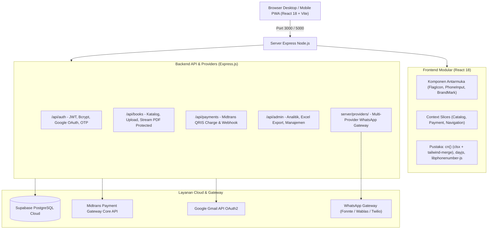

# 📖 Wahidiyah Book — Digital Library, Real Midtrans QRIS & WhatsApp Authenticator

[](https://nodejs.org/)
[](https://react.dev/)
[](https://expressjs.com/)
[](https://vitejs.dev/)
[](https://tailwindcss.com/)
[-emerald.svg)](https://supabase.com/)
[](https://midtrans.com/)
[](https://whatsapp.com/)

Perpustakaan digital modern berbasis web dengan katalog buku interaktif, pembaca PDF terproteksi, keanggotaan **Pro**, pembayaran **QRIS menggunakan Midtrans Core API (Sandbox)** sesungguhnya, serta **WhatsApp Authenticator Multi-Provider** dengan pemilih nomor internasional 245 negara dunia.

> 🎓 **Konteks Proyek Skripsi:**
> Repositori ini adalah implementasi sistem pembayaran **REAL MIDTRANS CORE API** dan **MULTI-CHANNEL AUTHENTICATOR (Email Gmail API & WhatsApp Gateway)**.
> Seluruh transaksi pembayaran QRIS di-generate secara real-time melalui server Midtrans Engine, divalidasi keaslian tanda tangan digitalnya (*SHA-512 signature key*), dan diselesaikan secara idempoten di sisi backend. Kode OTP registrasi & pemulihan akun dapat dikirim via WhatsApp resmi ke seluruh dunia.

---

## 📑 Daftar Isi
1. [Fitur Unggulan Sistem](#-fitur-unggulan-sistem)
2. [Arsitektur Sistem](#-arsitektur-sistem)
3. [Alur Pembayaran QRIS Midtrans](#-alur-pembayaran-qris-midtrans)
4. [WhatsApp Multi-Provider Gateway](#-whatsapp-multi-provider-gateway)
5. [Standar Keamanan Sistem (Security Hardening)](#-standar-keamanan-sistem-security-hardening)
6. [Prasyarat & Konfigurasi Lingkungan (.env)](#-prasyarat--konfigurasi-lingkungan-env)
7. [Panduan Instalasi & Setup Database](#-panduan-instalasi--setup-database)
8. [Panduan Menjalankan Aplikasi (NPM Scripts)](#-panduan-menjalankan-aplikasi-npm-scripts)
9. [Struktur Direktori Proyek](#-struktur-direktori-proyek)
10. [Histori Rilis & Rekam Jejak Kerja (R40–R61)](#-histori-rilis--rekam-jejak-kerja)

---

## ✨ Fitur Unggulan Sistem

### 1. Katalog Buku & E-Reader Terproteksi
- **Katalog Interaktif:** Pencarian cerdas, filter kategori, penanda buku populer, dan indikator status Pro (*locked* vs *free*).
- **Pembaca PDF Read-Only (Khusus Baca):**
  - Toolbar unduh browser dimatikan (`#toolbar=0&navpanes=0`).
  - Proteksi klik kanan (`onContextMenu preventDefault`) dan larangan seleksi (`select-none`).
  - Pengiriman konten berkas via header HTTP `Content-Disposition: inline` dengan otorisasi JWT.
- **Last Read Tracker (Ingat Halaman Terakhir):** Otomatis menyimpan progres membaca pengguna di `localStorage` dan menampilkan banner *"Lanjut membaca dari Halaman X?"*.
- **Mode Tema Pembaca:** Pilihan latar belakang **Terang**, **Sepia (Hangat)**, dan **Malam (Gelap)** untuk kenyamanan mata.

### 2. Autentikasi Pengguna & WhatsApp Multi-Provider (R61)
- **Registrasi & Verifikasi Dual-Channel:** Pengguna dapat mendaftar dengan email dan nomor WhatsApp internasional. Kode OTP 6 digit dapat dikirim via **Gmail API OAuth2** maupun pesan **WhatsApp resmi**.
- **Pemilih Kode Negara Sedunia (245 Negara):**
  - Menggunakan bendera vektor SVG resmi dari `flag-icons` di `public/flags/[iso].svg` (resolusi tajam di Windows, Linux, Android, iOS tanpa glitch teks emoji).
  - Integrasi pustaka standar Google `libphonenumber-js` untuk parsing nomor E.164 internasional dan deteksi validitas.
  - Pencarian dwibahasa (Indonesia & Inggris: *"Jepang"* / *"Japan"*, *"Arab Saudi"* / *"Saudi Arabia"*).
  - Pembuangan angka nol di awal nomor lokal secara otomatis (`0812...` ➔ `812...` dengan dial `+62`).
- **Login Akun Google:** Integrasi resmi Direct Google OAuth 2.0 dengan verifikasi token ID.
- **Sesi Aman:** Penyimpanan kata sandi dengan salt hashing `bcryptjs` (12 rounds) dan sesi berbasis token `jsonwebtoken` (JWT).

### 3. Sistem Keanggotaan Pro & Pembayaran Real Midtrans QRIS
- **Integrasi Midtrans Core API:** Charge QRIS dibuat langsung dari backend server dengan nominal dinamis (bebas dari manipulasi harga di sisi klien).
- **Simpan QRIS ke Galeri:** Konversi SVG EMVCo QRIS ke gambar PNG beresolusi tinggi via HTML5 Canvas agar dapat dipindai langsung dari galeri aplikasi e-wallet (DANA, GoPay, BCA, Livin, OVO).
- **Polling & Webhook Idempoten:** Pengecekan otomatis status transaksi setiap 3 detik dan verifikasi *SHA512 Signature Key* pada endpoint webhook notifikasi.
- **Kwitansi Pembayaran Resmi:** Faktur tanda terima digital berlogo resmi Wahidiyah Book yang siap cetak / simpan ke PDF.

### 4. Panel Administrasi Komprehensif
- **Manajemen Konten:** Unggah buku baru (thumbnail otomatis dikompresi ke format WebP via `sharp`), kelola kategori, dan deskripsi.
- **Dashboard Analitik:** Visualisasi tren pendapatan dan pertumbuhan pengguna baru menggunakan grafik kurva `recharts`.
- **Ekspor Laporan 1-Klik:** Unduh riwayat transaksi, data pengguna, dan katalog buku langsung ke format Microsoft Excel (`.xlsx`) via library `xlsx`.
- **Hero Carousel & Kalender Event:** Manajemen banner beranda dan jadwal agenda majelis.

### 5. Tema Tampilan Menyeluruh (Terang & Malam)
- **Mode Malam Aplikasi (Dark Mode):** Seluruh antarmuka mendukung palet gelap sadar-tema dengan CSS variable Tailwind.
- **Progressive Web App (PWA):** Terintegrasi Web App Manifest & Service Worker untuk instalasi ke Layar Utama (*Home Screen*).
- **Notifikasi Web Push:** Modul mandiri VAPID ES256 + enkripsi `aes128gcm` untuk pengingat agenda H-1.

---

## 🏛️ Arsitektur Sistem

Aplikasi dibangun menggunakan prinsip **Arsitektur Monolitik Terpadu (Unified Single-Port Architecture)**:



---

## 💳 Alur Pembayaran QRIS Midtrans

```
1. Pengguna memilih paket langganan Pro
   └──> Klien mengirim POST /api/payments/qris/charge

2. Server menghitung total biaya (Paket + Biaya Admin)
   └──> Memanggil Midtrans Core API (/v2/charge)
   └──> Midtrans mengembalikan qr_string (EMVCo) & URL QR PNG
   └──> Transaksi disimpan di Supabase berstatus 'pending'

3. Klien menampilkan QRIS Tajam & Tombol Simpan ke Galeri
   └──> Pengguna memindai QRIS via GoPay / BCA / DANA / Simulator Sandbox

4. Penyelesaian Transaksi (Idempoten):
   ├── Jalur A: Webhook POST /api/payments/midtrans/notification
   │   └──> Validasi SHA512 signature key -> Status 'settlement' -> Pro aktif
   └── Jalur B: Polling Status GET /api/payments/qris/:id/status
       └──> Server memverifikasi status ke Midtrans Engine -> Pro aktif

5. Klien menampilkan Layar Sukses + Animasi Confetti + Cetak Kwitansi
```

---

## 📱 WhatsApp Multi-Provider Gateway

Gateway WhatsApp menggunakan arsitektur **Strategy / Provider Pattern** di `server/providers/`:
- **Fonnte (`fonnte`)**: Provider default Indonesia.
- **Wablas (`wablas`)**: Alternatif provider lokal terpercaya.
- **WhaCenter (`whacenter`)**: Gateway alternatif berbasis device ID.
- **Twilio (`twilio`)**: Standar global resmi dengan sandbox gratis.
- **Webhook (`webhook`)**: Integrasi HTTP webhook ke gateway kustom.
- **Demo (`demo`)**: Fallback lokal tanpa token, mencetak pesan OTP rapi di terminal server.

Ganti provider kapan saja dengan mengubah satu variabel di `.env`:
```ini
WHATSAPP_PROVIDER=fonnte # atau wablas, whacenter, twilio, demo
```

---

## 🛡️ Standar Keamanan Sistem (Security Hardening)

1. **Perlindungan Password:** Bcrypt dengan salt cost 12 rounds.
2. **Otentikasi Stateless:** Token JWT berkekuatan tinggi dengan masa berlaku ketat 12 jam.
3. **Database RLS (Row Level Security):** Seluruh tabel Supabase dilindungi hak akses granular.
4. **Validasi Skema Terstruktur:** Pustaka `zod` memvalidasi seluruh input request.
5. **Anti Brute-Force Rate Limiting:** Pembatasan frekuensi request pada endpoint auth dan charge QRIS.
6. **HTTP Header Hardening:** Integrasi `helmet` untuk proteksi XSS, Clickjacking, dan MIME-sniffing.
7. **Fail-Closed Webhook Guard:** Webhook Midtrans menolak seluruh request tanpa signature digital SHA-512 yang sah.
8. **Proteksi Hak Cipta PDF:** Nonaktifkan toolbar download, streaming inline, larangan klik kanan, dan pencegahan seleksi teks.

---

## ⚙️ Prasyarat & Konfigurasi Lingkungan (.env)

### 1. Prasyarat Sistem
- **Node.js:** Versi `>= 22.0.0`
- **NPM:** Versi `>= 10.0.0`
- **Akun Layanan Cloud:**
  - Akun [Supabase](https://supabase.com/) (Database PostgreSQL)
  - Akun [Midtrans Sandbox](https://dashboard.sandbox.midtrans.com/) (Payment Gateway)
  - Google Cloud Console Project (OAuth 2.0 Client ID & Secret untuk Gmail API)
  - Akun WhatsApp Gateway (Fonnte / Wablas / Twilio) atau gunakan mode `demo`

### 2. Format Berkas `.env`
Salin template konfigurasi dari `.env.example` ke `.env`:

```env
# Port Server
PORT=5000
VITE_PORT=3000

# Konfigurasi Midtrans Sandbox
MIDTRANS_SERVER_KEY=SB-Mid-server-xxxxxxxxxxxxxxxxxxxx
MIDTRANS_CLIENT_KEY=SB-Mid-client-xxxxxxxxxxxxxxxxxxxx
MIDTRANS_IS_PRODUCTION=false
MIDTRANS_QRIS_ACQUIRER=gopay
MIDTRANS_QRIS_EXPIRY_MINUTES=15

# Konfigurasi Supabase Cloud
SUPABASE_URL=https://xxxxxxxxxxxxxxxxxxxx.supabase.co
SUPABASE_ANON_KEY=eyJhbGciOi...
SUPABASE_SERVICE_ROLE_KEY=eyJhbGciOi...

# Keamanan Sesi JWT
JWT_SECRET=rahasia-kunci-jwt-anda-minimal-32-karakter
JWT_EXPIRES_IN=12h

# Google OAuth & Gmail OTP API
GOOGLE_CLIENT_ID=xxxxxxxxxxxx.apps.googleusercontent.com
GOOGLE_CLIENT_SECRET=GOCSPX-xxxxxxxxxxxx
GMAIL_SENDER=email-pengirim@gmail.com
GMAIL_REFRESH_TOKEN=1//04xxxxxxxxxxxx

# WhatsApp Multi-Provider Gateway (fonnte | wablas | whacenter | twilio | webhook | demo)
WHATSAPP_PROVIDER=fonnte
FONNTE_TOKEN=your_fonnte_token_here
```

---

## 🚀 Panduan Instalasi & Setup Database

### 1. Kloning & Pemasangan Dependensi
```bash
git clone https://github.com/daffa-789/Wahidiyah-Book-Midtrans.git
cd "Wahidiyah Book + Real Midtrans Skripsi"
npm install
```

### 2. Migrasi Skema Database Supabase
Buka dasbor **Supabase** ➔ pilih project Anda ➔ masuk ke menu **SQL Editor** ➔ jalankan seluruh isi berkas:
```
supabase_database/full_setup.sql
```
Skrip ini akan secara otomatis membuat tabel `users` (dengan kolom `phone`), `books`, `subscriptions`, `transactions`, `email_verifications`, `events`, `hero_slides`, `push_subscriptions`, serta aturan keamanan Row Level Security (RLS).

---

## 💻 Panduan Menjalankan Aplikasi (NPM Scripts)

| Perintah Terminal | Peran & Deskripsi |
| :--- | :--- |
| **`npm run dev`** | **Mode Pengembangan (Harian):** Menjalankan backend Express dan frontend Vite sekaligus dalam 1 port terpadu dengan HMR. |
| **`npm start`** | **Mode Produksi (Siap Rilis):** Otomatis mem-build aset ke folder `dist/` lalu menyalakan server produksi di port 5000. |
| **`npm run health`** | **Uji Kesehatan Sistem (5/5 Checklist):** 1-klik periksa koneksi Cloud Supabase, tabel-tabel utama, dan status payment gateway Midtrans. |
| **`npm run check`** | **Validasi Integritas Kode:** Memeriksa sintaks server Node.js dan memastikan kompilasi bundle frontend 0 error. |
| **`npm run clean:ports`** | **Bebaskan Port Windows:** Menghentikan proses node yang macet di port 3000 / 5000 jika terminal tertutup paksa. |
| **`npm run build`** | Mengompilasi kode sumber React menjadi berkas statis siap saji di folder `dist/`. |
| **`npm run gmail:token`** | Wizard interaktif untuk mendapatkan refresh token Gmail API guna pengiriman OTP. |
| **`npm run audit:security`** | Memindai seluruh dependensi paket terhadap potensi celah keamanan. |

---

## 📁 Struktur Direktori Proyek

```
Wahidiyah Book + Real Midtrans Skripsi/
├── public/                 # Aset statis publik
│   └── flags/              # 271 vektor SVG bendera resmi seluruh negara dunia
├── scripts/                # Otomasi skrip (dev, start, health-check, clean-ports)
├── server/                 # Backend Node.js Express (ES Module)
│   ├── lib/                # Logika bisnis (midtrans, http, images, time, validate)
│   ├── middleware/         # Middleware upload multer & rate-limiter
│   ├── providers/          # Multi-Provider WhatsApp Gateway (Strategy Pattern)
│   ├── routes/             # Rute modular Express (auth, books, payments, admin, users)
│   ├── auth.js             # Otentikasi JWT & Bcrypt
│   ├── config.js           # Konfigurasi sistem & konstanta lingkungan
│   ├── db.js               # Inisialisasi klien Supabase server
│   ├── logger.js           # Logger konsol performa tinggi via picocolors
│   ├── mailer.js           # Pengirim email OTP via Gmail API OAuth2
│   ├── whatsapp.js         # Delegator pengirim OTP WhatsApp
│   └── server.js           # Titik masuk utama server Express
├── src/                    # Frontend React 18 (Vite)
│   ├── components/         # Komponen UI global (FlagIcon, PhoneInput, BrandMark, DeviceFrame)
│   ├── context/            # AppContext & Modular Slices (catalog, payment, nav)
│   ├── features/           # Halaman per fitur (home, reader, payment, admin, auth, profile)
│   ├── lib/                # Helper klien (api, countryCodes, utils/cn, date, normalizers)
│   ├── App.jsx             # Router navigasi utama
│   └── main.jsx            # Entry point React DOM
├── supabase_database/      # Skrip DDL & patch PostgreSQL Supabase (full_setup.sql)
├── docs/                   # Dokumentasi teknis komprehensif
├── Master_Memory_Workflow.md # Single Source of Truth teknis sistem terpadu
├── package.json            # Manifest dependensi & skrip proyek
└── README.md               # Dokumentasi utama proyek
```

---

## 📓 Histori Rilis & Rekam Jejak Kerja

| Rilis | Tanggal | Ruang Lingkup & Pencapaian | Status |
| :---: | :---: | :--- | :---: |
| **R40–R50** | 30 Sep – 05 Okt 2026 | Refaktor penanggalan WIB, arsitektur single-port, Google Direct OAuth 2.0, audit keamanan RLS Supabase, dekomposisi context slice, library terstandar (`dayjs`, `zod`, `picocolors`). | ✅ Selesai |
| **R51** | 06–07 Okt 2026 | Integrasi Real Midtrans Core API (Sandbox), koreksi EMVCo `qr_string` 244 karakter, migrasi kolom database, dan uji E2E 10/10 lulus. | ✅ Selesai |
| **R52** | 07–08 Okt 2026 | Proteksi PDF read-only (`#toolbar=0`), Last Read Tracker, tema pembaca 3 mode, simpan QRIS PNG galeri, dan kwitansi resmi. | ✅ Selesai |
| **R53** | 08 Okt 2026 | Tema Malam (dark mode) menyeluruh dengan token warna sadar-tema CSS variable. | ✅ Selesai |
| **R54–R56** | 08–10 Okt 2026 | Integrasi Zotero, Web Push Notification agenda H-1, identitas visual `BrandMark` SVG, ekspor Excel lazy. | ✅ Selesai |
| **R57–R60** | 09–10 Okt 2026 | Optimasi helper error `http.js`, penyatuan komponen bersama, 4 Activity Diagram bebas tembusan, perbaikan namespace layar auth. | ✅ Selesai |
| **R61** | 13 Okt 2026 | **WhatsApp Authenticator Multi-Provider + Bendera Vektor Sedunia.** Integrasi nomor HP internasional (`users.phone`), Multi-Provider WhatsApp Gateway (`Fonnte`, `Wablas`, `Whacenter`, `Twilio`, `Webhook`, `Demo`), komponen `FlagIcon` + `PhoneInput` 245 negara dunia, pustaka `libphonenumber-js`, `clsx`, `tailwind-merge` (`cn()`), pemadatan memori, dan pembersihan berkas usang. | ✅ Selesai |

---

## 👨‍💻 Informasi Pengembang & Skripsi

- **Pengembang:** Daffa
- **Topik Penelitian Skripsi:** Rancang Bangun Sistem Perpustakaan Digital Wahidiyah Berbasis Web dengan Pembaca PDF Terproteksi, Keanggotaan Pro, Pembayaran QRIS via Midtrans Core API, dan Autentikasi Multi-Channel WhatsApp
- **Repositori Resmi:** `daffa-789/Wahidiyah-Book-Midtrans`
- **Lisensi:** Private / Skripsi Project (Hak Cipta Dilindungi)
