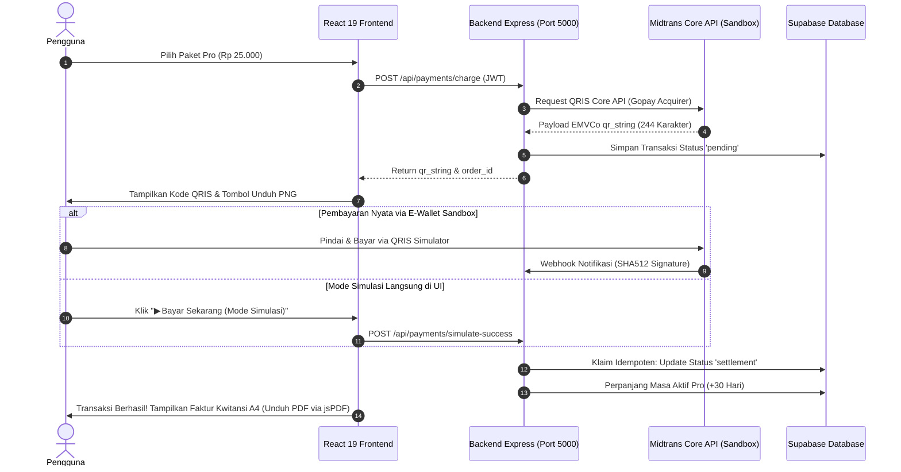

# 📚 Wahidiyah Book — Digital Library & Midtrans QRIS

**Perpustakaan digital** dengan sistem **membership Pro** dan pembayaran **QRIS via Midtrans Core API (Sandbox)** — aplikasi web full-stack: **Express + React 19 + Vite 6 + TailwindCSS 4 + Supabase (PostgreSQL)** dengan arsitektur *Modular Layered Monolith* (Express sekaligus melayani REST API dengan decoupled Service Layer dan hasil build SPA, serta mendukung deployment serverless Vercel).

[](https://nodejs.org/)
[](https://expressjs.com/)
[](https://react.dev/)
[](https://vitejs.dev/)
[](https://tailwindcss.com/)
[](https://vitest.dev/)
[-3fcf8e?logo=supabase&logoColor=white)](https://supabase.com/)
[-0052cc)](https://midtrans.com/)
[](https://vercel.com/)
[](./LICENSE)

---

## ✨ Fitur Unggulan

- 📖 **Katalog Buku Digital Minimalis** — Jelajahi koleksi buku dan manuskrip Sholawat Wahidiyah dengan antarmuka elegan ala e-reader (fokus sampul jilid & judul) dan pencarian instan.
- 📕 **Universal Document Reader (Continuous Vertical Scroll)** — Baca naskah buku langsung di peramban tanpa software eksternal:
  - **PDF Continuous Scroll:** Kanvas Mozilla PDF.js murni dengan gulir vertikal kontinyu, auto scroll-spy sinkronisasi halaman, fixed-aspect sheet, zoom anchor (teks tidak melompat), dan tombol kontrol zoom berdampingan dengan fullscreen.
  - **Mammoth Word DOCX:** Dikonversi ke HTML semantik terproteksi dengan sanitasi anti-XSS (`DOMPurify`).
  - **Proteksi Konten:** Tanda air dinamis (nama pembaca & ID transaksi), larangan seleksi teks (`select-none`), dan pemblokiran menu klik kanan (`onContextMenu preventDefault`).
- 💳 **Membership Pro & QRIS Real Midtrans Sandbox** — Sistem keanggotaan Pro tunggal (Rp 25.000) terintegrasi gateway **Midtrans Core API**:
  - Payload EMVCo QRIS dinamis dengan hitung mundur 15 menit.
  - Unduh gambar QR PNG resolusi tinggi untuk pembayaran via galeri e-wallet (BCA, Mandiri, DANA, GoPay).
  - Tombol *"Salin Kode QR String"* dan tautan langsung ke *Midtrans QRIS Simulator*.
  - Tombol *"▶ Bayar Sekarang (Mode Simulasi)"* langsung di UI via flag `ALLOW_PAYMENT_SIMULATION=1` untuk kemudahan demo sidang skripsi.
  - Polling status otomatis 3 detik dan webhook notifikasi ber-signature SHA512 idempoten.
- 🧾 **Kwitansi Digital Resmi A4 (Client-Side PDF)** — Pembuatan bukti transaksi A4 berdesain profesional dengan kop hijau zamrud, dua kolom metadata, rincian biaya, dan stempel verifikasi resmi yang diunduh langsung via pustaka `jspdf` tanpa dialog cetak browser.
- 👤 **Cupertino Inset Grouped Profile Hub** — Halaman profil modern ala iOS dengan kartu identitas taktil dan Data Akun di posisi teratas, switch slider tema gelap/terang, dan integrasi terpadu sub-halaman sekunder (Riwayat Langganan, Pusat Bantuan, dan Tentang Aplikasi).
- 🔙 **Universal Sticky Top Back Button Header** — Header navigasi sub-halaman seragam (`← [Judul]`) di **Desktop, Tablet, dan Mobile** dengan margin responsif terhadap sidebar dan mekanisme *smart fallback navigation*.
- 🔐 **Autentikasi Dual-Channel Terkendali** — Registrasi akun 100% via Email OTP (Gmail API OAuth2) bebas biaya API dan anti-flooding, dengan alokasi WhatsApp Multi-Provider (Fonnte, Wablas, WhaCenter, Twilio, Webhook) sebagai kanal pemulihan sekunder (*Secondary Fallback Lupa Password*), serta Google Sign-In.
- 🛠️ **Panel Administrasi Modular (6 Sub-Tabs)** — Didekomposisi menjadi komponen terisolasi (`OverviewTab`, `BooksTab`, `UsersTab`, `EventsTab`, `CarouselTab`, `LogsTab`) dengan grafik analitik kurva Recharts dan ekspor laporan Excel 1-klik via `exceljs`.
- 📅 **Kalender Agenda Majelis Mujahadah** — Matriks agenda bulanan dengan zona waktu terstandarisasi `Asia/Jakarta` (WIB) dan tautan presisi rute navigasi Google Maps.
- 🛡️ **Arsitektur Bersih & 30 Indikator Security Hardening** — Skema 7 tabel inti Supabase (PostgreSQL) ber-RLS fail-closed, bebas dead code, mitigasi celah *self-demotion*, validasi Zod ketat, rate limiting transaksi, dan lulus 17 pasang kontras WCAG AA $\ge 4.5:1$.

---

## 🏗️ Arsitektur Sistem

Aplikasi menerapkan pola **Modular Layered Monolith** dengan Service Layer terpisah:

```
┌─────────────────────────────────────────────────────────────┐
│ Express 4 (Unified Single-Port / Vercel Serverless api/)    │
│                                                             │
│ /api/*  ──►  routes/ (thin URL routing & middlewares)       │
│               └──► controllers/ (DTO extraction & Zod)      │
│                     └──► services/ (pure business logic)    │
│                           └──► Supabase Client / Midtrans   │
│                                                             │
│ /*       ──►  SPA React 19 + Vite 6 (Single Page App)       │
│                                                             │
│ Mode dev: vite.middlewares (HMR)                            │
└──────────────────────────────┬──────────────────────────────┘
                               ▼
        Supabase (PostgreSQL) ─── Midtrans Core API
```

---

## 📁 Struktur Proyek Terpadu

```text
Wahidiyah-Book-Midtrans/
├── api/                    # Serverless Functions (Vercel Entry Point api/index.js)
├── docs/diagrams/          # Diagram UML resmi (draw.io, use case, activity, sequence)
├── document skripsi/       # Berkas proposal, otomasi skripsi, dan generator diagram
├── public/                 # Aset statis publik (bendera SVG 271 negara, logo pembayaran)
├── scripts/                # Otomasi pengembang (check-syntax, check-colors, check-contrast, dll.)
├── server/                 # Backend Node.js Express (ES Module)
│   ├── controllers/        # auth.controller.js, payment.controller.js
│   ├── services/           # auth.service.js, payment.service.js (Pure Service Layer)
│   ├── lib/                # midtrans.js, time.js, validate.js, images.js, otp.js, http.js
│   ├── middleware/         # authJwt, requireAdmin, securityHeaders, rateLimiters
│   ├── providers/          # WhatsApp Gateway Multi-Provider Strategy Pattern
│   ├── routes/             # auth, books, payments, admin, users, events, carousel
│   ├── mailer.js           # Gmail API OAuth2 (google-auth-library)
│   ├── whatsapp.js         # Delegator pengirim OTP WhatsApp
│   └── server.js           # Entry point Express server
├── src/                    # Frontend React 19 (Vite SPA)
│   ├── components/         # DeviceFrame, FlagIcon, PhoneInput, BrandMark, ContinuousPdfViewer
│   ├── context/            # AppContext & Modular Slices (catalog, payment, nav)
│   ├── features/           # auth, home, book, reader, payment, subscription, admin, profile, help
│   ├── lib/                # api, countryCodes, styles, utils/cn, date, normalizers
│   ├── App.jsx             # Router navigasi utama
│   └── main.jsx            # Entry point React DOM
├── supabase_database/      # Skrip DDL 7 tabel inti (full_setup.sql, carousel_slides.sql)
├── tests/                  # 102 unit tests Vitest (auth, payment, membership, parsing, sanitize)
├── .env                    # Konfigurasi environment terproteksi
├── package.json            # Manifest dependensi & skrip proyek
├── vercel.json             # Konfigurasi deployment serverless Vercel
├── ARCHITECTURE.md         # Cetak biru arsitektur & standar rekayasa perangkat lunak
├── DESIGN.md               # Spesifikasi sistem desain 3-Color Key & Cupertino UI
└── Master_Memory_Workflow.md # SATU-SATUNYA MEMORY & SUMBER KEBENARAN DOKUMENTASI SISTEM
```

---

## 🚀 Quick Start

### Prasyarat
- **Node.js ≥ 24** (didukung pula pada Node 22)
- Akun **Supabase Cloud** (PostgreSQL) dan akun **Midtrans Sandbox**

### Pemasangan & Mode Pengembangan
```bash
# 1. Pemasangan dependensi
npm install

# 2. Setup database: Jalankan supabase_database/full_setup.sql di Supabase SQL Editor

# 3. Konfigurasi .env (lihat template di Master_Memory_Workflow.md)

# 4. Jalankan mode pengembangan terpadu (HMR satu port di http://localhost:5000)
npm run dev
```

### Build & Menjalankan Mode Produksi
```bash
npm run build        # Kompilasi aset Vite ke folder dist/
npm start            # Menjalankan server produksi di port 5000
npm run health       # Uji kesehatan 6/6 checklist koneksi cloud & gateway
```

---

## 🧪 Pengujian & Verifikasi Kualitas (Quality Harness)

Sebelum melakukan perubahan kode atau commit ke git, jalankan perintah pengujian komprehensif:

```bash
npm test
```

Pipeline `npm test` secara otomatis mengeksekusi 4 tahap validasi berturut-turut:
1. **Validasi Sintaks:** Memeriksa AST 62 berkas JavaScript tanpa error (`node scripts/check-syntax.js`).
2. **Audit 3-Color Key:** Memastikan seluruh elemen UI patuh pada proporsi 60-30-10 tanpa kelas Tailwind mentah non-token (`node scripts/check-colors.js`).
3. **Audit Kontras WCAG AA:** Memverifikasi 17 pasangan warna kontras teks $\ge 4.5:1$ dan non-teks $\ge 3:1$ (`node scripts/check-contrast.js`).
4. **Pengujian Unit Otomatis (Vitest):** Mengeksekusi 102 automated unit tests di `tests/` dengan 100% kelulusan (`vitest run`).

---

## 💳 Alur Pembayaran QRIS (Midtrans Sandbox)



---

## 📖 Dokumentasi Master (Single Source of Truth)

Dokumentasi teknis lengkap, naskah akademik, spesifikasi REST API rinci, skema DDL SQL, standar Zotero SINTA, dan rekam jejak rilis terkonsolidasi penuh dalam:

👉 [**`Master_Memory_Workflow.md`**](./Master_Memory_Workflow.md)

---

Dibuat dengan dedikasi untuk Perpustakaan Sholawat Wahidiyah oleh **Ghazalah Ramadhan Daffa Firjatullah** (NIM: 20232210156).
