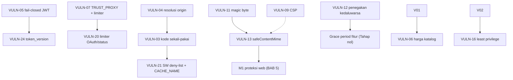
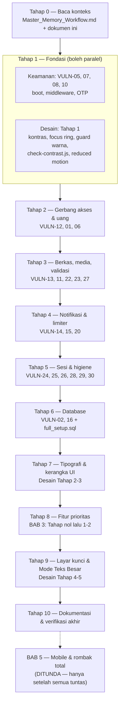

# MASTER-PLAN — Aplikasi Buku Wahidiyah (Edisi 2 — Diperluas)

Dokumen gabungan tunggal untuk seluruh rencana perbaikan dan pengembangan. Gabungan dari lima dokumen: `Security-and-Fixing.md`, `design-plan-improve.md`, `Next-Feature.md`, `mobile-and-content-protection.md`, dan indeks `README.md` (kelima berkas itu tetap ada di folder ini sebagai **arsip detail** — jika butuh penjelasan panjang per temuan, buka arsipnya).

> **Status 23 Okt 2026 — SELESAI PENUH (TAHAP 1 HINGGA 10 LENGKAP)**
> Seluruh rencana eksekusi web (BAGIAN 0 s/d BAB 4, Tahap 1–10) telah 100% tuntas diimplementasikan dan diverifikasi penuh:
> - **BAB 1 Keamanan:** VULN-01 s/d VULN-21 tuntas, CSP report-only aktif, limiter akun terpasang, validasi origin terlindungi.
> - **BAB 2 Desain:** D-01 s/d D-16 tuntas, WCAG AA lulus (17/17 pasang), skeleton loaders terpasang, tipografi rem konsisten, Mode Teks Besar untuk lansia aktif.
> - **BAB 3 Fitur Web:** Pencarian katalog, filter kategori, pengurutan, "Lanjutkan Membaca", progres membaca server, pembatas buku/bookmarks selesai.
> - **BAB 5 Proteksi Konten:** M1 (watermark pembaca, contextmenu disable, text selection disable) selesai di web. M2–M5 (Mobile App Native Expo terpisah) ditunda pasca-skripsi.
> Laporan eksekusi lengkap & bukti uji otomatis: [`EXECUTION-REPORT.md`](./EXECUTION-REPORT.md).

- Basis kode saat audit: branch `Whatsaap-authenticator`, commit `2f2b769`
- Tanggal penyusunan: 21–22 Oktober 2026 — Edisi 2 memperluas gabungan Edisi 1 dengan model ancaman, peta dependensi, matriks regresi, rencana commit/rollback, inventaris layar, pemetaan WCAG, skema data & kontrak API usulan, checklist per tahap, register risiko, dan lampiran templat.
- Total cakupan: **30 temuan keamanan** (VULN-01…VULN-30), **16 temuan desain** (D-01…D-16), **53 kandidat fitur**, **5 tahap mobile & proteksi konten** (M1…M5 — ditunda)
- Metode seluruh audit: **verified-by-reading** (pembacaan kode, perhitungan kontras numerik, query read-only Supabase). Belum ada PoC exploit, `npm audit` belum dijalankan, tangkapan layar peramban belum diperiksa.
- Dokumen ini sekaligus berfungsi sebagai **prompt eksekusi**: arahkan AI ke folder ini atau salin dokumennya utuh — AI tidak perlu mengaudit ulang.
- Konvensi tanda: tabel/daftar tanpa label = **fakta terverifikasi dari audit**. Blok berlabel **"Usulan"** = rancangan yang boleh disesuaikan saat eksekusi, bukan fakta repo.

## PETA DOKUMEN

| Bagian | Isi | Status |
|---|---|---|
| BAGIAN 0 | Konteks, invarian, aturan keras, kamus, peta kode, model ancaman, matriks persetujuan | Wajib dibaca sebelum semua |
| BAB 1 | Keamanan web — 30 temuan, kriteria, dependensi, regresi, alur target, SQL, uji, env, commit, rollback | Kerjakan sekarang |
| BAB 2 | Desain web — color key, kontras terukur, 16 temuan, inventaris layar, Tahap 1–5, WCAG, QA | Kerjakan sekarang |
| BAB 3 | Fitur web — celah, 53 kandidat, skoring, skema & API usulan, kriteria per tahap | Setelah fondasi aman |
| BAB 4 | Urutan eksekusi 10 tahap, peta konflik, gerbang verifikasi, checklist, risiko, laporan | Panduan eksekusi |
| BAB 5 | Mobile & proteksi konten M1–M5 | **DITUNDA** (pengecualian M1 — §5.0) |
| LAMPIRAN | Templat DoD, templat laporan, perintah cepat, indeks silang berkas→VULN | Referensi eksekusi |

---

# BAGIAN 0 — KONTEKS & ATURAN (WAJIB DIBACA SEBELUM SEMUA)

## 0.1 Konteks minimum repo

Agar tidak perlu menemukan ulang:

| Aspek | Nilai |
|---|---|
| Klien | React 19 + Vite + Tailwind CSS v4 (`src/`) |
| Server | Express 4, ESM, Node >= 22 (`server/`) |
| Database | Supabase Postgres, project `pdimjmbjutlzjdfjaqgt` (`supabase_database/full_setup.sql`) |
| Pembayaran | Midtrans Core API QRIS + jalur transfer manual untuk skripsi |
| Autentikasi | JWT 12 jam (klaim hanya `{ sub }`), bcrypt cost 12, OTP WhatsApp/email, Google OAuth |
| Platform | PWA dengan service worker (`public/sw.js`), app-shell + CacheStorage |
| Desain | Token terpusat di `component.json`, tema via CSS variable, arah "Editorial Elegan" + aturan 3 Color Key 60-30-10 |
| Penyimpanan media | Data URI base64 di kolom tabel (skema `storage` kosong — 0 bucket, 0 policy) |
| Limiter | `express-rate-limit` global auth 30 req/15 menit + limiter khusus pembayaran (kunci `req.socket.remoteAddress`) |
| State klien | React Context + slice (`src/context/slices/`), pola respons `{ success, ... }`, pesan berbahasa Indonesia |
| Penjadwal | `startReminderScheduler` (hanya agenda — tidak menyapu langganan) |
| Dokumen hidup | `Master_Memory_Workflow.md` di akar repo (arsitektur, konvensi, indikator, roadmap §15) |

## 0.2 Invarian yang tidak boleh dilanggar

1. **RLS otomatis aktif.** Event trigger `rls_auto_enable` menyalakan RLS pada setiap tabel baru di skema `public`. Tanpa policy artinya **default deny**. Setiap tabel baru wajib disertai policy eksplisit dan pembaruan `full_setup.sql`. *Cara menegakkan: setiap migration baru menyertakan blok `ALTER TABLE ... ENABLE ROW LEVEL SECURITY` + policy, dan ditambahkan ke `full_setup.sql` pada commit yang sama.*
2. **Konten berbayar tidak pernah dicache.** `public/sw.js:51-59` adalah deny-list; endpoint sensitif baru wajib ditambahkan, dan `CACHE_NAME` harus di-bump setiap deploy. *Cara menegakkan: setiap rute baru di `server/routes/` dicek terhadap daftar itu; arah akhirnya allow-list (§3.8 poin 6).*
3. **Server memegang kebenaran harga.** Harga paket diambil dari `server/lib/constants.js` (`findPlan`), bukan dari body permintaan. *Cara menegakkan: uji unit yang memastikan nominal klien bertentangan ditolak 400.*
4. **Token tidak membawa wewenang.** `requireAuth` selalu memuat ulang pengguna dari database; `role` hanya boleh dibaca dari baris database. *Cara menegakkan: tidak menambah klaim `role`/`is_pro` ke payload; uji bahwa token dengan klaim palsu tetap mengikuti database.*
5. **Media disimpan sebagai data URI base64 di kolom tabel.** Ada plafon unggah 25 MB dan tanpa dukungan `Range`/streaming sampai migrasi object storage (Tahap nol fitur). *Cara menegakkan: sampai migrasi, jangan menaikkan batas Multer; setelah migrasi, kolom base64 dihapus lewat migrasi terpisah yang terverifikasi.*
6. **`npm run check` adalah gerbang wajib** (sintaks + warna + `vite build`). Ada `overrides.uuid` di `package.json` yang harus dipertahankan. *Cara menegakkan: tidak ada commit yang melangkahi gerbang; skrip baru (`test`, `check:contrast`) digabung ke dalamnya.*

## 0.3 Aturan keras bersama (menggantikan aturan per-dokumen bila berbeda)

- **Satu cabang untuk eksekusi gabungan:** `improve/all-plans`. Nama cabang pada dokumen arsip (`security/hardening`, `design/accessibility-overhaul`) hanya berlaku bila dokumen itu dijalankan terpisah.
- Commit per tahap dengan gaya repo (`fix:`, `feat:`, `refactor:`, `docs:`). **Jangan pernah `git push`.**
- **Jangan menyunting `.env`.** Variabel baru cukup didokumentasikan dan dilaporkan sebagai "harus diset manual" beserta nilai produksi yang disarankan.
- **Jangan menambah dependensi npm.** Gunakan bawaan Node (`node:test`, `node:assert`, `crypto`) dan perkakas yang sudah ada (`sharp`, `ExcelJS`). Satu-satunya pengecualian di masa depan: pustaka mobile pada BAB 5, di proyek Expo terpisah.
- Jangan mengubah kontrak rute atau bidang respons yang sudah dipublikasikan; bila terpaksa, perbarui pemanggil di klien pada commit yang sama.
- Pertahankan jalur **transfer manual** (`POST /api/transactions` + verifikasi admin) karena itu bagian khusus skripsi — perbaiki, jangan hapus.
- Pertahankan **identitas visual** dan aturan 3 Color Key. Jangan menukar warna langsung dengan hex di komponen; ubah tokennya di `component.json` beserta fallback di `src/index.css`.
- Komentar dan laporan akhir **berbahasa Indonesia**; pertahankan komentar lama, tambahkan yang baru hanya pada logika yang tidak jelas.
- Skrip `npm` harus tetap kompatibel `cmd` (Windows), tanpa sintaks POSIX.
- Jangan mengubah klaim fakta produk secara diam-diam. Bila UI menjanjikan sesuatu yang belum ada (mis. "Sinkronisasi riwayat pembacaan offline"), **laporkan sebagai keputusan produk**, jangan sekadar diganti kalimatnya.
- Jangan merotasi kredensial. Laporkan bila menurut Anda perlu.

## 0.4 Kamus istilah

| Istilah | Arti dalam repo ini |
|---|---|
| RLS | Row Level Security — pembatasan baris pada level Postgres, di luar aplikasi |
| Policy | Aturan RLS per operasi (`USING` untuk baca, `WITH CHECK` untuk tulis) |
| Default deny | Tabel ber-RLS tanpa policy = tidak ada akses sama sekali dari klien |
| Service-role key | Kunci Supabase yang **melewati RLS**; hanya boleh hidup di server |
| Anon key | Kunci publik Supabase yang ikut bundle Vite; dibatasi RLS + grant |
| Data URI base64 | Media disimpan sebagai teks `data:<mime>;base64,…` di kolom tabel |
| Service worker / CacheStorage | Skrip PWA yang menyimpan respons untuk offline; cache manual tidak menghormati `Cache-Control` |
| Deny-list / allow-list cache | Pola kecualian (jangan cache X) vs pola izin (hanya cache X) |
| `findPlan` | Fungsi katalog harga server di `server/lib/constants.js` |
| `effectiveIsPro` / `hasActivePro` | Flag Pro dari kolom vs penegakan kedaluwarsa (yang belum ada) |
| Grant konten | JWT pendek (±10 menit) terikat `user_id`+`book_id` untuk mengambil bytes PDF |
| Text layer pdf.js | Lapisan teks terpilih di atas kanvas render PDF — sumber salin-teks |
| `FLAG_SECURE` | Flag Android (via `expo-screen-capture`) yang menghitamkan tangkapan layar & app switcher |
| Exposur OTP dev | Menyertakan kode OTP di respons HTTP untuk kemudahan pengembangan |
| `token_version` | Penghitung di baris pengguna untuk mencabut semua token lama sekaligus |
| 60-30-10 | Proporsi warna: 60% dasar krem, 30% struktur tinta, 10% aksen zamrud/emas |
| AA / AAA | Ambang kontras WCAG 2.1: 4.5:1 dan 7:1 untuk teks normal |
| Verified-by-reading | Audit berbasis pembacaan kode + query read-only, tanpa exploit hidup |
| Object storage + signed URL | Penyimpanan berkas Supabase dengan URL bermasa berlaku — pengganti base64 |
| TWA | Trusted Web Activity — pengemas PWA ke Google Play via Bubblewrap |
| M1–M5 | Tahap mobile & proteksi konten pada BAB 5 |

## 0.5 Peta permukaan kode (modul yang disentuh rencana)

| Modul / berkas | Peran | Sentuhan rencana |
|---|---|---|
| `server/config.js` | Parsing env, daftar rute ter-limiter | VULN-01, 07, 09, 20 |
| `server/auth.js` | JWT, `requireAuth`, keanggotaan, `settleExpiredMembership` (`:84-107`) | VULN-05, 12, 24 |
| `server/db.js` | Klien Supabase (service/anon) | VULN-10 |
| `server/lib/validate.js` | Skema zod | VULN-27; bidang fitur baru |
| `server/lib/constants.js` | `BOOK_FIELDS`, `SUBSCRIPTION_PLANS` | VULN-15; multi-plan |
| `server/lib/http.js` | `sendDataUrl`, pemetaan galat | VULN-13 |
| `server/lib/otp.js` | Generator & verifikator OTP | VULN-08 |
| `server/lib/webpush.js`, `eventReminder.js` | Push & pengingat | VULN-14; pengingat perpanjangan |
| `server/lib/membership.js` | `activatePaidMembership`, `planDaysFromPeriod` | VULN-12; multi-plan |
| `server/lib/images.js` | Kompresi avatar | VULN-22 |
| `server/middleware/security.js` | Helmet/CSP, limiter, batas body | VULN-07, 09 |
| `server/middleware/uploads.js` | Multer | VULN-11 |
| `server/middleware/requestLog.js` | Log permintaan | VULN-25 |
| `server/routes/auth.routes.js` | Login, OTP, Google, reset | VULN-03, 04, 08, 20, 26, 29; fitur sesi |
| `server/routes/books.routes.js` | Katalog, konten, thumbnail | VULN-12, 13, 15, 23; fitur katalog; M1 |
| `server/routes/transactions.routes.js` | Transfer manual | VULN-06 |
| `server/routes/payments.routes.js` | QRIS, webhook, simulasi | VULN-01, 20; (VULN-21 sisi SW) |
| `server/routes/notifications.routes.js` | Push subscribe/unsubscribe | VULN-14 |
| `server/routes/users.routes.js` | Profil, kelola pengguna | VULN-17, 18, 22, 27, 29, 30 |
| `server/routes/admin.routes.js`, `health.routes.js` | Log admin, statistik | VULN-30 |
| `public/sw.js` | Service worker | VULN-21; aturan fitur baru |
| `scripts/check-colors.js`, `check-syntax.js`, `health-check.js` | Guard & health | D-04; VULN-19; uji `tests/` |
| `component.json`, `src/index.css`, `tailwind.config.js` | Token & fallback | Desain Tahap 1–2 |
| `src/App.jsx`, `src/lib/styles.js` | Loading shell, kelas tipografi | D-09, D-01 |
| `src/features/**` | Layar (home, subscription, reader, calendar, admin, profile, payment) | Desain Tahap 2–5; fitur |
| `src/lib/api.js`, `src/lib/reminders.js` | Sesi klien, pengingat klien | VULN-21 (bersih-bersih cache); pengingat server |
| `src/data/mockData.js` | Teks HELP statis | D-11; FAQ dinamis |
| `supabase_database/full_setup.sql` | Sumber kebenaran skema & policy | VULN-02, 16; tabel fitur |
| `package.json` | Skrip & overrides | `test`, `check:contrast` |

## 0.6 Model ancaman ringkas

| Aset | Ancaman utama | Kontrol yang sudah ada | Celah (VULN) |
|---|---|---|---|
| Kredensial & sesi | Pencurian token, brute force, fixasi sesi | bcrypt 12, OTP kuat, `requireAuth` memuat ulang DB | 03, 04, 07, 24 |
| Uang & langganan | Pro gratis, harga palsu, langganan abadi | Tanda tangan webhook, settle idempoten, cek nominal | 01, 06, 12 |
| Data pembayaran (QRIS) | Kebocoran massal + insert sampah | RLS umum di 9 tabel | 02 |
| Konten premium | Ambil berkas tanpa bayar, XSS tersimpan | Gate `is_pro`, deny-list SW, `requireAdmin` unggahan | 12, 13, 21 |
| Panel admin | Lockout total, kredensial plaintext, endpoint mahal | `requireAdmin`, blokir hapus-diri | 17, 18, 30 |
| Identitas jamaah | Pelacakan, enumerasi, profil disisip | Tidak ada mass-assignment profil | 22, 26, 29 |
| Infrastruktur server | SSRF via push, pembekuan siaran, DoS publik | Anti-SSRF khusus QR (`*.midtrans.com`) | 14, 15, 20 |
| Log & riwayat | Token/OTP tertulis permanen | `X-Request-Id` ada | 25, 28 |

Bacaan model ancaman: dua aset dengan celah **aktif** (uang & data pembayaran) didahulukan — sesuai Tahap 2 BAB 4.

## 0.7 Koreksi hasil verifikasi (22 Oktober 2026, terhadap HEAD `2f2b769`)

Seluruh 30 temuan keamanan dan 13 dari 16 temuan desain **terverifikasi masih benar** di HEAD. Empat koreksi berikut ditemukan saat pembacaan ulang berkas dan sudah diperbaiki di dokumen ini:

| # | Dokumen semula | Kenyataan di kode | Tindak lanjut |
|---|---|---|---|
| K-1 | §1.3 & §1.9: `qris_transactions` punya 2 policy publik; "tidak ada policy UPDATE" | `full_setup.sql:401-403` membuat Read + Insert + **Update** (`TO anon, authenticated USING (status='WAITING_PAYMENT') WITH CHECK (status IN ('PAID','CANCELLED'))`), lalu `:509` menjatuhkan yang Update. File self-contradictory dan §1.9 hanya DROP 2 policy. | SQL §1.9 diperluas ke tiga policy idempoten; **verifikasi state DB live sebelum menganggap VULN-02 hanya kebocoran baca**. Bila policy Update masih hidup di live, anon bisa menandai transaksi PAID → eskalasi, bukan sekadar bocor. |
| K-2 | §0.5: `settleExpiredMembership` di `server/lib/membership.js` | Fungsi ada di **`server/auth.js:84-107`**. `server/lib/membership.js` hanya mengimpor `effectiveIsPro`. Helper `hasActivePro` **belum ada** di repo. | Peta kode §0.5 diperbaiki; helper baru tetap ditempatkan di `server/auth.js` (sebaris dengan `effectiveIsPro`). |
| K-3 | §2.3 D-04 "Guard warna berlubang: hanya melarang `bg-white`/`bg-black`/`text-black`" | **Sudah diperbaiki** oleh commit `ab8e352`: `scripts/check-colors.js` kini melarang 22 palet Tailwind mentah + mono, whitelist 2 berkas, dan sudah tersambung ke `npm run check`. | D-04 turun jadi **Low (sisa)**: yang tersisa hanya menambah larangan `text-white`/`ring-black`/`border-white`/`bg-[#…]` — dan itu menabrak **55 kemunculan `text-white`** di `src/`, jadi butuh commit migrasi sendiri. |
| K-4 | §2.3 D-05 "`DESIGN.md` tidak ada di repo" | Berkas ada di **`Research Design/DESIGN.md`** (167 baris, dibuat `ab8e352`), tapi `check-colors.js:7,13,84` dan `tailwind.config.js:60` merujuk `DESIGN.md` tanpa path sehingga tidak terselesaikan. | D-05 jadi **pindahkan/salinkan ke akar repo**, bukan tulis ulang dari nol. |

Temuan tambahan di luar katalog (ikut dikerjakan pada VULN-10): `server/db.js:22` menaruh **literal publishable key fallback** di dalam sumber, sehingga `supaKey` tidak pernah kosong dan `supabaseServer` tidak pernah null. Kunci itu publik secara desain (sudah ikut bundle Vite), tapi fallback hardcoded tetap harus hilang.

## 0.8 Matriks persetujuan pemilik

| Boleh langsung dikerjakan | Wajib tanya dulu |
|---|---|
| Semua perbaikan sesuai kriteria penerimaan §1.2 | Merotasi kredensial apa pun |
| Perubahan token desain di `component.json` + fallback | Menghapus rute/fitur yang ada |
| Menambah uji, skrip guard, dan lampiran gerbang | Mengubah kontrak respons API yang sudah dipublikasikan |
| Menambah tabel + policy di `full_setup.sql` | Mengganti identitas visual (warna/font/arahan) |
| Menyesuaikan komentar & dokumentasi repo | Mengubah klaim fakta produk (laporkan, jangan sunting diam-diam) |
| Menambah variabel env **di dokumentasi** (bukan `.env`) | Menambah dependensi npm |

---

# BAB 1 — KEAMANAN (VULN-01…VULN-30) — WEB

Hasil tiga putaran audit white-box. **5 High** (VULN-01, 02, 03, 04, 12), 1 Med-High, 7 Medium, 5 Low-Med, 12 Low. Tiga temuan **aktif saat ini** (bukan risiko laten): VULN-01, VULN-02, VULN-12.

## 1.1 Tabel 30 temuan

| ID | Temuan | Severity | Lokasi utama |
|---|---|---|---|
| VULN-01 | ✅ **fixed** — Rute `simulate-paid` aktif karena gerbangnya hanya satu flag env | High | `server/routes/payments.routes.js:371`, `server/config.js:51`, `.env` |
| VULN-02 | ✅ **fixed** — Anon dapat membaca seluruh transaksi QRIS dan menyisipkan baris | High | tabel legacy `qris_transactions` dibuang 23 Okt 2026 (`full_setup.sql`) |
| VULN-03 | ✅ **fixed 23 Okt 2026** — JWT sesi dikirim melalui query string pada redirect sukses | High | `server/lib/oneTimeCode.js`, `server/routes/auth.routes.js` |
| VULN-04 | ✅ **fixed 23 Okt 2026** — Host header dipercaya: open redirect, pencurian token, dan XSS | High | `server/lib/origin.js`, `server/routes/auth.routes.js` |
| VULN-05 | ✅ **fixed** — Secret JWT cadangan hardcoded + gagal-terbuka saat env kosong | Med-High | `server/auth.js:6-11` |
| VULN-06 | ✅ **fixed** — `POST /api/transactions` menerima nominal dari klien | Medium | `server/routes/transactions.routes.js:124-135`, `:154-155` |
| VULN-07 | ✅ **fixed** — Rate limit OTP berbasis alamat socket, `trust proxy` nonaktif | Medium | `server/middleware/security.js:35-43`, `server/config.js:29-42` |
| VULN-08 | ✅ **fixed** — Kode OTP dapat bocor di respons bila `NODE_ENV=development` | Medium | `server/lib/otp.js:22`, `server/routes/auth.routes.js:157`, `:270-282`, `:323-331` |
| VULN-09 | ✅ **fixed 23 Okt 2026** — CSP dimatikan dan `CORS_ORIGINS` tidak diset | Low-Med | `server/config.js` (`CSP_DIRECTIVES`), `server/middleware/security.js` |
| VULN-10 | ✅ **fixed** — Klien database turun ke anon key hanya dengan peringatan | Low | `server/db.js:18-24`, `:31-39` |
| VULN-11 | ✅ **fixed 23 Okt 2026** — Unggahan tanpa allowlist jenis berkas; kini diperiksa dari magic byte | Low | `server/lib/sniff.js`, `server/routes/books.routes.js`, `server/routes/carousel.routes.js` |
| VULN-12 | ✅ **fixed** — Masa berlaku langganan Pro tidak pernah ditegakkan pada gate konten | High | `server/routes/books.routes.js:167`, `server/auth.js:67-107` |
| VULN-13 | ✅ **fixed 23 Okt 2026** — MIME dari klien tersimpan di data URI lalu dipercaya saat konten disajikan | Medium | `server/lib/http.js` (`sendDataUrl`), `server/routes/books.routes.js` |
| VULN-14 | Langganan push tanpa autentikasi/limiter: SSRF ke host https mana pun + siaran berhenti | Medium | `server/routes/notifications.routes.js:30-39`, `:55`, `server/lib/webpush.js:184` |
| VULN-15 | Endpoint publik tanpa pembatas; katalog membawa seluruh cover/thumbnail base64 | Low-Med | `server/routes/books.routes.js:37-49`, `:143` |
| VULN-16 | ✅ **fixed** — `anon`/`authenticated` memegang TRUNCATE/REFERENCES/TRIGGER (bawaan Supabase) | Low | grant tabel `public` (terverifikasi live) |
| VULN-17 | Admin terakhir dapat diturunkan; Pro pemberian admin permanen tanpa kedaluwarsa | Low | `server/routes/users.routes.js:96-108`, `:111-127` |
| VULN-18 | Kata sandi sementara dikembalikan dalam respons pembuatan pengguna | Low | `server/routes/users.routes.js:172` |
| VULN-19 | Dev server terbuka ke seluruh antarmuka + divergensi pembacaan flag | Low | `vite.config.js:87`, `scripts/health-check.js:34`, `server/config.js:51` |
| VULN-20 | ✅ **fixed 23 Okt 2026** — OAuth dan endpoint status pembayaran tanpa rate limit | Low | `server/config.js`, `server/middleware/security.js` (`qrisStatusRateLimiter`) |
| VULN-21 | ✅ **fixed 23 Okt 2026** — Service worker menyimpan PNG QR pembayaran | Medium | `public/sw.js` (deny-list, isCacheable, CACHE_NAME v11), `src/context/AppContext.jsx` |
| VULN-22 | ✅ **tidak berlaku** — `avatar` menerima string bebas; fitur foto profil dicabut 23 Okt 2026 (kolom `users.avatar` dihapus) | Low-Med | — |
| VULN-23 | `cover_url` bebas → open redirect pada endpoint thumbnail publik | Low | `server/routes/books.routes.js:143-155`, `:181`, `server/lib/validate.js:42` |
| VULN-24 | Tidak ada pencabutan sesi: reset kata sandi tidak membatalkan token lama | Medium | `server/auth.js:127-158`, `server/routes/auth.routes.js:335` |
| VULN-25 | Log mencatat URL lengkap termasuk query string (membocorkan token sesi) | Low | `server/middleware/requestLog.js:22-28` |
| VULN-26 | Bidang profil dari body pada pembuatan akun Google | Low-Med | `server/routes/auth.routes.js:433-497` |
| VULN-27 | Skema tanpa batas atas, kata sandi hanya minimal 8 karakter, `POST /users` tanpa skema | Low | `server/lib/validate.js:17-44`, `server/routes/users.routes.js:139-174` |
| VULN-28 | `.npmrc` terlacak Git namun tidak diabaikan (berisi `allow-remote=all`, **tanpa token**) | Low-Med | `.npmrc`, `.gitignore` |
| VULN-29 | Enumerasi akun pada `/register` dan `POST /users` | Low | `server/routes/auth.routes.js:105-123`, `server/routes/users.routes.js:146-153` |
| VULN-30 | Respons tanpa batas dan agregasi di memori | Low | `server/routes/users.routes.js:83-93`, `server/routes/admin.routes.js:18-56`, `server/routes/health.routes.js:41-54` |

## 1.2 Perbaikan wajib + kriteria penerimaan

| ID | Perbaikan | Kriteria penerimaan |
|---|---|---|
| VULN-01 | Ganti gerbang `MIDTRANS_IS_PRODUCTION`-saja dengan opt-in eksplisit `ALLOW_PAYMENT_SIMULATION === '1'` **dan** `NODE_ENV !== 'production'`; default 404. Tambah helper murni `isPaymentSimulationAllowed(env)` + uji. Perbaiki komentar menyesatkan di baris 372-376. | Flag kosong → 404; flag diset di dev → simulasi QRIS tetap mengaktifkan Pro |
| VULN-02 | Hapus policy `Public Read QRIS Transactions` dan `Public Insert QRIS Transactions`; hapus `full_setup.sql:401-402` dan blok publikasi `supabase_realtime` yang tak terpakai. Tabel tetap ber-RLS dengan nol policy = default deny. Aman: `src/` tidak pernah menyentuh tabel itu; server memakai service-role key yang melewati RLS; tidak ada policy UPDATE dan fungsi simulasi sudah revoke dari anon. | `pg_policies` mengembalikan 0 policy anon/authenticated untuk `qris_transactions`; alur charge/poll tetap jalan |
| VULN-03 | Ganti JWT di query string dengan kode sekali-pakai (~60 detik TTL, tersimpan server-side): redirect ke `/auth/success?code=...`, tambah `POST /api/auth/exchange` yang mengembalikan bentuk `{ token, user }` yang sama. Klien menukar kode segera saat mount, lalu kode invalid. Jangan pindah ke cookie — SPA sengaja menyimpan Bearer token. | Tidak ada JWT di URL mana pun; login Google jalan ujung-ke-ujung |
| VULN-04 | Tentukan asal redirect hanya dari `FRONTEND_ORIGIN`/`ALLOWED_ORIGINS`; jangan pernah redirect ke host turunan `Host`/`x-forwarded-proto`; hapus fallback inline-script di baris 527 (XSS); sanitasi `x-forwarded-proto` ke `http`/`https`; berhenti memakai `req.get('host')` untuk redirect. Ekstrak helper murni `resolveFrontendOrigin(env, req)`. | `Host: evil.com` dan `x-forwarded-proto: javascript` tidak pernah menang; uji mencakup keduanya + `FRONTEND_ORIGIN` kosong |
| VULN-05 | Hapus literal fallback `wahidiyah-local-development-secret-change-me`; wajibkan `JWT_SECRET` saat boot bila `NODE_ENV === 'production'` (throw dengan pesan Indonesia yang jelas); secret efemeral dev-only bila tidak. Tambah `resolveJwtSecret(env)` + uji. | Secret hilang di produksi melempar error |
| VULN-06 | Ambil paket, harga, dan biaya layanan dari `findPlan(planId)` (katalog server); tolak 400 bila nominal klien bertentangan; abaikan `plan_name`/`amount`/`admin_fee`/`total_paid` dari body. Jaga alur pending dan bentuk respons (tambah bidang baru, jangan ganti makna). | `amount: 1` tidak lagi membuat transaksi pending Rp 1; jalur manual tetap jalan |
| VULN-07 | Jadikan `trust proxy` dapat dikonfigurasi via `TRUST_PROXY` (dokumentasikan nilai produksi), gunakan `ipKeyGenerator` dengan benar, pertahankan limiter global auth, dan tambah limiter per-identifier (identifier dinormalisasi) untuk `/api/auth/verify-registration`, `/api/auth/reset-password`, `/api/auth/request-password-reset`. | Satu penyerang tidak bisa mengunci semua pengguna |
| VULN-08 | Wajibkan flag eksplisit `EXPOSE_DEV_OTP === '1'`, tolak bila `NODE_ENV === 'production'`, dan hanya izinkan dari loopback. Konteks: fallback `deliveredBy === 'demo'` terpicu otomatis saat gateway WhatsApp gagal (`server/whatsapp.js:85-90`). | Matriks eksposur lulus uji |
| VULN-09 | Aktifkan CSP khusus produksi yang cocok build Vite (`default-src 'self'`, `img-src 'self' data: blob: https://*.midtrans.com`, `connect-src 'self' https://*.supabase.co`, `frame-ancestors 'none'`, inline styles untuk Tailwind). Bila ada halaman rusak, pakai `Content-Security-Policy-Report-Only` dan dokumentasikan alasannya. Buat `CORS_ORIGINS` eksplisit. | Halaman tampil normal; policy terpasang/dilaporkan |
| VULN-10 | Lempar error saat boot bila produksi dan tidak ada service-role/secret key; pertahankan fallback anon untuk dev lokal dengan peringatan keras yang ada. | Produksi menolak hidup setengah-konfigurasi |
| VULN-11 | Tambah `fileFilter` per field (PDF untuk `content`, `image/*` untuk `thumbnail` dan carousel) + validasi magic byte (`%PDF`, metadata `sharp`); balas 415 bila tidak cocok. Pertahankan `memoryStorage`. | Berkas non-PDF ditolak 415 |
| VULN-12 | Tegakkan kedaluwarsa di jalur autentikasi: `requireAuth`/`loadMembershipUser` memperlakukan Pro aktif hanya bila `is_pro` **dan** `subscription_expires_at` di masa depan (null hanya untuk pemberian admin eksplisit). Tambah penjadwal harian yang memanggil `settleExpiredMembership()` global, dan ekstrak helper murni `hasActivePro(user, now)`. Konteks: saat ini hanya `settleExpiredMembership` yang mengembalikan `is_pro`, dan itu hanya dipanggil di dua alur pembayaran. | Pengguna dengan kedaluwarsa lewat ditolak `GET /api/books/:id/content` tanpa membuka endpoint pembayaran; uji mencakup lewat/tepat batas/null |
| VULN-13 | Berhenti percaya MIME tersimpan: sajikan konten buku memakai `safeContentMime(book)` (bukan `matches[1]` dari data URI); kirim `Content-Disposition: attachment` untuk semua ekstensi kecuali PDF; jangan pernah sajikan `text/html`; tambah validasi magic byte VULN-11 saat unggah. | Berkas diunggah dengan `Content-Type: text/html` tidak pernah dirender sebagai HTML |
| VULN-14 | Wajibkan auth (atau minimal limiter + deduplikasi endpoint) pada `POST /api/notifications/subscribe`; ganti cek "host https apa pun" dengan allowlist layanan push yang dikenal (FCM, Mozilla, Windows, Apple); tambah `AbortSignal.timeout(...)` pada `fetch` di `sendWebPush`; batasi jumlah langganan per pengguna; jangan tampilkan detail status di `/notifications/status`. | Host di luar allowlist ditolak; endpoint menggantung tidak bisa membekukan siaran |
| VULN-15 | Tambah limiter pada `GET /api/books` dan `GET /api/books/:id/thumbnail`; tambah `ETag`/`Cache-Control` pada respons katalog. **Jangan** migrasi media di sini — itu fitur Tahap nol (BAB 3). | Permintaan berlebih menerima 429; respons katalog membawa header cache |
| VULN-16 | Cabut `TRUNCATE, REFERENCES, TRIGGER, MAINTAIN` dari `anon` dan `authenticated` pada seluruh tabel `public` (SQL di §1.10) dan tambahkan ke `full_setup.sql` termasuk `ALTER DEFAULT PRIVILEGES`. | `aclexplode` menunjukkan hanya SELECT/INSERT/UPDATE/DELETE untuk kedua role |
| VULN-17 | Tolak perubahan peran yang menyisakan nol admin (termasuk turunkan-diri admin terakhir); `PUT /api/users/:id/pro` menyetel masa berlaku eksplisit (nilai opsional, default 30 hari) alih-alih selalu null. | Penurunan admin terakhir ditolak; Pro pemberian admin selalu bermasa berlaku |
| VULN-18 | Berhenti mengembalikan `temporaryPassword` di respons; wajibkan admin mengisi kata sandi awal, atau kembalikan hanya sekali di balik flag eksplisit dengan peringatan. | `POST /api/users` tidak lagi membawa plaintext password |
| VULN-19 | Set `host: '127.0.0.1'` (atau `allowedHosts`) di `vite.config.js`; samakan pembacaan flag dengan `scripts/health-check.js` memakai parser yang sama dengan `server/config.js`. | Keduanya sepakat mode Midtrans untuk `true`/`TRUE`/`1` |
| VULN-20 | Tambah `/api/auth/google` dan `/api/auth/google/callback` ke `AUTH_RATE_LIMITED_PATHS` (atau limiter khusus) dan limiter per-akun untuk `GET /api/payments/qris/:orderId/status` (polling 3 detik klien harus tetap jalan). | OAuth dan endpoint status terbatas tanpa memutus polling |
| VULN-21 | Tambah `/api/payments/` ke deny-list service worker; jangan pernah `cache.put` respons `Cache-Control: private` atau dari rute ber-`requireAuth`; persempit blok cache-first ke aset statis internal; bersihkan cache saat keluar akun; bump `CACHE_NAME`. | `/api/payments/qris/<id>/qr.png` tidak pernah masuk CacheStorage; entri QR lama hilang dari perangkat lama |
| VULN-22 | Wajibkan data URL gambar sungguhan untuk `avatar` (tolak lainnya 415, jangan simpan mentah); batasi panjang; terapkan aturan sama ke `cover_url`. | `PUT /users/profile` dengan `avatar: "https://evil.example/x.png"` ditolak dan tidak ada yang tersimpan |
| VULN-23 | Validasi `cover_url` saat disimpan; bila bukan data URL, balas 404 alih-alih redirect. | `GET /api/books/:id/thumbnail` tidak pernah 302 ke URL tersimpan non-data |
| VULN-24 | Tambah `token_version` (atau `password_changed_at`) pada `users`, sertakan di payload JWT, verifikasi di `requireAuth`, naikkan saat reset/ganti kata sandi dan keluar-paksa admin; tambah `POST /api/auth/logout-all` dan endpoint ganti kata sandi untuk pengguna yang sudah masuk. Pertimbangkan masa berlaku token 2–4 jam dengan refresh. | Token sebelum reset ditolak sesudahnya; uji mencakup matriks sebelum/sesudah |
| VULN-25 | Catat `req.path` tanpa query string, atau redaksi parameter `token`/`code`/`otp`; pertahankan `X-Request-Id`. | Tidak ada JWT/OTP di log permintaan untuk rute mana pun |
| VULN-26 | Ambil `name`/`avatar` dari objek pengguna Supabase hasil verifikasi, atau validasi dengan skema yang sama dengan registrasi. | `name`/`avatar` dari body tidak bisa lolos validasi saat pembuatan akun |
| VULN-27 | Tambah `.max()` pada setiap bidang string di `validate.js`; terapkan skema sama pada pembuatan pengguna admin; kata sandi awal admin wajib memenuhi minimum yang sama. | `name` 1 MB atau kata sandi admin 1 karakter ditolak 400 |
| VULN-28 | Abaikan `.npmrc` dari Git (`git rm --cached .npmrc` + entri `.gitignore`); tinjau setelan `allow-remote=all`; pastikan tidak pernah ada token registry di riwayat (`git log -p -- .npmrc`). | `git ls-files .npmrc` kosong; riwayat bebas token |
| VULN-29 | Gunakan pesan netral untuk email/telepon yang sudah terdaftar pada `/register` dan `POST /users`, atau terima paparan ini secara sadar dan catat di dokumen. | `/register` tidak lagi memastikan keberadaan email/telepon |
| VULN-30 | Paginasi `GET /api/users`; agregasikan `/api/stats` dan `/api/admin/logs` lewat SQL (view atau RPC); singgahkan ringkasan sebentar. | Tidak ada endpoint yang memuat hasil tanpa batas atau mengurutkan array besar di memori |

## 1.3 Bukti kunci temuan High (konteks eksekusi)

- **VULN-01:** parsing `server/config.js:51` (`toLowerCase() === 'true'`) membuat `1`, `yes`, `on`, string kosong dianggap non-produksi sehingga rute simulasi hidup diam-diam. Pemeriksaan kepemilikan transaksi sudah ada — masalahnya murni gerbang.
- **VULN-02:** yang bocor ke anon key (dikirim via bundle Vite): `user_id`, `customer_name`, `amount`, `plan_name`, `qr_payload`, `created_at`, `paid_at`. Kabar baik: `full_setup.sql:509` menjatuhkan policy UPDATE, dan fungsi simulasi sudah revoke dari anon. **Koreksi (lihat §0.7 K-1):** baris `:403` file yang sama justru *membuat* policy UPDATE untuk `anon, authenticated` dengan `WITH CHECK (status IN ('PAID','CANCELLED'))` — jadi naskah file kontradiktif dan state DB live wajib diverifikasi sebelum menyimpulkan dampaknya hanya kebocoran baca.
- **VULN-03:** token berlaku 12 jam; tercatat di riwayat peramban, `Referer`, dan log proxy. Alur target ada di §1.7.
- **VULN-04:** dua dampak — redirect ke host penyerang sambil membawa `?token=...` (bergabung dengan VULN-03), dan injeksi inline `<script>window.location.href='${frontendOrigin}/login';</script>` tanpa escape di baris 527.
- **VULN-12:** `toPublicUser` juga melaporkan Pro aktif walau sudah kedaluwarsa, sehingga pengguna sendiri tidak sadar. Ini kebocoran pendapatan langsung.

## 1.4 Peta dependensi antar-perbaikan



Kesimpulan eksekusi: (1) kerjakan VULN-04 **sebelum** VULN-03 — berkas sama, asal dulu; (2) VULN-11 menyediakan validator yang dipakai ulang VULN-13 dan M1; (3) VULN-05 dan VULN-24 sama-sama menyentuh `server/auth.js` — kerjakan satu rentetan; (2 SQL VULN-02+16 dijalankan satu sesi agar `full_setup.sql` disunting sekali.

## 1.5 Matriks regresi risiko

| Perbaikan | Fitur yang berisiko rusak | Cara memastikan tidak rusak |
|---|---|---|
| VULN-01 | Demo simulasi bayar saat sidang | Uji manual: flag `1` di dev tetap mengaktifkan Pro |
| VULN-03/04 | Login Google end-to-end | Uji manual browser: consent → exchange → dashboard |
| VULN-06 | Transfer manual skripsi | Buat transaksi manual ujung-ke-ujung + verifikasi admin |
| VULN-07 | Login dari jaringan dengan proxy | `TRUST_PROXY` kosong = perilaku lama; uji dev lokal |
| VULN-08 | Alur OTP pengembangan | Matriks uji eksposur (§1.11) |
| VULN-09 | Halaman dengan aset eksternal | Mulai report-only; audit konsol per halaman sebelum enforce |
| VULN-12 | Pengguna Pro aktif sah | Uji batas: masa depan = aktif, lewat = tolak, null = sesuai keputusan |
| VULN-13 | Unduhan/preview PDF sah | PDF tetap `inline`; non-PDF `attachment` |
| VULN-21 | Gambar/ikon statis PWA | Whitelist aset internal tetap tercache; hanya rute privat yang lepas |
| VULN-22/23 | Unggahan cover/avatar admin | Alur data URL yang sah tetap lolos |
| VULN-24 | Sesi 12 jam pengguna lama | Nilai awal `token_version = 0` bersifat kompatibel — tidak ada yang ter-logout massal saat deploy |

## 1.6 Alur kritis target (setelah perbaikan)

**Login Google (VULN-03 + 04):**

```mermaid
sequenceDiagram
    participant U as Browser (SPA)
    participant S as Express server
    participant G as Google OAuth
    U->>S: GET /api/auth/google
    S-->>U: 302 + state cookie (SameSite=Lax)
    U->>G: consent
    G->>S: GET /api/auth/google/callback?code&state
    S->>S: verifikasi state; origin hanya dari FRONTEND_ORIGIN/ALLOWED_ORIGINS
    S-->>U: 302 /auth/success?code=<sekali-pakai, 60s>
    U->>S: POST /api/auth/exchange {code}
    S-->>U: { token, user } (kode invalid setelah dipakai)
    U->>S: API calls dengan Authorization: Bearer
```

**Pembayaran manual (VULN-06):** klien mengirim hanya `planId` (+ bukti transfer) → server memanggil `findPlan(planId)` → nominal, biaya layanan, dan nama paket dari katalog → transaksi pending → admin memverifikasi → `activatePaidMembership`. Nominal klien yang bertentangan → 400.

**Konten premium (VULN-12 + 13, dan M1 nanti):** `requireAuth` → `hasActivePro` (is_pro **dan** kedaluwarsa di masa depan) → gate `is_locked` → penyajian memakai `safeContentMime(book)`, `Content-Disposition: inline` hanya untuk PDF → (M1) permintaan grant 10 menit → bytes → watermark kanvas.

## 1.7 Yang sudah benar (jangan diubah)

- RLS aktif di seluruh 9 tabel publik; `users`, `transactions`, `subscriptions`, `email_verifications`, `push_subscriptions` = 0 policy (default deny).
- Token tanpa klaim wewenang; `requireAdmin` konsisten di endpoint admin.
- Webhook Midtrans benar: SHA512 `order_id + status_code + gross_amount + server key`, `timingSafeEqual`, idempoten, cek nominal & `fraud_status`.
- Anti-SSRF pengambilan gambar QR: hanya `*.midtrans.com`, `redirect: 'manual'`.
- OTP kuat: `crypto.randomInt` 6 digit, 10 menit, 5 percobaan, sekali pakai, terhash, respons reset disamakan.
- bcrypt cost 12; `verifyPassword` menolak hash non-bcrypt.
- Riwayat git bersih dari kredensial.
- Tidak ada mass-assignment pada `PUT /users/profile`.
- Fungsi `SECURITY DEFINER` terkunci (`search_path=public, pg_temp`, EXECUTE hanya postgres/service_role).
- Unggahan carousel sudah benar (sharp + 415) — pola yang harus ditiru VULN-13.
- Penghapusan akun sendiri diblokir; lapisan galat terkendali; batas body 1 MB.

## 1.8 Koreksi klaim dokumentasi

| Lokasi | Klaim | Kenyataan |
|---|---|---|
| `Master_Memory_Workflow.md:572` (indikator #12) | Harga dari konstanta backend — Lulus | Benar hanya jalur Midtrans; transfer manual menerima nominal klien (VULN-06) |
| `Master_Memory_Workflow.md:77` | Charge QRIS anti manipulasi harga klien | Perlu kualifikasi: hanya jalur Midtrans |
| `payments.routes.js:372-376` | Simulasi "tidak mungkin diaktifkan lewat konfigurasi" | Keliru — sepenuhnya dikendalikan env |
| `notifications.routes.js:27-29` | Cek `https:` mencegah SSRF | Tidak membatasi host (VULN-14) |
| `scripts/health-check.js:34` | Mode Sandbox/Production | `=== 'true'` vs `toLowerCase()` — `TRUE` dilaporkan Sandbox padahal produksi (VULN-19) |
| `Master_Memory_Workflow.md` (bagian Pro) | Pro hanya untuk pelanggan aktif | Kedaluwarsa tak pernah ditegakkan (VULN-12) |
| `public/sw.js:51` | "JANGAN cache endpoint privat" | Deny-list tak memuat `/api/payments/` (VULN-21) |
| `src/data/mockData.js:89` | Bookmark + akses offline Pro | Belum ada keduanya (BAB 3 §3.2) |
| `server/lib/validate.js` (asumsi menyeluruh) | Validasi zod terpusat | Hanya `login`, `register`, `bookInputSchema`; `POST /users`, `PUT /users/profile`, `google-supabase` lewat (VULN-26/27) |

## 1.9 Migrasi SQL

```sql
-- VULN-02 — Jalankan pada project Supabase pdimjmbjutlzjdfjaqgt
-- Tiga policy, BUKAN dua: full_setup.sql:403 membuat policy UPDATE untuk
-- anon/authenticated (WITH CHECK status IN ('PAID','CANCELLED')) lalu :509
-- menjatuhkannya. DROP ketiganya secara idempoten agar file dan DB konsisten.
DROP POLICY IF EXISTS "Public Read QRIS Transactions" ON public.qris_transactions;
DROP POLICY IF EXISTS "Public Insert QRIS Transactions" ON public.qris_transactions;
DROP POLICY IF EXISTS "Public Update QRIS Transactions" ON public.qris_transactions;

-- Tabel tetap ber-RLS dengan nol policy = default deny untuk anon/authenticated.
-- Server tetap berfungsi karena memakai service-role key yang melewati RLS.

-- Verifikasi sebelum eksekusi (catat keluarannya sebagai snapshot rollback):
SELECT policyname, cmd, roles::text, qual, with_check
FROM pg_policies
WHERE schemaname = 'public' AND tablename = 'qris_transactions';

-- Verifikasi sesudah eksekusi (harus mengembalikan 0 baris):
SELECT tablename, policyname, roles::text
FROM pg_policies
WHERE schemaname = 'public' AND tablename = 'qris_transactions';
```

```sql
-- VULN-16 — Least privilege: RLS tidak mengatur operasi tingkat tabel berikut,
-- dan aplikasi tidak memerlukannya. Aman dijalankan pada instalasi yang ada.
REVOKE TRUNCATE, REFERENCES, TRIGGER, MAINTAIN ON ALL TABLES IN SCHEMA public FROM anon, authenticated;

-- Jaga agar tabel baru mewarisi kebijakan yang sama:
ALTER DEFAULT PRIVILEGES IN SCHEMA public
  REVOKE TRUNCATE, REFERENCES, TRIGGER, MAINTAIN ON TABLES FROM anon, authenticated;

-- Verifikasi: harus tersisa hanya SELECT/INSERT/UPDATE/DELETE.
SELECT c.relname, a.grantee::regrole::text AS role, a.privilege_type
FROM pg_class c
JOIN pg_namespace n ON n.oid = c.relnamespace
CROSS JOIN LATERAL aclexplode(c.relacl) a
WHERE n.nspname = 'public' AND c.relkind = 'r' AND a.grantee::regrole::text IN ('anon', 'authenticated')
ORDER BY 1, 2, 3;
```

## 1.10 Uji otomatis keamanan

`node:test` + `node:assert` di `tests/`, tanpa jaringan dan tanpa database. Tambah `"test": "node --test tests/"` ke `package.json`. Cakup minimum:

- `server/lib/otp.js`: matriks eksposur dev-OTP (`EXPOSE_DEV_OTP`, `NODE_ENV`, loopback vs remote), kedaluwarsa TTL, maks percobaan, jeda kirim ulang (injeksi `now`).
- `server/auth.js`: `resolveJwtSecret` (produksi tanpa secret wajib throw), `toPublicUser`, `effectiveIsPro`, `hasActivePro(user, now)`.
- `server/lib/midtrans.js`: `verifySignatureKey` (valid, hash salah, panjang salah), `isTransactionSettled` (settlement/capture/fraud), `isAllowedQrUrl` (`https://*.midtrans.com` ok; `https://midtrans.com.evil.com`, `http://`, malformed gagal).
- `server/lib/constants.js` + transactions: `findPlan`, `toPositiveNumber`, `decideTransactionVerification`.
- Helper baru: `resolveFrontendOrigin` (Host palsu, `x-forwarded-proto` hostil, env kosong), `isPaymentSimulationAllowed` (matriks flag/env), resolusi harga katalog (nominal klien diabaikan), `resolveContentMime(book)` (MIME tersimpan tidak pernah menang), allowlist host push, `isCacheableRequest(path, headers)` untuk service worker, `shouldInvalidateToken(payloadVersion, userVersion)`.
- Aturan cache service worker: uji unit predikat path/cache — `/api/payments/qris/<id>/qr.png`, `/api/books/<id>/content`, semua `/api/auth*`, `/api/subscriptions*`, `/api/transactions*` tidak pernah tercache; respons `Cache-Control: private` dilewati.

Perluas `scripts/check-syntax.js` agar memindai `tests/` (saat ini hanya `server` dan `scripts`).

## 1.11 Matriks uji penerimaan temuan High

**VULN-01 — `isPaymentSimulationAllowed(env)`:**

| Kasus | `ALLOW_PAYMENT_SIMULATION` | `NODE_ENV` | Harapan |
|---|---|---|---|
| Default | kosong | `production` | 404 |
| Default dev | kosong | `development` | 404 |
| Opt-in dev | `1` | `development` | Rute aktif |
| Opt-in tapi produksi | `1` | `production` | 404 |
| Nilai kotor | `'1 '` (dengan spasi) | `development` | Ditolak (perbandingan ketat `=== '1'`) |

**VULN-02 — verifikasi database:** query `pg_policies` (§1.9) = 0 baris; charge QRIS sandbox tetap sukses; polling status tetap sukses (service-role).

**VULN-03 — kode sekali-pakai:**

| Kasus | Harapan |
|---|---|
| Kode sah, pertama kali | `{ token, user }` |
| Kode sama, kedua kali | 401/410 — kode invalid |
| Kode setelah 60 detik | 401 — kedaluwarsa |
| Kode acak | 401 |

**VULN-04 — `resolveFrontendOrigin(env, req)`:**

| Kasus | Harapan |
|---|---|
| `Host: evil.com`, `FRONTEND_ORIGIN` terisi | Origin tetap `FRONTEND_ORIGIN` |
| `Host: evil.com`, env kosong, tak ada ALLOWED_ORIGINS | **Error page, bukan redirect** |
| `x-forwarded-proto: javascript` | Disanitasi → diabaikan |
| Host di `ALLOWED_ORIGINS` | Diizinkan |

**VULN-12 — `hasActivePro(user, now)`:**

| `is_pro` | `subscription_expires_at` | Harapan |
|---|---|---|
| true | masa depan | Pro aktif |
| true | masa lalu | Tidak aktif |
| true | tepat batas (== now) | Tidak aktif (boundary ketat) |
| true | null (pemberian admin) | Aktif — hanya lewat jalur admin eksplisit |
| false | — | Tidak aktif |

## 1.12 Pembaruan dokumentasi (bagian keamanan)

- `Master_Memory_Workflow.md:572` (indikator #12): setelah VULN-06, nyatakan tepat bahwa **kedua** jalur (Midtrans dan transfer manual) mengambil harga dari katalog backend, dan catat celah sebelumnya.
- `Master_Memory_Workflow.md:77`: selaraskan butir Midtrans dengan rumusan yang sama.
- `Master_Memory_Workflow.md` §8: tambah baris untuk kontrol baru (flag simulasi, RLS `qris_transactions`, allowlist origin, JWT fail-closed, flag eksposur OTP).
- Dokumentasikan variabel env baru + nilai produksi di bagian environment (tabel §1.13).

## 1.13 Tabel induk variabel env

| Variabel | Status | Nilai dev | Nilai produksi disarankan | Dipakai di | Terkait |
|---|---|---|---|---|---|
| `FRONTEND_ORIGIN` | **Baru — wajib** | `http://localhost:3000` | `https://<domain-produksi>` | `resolveFrontendOrigin` di auth | VULN-04 |
| `ALLOW_PAYMENT_SIMULATION` | **Baru** | `1` hanya saat demo dev | **Kosongkan** (wajib) | gerbang simulate-paid | VULN-01 |
| `EXPOSE_DEV_OTP` | **Baru** | kosong (atau `1` bila debugging OTP lokal) | **Kosongkan** (wajib) | `canExposeDevOtp` | VULN-08 |
| `CORS_ORIGINS` | Eksplisitkan | `http://localhost:3000` | `https://<domain-produksi>` | middleware CORS | VULN-09 |
| `TRUST_PROXY` | **Baru** | kosong | `1` (atau hop count sesuai arsitektur proxy) | `app.set('trust proxy', …)`, limiter | VULN-07 |
| `JWT_SECRET` | Ada — wajib isi | secret kuat ≥ 32 byte acak | secret kuat berbeda dari dev | tanda tangan JWT | VULN-05 |
| `MIDTRANS_IS_PRODUCTION` | Ada | `false` (lokal) | `true` | `server/config.js`, `scripts/health-check.js` | VULN-01, 19 |
| `NODE_ENV` | Ada | `development` | `production` (eksplisit) | hampir semua gate | VULN-05, 08, 09, 10 |

Aturan: tidak ada satu pun baris `.env` yang disunting oleh eksekusi ini — seluruh nilai di atas **diset manual oleh pemilik**.

## 1.14 Rencana commit (urut, gaya konvensional repo)

| Urut | Pesan commit | Isi |
|---|---|---|
| 1 | `fix(security): fail-closed boot for jwt secret, db key, and dev otp exposure` | VULN-05, 10, 08 + uji |
| 2 | `fix(security): configurable trust proxy and per-identifier auth limiters` | VULN-07 |
| 3 | `fix(payments): explicit simulation opt-in and catalog-priced manual transfer` | VULN-01, 06 |
| 4 | `fix(books): enforce subscription expiry on the content gate` | VULN-12 + penjadwal harian |
| 5 | `fix(books): serve content with sanitized mime and validate uploads` | VULN-11, 13 |
| 6 | `fix(notifications): authenticate push subscribe and allowlist push hosts` | VULN-14 |
| 7 | `fix(auth): origin allowlist and one-time success code exchange` | VULN-04 lalu 03 |
| 8 | `fix(db): drop public qris policies and least-privilege table grants` | VULN-02, 16 + `full_setup.sql` |
| 9 | `fix(admin): last-admin guard, pro expiry, pagination, log hygiene` | VULN-17, 18, 25, 30 |
| 10 | `fix(sw): never cache private responses; bump CACHE_NAME` | VULN-21 |
| 11 | `fix(users): data-url-only media fields, schema bounds, neutral registration` | VULN-22, 23, 26, 27, 28, 29 |
| 12 | `fix(headers): production csp and explicit cors origins` | VULN-09, 19 |
| 13 | `feat(test): node:test suites for security helpers` | bila belum ikut commit 1–12 |
| 14–20 | `feat(design)/refactor(design)/feat(ui)/feat(a11y)` per Tahap desain | BAB 2 Tahap 1–5 |
| 21–26 | `feat(books)/feat(reading)/feat(media)/…` per tahap fitur | BAB 3 |
| 27 | `docs: sync master memory workflow with new controls` | Tahap 10 |

## 1.15 Rencana rollback

| Grup perbaikan | Cara mundur yang aman |
|---|---|
| Boot fail-closed (05, 10, 08) | Revert commit; tidak ada perubahan data. Bila produksi gagal boot, set env yang kurang (itu memang tujuannya) |
| Limiter (07, 20) | Revert; limiter lama hidup lagi tanpa perubahan data |
| Pembayaran (01, 06) | Revert; jalur transfer manual kembali ke perilaku lama (tandai segera karena VULN-06 kembali terbuka) |
| Kedaluwarsa (12) | Revert; flag `is_pro` kembali satu-satunya sumber — laporkan segera |
| Berkas (11, 13) | Revert; berkas lama ber-MIME mentah kembali tersaji — jangan revert kecuali darurat |
| OAuth (03, 04) | Revert; alur token-in-URL kembali — laporkan segera |
| SQL (02, 16) | Simpan snapshot `pg_policies`/ACL sebelum DROP/REVOKE; restore dari snapshot bila perlu |
| Service worker (21) | Bump `CACHE_NAME` lagi; entri buruk hilang saat deploy berikutnya |
| `token_version` (24) | Kolom `DEFAULT 0` bersifat aditif; revert kode aman tanpa migrasi mundur |

## 1.16 Langkah manual yang tidak bisa diotomatiskan

1. Pastikan `MIDTRANS_IS_PRODUCTION=true` di lingkungan produksi (nilai `false` tercatat berasal dari `.env` lokal).
2. Set nilai produksi `FRONTEND_ORIGIN`, `ALLOW_PAYMENT_SIMULATION`, `EXPOSE_DEV_OTP`, `CORS_ORIGINS`, `TRUST_PROXY` (tabel §1.13).
3. Periksa reverse proxy produksi: apakah `Host`/`x-forwarded-proto` klien diteruskan apa adanya.
4. Periksa setelan Auth Supabase di dashboard (rate limit bawaan, provider). Skema `storage` terverifikasi kosong.
5. Rotasi kredensial hanya bila `.env` pernah keluar mesin pengembang; riwayat git bersih.
6. Set `NODE_ENV=production` eksplisit di produksi; `EXPOSE_DEV_OTP` biarkan kosong.
7. Uji regresi VULN-12 manual: ubah `subscription_expires_at` pengguna uji ke masa lalu langsung di database, pastikan `GET /api/books/:id/content` menolak.
8. Saat nanti migrasi ke object storage, jaga tidak ada bucket publik tanpa sengaja.
9. Setelah VULN-21 ter-deploy: bump `CACHE_NAME` + pertimbangkan `caches.delete()` saat keluar akun.
10. Tinjau `.npmrc` terlacak: `git rm --cached .npmrc`, tambah `.gitignore`, periksa `git log -p -- .npmrc`; putuskan apakah `allow-remote=all` disengaja.

---

# BAB 2 — DESAIN (D-01…D-16) — WEB

Arah eksekusi: **"rombak eksekusinya, pertahankan wajahnya."** Fondasi desain (token terpusat, mode malam CSS variable, guard otomatis, arah "Editorial Elegan" — zamrud tua + krem hangat + emas, serif Fraunces) sudah di atas rata-rata untuk skripsi. Jangan ganti identitas; perbaiki kalibrasi dan konsistensi eksekusi.

## 2.1 Color key 60-30-10

| Porsi | Peran | Token | Nilai inti |
|---|---|---|---|
| **60%** — dasar | Latar & permukaan | `cream-50`, `cream-100`, `ui-bg`, `ui-surface`, `ui-card` | `#FBF8F3`, `#F7F2E9`, `#FFFDFA` |
| **30%** — struktur | Teks & garis | `ink-200…ink-900`, `ui-border`, `ui-text*` | `#1D1B17`, `#5A544C`, `#7C756C`, `#E4D9C6` |
| **10%** — aksen | Aksi & identitas | `brand-50…900` (zamrud), `gold-300…700`, `accent-gold` | `#14523A` (primary), `#B8860B` (emas) |
| — | Semantik | `semantic-success/warning/danger/info` + varian `Light` | `#216B4C`, `#7A5608`, `#A62F26`, `#1E5B8C` |
| — | Pihak ketiga (sengaja) | `qris-600/700` | `#E30613`, `#C00511` |

Arsitektur tema benar dan layak dipertahankan: `tailwind.config.js:24` membungkus token menjadi `rgb(var(--brand-600) / <alpha-value>)`; nilai LIGHT/DARK disuntik `src/theme/themeInjector.js` dari `component.json` dengan fallback statis `src/index.css:73-76`/`:147-150`; `index.html:34-46` memasang `.dark` sebelum render. Dua pengecualian guard terdokumentasi (permukaan cetak putih): `PaymentReceiptModal.jsx` dan `PdfReaderScreen.jsx`.

## 2.2 Hasil perhitungan kontras (WCAG 2.1; AA = 4.5:1 teks normal, 3:1 teks besar/indikator)

**Gagal atau belum aman:**

| Pasangan | Rasio | Vonis | Dipakai di |
|---|---|---|---|
| `ink-400 #7C756C` di `cream-50 #FBF8F3` | **4.29:1** | Gagal AA | `typography.helper/meta/helperTight` (`styles.js:32-38`), nama penulis & deskripsi kartu |
| `ink-400` di `ui-surface #F7F2E9` | **4.08:1** | Gagal AA | Panel & kartu surface |
| `ink-400` di `ui-card #FFFDFA` | **4.48:1** | Nyaris gagal | Teks bantuan di kartu |
| `ink-300 #A8A199` di `cream-50` | **2.41:1** | Gagal | Placeholder, tombol nonaktif (`ProScreen.jsx:88`), `emptyIcon` |
| `brand-400 #5AA37E` di `cream-50` | **2.84:1** | Gagal (<3:1) | **Ring fokus** `controls.input` (`styles.js:55`) — WCAG 2.2 SC 1.4.11 |
| `semantic-danger #A62F26` di sidebar `#141210` | **2.72:1** | Gagal | Item Log Out (`DeviceFrame.jsx:77`) |
| `semantic-danger/70` di sidebar | **1.89:1** | Gagal berat | Item Log Out versi opasitas |
| `ink-400` di sidebar `ink-900` | **4.11:1** | Belum AA | Nav non-aktif sisi gelap |
| teks `cream-50` di `primaryHover #26906A` (malam) | **3.75:1** | Belum AA | Tombol saat hover, label 13.5px bold |

**Sudah aman (pertahankan):** `ink-800` di `cream-50` 16.23:1 (AAA); `ink-500` 7.06:1 (AAA); `brand-700` di `cream-50` dan sebaliknya 8.63:1 (AAA); `gold-600` 4.59:1 (AA); `danger/warning/info` di latar `*Light` 5.28–5.85:1 (AA); badge `brand-700` di `brand-100` 7.52:1; mode malam `ink-900-text` di `#14130F` 16.20:1 dan `ink-400` gelap 5.51:1 (AA); `qris-600` di putih 4.81:1 (AA).

Kesimpulan kunci: **palet aksen sehat; token teks "muted" yang paling sering dipakai justru di bawah AA.** Satu perbaikan token berdampak ke seluruh aplikasi.

Catatan mode malam: paritas rapi (charcoal hangat `#14130F`, hijau digeser terang), tetapi `component.json` menyebut tombol malam memakai override `index.css` sehingga D-07 wajib diverifikasi di peramban; `theme-color` di `index.html:10` belum punya varian malam.

## 2.3 Temuan desain

| ID | Temuan | Severity | Bukti |
|---|---|---|---|
| D-01 | Teks sekunder `ink-400` gagal AA di tiga permukaan utama | High | §2.2; `styles.js:32-38`; `HomeScreen.jsx:121,124` |
| D-02 | Item "Log Out" sidebar paling tidak terbaca (1.89:1) | High | `DeviceFrame.jsx:77` |
| D-03 | Tipografi tidak mengikuti token: **285** ukuran mentah vs **109** token; terkecil 9–11px | High | grep `text-(xs\|sm\|…)`; `component.json` `typography.scale` |
| D-04 | Guard warna berlubang: hanya melarang `bg-white`/`bg-black`/`text-black` | Medium-High | `check-colors.js:26`; 23 berkas memuat `text-white`/`ring-black`/`border-white` |
| D-05 | `DESIGN.md` v2.6.0 §1.5 dirujuk kode tapi tidak ada di repo | Medium | `check-colors.js:7`; `tailwind.config.js:60` |
| D-06 | Ring fokus `brand-400` 2.84:1 (< 3:1) | Medium | `styles.js:55,60` |
| D-07 | Tombol primary malam 3.75:1 saat hover | Medium | `component.json` `dark.primaryHover` — verifikasi peramban |
| D-08 | Tanpa `prefers-reduced-motion` global; `scroll-behavior: smooth` tanpa pengaman | Medium | `index.css:190`; hanya `HeroCarousel.jsx` yang memeriksa |
| D-09 | 0 skeleton loader di seluruh kode | Medium | grep `animate-pulse\|skeleton`; `App.jsx:33-40` |
| D-10 | Kartu buku `<div onClick>` tanpa `role`/`tabIndex`, tombol bersarang menduplikasi aksi | Medium | `HomeScreen.jsx:67-71,131-155` |
| D-11 | Layar Pro menjual fitur yang belum ada ("Sinkronisasi riwayat pembacaan offline", "Bebas iklan") | Low-Med | `ProScreen.jsx:79,67` vs `PdfReaderScreen.jsx:80-90` & `sw.js:51-59` |
| D-12 | Grid 2 kolom mobile dengan teks 10–12px; kepadatan tinggi untuk senior | Low-Med | `HomeScreen.jsx:216` |
| D-13 | Hover no-op: `bg-brand-700` + `hover:bg-brand-700` | Low | `HomeScreen.jsx:201` |
| D-14 | Drift token: `text-[11px]` arbitrer; `itemRadius` 6px dipakai sebagai `rounded-xl` 12px | Low | `DeviceFrame.jsx:412,42,60` |
| D-15 | `theme-color` tunggal tanpa varian malam | Low | `index.html:10` |
| D-16 | Tiga keluarga font; Amiri (2 bobot) hanya dipakai reader | Low | `index.html:26` |

Yang sudah baik dan **jangan diubah**: struktur token terpusat; mode malam CSS variable; `min-h-11` (44px) tombol & bottom nav; `pb-safe`; `aria-current`/`aria-label`/`role="dialog"`/`aria-modal`/focus trap; `-webkit-text-size-adjust: 100%`; `focus-visible` konsisten; empty state & error state di `HomeScreen.jsx:196-208`.

## 2.4 Kalibrasi untuk jamaah lanjut usia

| Aspek | Standar umum | Kebutuhan senior | Kondisi sekarang |
|---|---|---|---|
| Teks isi | 16px | 16–18px | `body` token **14px** |
| Teks metadata | 12–13px | ≥13px | `caption` 11px, `micro` 10px, `overline` **9px** |
| Target sentuh | 44×44px | 48×48px | 44px — lulus minimum, belum ideal |
| Kontras teks kecil | 4.5:1 | 4.5:1, lebih baik 7:1 | `ink-400` 4.29:1 |
| Aksi per layar | bebas | sedikit, satu jalur | Home menumpuk carousel + grid |
| Istilah | — | Indonesia lugu | "Log Out", "Akses Khusus Pembaca Pro" |
| Jaringan | 4G | sering 3G/tidak stabil | 3 keluarga font tanpa subset, media base64 besar |

Dua yang paling terasa senior: teks bantuan pucat (D-01) dan kepadatan grid 360px (D-12) — murah diperbaiki, dampak besar.

## 2.5 Inventaris layar (temuan × tahap yang menyentuh)

| Layar / berkas | Temuan yang menempel | Beban migrasi tipografi | Tahap yang menyentuh |
|---|---|---|---|
| `AdminDashboard` | tabel tanpa paginasi (pasangan VULN-30) | 32 ukuran mentah (terpadat) | Desain 2, 3, 4 |
| `CalendarScreen` | 5 pola `text-white`/`border-white` | 15 | Desain 2, 4 |
| `HomeScreen` | D-01, D-10, D-12, D-13; 7 pola warna | 13 | Desain 1, 2, 4; fitur Tahap 1–2 |
| `EditProfileScreen` | — | 9 | Desain 2 |
| `ProScreen` | D-11; `ink-300` di tombol nonaktif | 6 | Desain 2, 4 |
| `PdfReaderScreen` | 19 pola (whitelist); `font-arabic` | — | Desain 4; M1; fitur EPUB/TTS |
| `PaymentConfirmScreen` | 4 pola warna | — | Desain 4 |
| `EventsTab` | 4 pola warna | — | Desain 2 |
| `DeviceFrame` (shell) | D-02, D-14 | — | Desain 1, 3 |
| `App.jsx` | D-09 (spinner) | — | Desain 3 |
| `index.html` | D-15, D-16 | — | Desain 1, 2 |
| `PaymentReceiptModal` | whitelist (jangan disentuh) | — | — |

## 2.6 Rencana perombakan — Tahap 1 sampai 5

**Tahap 1 — Fondasi kepatuhan (dampak terbesar, risiko terkecil):**
1. Naikkan token teks sekunder: `ink-500` (#5A544C, 7.06:1) untuk semua teks < 18px; sisakan `ink-400` untuk teks besar/non-teks. Satu perubahan `styles.js` + token, berlaku seluruh aplikasi.
2. Ring fokus ke `brand-600` (6.06:1), tebal 2px + offset — lulus SC 1.4.11.
3. Item destruktif sidebar: varian terang khusus latar gelap (mis. `#F0A9A2` dari `dark.semantic.danger` ≈ 7:1) atau latar chip.
4. Perluas `check-colors.js`: larang juga `text-white`, `ring-black`, `border-white`, `bg-[#…]`; pertahankan whitelist yang ada.
5. Tambah `scripts/check-contrast.js` (baru): hitung rasio pasangan token penting, gagal bila di bawah ambang; sambungkan ke `npm run check`.
6. Tambah `@media (prefers-reduced-motion: reduce)` global di `index.css` (matikan transform/transisi panjang, `scroll-behavior: auto`), dan `theme-color` terpisah per skema.

*DoD Tahap 1:* semua pasangan §2.2 kolom "Gagal" berubah status jadi lulus pada `check-contrast.js`; guard baru menolak pola liar; kedua tema tersinkron.

**Tahap 2 — Tipografi:** naikkan skala di `component.json` lalu migrasikan pemakaian mentah per layar, terpadat dulu: `AdminDashboard` (32), `CalendarScreen` (15), `HomeScreen` (13), `EditProfileScreen` (9), `ProScreen` (6). Larang `text-[…]` arbitrer dan ukuran mentah di layar yang sudah dimigrasikan. **Jangan naikkan `body` di semua layar sekali gus** — verifikasi 360px, 414px, desktop per langkah.

*DoD Tahap 2:* setiap layar yang dimigrasikan = 0 ukuran mentah; line-height body 1.6–1.7; tidak ada regresi tata letak pada tiga viewport.

**Tahap 3 — Kerangka & keadaan antarmuka:** skeleton untuk katalog, agenda, dashboard admin (menggantikan spinner teks); indikator offline/koneksi lambat (pola `ServerStatusBanner`); label nav memakai token; istilah dilokalkan ("Log Out" → "Keluar"); semua transisi hormati preferensi gerak.

*DoD Tahap 3:* skeleton tampil pada ketiga konteks; tidak ada lagi `text-[11px]` di nav; radius nav sesuai token `itemRadius`.

**Tahap 4 — Layar kunci:**
- **Home:** kartu buku keyboard-operable (perbaiki D-10), teks ≥14px, opsi satu kolom, pencarian + filter + rak terkurasi.
- **Pro:** bukti nilai (daftar koleksi Pro, jumlah kitab, contoh halaman), langkah bayar, FAQ, jaminan; **hapus atau implementasikan** klaim D-11 — laporkan sebagai keputusan produk.
- **Pembayaran:** stepper, status jelas (menunggu/berhasil/kedaluwarsa), salin & unduh QR, penghitung kedaluwarsa.
- **Reader:** kontrol ukuran font & spasi baris, indikator progres, tombol kembali jelas.
- **Admin:** tabel layar lebar, filter + paginasi, aksi massal, ringkasan tanpa memindai seluruh data.

*DoD Tahap 4:* setiap layar kunci lolos matriks QA §2.7; klaim D-11 selesai (dihapus atau fiturnya ada).

**Tahap 5 — Mode Teks Besar (pembeda untuk senior):** saklar tiga tingkat (Normal / Besar / Sangat Besar) menaikkan skala akar 100% / 115% / 130%, tersimpan bersama preferensi tema, target sentuh 48px, opsi kontras tinggi. Verifikasi tidak merusak tata letak 360px pada ketiga tingkat.

*DoD Tahap 5:* preferensi bertahan setelah reload; ketiga tingkat + dua tema + 360px tanpa tata letak pecah.

## 2.7 Matriks QA visual (untuk setiap perubahan tata letak)

| Viewport | Terang | Gelap | Keadaan yang diuji |
|---|---|---|---|
| 360px | wajib | wajib | empty, loading (skeleton), error |
| 414px | wajib | wajib | empty, loading, error |
| Desktop ≥1280px | wajib | wajib | layout lebar + hover state |

Aturan: satu sel matriks gagal = perubahan belum boleh di-commit. Selain itu: uji keyboard (Tab berpindah logis, fokus terlihat) pada layar yang menyentuh D-10/D-06.

## 2.8 Pemetaan WCAG → temuan → perbaikan

| Kriteria WCAG | Isu | Perbaikan |
|---|---|---|
| 1.4.3 Contrast (Minimum) | D-01, D-02, D-07 | Token `ink-500`; varian danger terang; hover malam ≥4.5:1 |
| 1.4.11 Non-text Contrast | D-06 | Ring fokus `brand-600` ≥3:1 |
| 1.4.4 Resize Text | D-03, Tahap 5 | Skala token + Mode Teks Besar 130% tanpa pecah |
| 1.4.10 Reflow | D-12 | Opsi satu kolom; uji 360px |
| 2.3.3 Animation from Interactions | D-08 | `prefers-reduced-motion` global |
| 2.4.7 Focus Visible | D-06, D-10 | Ring 2px + offset; kartu keyboard-operable |
| 2.5.8 Target Size (Minimum) | Kalibrasi senior | 44px → 48px aksi utama |

## 2.9 Spesifikasi visual usulan

| Aspek | Sekarang | Usulan | Alasan |
|---|---|---|---|
| `overline` | 9px | 11px | Teks mustahil dibaca di perangkat nyata |
| `micro` | 10px | 12px | Badge kategori & label Pro |
| `caption` | 11px | 13px | Metadata (jumlah halaman, tanggal) |
| `small` | 12px | 14px | Teks pendukung |
| `body` | 14px | **16px** | Standar baca nyaman |
| `lead` | 15px | 17px | Paragraf pengantar |
| `h2` / `h3` | 18px / 16px | 20px / 18px | Hierarki tetap terbaca |
| Tinggi baris body | longgar | 1.6–1.7 | Kenyamanan naskah panjang |
| Teks sekunder | `ink-400` | `ink-500` | 4.29:1 → 7.06:1 |
| Ring fokus | `brand-400` 2.84:1 | `brand-600` 6.06:1, 2px + offset 2px | Lulus SC 1.4.11 |
| Target sentuh utama | 44px | 48px | Presisi jari menurun seiring usia |
| Radius item nav | `rounded-xl` 12px | 8px (token `itemRadius`) | Hentikan drift token |
| Font | Fraunces + Plus Jakarta + Amiri (9 varian) | Sama, subset Amiri + preload 2 bobot utama | Pangkas beban awal |
| Gerak | 140–320ms, smooth scroll | Sama, nonaktif saat `prefers-reduced-motion` | Aksesibilitas vestibular |
| Mode malam | Tombol hover 3.75:1 | ≥4.5:1 | AA pada label 13.5px |

## 2.10 Kriteria keberhasilan desain

1. `npm run check` lulus dengan guard warna diperluas + `check-contrast.js` baru (0 pelanggaran).
2. Tidak ada pasangan teks < 4.5:1 untuk teks < 18.66px; tidak ada indikator fokus < 3:1.
3. Ukuran teks terkecil bermakna ≥ 12px (≥ 13px setelah Tahap 5).
4. 0 ukuran mentah dan 0 `text-[…]` arbitrer di layar yang sudah dimigrasikan.
5. Skeleton muncul di katalog, agenda, dashboard; tidak ada layar kosong tanpa indikator.
6. Mode Teks Besar berfungsi tiga tingkat tanpa merusak 360px.
7. Setiap perubahan diuji mode malam **dan** terang.
8. Layar Pro tidak lagi memuat klaim yang belum diimplementasikan.

## 2.11 Aturan eksekusi desain

- Token = sumber kebenaran tunggal: ubah nilai di `component.json` (dan fallback `src/index.css`), jangan hardcode hex di komponen.
- Jangan melewati token dengan palet Tailwind mentah (`bg-gray-100`, `text-indigo-600`) atau `text-white`/`ring-black`/`border-white`/`bg-[#…]`.
- Kedua tema wajib bekerja; setiap perubahan diverifikasi terang **dan** gelap.
- Jangan mengubah fakta produk atau menciptakan fitur; klaim tanpa implementasi dilaporkan sebagai keputusan produk.
- Pertahankan whitelist `check-colors.js` (`PaymentReceiptModal.jsx`, `PdfReaderScreen.jsx`).
- Identitas "Editorial Elegan" dipertahankan — jangan gradien ungu/biru, glassmorphism, atau tampilan dashboard SaaS generik.
- Lengkapi D-05: buat ulang `DESIGN.md` dari `component.json` sebagai sumber aturan 3 Color Key yang bisa dibaca manusia & AI.

---

# BAB 3 — FITUR WEB

Analisis fitur: apa yang sudah ada, celah terverifikasi, 53 kandidat, dan urutan pengerjaan. Kesimpulan roadmap: seluruh fitur inti sudah selesai dan saling terhubung — pengembangan paling produktif diarahkan ke **retensi pembaca**, **penemuan konten**, dan **pendalaman monetisasi**.

## 3.1 Kondisi saat ini

| Area | Status |
|---|---|
| Katalog buku | Grid kartu + badge kategori, hero carousel dikelola admin |
| Agenda majelis | `CalendarScreen` + pengingat H-1 + push (`public/sw.js` v10) |
| E-Reader PDF | Terang/gelap, zoom, rotate, fullscreen, resume halaman |
| Keanggotaan | Satu paket Pro (Rp 25.000/bulan + biaya layanan) + riwayat |
| Pembayaran | QRIS Midtrans Core API: charge, polling 3 detik, settle idempoten, struk |
| Autentikasi | OTP WhatsApp multi-provider / email, Google OAuth, reset password |
| Admin | Statistik (AreaChart + PieChart), kelola buku/pengguna/agenda/carousel, log, ekspor Excel |
| Platform | PWA app-shell, service worker, sistem tema, ekspor Excel |

## 3.2 Celah terverifikasi (bukan dugaan — tiap butir ada lokasinya)

1. **Bookmark belum ada, Help Center mengklaim sudah ada.** `mockData.js:89` mengklaim bookmark + akses offline Pro; kenyataannya ikon `Bookmark` hanya ornamen dialog resume (`PdfReaderScreen.jsx:380`). Tidak ada tabel/rute `bookmarks`. Berisiko temuan UAT.
2. **Progres baca hanya lokal.** `localStorage` (`PdfReaderScreen.jsx:80-90`) — hilang saat cache dibersihkan, tidak pindah perangkat, tidak ada data keterbacaan bagi admin.
3. **Tidak ada pencarian/filter katalog.** Kolom `category` sudah tersimpan (`books.routes.js:27`, `:115-123`) dan tampil sebagai badge, tetapi tanpa kotak pencarian, filter, maupun sort. Celah UX terbesar dan termurah.
4. **Offline PDF bertabrakan proteksi konten.** `sw.js:51-59` sengaja tak pernah menyimpan PDF berbayar; "caching offline cerdas" berarti keputusan desain (masa berlaku, tanda air, penyimpanan terenkripsi) — lihat BAB 5.
5. **Pengingat langganan masih di klien.** `src/lib/reminders.js` menghitung di peramban; infrastruktur push server lengkap tapi belum dipakai untuk pengingat perpanjangan.
6. **Belum ada ulasan, pusat notifikasi, voucher, referral, i18n.** Kolom `subscriptions.ref_code` ada tapi belum dipakai; `SUBSCRIPTION_PLANS` sudah array tapi berisi satu paket; PhoneInput mendukung 245 negara tapi UI hardcoded Indonesia.
7. **Media base64 di kolom tabel = utang teknis terbesar.** `storage.buckets` = 0 baris. Konsekuensi: overhead ~33%, plafon unggah 25 MB, `GET /api/books` membawa semua cover/thumbnail base64 (`BOOK_FIELDS`, `constants.js:28-33`), tiap `/content` membangun ulang buffer penuh. Migrasi object storage = prasyarat EPUB, kitab besar, unduhan offline.
8. **Masa berlaku Pro tidak ditegakkan** (VULN-12) — juga menandai absennya grace period dan alur perpanjangan eksplisit.
9. **Plumbing ada tapi belum dipakai:** `planDaysFromPeriod` (`membership.js:16-28`) mampu membaca "1 Tahun"/"3 Bulan" tapi selalu dipanggil tanpa `periodFallback` (semua langganan 30 hari); `ref_code` terisi lewat `toRefCode` tapi tak pernah dibaca; `push_subscriptions` menyimpan `user_agent`/`is_active`/`updated_at`; `events.reminder_sent_at` + `sendEventAnnouncementNow` sudah menyediakan siaran; `/api/stats` memindai seluruh transaksi.
10. **Pembayaran satu metode, tanpa pembatalan/refund.** `cancel_qris_simulation` ada di database tapi tak pernah dipanggil; transfer manual tak punya endpoint pembatalan.
11. **Tidak ada pengelolaan sesi/perangkat** (sisi fitur VULN-24): tak ada ganti kata sandi, tak ada keluar-semua-perangkat; bahan "Perangkat saya" sudah tersimpan di `push_subscriptions`.
12. **Panel admin tanpa jejak audit/observability.** `/api/admin/logs` bukan audit trail; tak ada tabel `audit_log`, error tracking, uptime; belum ada ekspor data pribadi/hapus akun (kepatuhan — sering ditanya penguji).
13. **Help Center statis.** Teks HELP ikut ter-bundle (`mockData.js:89`); koreksi kalimat = deploy ulang; sudah memuat klaim tidak akurat.

## 3.3 Kandidat fitur (53)

Kolom "Ruang lingkup" = besaran kerja relatif, bukan durasi.

| Fitur | Ruang lingkup | Lapisan yang disentuh | Catatan |
|---|---|---|---|
| Pencarian + filter + sort katalog | Rendah | `books.routes.js` (query param), `useCatalogSlice`, `HomeScreen` | Tanpa tabel baru; `ILIKE` + index pada `title`, `author`, `category` |
| Halaman detail buku + "Lanjutkan Membaca" | Rendah–sedang | `GET /api/books/:id`, `HomeScreen` | Memakai progres baca yang sudah ada |
| Bookmark tersinkron | Sedang | Tabel `user_bookmarks` + rute + slice | Menutup klaim `mockData.js:89` |
| Progres baca di server | Sedang | Tabel `reading_progress` + rute + `PdfReaderScreen` | Dasar fitur turunan |
| Multi-plan (bulanan/tahunan/yayasan) | Rendah–sedang | `SUBSCRIPTION_PLANS`, `ProScreen`, `PaymentMethodScreen` | Struktur array siap; dampak pendapatan |
| Kode voucher / promo | Sedang | Tabel `vouchers` + validasi `payments.routes.js` | Perlu aturan kuota & masa berlaku |
| Program referral | Sedang | Kolom `subscriptions.ref_code` yang ada | Rekomendasi manajerial yayasan |
| Pengingat perpanjangan otomatis | Sedang | Penjadwal server + `push_subscriptions` | Menekan churn; jalur push terbukti |
| Pusat notifikasi in-app | Sedang | Tabel `notifications` + endpoint list/read | Melengkapi push sekali-kirim |
| Ulasan + rating dengan moderasi | Sedang | Tabel `book_reviews` + tab moderasi admin | Policy RLS ketat + anti-spam |
| RSVP/presensi majelis + ekspor ICS | Sedang | Tabel `event_attendees`, `CalendarScreen` | Nilai tinggi bagi jamaah |
| Analitik keterbacaan per kitab | Sedang | Turunan `reading_progress` → dashboard admin | Data empiris baru untuk Bab IV |
| Riwayat unduhan / lisensi Pro | Sedang | Turunan `subscriptions` + `transactions` | Klaim pengguna saat kendala akses |
| Refresh token + kelola sesi perangkat | Sedang | `server/auth.js` + tabel sesi | Menutup VULN-24 dari sisi fitur |
| Uji otomatis + CI | Sedang | `tests/`, `npm test`, pipeline | Prasyarat anti-regresi |
| i18n ID/EN/AR + RTL | Tinggi | Layer i18n + konversi string | Bahasa Arab perlu pencerminan tata letak |
| Dukungan EPUB | Tinggi | Parser + renderer + kolom format | Membuka tipografi, pencarian teks, TTS |
| Text-to-Speech untuk lansia | Tinggi | Ekstraksi teks + Web Speech API (bawaan, tanpa pustaka) | Kontribusi aksesibilitas kuat |
| Unduhan offline terkontrol (Pro) | Tinggi | CacheStorage/IndexedDB + enkripsi + masa berlaku | Wajib kajian hak cipta (lihat BAB 5) |
| PWA ke Google Play (TWA) | Sedang | Bubblewrap + Play Console | Roadmap §15.1 poin 4; murni pengemasan |
| Migrasi media ke object storage + signed URL | Tinggi | `books.routes.js`, kolom media, `uploads.js`, `full_setup.sql` | Menghapus plafon 25 MB & overhead 33%; menutup VULN-15 |
| Grace period + alur perpanjangan | Sedang | `server/auth.js`, penjadwal, `ProScreen`, `reminders.js` | Pasangan wajib VULN-12; pengingat H-3 via push |
| Pembatalan/refund transaksi (QRIS & manual) | Sedang | `payments.routes.js`, `transactions.routes.js`, panel admin | `cancel_qris_simulation` sudah ada di database |
| Metode pembayaran lain (VA/e-wallet) | Sedang | Midtrans Snap/Core, `PaymentMethodScreen` | Kredensial Midtrans sama |
| Manajemen perangkat & langganan push | Sedang | `push_subscriptions`, `notifications.routes.js` | Data `user_agent` sudah ada; memitigasi VULN-14 |
| Riwayat & kirim ulang siaran pengumuman | Rendah | `eventReminder.js`, tab agenda admin | `reminder_sent_at` + `sendEventAnnouncementNow` tersedia |
| Broadcast pengumuman via WhatsApp | Sedang | `server/whatsapp.js` | Jangkauan jamaah tanpa PWA |
| Laporan pendapatan bulanan (agregasi SQL) | Sedang | `health.routes.js`, `admin.routes.js` | Memperbaiki pemindaian penuh `/api/stats` |
| Ekspor kuitansi/struk PDF | Rendah–sedang | `transactions` + `ref_no`/`ref_code` | `toRefCode` sudah ada |
| 2FA untuk admin | Sedang | Infrastruktur OTP yang ada | Implementasi TOTP dengan `node:crypto` (RFC 6238), tanpa pustaka |
| Rak/koleksi kurasi admin | Rendah | `carousel.routes.js`, `HomeScreen` | Memakai ulang mekanisme carousel |
| Gamifikasi keterlibatan (streak, papan mujahadah) | Sedang | `reading_progress`, `HomeScreen` | Retensi + data Bab IV |
| Pencarian teks di dalam kitab | Sedang | `PdfReaderScreen` (text layer pdf.js) | Prasyarat TTS & kutipan |
| Audit trail perubahan data admin | Sedang | Tabel `audit_log` + hook rute admin | Log yang ada hanya menurunkan data |
| Halaman "Perangkat & sesi saya" + keluar semua perangkat | Sedang | `server/auth.js`, tabel sesi | Menutup VULN-24; `user_agent` tersimpan |
| Ganti kata sandi untuk pengguna yang sudah masuk | Rendah | `auth.routes.js`, `EditProfileScreen` | Saat ini hanya lewat alur lupa-sandi |
| Penangkapan galat klien & server | Sedang | `src/main.jsx`, `logger.js`, endpoint baru | Observability; menutup §3.2 poin 12 |
| Pemantauan uptime + riwayat insiden | Rendah | `GET /api/health` yang ada | Bukti kesiapan operasional |
| Ekspor data pribadi & hapus akun atas permintaan | Sedang | Alur admin + tabel pengguna | Kepatuhan privasi |
| Pusat FAQ dinamis dikelola admin | Rendah | `mockData.js` → tabel | Menutup klaim tidak akurat |
| Panduan onboarding interaktif untuk senior | Rendah–sedang | `HomeScreen` + komponen tour | Adopsi pengguna lanjut usia |
| Aksesibilitas menyeluruh | Sedang | Seluruh komponen UI | Layak jadi bab pembahasan tersendiri |
| Mode baca berdampingan (kitab + terjemah) | Sedang | `PdfReaderScreen` | Butuh EPUB/teks berlapis |
| Catatan & sorotan per halaman + ekspor | Sedang | Tabel anotasi + reader | Melengkapi bookmark |
| Generator kartu kutipan | Rendah | Canvas + data kutipan | Viral loop dakwah tanpa biaya |
| Kuis/evaluasi pemahaman kitab + sertifikat | Tinggi | Modul baru + `reading_progress` | Kontribusi akademik (e-learning) |
| Absensi majelis via pemindaian QR + sertifikat | Sedang | Agenda + kamera + tabel kehadiran | Memakai pola QR & agenda yang ada |
| Donasi/infaq QRIS dengan kampanye | Sedang | Memakai ulang alur QRIS terbukti | Nilai tinggi, biaya teknis rendah |
| Kitab audio / rekaman ceramah (player + playlist) | Sedang | Object storage + komponen player | Butuh Tahap nol |
| Manajemen petugas/mubaligh (roster) | Sedang | Tabel penugasan + `events` | Operasional lembaga |
| Bulk import kitab & pengguna via Excel/CSV | Rendah | ExcelJS sudah ada | Mempercepat pengelolaan awal |
| Versi/revisi kitab + changelog | Sedang | `books` + tabel revisi | Transparansi perubahan isi |
| API publik + webhook keluar untuk lembaga | Sedang | Layer API baru | Integrasi pesantren/lembaga lain |

## 3.4 Skoring fitur prioritas (dampak × usaha, kualitatif)

| Fitur | Dampak | Usaha | Tahap | Ketergantungan |
|---|---|---|---|---|
| Migrasi object storage | Tinggi | Tinggi | nol | VULN-13/15 beres |
| Penegakan kedaluwarsa + grace period | Tinggi | Rendah | nol | VULN-12 |
| Pencarian + filter katalog | Tinggi | Rendah | 1 | — |
| Detail buku + Lanjutkan Membaca | Sedang | Rendah | 1 | progres baca |
| Bookmark tersinkron | Sedang | Sedang | 2 | — |
| Progres baca server | Sedang | Sedang | 2 | — |
| Multi-plan | Tinggi | Rendah–sedang | 3 | `planDaysFromPeriod` |
| Voucher | Sedang | Sedang | 3 | — |
| Pengingat perpanjangan | Sedang | Sedang | 3 | push server |
| RSVP majelis | Sedang | Sedang | 4 | — |
| Ulasan + moderasi | Sedang | Sedang | 4 | RLS ketat |
| Notifikasi in-app | Sedang | Sedang | 4 | — |
| EPUB | Tinggi | Tinggi | 5 | object storage |
| TTS (Web Speech API) | Tinggi | Tinggi | 5 | teks/EPUB |
| Audit trail | Sedang | Sedang | 6 | — |
| 2FA admin (`node:crypto`) | Sedang | Sedang | 6 | — |

Prinsip: **usaha Rendah + dampak Tinggi dikerjakan lebih dulu**; usaha Tinggi (object storage, EPUB) adalah prasyarat yang harus ditembus, bukan ditunda tanpa batas.

## 3.5 Urutan pengerjaan fitur

- **Tahap nol — prasyarat teknis:** migrasi media ke object storage dengan signed URL + penegakan masa berlaku (VULN-12) beserta grace period. Membuka plafon 25 MB, memangkas overhead base64, memastikan langganan benar-benar berakhir — fondasi seluruh monetisasi.
- **Tahap pertama — dampak besar, pekerjaan kecil:** pencarian + filter katalog, lalu detail buku dengan "Lanjutkan Membaca". Tanpa tabel baru.
- **Tahap kedua — menutup celah yang diklaim:** bookmark tersinkron + progres baca di server; betulkan teks Help Center `mockData.js:89`.
- **Tahap ketiga — monetisasi di atas fondasi terbukti:** multi-plan + voucher, lalu pengingat perpanjangan di server.
- **Tahap keempat — keterlibatan:** RSVP/presensi, ulasan + rating dengan moderasi, pusat notifikasi in-app.
- **Tahap kelima — pekerjaan besar bernilai akademik:** EPUB + TTS, lalu unduhan offline terkontrol (dengan kajian trade-off hak cipta — kontribusi skripsi, bukan sekadar layar).
- **Tahap keenam — kepercayaan & operasional:** pengelolaan sesi/perangkat, audit trail, pemantauan galat + uptime, alur privasi (ekspor data, hapus akun).
- **Paralel kapan saja:** uji otomatis + CI, refresh token + kelola sesi, pengemasan TWA ke Play.

## 3.6 Skema data usulan untuk fitur prioritas

> **Usulan** — finalisasi saat eksekusi; wajib mengikuti pola tiga langkah §3.8 poin 2, sinkron ke `full_setup.sql`, dan menghormati invarian §0.2 poin 1 (RLS + policy eksplisit). Kolom `updated_at` memakai `trigger` atau `DEFAULT now()` sesuai pola tabel yang ada.

**`user_bookmarks` (Tahap 2):**

```sql
CREATE TABLE public.user_bookmarks (
  id uuid PRIMARY KEY DEFAULT gen_random_uuid(),
  user_id uuid NOT NULL REFERENCES public.users(id) ON DELETE CASCADE,
  book_id uuid NOT NULL REFERENCES public.books(id) ON DELETE CASCADE,
  page integer NOT NULL CHECK (page >= 1),
  note text,
  created_at timestamptz NOT NULL DEFAULT now(),
  UNIQUE (user_id, book_id, page)
);
ALTER TABLE public.user_bookmarks ENABLE ROW LEVEL SECURITY;
CREATE POLICY "own rows" ON public.user_bookmarks
  FOR ALL TO authenticated USING (user_id = auth.uid()) WITH CHECK (user_id = auth.uid());
-- anon: tanpa policy (default deny). Index: (user_id, book_id).
```

**`reading_progress` (Tahap 2):** satu baris per (user, book) — `last_page`, `total_pages`, `updated_at`; `UNIQUE (user_id, book_id)`; policy identik pola "own rows" di atas.

**`vouchers` (Tahap 3):** `code text UNIQUE`, `discount_type` (`percent`/`fixed`), `discount_value`, `quota`, `used_count`, `valid_from`, `valid_until`, `is_active`. **Tanpa policy untuk role klien** (default deny) — validasi hanya lewat server (service-role) saat pembayaran, agar kuota tidak bisa dilompati dari klien.

**`notifications` (Tahap 4):** `user_id` (null = siaran global), `title`, `body`, `read_at`, `created_at`; policy "own rows"; broadcast dibaca semua authenticated lewat policy `FOR SELECT USING (user_id IS NULL OR user_id = auth.uid())`.

**`audit_log` (Tahap 6):** `actor_id`, `action`, `entity`, `entity_id`, `before jsonb`, `after jsonb`, `created_at`. Tulis hanya via service-role dari hook rute admin; **tanpa policy klien** — dibaca lewat endpoint admin (server), bukan PostgREST.

**`content_access_log` (M1, BAB 5):** `user_id`, `book_id`, `granted_at`, `expires_at`, `user_agent`; tulis via service-role saat grant diberikan; baca lewat panel admin.

## 3.7 Kontrak API usulan per tahap

> **Usulan** — bentuk respons mengikuti pola `{ success, ... }` dan pesan Indonesia; kontrak lama tidak diubah, hanya ditambah.

| Tahap | Endpoint | Catatan |
|---|---|---|
| 1 | `GET /api/books?search=&category=&sort=&page=` | Query param opsional; `ILIKE` pada `title`, `author`, `category`; respons katalog tetap bentuk lama saat param kosong |
| 2 | `GET/POST/DELETE /api/books/:id/bookmarks` | Pemilik saja; batasi `note` (`.max()`) |
| 2 | `GET/PUT /api/reading-progress/:bookId` | Upsert satu baris per (user, book) |
| 3 | `POST /api/payments/qris` (tambah `planId`), `POST /api/vouchers/validate` | Harga selalu dari `findPlan`; voucher divalidasi server |
| 4 | `POST /api/events/:id/rsvp`, `GET /api/events/:id/attendees` (admin) | — |
| 4 | `GET/POST /api/reviews`, `PUT /api/admin/reviews/:id/moderate` | Moderasi sebelum tampil |
| 4 | `GET /api/notifications`, `POST /api/notifications/:id/read` | — |
| 6 | `POST /api/auth/change-password`, `POST /api/auth/logout-all`, `GET /api/users/me/sessions` | Pasangan VULN-24 |
| 6 | `GET /api/admin/audit-log?entity=&actor=` | Paginasi wajib |

## 3.8 Catatan teknis wajib untuk fitur baru

1. **Tabel baru otomatis ber-RLS; tanpa policy = default deny.** Event trigger `rls_auto_enable` (SECURITY DEFINER) mengunci setiap tabel baru. Untuk setiap tabel baru: aktifkan RLS eksplisit, tulis policy (baca sendiri, tulis sendiri), ingat role `anon`/`authenticated` memegang grant penuh sehingga RLS satu-satunya pembatas — **jangan pernah policy `USING (true)` untuk data pengguna**, dan tambahkan definisinya ke `full_setup.sql`.
2. **Ikuti pola tiga langkah:** rute `server/routes/` → state slice `src/context/slices/` tersambung `AppContext` → komponen `src/features/`.
3. **Jangan regresi invarian:** service worker mengecualikan `/api/books/*/content`; `CACHE_NAME` di-bump tiap deploy; nama rute, pola respons `{ success, ... }`, dan pesan Indonesia konsisten; `npm run check` 0 error + `npm run health` sebelum commit.
4. **Batas media sebelum format baru:** base64 = 25 MB unggah, overhead ~33%, tanpa `Range`/streaming. EPUB, kitab besar, unduhan offline tidak layak dikerjakan sebelum object storage.
5. **Manfaatkan yang ada, jangan bangun ulang:** periodisasi paket, `ref_code`, metadata perangkat, jalur siaran, katalog paket — sebagian kandidat hanya perlu "menyalakan" plumbing.
6. **Setiap endpoint sensitif baru wajib memperbarui aturan service worker.** Deny-list pola sekarang berlubang (`/api/payments/` lolos — VULN-21). Lebih aman membalik: **allow-list eksplisit** jalur yang boleh dicache; jangan pernah simpan respons `Cache-Control: private`.
7. **Deklarasikan batas panjang tiap bidang baru** (body 1 MB bukan pengganti skema; zod belum memakai `.max()` — VULN-27), plus daftar limiter dan aturan cache.

## 3.9 Kriteria penerimaan per tahap fitur

| Tahap | Bukti selesai |
|---|---|
| nol | `/api/books` tidak lagi membawa cover/thumbnail base64; unggah kitab besar (> 25 MB) sukses via storage; kedaluwarsa ditegakkan + grace period terukur |
| 1 | Pencarian mengembalikan hasil `ILIKE` yang benar; filter kategori dan sort berfungsi; katalog tanpa param berperilaku identik dengan sekarang |
| 2 | Bookmark tampil di perangkat kedua setelah login; Help Center tidak lagi memuat klaim palsu |
| 3 | Paket "1 Tahun" menghasilkan masa aktif 365 hari via `planDaysFromPeriod`; voucher menolak saat kuota habis/masa berlaku lewat |
| 4 | RSVP tercatat dan tampil di admin; ulasan baru tak tampil sebelum dimoderasi; notifikasi bisa dibaca ulang |
| 5 | EPUB terbuka dengan kontrol tipografi; TTS membacakan; unduhan offline terkunci otomatis setelah kedaluwarsa |
| 6 | Ganti kata sandi membatalkan token lama; audit log terisi pada perubahan admin; ekspor data pribadi menghasilkan berkas |

---

# BAB 4 — URUTAN EKSEKUSI GABUNGAN, VERIFIKASI, LAPORAN

## 4.1 Urutan 10 tahap



**Alasan urutan:**
- **Tahap 1 paralel** — berkasnya tidak bertabrakan: keamanan menyentuh `server/`, desain menyentuh `component.json`, `src/index.css`, `src/lib/styles.js`, `scripts/`, `index.html`.
- **VULN-12 masuk Tahap 2** — High, berdampak pendapatan, dan menyentuh berkas yang juga disentuh fitur.
- **Tipografi (Tahap 7) sebelum fitur (Tahap 8)** — komponen baru lahir dengan skala yang benar, bukan mewarisi skala lama.
- **Migrasi object storage (Tahap 8)** menunggu validasi berkas beres (Tahap 3); pemindahan media memakai aturan MIME yang sudah diperbaiki.
- **Tahap 9 menyentuh layar yang sama dengan Tahap 8** (`HomeScreen`, `ProScreen`, `PaymentMethodScreen`, `PdfReaderScreen`) — wajib berurutan.
- **Pembaruan `Master_Memory_Workflow.md` dikumpulkan di Tahap 10** — tiga domain menyentuh berkas itu.
- **Trek mobile (BAB 5) berjalan terpisah:** M1 (proteksi web, tanpa dependensi) boleh masuk setelah Tahap 2; M2–M5 menunggu Tahap nol fitur dan membangun proyek Expo baru di folder terpisah — jangan dicampur ke repo web.

## 4.2 Peta konflik berkas

Berkas yang disentuh lebih dari satu rencana — selesaikan sesuai urutan kolom "Selesaikan":

| Berkas | Disentuh oleh | Selesaikan |
|---|---|---|
| `server/routes/books.routes.js` | VULN-12 (gate kedaluwarsa), VULN-13 (MIME), VULN-15 (limiter), VULN-23 (redirect); fitur pencarian/filter/detail; M1 | Keamanan dulu, fitur sesudah |
| `server/routes/users.routes.js` | VULN-17, 18, 22, 27, 29, 30 | Keamanan saja |
| `server/lib/validate.js` | VULN-27 (`.max()`); fitur (batas bidang baru) | Keamanan dulu, fitur menambah |
| `public/sw.js` | VULN-21 (deny-list + `CACHE_NAME`); fitur (endpoint baru) | Keamanan dulu, fitur menambah |
| `supabase_database/full_setup.sql` | VULN-02, VULN-16, `ALTER DEFAULT PRIVILEGES`; tabel baru fitur | Keamanan dulu, fitur menambah |
| `package.json` | skrip `test` (keamanan); skrip `check:contrast` (desain) | Gabungkan di satu commit `chore:` |
| `src/features/home/HomeScreen.jsx` | Desain (tipografi, aksesibilitas kartu, hover no-op); fitur (pencarian, filter, lanjutkan membaca) | Desain Tahap 7 dulu (skala), baru fitur |
| `component.json` + `src/index.css` | Desain saja (token, skala, fallback, reduced motion) | Desain |
| `Master_Memory_Workflow.md` | Keamanan (indikator #12, §8, env baru), Fitur (roadmap), Desain (aturan token) | Kumpulkan di Tahap 10 |
| `src/data/mockData.js` | D-11 (klaim Pro); fitur FAQ dinamis | Jangan tulis ulang klaim di desain; putuskan di fitur |
| `server/routes/auth.routes.js` | VULN-03, 04, 08, 20, 26, 29; fitur ganti kata sandi & keluar semua perangkat | Keamanan dulu, fitur menambah |
| `books.routes.js` (konten) + `PdfReaderScreen.jsx` | M1 (text layer off, watermark, grant, `content_access_log`); VULN-13/15; fitur EPUB/TTS (jauh) | Keamanan dulu, M1 sesudahnya, fitur besar terakhir |

## 4.3 Gerbang verifikasi gabungan

Jalankan seluruh rangkaian sebelum melaporkan selesai:

| Perintah / uji | Harapan |
|---|---|
| `npm run check` | Sintaks + warna + `check-contrast` baru + `vite build`, semuanya lulus |
| `npm test` | Uji unit (`node:test`) untuk helper keamanan lulus |
| `npm run health` | 6 checklist integrasi |
| Query `pg_policies` | 0 policy untuk `anon`/`authenticated` pada `qris_transactions` |
| Query `aclexplode` | Hanya SELECT/INSERT/UPDATE/DELETE tersisa untuk `anon`/`authenticated` |
| Uji manual login Google | Tidak ada `token=` di URL mana pun; pertukaran kode sekali-pakai berhasil |
| Uji manual kedaluwarsa | Pengguna `subscription_expires_at` masa lalu ditolak `GET /api/books/:id/content` |
| Uji manual simulasi bayar | Tanpa `ALLOW_PAYMENT_SIMULATION=1` rute mengembalikan 404 |
| Uji manual QR di perangkat | `/api/payments/qris/<id>/qr.png` tidak masuk CacheStorage |
| Uji visual | 360px + desktop, mode terang + gelap, tiap perubahan tata letak |
| `git status` | Tidak ada `.env` berubah, tidak ada rahasia di diff |

## 4.4 Checklist DoD per tahap eksekusi

| Tahap | Checklist sebelum lanjut |
|---|---|
| 0 | `Master_Memory_Workflow.md` + dokumen ini dibaca; cabang `improve/all-plans` aktif; baseline `npm run check` hijau |
| 1 | VULN-05/07/08/10 lulus uji unit; Desain Tahap 1 lulus `check-contrast` baru; kedua jalur di-commit terpisah |
| 2 | Simulasi bayar 404 tanpa flag; nominal klien ditolak 400; kedaluwarsa ditegakkan (matriks §1.11) |
| 3 | Unggahan non-PDF 415; `text/html` tak pernah tersaji; avatar/cover data URL wajib |
| 4 | Subscribe push butuh auth/limiter; host push di-allowlist; siaran tahan endpoint menggantung |
| 5 | Reset kata sandi membatalkan token lama; log bebas query string; paginasi admin aktif |
| 6 | SQL VULN-02/16 dijalankan + `full_setup.sql` sinkron; verifikasi query = 0 baris / 4 privilege |
| 7 | Skala tipografi naik; 5 layar terpadat = 0 ukuran mentah; skeleton terpasang |
| 8 | Object storage aktif; pencarian/filter hidup; bookmark + progres tersinkron |
| 9 | Layar kunci lolos matriks QA; Mode Teks Besar 3 tingkat; D-11 selesai |
| 10 | `Master_Memory_Workflow.md` tersinkron; seluruh gerbang §4.3 hijau; laporan akhir sesuai §4.6 |

## 4.5 Format laporan akhir

1. **Tabel status** memetakan VULN-01…30, D-01…16, dan setiap tahap fitur ke `fixed` / `already-fixed` / `deferred`, disertai `file:line` dan bukti (perintah + keluaran). Item `deferred` wajib beralasan eksplisit dan bertanya.
2. **Daftar berkas yang diubah** — satu baris tujuan per berkas.
3. **Hasil verifikasi** sesuai §4.3, termasuk angka kontras sebelum/sesudah dari `check-contrast.js`.
4. **Nilai env yang harus diset manual:** `FRONTEND_ORIGIN`, `ALLOW_PAYMENT_SIMULATION`, `EXPOSE_DEV_OTP`, `CORS_ORIGINS`, `TRUST_PROXY` — beserta nilai produksi yang disarankan, tanpa menyentuh `.env`.
5. **Blocker dan ambiguitas** yang ditemui, serta apa yang dibutuhkan untuk melanjutkan.
6. Konfirmasi cabang masih lokal dan menunggu tinjauan; jangan push, jangan rotasi kredensial.

## 4.6 Ringkasan prioritas

| Prioritas | Item | Alasan |
|---|---|---|
| 1 | VULN-12 (kedaluwarsa), VULN-01 (simulasi bayar), VULN-02 (RLS QRIS) | Aktif saat ini; berdampak langsung data & pendapatan |
| 2 | VULN-21 (cache QR), VULN-24 (pencabutan sesi) | Medium, dampak nyata di perangkat bersama & pasca-reset |
| 3 | Desain Tahap 1 (kontras + guard) dan Tahap 2 (tipografi) | Satu perubahan token menyentuh seluruh aplikasi; murah, berdampak luas |
| 4 | Pencarian katalog, bookmark + progres baca | Menutup klaim Help Center yang tidak akurat; langsung terasa |
| 5 | Migrasi media ke object storage | Prasyarat EPUB, kitab besar, unduhan offline |
| 6 | Mode Teks Besar | Pembeda paling relevan untuk jamaah lanjut usia |
| 7 | M1 proteksi konten web + keputusan mobile (Expo) | Tanpa dependensi baru; deteren jejak; jawaban siap-kutip untuk penguji soal keamanan konten premium |

## 4.7 Register risiko

| Risiko | Kemungkinan | Dampak | Mitigasi |
|---|---|---|---|
| `body` 16px menggeser tata letak luas | Tinggi | Sedang | Migrasi per layar; matriks QA §2.7 sebelum commit |
| CSP memutus aset halaman | Sedang | Sedang | Mulai report-only; audit konsol per halaman |
| `TRUST_PROXY` salah set di produksi | Sedang | Tinggi | Tabel §1.13 + uji header dari proxy nyata |
| Migrasi object storage kehilangan data media | Rendah | Tinggi | Dual-write sementara + verifikasi ukuran/checksum per berkas sebelum kolom base64 dikosongkan |
| Fail-closed membuat produksi tak bisa boot | Sedang | Tinggi | Itu perilaku yang diminta — siapkan env sebelum deploy (§1.13) |
| Entri QR lama bertahan di perangkat pengguna | Sedang | Sedang | Bump `CACHE_NAME` + `caches.delete()` saat keluar akun |
| Satu pengembang, konflik antar-rencana | Tinggi | Sedang | Peta konflik §4.2 + urutan tahap meminimalkan tabrakan |
| Demo sidang butuh simulasi bayar | Tinggi | Sedang | `ALLOW_PAYMENT_SIMULATION=1` hanya di lingkungan demo; dokumentasikan langkah menyalakan/mematikan |
| Fitur menabrak invarian cache/RLS | Sedang | Tinggi | Checklist §3.8 wajib untuk setiap tabel & endpoint baru |

## 4.8 Batasan dan asumsi lintas dokumen

- Seluruh temuan **verified-by-reading**; belum ada PoC exploit (CLI Strix/Docker tak tersedia saat penyusunan).
- `npm audit` belum dijalankan agar state tidak berubah; area dependensi belum terverifikasi.
- Audit desain belum memeriksa tangkapan layar nyata; kepadatan aktual di perangkat perlu diverifikasi di peramban.
- Konfigurasi produksi (reverse proxy, pemalsuan `Host`/`X-Forwarded-*`, `NODE_ENV`, setelan Auth Supabase) di luar repo; tingkat keparahan VULN-04 dan VULN-07 bergantung padanya.
- Naskah skripsi (`document skripsi/`, `Research Design/`) belum dibuka; pemetaan fitur ke bab pembahasan belum diselaraskan.
- `DESIGN.md` v2.6.0 §1.5 dirujuk kode tapi tidak ada di repo — buat ulang dari `component.json` agar aturan 3 Color Key punya sumber tunggal (D-05).

---

# BAB 5 — MOBILE & PROTEKSI KONTEN (⚠ DITUNDA)

> **STATUS: DITUNDA. Jangan eksekusi bab ini sampai BAB 1–4 selesai tuntas.** Rombakan total mobile (Expo/native + landing APK) hanya dimulai setelah seluruh pekerjaan web selesai, sesuai keputusan pemilik proyek: "fokus web dulu, nanti kalau udah semua baru rombak total."
>
> **Pengecualian tunggal — lihat §5.0.**

## 5.0 Pengecualian: M1 (proteksi konten WEB) boleh lebih awal

M1 bukan pekerjaan mobile — ia proteksi reader **web** di `PdfReaderScreen.jsx` + `books.routes.js`, tanpa satu pun dependensi baru, dan menjawab pertanyaan penguji tentang keamanan konten premium. M1 **boleh dikerjakan setelah Tahap 2 urutan BAB 4** (setelah gerbang akses & uang beres, karena menyentuh berkas yang sama). M2–M5 tetap ditunda sampai BAB 1–4 tuntas.

## 5.1 Keputusan final yang sudah dikunci

| Pertanyaan | Keputusan |
|---|---|
| Library anti-screenshot + anti-copy untuk PDF premium? | **Web: tidak ada API** untuk mencegah tangkapan layar OS — yang bisa dilakukan adalah lapisan penghalang + deteren. **Native: bisa nyata** via `expo-screen-capture` (Android `FLAG_SECURE` = layar hitam; iOS pembatas rekaman). Foto pakai HP lain mustahil dicegah → strategi **deteren vs penghalang vs jejak** (watermark identitas + audit akses). |
| React Native atau Flutter? | **React Native via Expo.** Satu bahasa dengan web yang ada (React 19), `expo-screen-capture`/`expo-secure-store`/`expo-notifications` resmi first-party, EAS Update untuk OTA. Flutter = menulis ulang di Dart. Mobile SDK Midtrans **deprecated** (pengumuman Sept 2026) sehingga pembayaran mobile tetap WebView Snap — bukan pemberat kedua framework. |
| Versi minimum Android | Expo SDK 54 / RN 0.81 = Android 7+ (API 24); Flutter 3.35 juga minSdk 24 — Android 8 bukan pembeda. Catatan: Chrome 138 = versi terakhir untuk Android 8/9 (Chrome 139 butuh Android 10), sehingga **PWA beku di Android 8/9** — native lebih awet untuk jamaah dengan perangkat lama. |
| Landing .apk dipisah? | **Ya, halaman statis terpisah** (bukan bagian bundle aplikasi). **Admin tetap web-only** — jangan dibuatkan versi mobile. |
| Arsitektur | **Satu backend, satu API** — aplikasi native memanggil Express API yang sama dengan JWT yang sama; PWA tetap produk utama; native menargetkan jamaah yang butuh FLAG_SECURE + notifikasi native. |
| Model unduhan | APK = base app tipis tanpa konten; katalog/pengumuman/tanggal live dari server; premium unduh PDF on-demand ke storage privat; kitab direvisi → unduh ulang kitab itu saja (versi per-kitab via `updated_at`); offline bebas sampai kedaluwarsa; kedaluwarsa → auto-lock walau offline. |

## 5.2 Audit pustaka (catatan yang relevan sejak sekarang)

- **Sudah terpasang dan cukup:** `sharp` (metadata = magic byte, VULN-11/13), `midtrans-client`, `google-auth-library`, `helmet`, `express-rate-limit`, `multer`, `exceljs`, `zod`, `supabase-js`, `libphonenumber-js`, `qrcode.react`, `recharts`, dll.
- **Bawaan platform yang menggantikan pustaka (opsional):** `dotenv` → `node --env-file` (biarkan — loader `server/env.js` butuh `override`); `dayjs` → `Intl` (ganti hanya saat i18n menuntut); `bcryptjs` → `crypto.scrypt` (**jangan sekarang** — migrasi hash); `jsonwebtoken` → hand-rolled HMAC (**jangan** — pustaka menutup alg-confusion).
- **Yang layak ditambah nanti:** `pg_cron` (ekstensi Supabase — sweep kedaluwarsa VULN-12 & pengingat, alternatif `setInterval` yang rapuh); 2FA TOTP via `node:crypto` RFC 6238 ±40 baris (**bukan** `otplib` — sesuai etos repo); `react-i18next` saat i18n (atau kamus JSON custom); `epubjs` saat EPUB; `react-native-pdf` **hanya** di proyek mobile.
- **Bukan pustaka:** error tracking → endpoint `/api/client-errors` custom + tabel log; file hosting → Supabase Storage (fitur platform).

## 5.3 Matriks kelayakan proteksi konten (jujur)

| Lapisan | Web / PWA | Native (Expo) |
|---|---|---|
| Blokir tangkapan layar oleh OS | **Tidak ada API — mustahil** | **Bisa** (FLAG_SECURE / secure layer iOS) |
| Deteksi tangkapan layar | Tidak ada | Android 14+ terbatas (listener tak menyala untuk ADB/instrumentasi — isu expo/expo #31678); iOS ada |
| Blokir salin teks | Bisa (text layer off + CSS) | Bisa |
| Blokir cetak | Bisa (`@media print`) | Bisa |
| Watermark identitas | Bisa (dibakar ke kanvas) | Bisa |
| Cegah ambil byte PDF via devtools | Tidak bisa | Sebagian (unduhan terenkripsi + secure store; rooted tetap kalah) |
| Foto HP lain | Mustahil dicegah | Mustahil dicegah — tapi membawa watermark → telusur ke akun → sanksi |
| DRM sungguhan (Widevine/Readium LCP) | Overkill untuk skripsi | Idem |

Rumusan untuk naskah: **web memberi deteren, native memberi penghalang, keduanya memberi jejak** — jawaban berkerangka risiko, bukan janji, untuk pertanyaan "apakah bisa 100% aman?".

## 5.4 M1 — proteksi lapisan web (tanpa pustaka baru; boleh setelah Tahap 2)

Semua di `PdfReaderScreen.jsx` + `books.routes.js`:

1. **Nonaktifkan text layer pdf.js** — render hanya ke kanvas; `user-select: none` di area reader; batalkan `onContextMenu`/`onCopy`/`onCut`/`onDragStart`. Catatan aksesibilitas: TTS nanti mengambil teks lewat jalur server, bukan seleksi klien.
2. **Blokir cetak:** `@media print { .reader-protected { display: none } body::after { content: "Konten terlindungi hak cipta" } }`.
3. **Watermark dibakar ke kanvas** (bukan overlay div yang bisa dihapus devtools): diagonal, tipis, repetitif — `nama depan • 3 digit akhir nomor HP • tanggal • id transaksi`; data dari sesi pengguna, bukan input klien. Overlay CSS jadi lapisan kedua.
4. **Grant unduh berumur pendek:** `POST /api/books/:id/read-grant` mengembalikan JWT pendek (TTL 10 menit, terikat `user_id` + `book_id`); `GET /content` menerima grant atau sesi. Setiap pemberian grant dicatat ke tabel `content_access_log` (RLS + policy eksplisit + `full_setup.sql`) — deteren jejak sekaligus bahan analitik keterbacaan.
5. **Rate limit + harga MIME** pada endpoint konten = bagian VULN-15/13 — M1 menyambungkan, bukan menyalahi.
6. **Pesan hak cipta** satu layar sebelum buka: pemilik hak, batas penggunaan pribadi, keterangan watermark identitas.

## 5.5 M2–M4 — aplikasi native, pembayaran, distribusi (DITUNDA sampai BAB 1–4 tuntas)

- **M2 — scaffold Expo (proyek baru `wahidiyah-mobile`, jangan campur ke repo web):** `npx create-expo-app`; `expo-screen-capture` (`preventScreenCaptureAsync` + `useScreenshotListener` → catat ke API + peringatan); `expo-secure-store` untuk JWT; login lewat API yang ada; PDF via `react-native-pdf` dari unduhan terenkripsi berkunci per perangkat + masa berlaku; verifikasi FLAG_SECURE di perangkat fisik. Metadata kedaluwarsa ikut tersimpan sehingga buku terkunci otomatis walau offline.
- **M3 — pembayaran mobile:** tombol "Bayar" membuka `redirect_url` Snap via Custom Tabs/WebView (**bukan** SDK — deprecated); kembali via deep link; polling memakai endpoint yang sama; bukti sandbox ujung-ke-ujung.
- **M4 — landing statis + distribusi:** satu halaman gelap dengan identitas "Editorial Elegan": versi terkini + `versionCode` + tanggal rilis; unduh APK ter-sign + checksum SHA-256 tampil sebagai teks; changelog; langkah pemasangan + copywriting tenang untuk peringatan Play Protect; QR ke URL unduhan (memakai `qrcode.react` yang sudah ada); tautan PWA sebagai alternatif. Distribusi: APK langsung (gratis; keystore konsisten sejak build pertama — hilang = tak bisa update) atau Play Console internal testing (USD 25 sekali).

Prasyarat M2–M4: VULN-03 + VULN-24 beres (token identik web); Tahap nol fitur (object storage) beres; Desain Tahap 1–2 beres (reader lahir dengan skala benar).

## 5.6 M5 — penguatan admin (DITUNDA, pasangan produksi)

TOTP 2FA untuk login admin via `node:crypto` (RFC 6238), provisi QR lewat `qrcode.react` yang sudah ada; `content_access_log` muncul di halaman log admin; opsional memindahkan panel admin ke subdomain terpisah dengan CSP lebih ketat (defense in depth).

## 5.7 Urutan eksekusi BAB 5 (saat telah dibuka kunci)

| Tahap | Isi | Keluaran |
|---|---|---|
| M1 | Proteksi web: text layer off, watermark kanvas, `@media print`, grant 10 menit, tabel audit akses, pesan hak cipta | Reader web terlindungi tanpa dependensi baru |
| M2 | Keputusan + scaffold Expo | Aplikasi Android bisa login & membaca dengan FLAG_SECURE aktif |
| M3 | Pembayaran mobile via Snap WebView | Alur bayar ujung-ke-ujung di Android |
| M4 | Landing statis + distribusi | APK terdistribusi ke jamaah |
| M5 | 2FA TOTP + audit akses konten di panel | Panel aman untuk produksi |

Estimasi bobot: M1 paling murah dan paling cepat terasa; M2–M3 terbesar; M4 ringan; M5 sedang. Batasan: verifikasi perilaku `expo-screen-capture` di perangkat fisik adalah bagian M2 (bukan opsional); biaya/kebijakan Play Console dan Midtrans dapat berubah — cek ulang saat eksekusi.

---

# LAMPIRAN

## L1 — Templat checklist per commit

Setiap commit wajib lolos:

- [ ] `npm run check` 0 error
- [ ] `npm test` lulus (setelah skrip terpasang)
- [ ] `git status` — tidak ada `.env` atau berkas rahasia di diff
- [ ] Pesan commit konvensional (`fix:`/`feat:`/`refactor:`/`docs:`/`chore:`)
- [ ] Tidak ada kontrak API yang berubah tanpa pemanggil klien diperbarui pada commit yang sama
- [ ] Tabel/endpoint baru: RLS + policy ada di `full_setup.sql`, batas bidang dideklarasikan, aturan cache diperbarui
- [ ] Perubahan tata letak: matriks QA §2.7 lulus

## L2 — Templat laporan akhir

```markdown
# Laporan Eksekusi MASTER-PLAN

## 1. Tabel status
| ID | Item | Status | file:line | Bukti |
|---|---|---|---|---|
| VULN-01 | … | fixed | … | npm test → … |
| D-01 | … | fixed | … | check-contrast → 7.06:1 |
| Fitur Tahap 1 | … | deferred | — | alasan + pertanyaan |

## 2. Berkas yang diubah
| Berkas | Tujuan |

## 3. Verifikasi
| Gerbang §4.3 | Hasil |

## 4. Env yang harus diset manual
| Variabel | Nilai produksi disarankan |

## 5. Blocker & ambiguitas
## 6. Konfirmasi
Cabang lokal `improve/all-plans`, belum push, kredensial tidak dirotasi.
```

## L3 — Perintah verifikasi cepat

```bash
npm run check
npm test
npm run health
git status
```

```bash
:: Simulasi bayar harus 404 tanpa flag:
curl -i -X POST http://localhost:5000/api/payments/qris/ORD-CONTOH/simulate-paid
:: Callback dengan Host palsu tidak boleh redirect ke evil.com:
curl -i -H "Host: evil.com" "http://localhost:5000/api/auth/google/callback?code=x&state=y"
```

```sql
-- RLS qris_transactions (harus 0 baris):
SELECT policyname FROM pg_policies
WHERE schemaname='public' AND tablename='qris_transactions';
-- Grant tersisa (harus hanya SELECT/INSERT/UPDATE/DELETE):
SELECT c.relname, a.grantee::regrole::text, a.privilege_type
FROM pg_class c JOIN pg_namespace n ON n.oid=c.relnamespace
CROSS JOIN LATERAL aclexplode(c.relacl) a
WHERE n.nspname='public' AND c.relkind='r' AND a.grantee::regrole::text IN ('anon','authenticated');
```

## L4 — Indeks silang berkas → temuan (berkas dulu)

| Berkas | Temuan/tema yang menyentuh |
|---|---|
| `server/routes/auth.routes.js` | VULN-03, 04, 08, 20, 26, 29; fitur sesi |
| `server/routes/books.routes.js` | VULN-12, 13, 15, 23; fitur katalog; M1 |
| `server/routes/payments.routes.js` | VULN-01, 20; (21 sisi SW) |
| `server/routes/transactions.routes.js` | VULN-06 |
| `server/routes/notifications.routes.js` | VULN-14 |
| `server/routes/users.routes.js` | VULN-17, 18, 22, 27, 29, 30 |
| `server/routes/admin.routes.js` + `health.routes.js` | VULN-30 |
| `server/auth.js` | VULN-05, 12, 24 |
| `server/config.js` | VULN-01, 07, 09, 20 |
| `server/db.js` | VULN-10 |
| `server/lib/validate.js` | VULN-27 |
| `server/lib/http.js` | VULN-13 |
| `server/lib/otp.js` | VULN-08 |
| `server/lib/webpush.js` + `eventReminder.js` | VULN-14 |
| `server/lib/membership.js` | VULN-12; multi-plan |
| `server/lib/images.js` | VULN-22 |
| `server/middleware/security.js` | VULN-07, 09 |
| `server/middleware/uploads.js` | VULN-11 |
| `server/middleware/requestLog.js` | VULN-25 |
| `public/sw.js` | VULN-21 |
| `scripts/health-check.js` | VULN-19 |
| `scripts/check-colors.js` | D-04, D-05 |
| `vite.config.js` | VULN-19 |
| `component.json` + `src/index.css` + `tailwind.config.js` | Desain Tahap 1–2 |
| `src/lib/styles.js` | D-01, D-06 |
| `src/components/ui/DeviceFrame.jsx` | D-02, D-14 |
| `src/features/home/HomeScreen.jsx` | D-01, D-10, D-12, D-13; fitur |
| `src/features/subscription/ProScreen.jsx` | D-11; `ink-300` |
| `src/features/reader/PdfReaderScreen.jsx` | D-16; M1; progres baca |
| `src/App.jsx` | D-09 |
| `index.html` | D-15, D-16 |
| `src/data/mockData.js` | D-11; FAQ dinamis |
| `supabase_database/full_setup.sql` | VULN-02, 16; tabel fitur |
| `package.json` | skrip `test`, `check:contrast`, `overrides.uuid` |
| `.npmrc` + `.gitignore` | VULN-28 |
| `Master_Memory_Workflow.md` | koreksi klaim §1.8; Tahap 10 |

---

*Akhir dokumen. Arsip detail: `Security-and-Fixing.md` (penjelasan panjang per VULN), `design-plan-improve.md` (prompt eksekusi desain), `Next-Feature.md` (analisis fitur lengkap), `mobile-and-content-protection.md` (analisis pustaka & mobile lengkap), `README.md` (indeks folder). Jika arsip bertentangan dengan dokumen ini, ikuti dokumen ini.*
