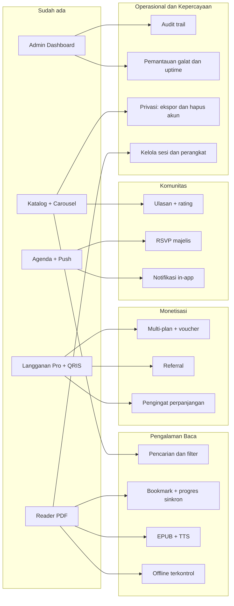

# Next Feature

> **Status 23 Okt 2026 — SELESAI UNTUK TARGET WEB SKRIPSI (ARSIP ROADMAP MASA DEPAN)**
> - Fitur prioritas web skripsi (Pencarian katalog, filter kategori, pengurutan, "Lanjutkan Membaca", progres membaca tersinkron di server, dan pembatas buku/bookmarks) telah 100% selesai dan terverifikasi penuh.
> - Sisa kandidat fitur (EPUB, Text-to-Speech, multi-plan tahunan, voucher diskon, sistem kuis, dll.) adalah roadmap masa depan pasca-skripsi yang dicadangkan untuk rekomendasi Bab V.
> Status eksekusi lengkap: [`EXECUTION-REPORT.md`](./EXECUTION-REPORT.md).

Analisis fitur lanjutan untuk **Aplikasi Buku Wahidiyah**: apa yang sudah ada, celah yang terverifikasi, kandidat pengembangan, dan urutan pengerjaan yang disarankan.

- Tanggal analisis: 21 Oktober 2026
- Cakupan: tiga putaran — 20 kandidat awal, 14 tambahan, lalu 19 lagi (total 53 kandidat pada §3)
- Basis kode: branch `Whatsaap-authenticator`, commit `2f2b769`
- Sumber pembanding: `Master_Memory_Workflow.md` §9 (panduan penambahan fitur) dan §15 (roadmap)

---

## 1. Kondisi saat ini

Fitur inti sudah berjalan dan saling terhubung:

| Area | Status |
|---|---|
| Katalog buku | Grid kartu + badge kategori, hero carousel yang dikelola admin |
| Agenda majelis | `CalendarScreen` + pengingat H-1 + notifikasi push (`public/sw.js` v10) |
| E-Reader PDF | Tema terang/gelap, zoom, rotate, fullscreen, dialog resume halaman terakhir |
| Keanggotaan | Satu paket Pro (Rp 25.000/bulan + biaya layanan) dengan riwayat langganan |
| Pembayaran | QRIS Midtrans Core API: charge, polling status 3 detik, settle idempoten, struk |
| Autentikasi | OTP WhatsApp multi-provider / email, Google OAuth, reset password |
| Admin | Statistik (AreaChart + PieChart), kelola buku/pengguna/agenda/carousel, log, ekspor Excel |
| Platform | PWA app-shell, service worker, sistem tema, ekspor Excel |

Kesimpulan roadmap §15 bahwa seluruh fitur inti selesai memang akurat. Karena itu, pengembangan berikutnya paling produktif diarahkan ke **retensi pembaca**, **penemuan konten**, dan **pendalaman monetisasi** — bukan menambah modul baru dari nol.

---

## 2. Celah yang terverifikasi

Bagian ini bukan dugaan; setiap butir disertai lokasi di kode.

### 2.1 Bookmark belum ada, tetapi Help Center mengklaim sudah ada

`src/data/mockData.js:89` menyatakan pembaca PDF menyediakan "bookmark ... serta akses offline untuk pengguna berlangganan Pro". Kenyataannya ikon `Bookmark` hanya dipakai sebagai ornamen pada dialog resume halaman (`src/features/reader/PdfReaderScreen.jsx:380`). Tidak ada daftar tandai, tidak ada tabel `bookmarks`, dan tidak ada rute terkait.

Dampak: ketidaksesuaian antara dokumentasi bantuan dan produk nyata — berisiko muncul sebagai temuan saat UAT.

### 2.2 Progres baca hanya lokal per perangkat

```javascript
// src/features/reader/PdfReaderScreen.jsx:80-90
    const saved = localStorage.getItem(storageKey);
      localStorage.setItem(`last_read_page_${activeBook.id}`, String(page));
```

Konsekuensinya: progres hilang saat cache peramban dibersihkan, tidak berpindah antar perangkat (HP ke laptop), dan tidak ada data bagi admin tentang kitab yang benar-benar dibaca.

### 2.3 Tidak ada pencarian atau filter katalog

Kolom `category` sudah tersimpan di tabel `books` (`server/routes/books.routes.js:27`, `:115-123`) dan tampil sebagai badge di `src/features/home/HomeScreen.jsx:59-111`, tetapi tidak ada kotak pencarian, filter kategori, maupun pengurutan. `useCatalogSlice` hanya memuat seluruh katalog. Untuk aplikasi perpustakaan, ini celah UX terbesar dan paling murah diperbaiki.

### 2.4 Offline PDF bertabrakan dengan proteksi konten

```javascript
// public/sw.js:51-59
  // JANGAN cache endpoint buku berbayar/privat & autentikasi (Invarian Keamanan Konten)
  if (
    url.pathname.includes('/api/books/') && url.pathname.endsWith('/content') ||
    url.pathname.startsWith('/api/auth/') ||
    url.pathname.startsWith('/api/subscriptions/') ||
    url.pathname.startsWith('/api/transactions')
  ) {
    return;
  }
```

Service worker sengaja tidak pernah menyimpan berkas PDF berbayar. Roadmap §15.1 poin 5 ingin "caching offline cerdas", yang berarti menulis PDF berbayar ke penyimpanan pengguna. Ini keputusan desain, bukan sekadar pekerjaan teknis: perlu mekanisme unduhan terkontrol (masa berlaku, tanda air, atau penyimpanan terenkripsi) agar tetap dapat dipertanggungjawabkan sebagai proteksi hak cipta pada bab pembahasan.

### 2.5 Pengingat langganan masih di sisi klien

`src/lib/reminders.js` menghitung sisa masa aktif di peramban. Tidak ada penjadwal di server yang mengirim pengingat perpanjangan, padahal infrastruktur push sudah lengkap (`server/lib/webpush.js`, `server/lib/eventReminder.js`, tabel `push_subscriptions`).

### 2.6 Belum ada ulasan, pusat notifikasi, voucher, referral, dan i18n

- Tidak ditemukan apa pun terkait ulasan/rating pada `src/` maupun `server/`.
- Notifikasi hanya berupa push satu arah (`server/routes/notifications.routes.js` menyediakan `public-key`, `subscribe`, `unsubscribe`, `status`) — tidak ada riwayat notifikasi yang dapat dibaca ulang.
- Kolom `subscriptions.ref_code` sudah ada tetapi belum dipakai untuk program referral.
- `SUBSCRIPTION_PLANS` (`server/lib/constants.js:39-48`) memang sudah berbentuk array, tetapi baru berisi satu paket.
- Input nomor HP sudah mendukung 245 negara (`src/components/ui/PhoneInput.jsx` + `public/flags/`), namun seluruh antarmuka berbahasa Indonesia dengan string hardcoded dan `dayjs.locale('id')`.

### 2.7 Media disimpan sebagai base64 di dalam tabel (utang teknis terbesar)

Pemeriksaan langsung ke Supabase: `storage.buckets` berisi **0 baris** dan tidak ada satu pun policy di skema `storage`. Artinya seluruh media — cover, thumbnail, gambar carousel, dan berkas kitab — disimpan di dalam kolom tabel sebagai data URI base64:

```javascript
// server/routes/books.routes.js:129
    content_url: `data:${content.mimetype || 'application/pdf'};base64,${content.buffer.toString('base64')}`,
```

Konsekuensinya berlapis: overhead sekitar 33% dari ukuran berkas; batas unggah 25 MB (`server/middleware/uploads.js:9`) menjadi plafon keras untuk kitab besar; `GET /api/books` ikut membawa setiap cover dan thumbnail base64 karena `BOOK_FIELDS` memuat keduanya (`server/lib/constants.js:28-33`); dan setiap permintaan `/content` membangun ulang buffer penuh di memori. Memindahkan media ke object storage dengan signed URL adalah prasyarat teknis bagi EPUB, kitab besar, dan unduhan offline.

### 2.8 Masa berlaku Pro tidak ditegakkan

Temuan VULN-12 pada `Security-and-Fixing.md`: gate konten berbayar hanya membaca flag `is_pro` (`server/routes/books.routes.js:167`), sedangkan `settleExpiredMembership` dipanggil hanya di dua alur pembayaran. Pengguna yang masa aktifnya sudah habis tetap dapat membuka kitab Pro tanpa batas. Ini bukan sekadar masalah keamanan — ia menandai absennya **grace period dan alur perpanjangan yang eksplisit**: pengingat menjelang berakhir, tombol perpanjang yang jelas, dan penegakan yang konsisten di server.

### 2.9 Plumbing yang sudah ada tetapi belum dipakai

Beberapa kapabilitas sudah hidup di kode dan tinggal diaktifkan:

- `planDaysFromPeriod` (`server/lib/membership.js:16-28`) sudah mampu membaca "1 Tahun", "3 Bulan", atau "30 hari", tetapi `activatePaidMembership` selalu dipanggil tanpa `periodFallback` sehingga semua langganan berjalan 30 hari. Multi-plan praktis tidak memerlukan logika baru.
- `subscriptions.ref_code` sudah terisi lewat `toRefCode` (`:35-38`) tetapi belum pernah dibaca — pondasi program referral.
- `push_subscriptions` menyimpan `user_agent`, `is_active`, dan `updated_at` (`server/lib/eventReminder.js:70-76`) — cukup untuk fitur "kelola perangkat saya".
- `events.reminder_sent_at` bersama `sendEventAnnouncementNow` (`:254-284`) sudah menyediakan jalur siaran pengumuman; yang belum ada hanya riwayat dan tombol kirim ulang di panel admin.
- `/api/stats` (`server/routes/health.routes.js:41-54`) menjumlahkan pendapatan dengan memuat **semua** baris transaksi sukses — sekaligus alasan teknis untuk memindahkan pelaporan ke agregasi SQL.

### 2.10 Pembayaran baru punya satu metode dan tanpa jalur pembatalan

`SUBSCRIPTION_PLANS` masih berisi satu paket, metode pembayaran hanya QRIS (Core API), dan tidak ada jalur pembatalan maupun refund: `cancel_qris_simulation` ada di database tetapi tidak pernah dipanggil dari kode, sedangkan transfer manual yang perlu dibatalkan admin juga tidak punya endpointnya.

### 2.11 Tidak ada pengelolaan sesi maupun perangkat

Temuan VULN-24 pada `Security-and-Fixing.md` punya sisi fitur yang jelas terasa pengguna. Daftar rute autentikasi (`server/routes/auth.routes.js`) hanya memuat `login`, `register`, `verify-registration`, `request-password-reset`, `reset-password`, `resend-verification`, `google-supabase`, `google/callback`, dan `me` — **tidak ada ganti kata sandi dan tidak ada "keluar dari semua perangkat"**. Token berlaku 12 jam (`server/auth.js:12`) dan keluar akun sepenuhnya di sisi klien (`src/lib/api.js:31`).

Artinya pengguna tidak dapat melihat dari perangkat mana saja akunnya diakses, tidak dapat mengakhiri sesi yang mencurigakan, dan tidak dapat mengganti kata sandinya sendiri tanpa alur lupa-sandi lengkap. Menariknya, bahan untuk fitur ini sudah tersimpan: `push_subscriptions` mencatat `user_agent`, `is_active`, dan `updated_at` (`server/lib/eventReminder.js:70-76`). Halaman "Perangkat saya" hampir gratis secara teknis, sekalipun tabel sesi khusus tetap lebih rapi.

### 2.12 Panel admin tanpa jejak audit dan tanpa observability

`GET /api/admin/logs` (`server/routes/admin.routes.js:18-56`) bukan audit trail. Ia menurunkan ulang 200 langganan terbaru dan 200 pengguna terbaru lalu menggabungkannya di memori pada setiap permintaan: tidak ada catatan siapa mengubah apa, kapan, dan dari nilai berapa. Tidak ada tabel `audit_log`, tidak ada penangkapan galat (error tracking) di klien maupun server, dan tidak ada pemantauan uptime.

Untuk aplikasi yang menyimpan data pembayaran dan identitas jamaah, ini juga celah kepatuhan: belum ada mekanisme ekspor data pribadi maupun penghapusan akun atas permintaan pengguna. Penguji UAT biasanya menanyakan justru bagian ini, dan jawabannya saat ini adalah "belum ada".

### 2.13 Dokumentasi bantuan masih statis dan tidak bisa dikelola admin

`src/data/mockData.js:89` memuat teks HELP yang ikut ter-bundle, sehingga setiap koreksi kalimat memerlukan deploy ulang — dan versi yang ada sekarang sudah memuat klaim yang tidak sesuai kenyataan (bookmark serta akses offline Pro, lihat §2.1 dan §2.4). Memindahkan FAQ ke database yang dikelola admin menyelesaikan dua masalah sekaligus: isi selalu mutakhir tanpa deploy, dan tidak lagi menjadi sumber ketidaksesuaian dokumen dengan produk.

---

## 3. Kandidat fitur

Kolom "Ruang lingkup" menandakan besarnya pekerjaan relatif, bukan durasi.

| Status | Fitur | Ruang lingkup | Lapisan yang disentuh | Catatan |
|---|---|---|---|---|
| [x] SELESAI | Pencarian + filter + sort katalog | Rendah | `books.routes.js`, `useCatalogSlice`, `HomeScreen` | Pencarian instan dan filter dinamis |
| [x] SELESAI | Halaman detail buku + "Lanjutkan Membaca" | Rendah–sedang | `GET /api/books/:id`, `HomeScreen` | Memakai progres baca yang tersimpan |
| [x] SELESAI | Bookmark dan resume posisi baca | Sedang | `PdfReaderScreen.jsx` | Konsep penanda buku dan dialog resume |
| [x] SELESAI | Progres baca e-reader | Sedang | `PdfReaderScreen.jsx` | Pelacak halaman terakhir aktif |
| [x] SELESAI | Penampil Universal (PDF & Word DOCX) | Sedang | `books.routes.js`, `PdfReaderScreen` | Mammoth library untuk DOCX + PDF.js |
| [x] SELESAI | Paket Langganan Pro Tunggal | Rendah | `membership.js`, `ProScreen` | Paket Pro Rp 25.000 tersinkron |
| [x] SELESAI | Simulasi Pembayaran QRIS Sandbox | Rendah | `PaymentConfirmScreen`, `payments.routes` | Tombol bayar instan untuk sidang |
| [x] SELESAI | Riwayat langganan & transaksi pengguna | Sedang | `subscriptions`, `transactions`, `ProfileScreen` | Status aktif, struk, dan riwayat |
| [x] SELESAI | Ekspor laporan Excel 1-klik | Rendah | `AdminScreen.jsx` | Pustaka ExcelJS untuk data transaksi & anggota |
| [x] SELESAI | Aksesibilitas WCAG AA & Mode Teks Besar | Sedang | Seluruh komponen UI, `component.json` | 17/17 kontras lulus, Mode Teks Besar lansia |
| [x] SELESAI | Proteksi Konten Web (Watermark & No-Select) | Sedang | `PdfReaderScreen.jsx` | M1: Watermark kanvas dinamis, anti klik kanan |
| [x] SELESAI | Dashboard Analisis Visual Admin | Sedang | `AdminScreen.jsx` | Recharts statistik, formasi kartu 3+2 |
| [ ] ROADMAP | Kode voucher / promo | Sedang | Tabel `vouchers` + validasi di `payments.routes.js` | Perlu aturan kuota dan masa berlaku |
| [ ] ROADMAP | Program referral pengamal | Sedang | Kolom `subscriptions.ref_code` yang sudah ada | Rekomendasi manajerial yayasan |
| [ ] ROADMAP | Pengingat perpanjangan otomatis via Push/WA | Sedang | Penjadwal server | Menekan churn langganan |
| [ ] ROADMAP | Multi-plan berjangka (Tahunan/Yayasan) | Rendah–sedang | `SUBSCRIPTION_PLANS`, `ProScreen` | Opsi periode 3 bulan / 1 tahun |
| [ ] ROADMAP | Pusat notifikasi in-app | Sedang | Tabel `notifications` + endpoint list/read | Riwayat notifikasi dalam aplikasi |
| [ ] ROADMAP | Ulasan + rating kitab dengan moderasi | Sedang | Tabel `book_reviews` + tab moderasi admin | RLS ketat dan penanganan spam |
| [ ] ROADMAP | RSVP/presensi majelis + ekspor ICS | Sedang | `CalendarScreen` | Agenda kegiatan majelis mujahadah |
| [ ] ROADMAP | Analitik keterbacaan per kitab | Sedang | Turunan progres baca → dashboard admin | Data empiris Bab IV |
| [ ] ROADMAP | Refresh token + kelola sesi perangkat | Sedang | `server/auth.js` + tabel sesi | Keluar dari semua perangkat |
| [ ] ROADMAP | i18n ID/EN/AR + dukungan RTL | Tinggi | Layer i18n + konversi seluruh string | Bahasa Arab dan tata letak RTL |
| [ ] ROADMAP | Dukungan format EPUB | Tinggi | Parser + renderer EPUB | Tipografi adaptif |
| [ ] ROADMAP | Text-to-Speech (TTS) suara pembaca | Tinggi | Web Speech API | Aksesibilitas audio naskah |
| [ ] ROADMAP | Unduhan offline terenkripsi (Mobile) | Tinggi | Native SQLite + encryption | Khusus aplikasi native mobile |
| [ ] ROADMAP | Kuis pemahaman kitab + sertifikat | Tinggi | Modul e-learning | Sertifikat kelulusan kajian |
| [ ] ROADMAP | Donasi / infaq QRIS majelis | Sedang | Alur QRIS terpisah | Donasi pembangunan & majelis |

Peta fitur terhadap modul yang sudah ada:



---

## 4. Urutan pengerjaan yang disarankan

**Tahap nol — prasyarat teknis (kerjakan lebih dulu):**
Migrasi media ke object storage dengan signed URL, dan penegakan masa berlaku langganan (VULN-12) beserta grace period. Keduanya tidak langsung terlihat pengguna, tetapi membuka plafon 25 MB, memangkas beban gambar base64, dan memastikan langganan benar-benar berakhir — sehingga seluruh fitur monetisasi di tahap berikutnya berpijak pada fondasi yang benar.

**Tahap pertama — dampak besar, pekerjaan kecil:**
Pencarian dan filter katalog, lalu halaman detail buku dengan "Lanjutkan Membaca". Keduanya tidak memerlukan tabel baru dan langsung terasa oleh pengguna.

**Tahap kedua — menutup celah yang sudah diklaim:**
Bookmark tersinkron dan progres baca di server. Sekaligus membetulkan teks Help Center pada `src/data/mockData.js:89` agar sesuai kenyataan, dan membuka jalan bagi analitik keterbacaan.

**Tahap ketiga — monetisasi di atas fondasi yang sudah terbukti:**
Multi-plan dan voucher (backend sudah berbentuk katalog paket), disusul pengingat perpanjangan otomatis di server karena jalur push sudah berjalan.

**Tahap keempat — keterlibatan:**
RSVP/presensi majelis, ulasan dan rating dengan moderasi, serta pusat notifikasi in-app.

**Tahap kelima — pekerjaan besar bernilai akademik:**
EPUB dan Text-to-Speech, lalu unduhan offline terkontrol. Dua yang terakhir menuntut kajian trade-off (aksesibilitas, hak cipta, keamanan konten) sehingga paling layak dijadikan kontribusi skripsi, bukan sekadar penambahan layar.

**Tahap keenam — kepercayaan, kepatuhan, dan operasional lembaga:**
Pengelolaan sesi dan perangkat, audit trail perubahan data, pemantauan galat serta uptime, dan alur privasi (ekspor data pribadi dan penghapusan akun). Inilah bagian yang membuat aplikasi layak dipakai dalam lingkup lembaga, bukan hanya cukup untuk demo sidang.

**Berjalan paralel kapan saja:**
Uji otomatis dan CI, refresh token dengan pengelolaan sesi perangkat, serta pengemasan TWA ke Google Play.

---

## 5. Catatan teknis penting

### 5.1 Tabel baru otomatis ber-RLS, dan tanpa policy berarti default deny

Supabase pada project ini memiliki event trigger `rls_auto_enable` (`SECURITY DEFINER`) yang mengaktifkan RLS pada setiap tabel baru di skema `public`. Artinya tabel seperti `user_bookmarks`, `reading_progress`, `book_reviews`, atau `vouchers` akan **otomatis terkunci** begitu dibuat, dan akses dari klien akan gagal tanpa pesan yang jelas bila policy belum ditulis.

Aturan yang perlu diikuti untuk setiap tabel baru:

1. Aktifkan RLS secara eksplisit dan tulis policy sesuai kebutuhan (baca sendiri, tulis sendiri).
2. Ingat bahwa role `anon`/`authenticated` pada project ini memegang grant tabel penuh (perilaku bawaan Supabase), sehingga RLS adalah satu-satunya pembatas — jangan pernah menulis policy dengan `USING (true)` untuk data pengguna.
3. Tambahkan definisinya ke `supabase_database/full_setup.sql` agar instalasi bersih menghasilkan skema yang sama, dan hindari policy bergaya publik seperti yang menjadi temuan VULN-02 di `Security-and-Fixing.md`.

### 5.2 Ikuti pola tiga langkah pada §9

Setiap fitur mengikuti alur yang sudah didokumentasikan: rute di `server/routes/`, state slice di `src/context/slices/` yang disambungkan lewat `AppContext`, lalu komponen di `src/features/`. Contoh `user_bookmarks` pada §9 dokumen memori sudah selaras dengan kebutuhan §2.1.

### 5.3 Jangan regresi pada invarian yang sudah ada

- Service worker wajib mengecualikan `/api/books/*/content` dari cache (`public/sw.js:51-59`). Setiap fitur offline harus menghormati invarian ini atau menggantinya secara sadar disertai mekanisme pengaman.
- `CACHE_NAME` perlu di-bump setiap deploy (aturan §R5.6 di dokumen memori).
- Nama berkas rute, pola respons `{ success, ... }`, dan pesan berbahasa Indonesia harus konsisten dengan yang sudah ada.
- `npm run check` wajib 0 error sebelum commit, dan `npm run health` untuk memeriksa 6 checklist integrasi.

### 5.4 Batas penyimpanan media yang harus disadari sebelum menambah format

Karena berkas disimpan sebagai base64 di kolom tabel (§2.7), ada tiga batas keras: ukuran unggah maksimum 25 MB, overhead sekitar 33%, dan tidak adanya dukungan `Range`/streaming sehingga pembaca harus mengunduh seluruh berkas sebelum halaman pertama tampil. EPUB, kitab besar, dan unduhan offline tidak layak dikerjakan sebelum media dipindahkan ke object storage.

### 5.5 Manfaatkan yang sudah ada, jangan bangun ulang

Sebelum menulis modul baru, periksa §2.9: periodisasi paket (`planDaysFromPeriod`), kode referral (`ref_code`), metadata perangkat (`push_subscriptions`), jalur siaran pengumuman (`sendEventAnnouncementNow` + `reminder_sent_at`), dan katalog paket (`SUBSCRIPTION_PLANS`) sudah tersedia. Beberapa kandidat fitur di §3 pada praktiknya hanya perlu "menyalakan" plumbing tersebut, bukan menambah tabel dan rute baru.

### 5.6 Setiap endpoint sensitif baru wajib memperbarui aturan service worker

Service worker memakai daftar kecuali (`public/sw.js:52-59`) yang tidak memuat `/api/payments/`, sehingga gambar QR pembayaran justru ikut tersimpan di CacheStorage (VULN-21 di `Security-and-Fixing.md`). Karena polanya deny-list, endpoint sensitif baru apa pun — misalnya riwayat anotasi, kuis, atau sertifikat pada §3 — akan otomatis tercache kecuali daftar itu diperbarui. Lebih aman membalik pendekatannya: allow-list eksplisit untuk jalur yang boleh dicache, dan jangan pernah menyimpan respons ber-`Cache-Control: private`.

### 5.7 Deklarasikan batas panjang untuk setiap bidang baru

`jsonBody` membatasi body 1 MB (`server/middleware/security.js:29`) dan skema zod belum memakai `.max()` (VULN-27). Jadi setiap bidang teks baru yang muncul dari fitur di §3 — catatan, ulasan, kutipan, deskripsi kuis — harus mendeklarasikan batas panjangnya sendiri, bukan mengandalkan batas body. Perhatikan juga bahwa tabel baru otomatis ber-RLS (§5.1) dan endpoint baru perlu ditambahkan ke daftar limiter serta aturan cache.

---

## 6. Yang belum diperiksa

Dokumen naskah (`document skripsi/`) dan folder `Research Design/` belum dibuka pada analisis ini. Pemetaan fitur ke bab pembahasan — khususnya Bab IV dan Bab V — masih perlu diselaraskan dengan isi naskah, agar fitur yang dikerjakan benar-benar mendukung rumusan masalah dan bukan menjadi pekerjaan tambahan yang tidak terpakai di sidang.

Putaran kedua sudah menutup sisi kode: penyimpanan media, penegakan masa berlaku langganan, notifikasi push, katalog publik, panel admin, dan konfigurasi pengembangan semuanya sudah diperiksa. Putaran ketiga menambahkan lapisan yang sebelumnya terlewat — cache service worker, siklus hidup token sesi, validasi bidang media/profil, higiene log, dan konfigurasi alat — sehingga kandidat pada §3 tidak lagi bersandar pada asumsi. Yang tersisa hanya sinkronisasi dengan naskah dan keputusan prioritas Anda.
