# Design Plan & Improve

> **Status 23 Okt 2026** — berkas ini **arsip penjelasan**, bukan status terkini.
> Status eksekusi terbaru: [`EXECUTION-REPORT.md`](./EXECUTION-REPORT.md).
> D-01/02/03/04/05/06/07/08/09/10/11/12/13/14/15/16 seluruhnya sudah tuntas dikerjakan dan diverifikasi (Tahap 7 Desain selesai).

Audit desain dan rencana perombakan antarmuka **Aplikasi Buku Wahidiyah** agar lebih ramah pengguna, khususnya jamaah lanjut usia.

- Tanggal audit: 21 Oktober 2026
- Basis kode: branch `Whatsaap-authenticator`, commit `2f2b769`
- Sumber analisis: `component.json`, `tailwind.config.js`, `src/index.css`, `src/lib/styles.js`, `src/App.jsx`, `src/components/ui/DeviceFrame.jsx`, layar `home/`, `subscription/`, `calendar/`, `admin/`, `profile/`, `reader/`, `payment/`, serta `scripts/check-colors.js`
- Metode: pembacaan kode + perhitungan rasio kontras WCAG 2.1 secara numerik dari nilai token (skrip sekali pakai, bukan perkiraan visual)

---

## 1. Ringkasan eksekutif

Fondasi desain aplikasi ini justru **di atas rata-rata** untuk skripsi: token terpusat di `component.json`, warna berbasis CSS variable sehingga mode malam bekerja tanpa duplikasi utility, arah visual yang jelas ("Editorial Elegan" — zamrud tua + krem hangat + emas dengan serif Fraunces), plus **guard otomatis** `scripts/check-colors.js` yang memaksa disiplin warna saat `npm run check`.

Masalahnya bukan identitas, melainkan **eksekusi yang tidak konsisten dan kalibrasi yang kurang cocok untuk pengguna lanjut usia**:

| Area | Kondisi | Dampak |
|---|---|---|
| Kontras teks sekunder | Token `ink-400` hanya **4.29:1** di latar utama, **4.08:1** di surface, **4.48:1** di kartu | Gagal WCAG AA (4.5:1) untuk teks 12–14px, padahal justru inilah teks bantuan, nama penulis, dan deskripsi |
| Item "Log Out" di sidebar | `semantic-danger/70` di atas `ink-900` = **1.89:1** | Aksi destruktif adalah elemen paling tidak terbaca di seluruh aplikasi |
| Tipografi | **285** pemakaian ukuran mentah (`text-xs/sm/…`) vs **109** pemakaian token skala | Skala token 9–14px dilewati; ukuran terkecil 9–11px terlalu kecil untuk jamaah senior |
| Guard warna | Hanya melarang `bg-white`/`bg-black`/`text-black` | `text-white`, `ring-black/10`, `border-white/[0.06]` lolos → 23 berkas memuat pola di luar token |
| Sumber kebenaran | `DESIGN.md` v2.6.0 §1.5 dirujuk `check-colors.js` dan `tailwind.config.js`, tetapi **tidak ada di repo** | Aturan 3 Color Key tidak dapat dilihat kontributor maupun AI lain |
| Keadaan muat | **0** skeleton loader; hanya spinner + teks "Memuat halaman…" | Terasa lambat di jaringan seluler |

**Rekomendasi inti:** jangan ganti identitas visualnya. Arah "Editorial Elegan" sudah kuat, berbeda dari tampilan dashboard SaaS generik, dan konsisten dengan daftar "avoid" di `component.json`. Yang perlu dirombak adalah **lapisan eksekusi dan pengalaman pakai**: kalibrasi ulang kontras, naikkan skala tipografi, tertibkan token, perbaiki navigasi dan keadaan antarmuka, lalu tambahkan **mode teks besar** sebagai fitur khas untuk jamaah senior. Mengganti dunia visual dari nol akan menghapus justru bagian terbaik dari pekerjaan ini.

Ringkasnya: **rombak eksekusinya, pertahankan wajahnya.**

---

## 2. Color key yang dipakai

### 2.1 Tiga kunci warna dan porsi 60-30-10

`component.json` mendefinisikan arah "Editorial Elegan" dengan tiga kunci warna. Guard `scripts/check-colors.js` menegakkan aturan ini dengan melarang palet Tailwind mentah (slate, gray, indigo, rose, dst.) di seluruh `src/`:

| Porsi | Peran | Token | Nilai inti |
|---|---|---|---|
| **60%** — dasar | Latar & permukaan | `cream-50`, `cream-100`, `ui-bg`, `ui-surface`, `ui-card` | `#FBF8F3`, `#F7F2E9`, `#FFFDFA` |
| **30%** — struktur | Teks & garis | `ink-200…ink-900`, `ui-border`, `ui-text*` | `#1D1B17`, `#5A544C`, `#7C756C`, `#E4D9C6` |
| **10%** — aksen | Aksi & identitas | `brand-50…900` (zamrud), `gold-300…700`, `accent-gold` | `#14523A` (primary), `#B8860B` (emas) |
| — | Semantik | `semantic-success/warning/danger/info` + varian `Light` | `#216B4C`, `#7A5608`, `#A62F26`, `#1E5B8C` |
| — | Pihak ketiga (sengaja tetap) | `qris-600/700` | `#E30613`, `#C00511` |

Dua pengecualian terdokumentasi pada guard: `PaymentReceiptModal.jsx` (kertas kwitansi cetak) dan `PdfReaderScreen.jsx` (kertas PDF). Keduanya wajar — permukaan cetak memang putih.

### 2.2 Arsitektur tema

Warna tidak ditulis sebagai hex di utility. `tailwind.config.js:24` membungkusnya menjadi `rgb(var(--brand-600) / <alpha-value>)`, sehingga satu set kelas Tailwind yang sama berubah nilai saat `.dark` dipasang di `<html>`. Nilai LIGHT/DARK disuntikkan `src/theme/themeInjector.js` dari `component.json`, dengan fallback statis di `src/index.css:73-76` (terang) dan `:147-150` (gelap) agar render pertama tidak berkedip. `index.html:34-46` memasang kelas `dark` sebelum halaman dilukis. Ini pola yang benar dan layak dipertahankan.

### 2.3 Hasil perhitungan kontras (WCAG 2.1)

Dihitung dari nilai token, ambang AA = 4.5:1 untuk teks normal dan 3:1 untuk teks besar (≥18.66px bold / ≥24px) serta indikator antarmuka.

**Gagal atau belum aman:**

| Pasangan | Rasio | Vonis | Dipakai di |
|---|---|---|---|
| `ink-400 #7C756C` di `cream-50 #FBF8F3` | **4.29:1** | Gagal AA | `typography.helper/meta/helperTight` (`styles.js:32-38`), nama penulis & deskripsi kartu (`HomeScreen.jsx:121,124`) |
| `ink-400` di `ui-surface #F7F2E9` | **4.08:1** | Gagal AA | Panel & kartu bernuansa surface |
| `ink-400` di `ui-card #FFFDFA` | **4.48:1** | Nyaris gagal | Teks bantuan di atas kartu |
| `ink-300 #A8A199` di `cream-50` | **2.41:1** | Gagal | Placeholder, teks tombol nonaktif (`ProScreen.jsx:88`), `emptyIcon` |
| `brand-400 #5AA37E` di `cream-50` | **2.84:1** | Gagal (<3:1) | **Ring fokus** `controls.input` (`styles.js:55`) — WCAG 2.2 SC 1.4.11 |
| `semantic-danger #A62F26` di sidebar `#141210` | **2.72:1** | Gagal | Item Log Out (`DeviceFrame.jsx:77`) |
| `semantic-danger/70` di sidebar | **1.89:1** | Gagal berat | Item Log Out versi opasitas (`DeviceFrame.jsx:77`) |
| `ink-400` di sidebar `ink-900` | **4.11:1** | Belum AA | Item navigasi non-aktif sisi gelap (`DeviceFrame.jsx:78`) |
| teks `cream-50` di `primaryHover #26906A` (malam) | **3.75:1** | Belum AA | Tombol saat hover, label 13.5px bold |

**Sudah aman (pertahankan):**

| Pasangan | Rasio | Vonis |
|---|---|---|
| `ink-800 #1D1B17` di `cream-50` | 16.23:1 | AAA |
| `ink-500 #5A544C` di `cream-50` | 7.06:1 | AAA |
| `brand-700 #14523A` di `cream-50` | 8.63:1 | AAA |
| `cream-50` di `brand-700` (tombol utama) | 8.63:1 | AAA |
| `gold-600 #96690A` di `cream-50` | 4.59:1 | AA |
| `danger/warning/info` di latar `*Light` masing-masing | 5.28–5.85:1 | AA |
| `brand-700` di `brand-100` (badge) | 7.52:1 | AAA |
| Mode malam: `ink-900-text #F4EFE3` di `#14130F` | 16.20:1 | AAA |
| Mode malam: `ink-400 #948B79` di `#14130F` | 5.51:1 | AA |
| `qris-600 #E30613` di putih | 4.81:1 | AA |

Kesimpulan penting: **palet aksennya sehat, tetapi token teks "muted" yang paling sering dipakai justru berada di bawah ambang AA.** Ini satu perbaikan token yang berdampak ke seluruh aplikasi.

### 2.4 Catatan mode malam

Paritas tema tergolong rapi: latar diubah ke charcoal hangat (`#14130F`), bukan inversi putih-hitam, dan hijau digeser lebih terang agar tetap terbaca sebagai teks. Dua hal yang perlu dijaga: `component.json` menyebut tombol tetap memakai hijau pekat lewat override di `index.css`, sehingga rasio tombol mode malam **harus diverifikasi di peramban** (perhitungan di §2.3 memakai `primary` dari token); dan `theme-color` di `index.html:10` hanya satu nilai (`#14523A`) tanpa varian malam, sehingga bilah status peramban tetap hijau terang pada mode gelap.

---

## 3. Temuan desain

| ID | Temuan | Severity | Bukti |
|---|---|---|---|
| D-01 | Teks sekunder `ink-400` gagal AA di semua tiga permukaan utama | High | §2.3; `styles.js:32-38`; `HomeScreen.jsx:121,124` |
| D-02 | Item "Log Out" sidebar paling tidak terbaca (1.89:1) | High | `DeviceFrame.jsx:77` |
| D-03 | Tipografi tidak mengikuti token: 285 pemakaian ukuran mentah vs 109 token; ukuran terkecil 9–11px | High | grep `text-(xs\|sm\|…)`; `component.json` `typography.scale` |
| D-04 | Guard warna berlubang: hanya melarang `bg-white`/`bg-black`/`text-black` | Medium-High | `check-colors.js:26`; 23 berkas memuat `text-white`/`ring-black`/`border-white` (HomeScreen 7, CalendarScreen 5, PaymentConfirmScreen 4, EventsTab 4, PdfReaderScreen 19 termasuk whitelist) |
| D-05 | `DESIGN.md` v2.6.0 §1.5 (sumber aturan 3 Color Key) tidak ada di repo | Medium | `check-colors.js:7`; `tailwind.config.js:60` merujuk "DESIGN.md 1.5 whitelist"; hanya ada `docs/diagrams/` |
| D-06 | Ring fokus `brand-400` 2.84:1, di bawah ambang 3:1 untuk indikator fokus | Medium | `styles.js:55,60` |
| D-07 | Tombol primary mode malam 3.75:1 saat hover | Medium | `component.json` `dark.primaryHover`; perlu verifikasi peramban (§2.4) |
| D-08 | Tidak ada `prefers-reduced-motion` global; `scroll-behavior: smooth` tanpa pengaman | Medium | `index.css:190`; hanya `HeroCarousel.jsx` yang memeriksanya |
| D-09 | Tidak ada skeleton loader sama sekali (0 berkas) | Medium | grep `animate-pulse\|skeleton`; `App.jsx:33-40` spinner + teks |
| D-10 | Kartu buku `
` tanpa `role`/`tabIndex`, tombol bersarang menduplikasi aksi | Medium | `HomeScreen.jsx:67-71,131-155` |
| D-11 | Layar Pro menjual fitur yang belum ada: "Sinkronisasi riwayat pembacaan offline" | Low-Med | `ProScreen.jsx:79` vs `PdfReaderScreen.jsx:80-90` (localStorage) & `sw.js:51-59` (konten tak pernah dicache). "Bebas iklan" (`:67`) padahal tidak ada iklan |
| D-12 | Grid 2 kolom di mobile dengan teks 10–12px: kepadatan tinggi untuk penglihatan senior | Low-Med | `HomeScreen.jsx:216`; badge `text-micro` (10px), halaman `text-caption` (11px) |
| D-13 | Hover no-op: `bg-brand-700` + `hover:bg-brand-700` | Low | `HomeScreen.jsx:201` |
| D-14 | Drift token: `text-[11px]` arbitrer, dan `itemRadius` token 6px dipakai sebagai `rounded-xl` (12px) | Low | `DeviceFrame.jsx:412,42,60` vs `component.json` `components.sidebar.itemRadius` |
| D-15 | `theme-color` tunggal tanpa varian mode malam | Low | `index.html:10` |
| D-16 | Tiga keluarga font; Amiri (2 bobot) hanya dipakai reader | Low | `index.html:26`; grep `font-arabic` → `PdfReaderScreen.jsx`, `index.css` |

Yang sudah baik dan **jangan diubah**: struktur token terpusat; mode malam berbasis CSS variable; `min-h-11` (44px) pada tombol aksi dan bottom nav; `pb-safe` pada navigasi bawah; `aria-current`, `aria-label`, `role="dialog"`, `aria-modal`, dan focus trap pada dialog (paywall, logout); `-webkit-text-size-adjust: 100%`; keyboard ring `focus-visible` yang konsisten hadir; serta keberadaan empty state dan error state di `HomeScreen.jsx:196-208`.

---

## 4. Kalibrasi untuk jamaah lanjut usia

Target pengguna aplikasi ini bukan pengguna teknis berusia muda. Konsekuensi praktisnya:

| Aspek | Standar umum | Kebutuhan jamaah senior | Kondisi sekarang |
|---|---|---|---|
| Ukuran teks isi | 16px | 16–18px | `body` token **14px** (`component.json`) |
| Teks metadata | 12–13px | ≥13px | `caption` 11px, `micro` 10px, `overline` **9px** |
| Target sentuh | 44×44px | 48×48px | 44px (token `touchTarget`) — sudah lulus minimum, belum ideal |
| Kontras teks kecil | 4.5:1 | 4.5:1 minimum, lebih baik 7:1 | `ink-400` 4.29:1 → belum lulus |
| Jumlah aksi per layar | bebas | sedikit, satu jalur utama | Home menumpuk carousel + grid padat |
| Istilah | — | kata Indonesia lugu | "Log Out" (Inggris), "Paket Reguler", "Akses Khusus Pembaca Pro" |
| Jaringan | 4G | sering 3G/tidak stabil | 3 keluarga font tanpa subset, media base64 besar |

Dua hal yang paling terasa oleh pengguna senior di lapangan: **teks bantuan yang tipis dan pucat** (D-01) dan **kepadatan grid katalog di layar 360px** (D-12). Keduanya murah diperbaiki dan berdampak besar.

---

## 5. Rencana perombakan

Peta lapisan yang akan disentuh:

```mermaid
flowchart TD
  subgraph T1["Tahap 1 — Fondasi"]
    A1[Token kontras: ink-400 ke ink-500 untuk teks kecil]
    A2[Focus ring brand-600]
    A3[Sidebar: item danger terbaca]
    A4[Guard warna diperluas + check-contrast baru]
    A5[prefers-reduced-motion global + theme-color per skema]
  end
  subgraph T2["Tahap 2 — Tipografi"]
    B1[Skala naik: body 16, small 14, caption 13, micro 12, overline 11]
    B2[Migrasi 285 ukuran mentah ke token]
    B3[Aturan: larang text-&#91;..&#93; arbitrer]
  end
  subgraph T3["Tahap 3 — Kerangka"]
    C1[Skeleton per layar]
    C2[Indikator offline & lambat]
    C3[Label nav token + istilah Indonesia]
    C4[Transisi hormati reduced motion]
  end
  subgraph T4["Tahap 4 — Layar kunci"]
    D1[Home: cari, filter, rak, kartu lega]
    D2[Pro: bukti nilai, FAQ, langkah bayar, jaminan]
    D3[Pembayaran: stepper, status, timer kedaluwarsa]
    D4[Reader: ukuran font, spasi baris, progres]
    D5[Admin: tabel, filter, aksi massal]
  end
  subgraph T5["Tahap 5 — Mode Teks Besar"]
    E1[Saklar skala 100/115/130 persen]
    E2[Target sentuh 48px]
    E3[Kontras tinggi opsional]
  end
  T1 --> T2 --> T3 --> T4 --> T5
```

### Tahap 1 — Fondasi kepatuhan (dampak terbesar, risiko terkecil)

1. Naikkan token teks sekunder: pakai `ink-500` (#5A544C, 7.06:1) untuk semua teks di bawah 18px; sisakan `ink-400` hanya untuk teks besar atau elemen non-teks. Ini satu perubahan `styles.js` + token, berlaku ke seluruh aplikasi.
2. Ganti ring fokus ke `brand-600` (6.06:1) dengan tebal 2px + offset, agar indikator fokus lulus SC 1.4.11.
3. Perbaiki item destruktif sidebar: `semantic-danger` di atas `ink-900` masih 2.72:1, jadi pakai varian terang khusus latar gelap (mis. `#F0A9A2` dari palet `dark.semantic.danger` ≈ 7:1) atau beri latar chip agar terbaca.
4. Perluas `check-colors.js` untuk menangkap `text-white`, `ring-black`, `border-white`, dan `bg-[#…]`; tambahkan whitelist yang sudah ada agar tidak menggagalkan berkas yang sah.
5. Tambahkan `scripts/check-contrast.js` (baru) yang menghitung rasio pasangan token penting dan gagal bila di bawah ambang — sehingga regresi kontras tertangkap otomatis seperti halnya warna.
6. Tambahkan blok `@media (prefers-reduced-motion: reduce)` global di `index.css` (matikan transform/transisi panjang, ubah `scroll-behavior` menjadi `auto`), dan pasang `theme-color` terpisah untuk skema gelap.

### Tahap 2 — Tipografi

Naikkan skala di `component.json` lalu migrasikan pemakaian mentah secara mekanis per layar (mulai dari yang terpadat: `AdminDashboard` 32 temuan, `CalendarScreen` 15, `HomeScreen` 13, `EditProfileScreen` 9, `ProScreen` 6). Tambahkan aturan pelarangan `text-[…]` arbitrer dan ukuran mentah di layar yang sudah dimigrasikan, agar tidak kembali longgar.

### Tahap 3 — Kerangka dan keadaan antarmuka

Skeleton untuk katalog, agenda, dan dashboard admin (menggantikan spinner teks); indikator "sedang offline / koneksi lambat"; label navigasi memakai token (bukan `text-[11px]`); istilah dilokalkan ("Log Out" → "Keluar"); dan pastikan semua transisi mematuhi preferensi gerak pengguna.

### Tahap 4 — Layar kunci

- **Home:** pencarian + filter kategori + rak terkurasi (memakai ulang carousel), kartu lebih lega dengan teks ≥14px, opsi satu kolom.
- **Pro:** sajikan bukti nilai (daftar isi koleksi Pro, jumlah kitab, contoh halaman), langkah pembayaran, FAQ, dan jaminan; **hapus klaim yang belum ada** (D-11) atau implementasikan fiturnya (lihat `Next-Feature.md` §2.4).
- **Pembayaran:** stepper tahapan, status yang jelas (menunggu/berhasil/kedaluwarsa), tombol salin & unduh QR, penghitung waktu kedaluwarsa.
- **Reader:** kontrol ukuran font dan spasi baris (bukan hanya zoom PDF), indikator progres, dan tombol kembali yang jelas.
- **Admin:** tampilan tabel pada layar lebar, filter dan paginasi, aksi massal, serta ringkasan angka yang tidak lagi memindai seluruh data.

### Tahap 5 — Mode Teks Besar (pembeda untuk jamaah senior)

Saklar tiga tingkat (Normal / Besar / Sangat Besar) yang menaikkan skala akar 100% / 115% / 130%, disimpan bersama preferensi tema, plus target sentuh 48px dan opsi kontras tinggi. Inilah fitur yang paling langsung menjawab kebutuhan pengguna lanjut usia dan mudah dipertanggungjawabkan di sidang.

---

## 6. Spesifikasi visual usulan

| Aspek | Sekarang | Usulan | Alasan |
|---|---|---|---|
| `overline` | 9px | 11px | Teks mustahil dibaca pada perangkat nyata |
| `micro` | 10px | 12px | Badge kategori & label Pro |
| `caption` | 11px | 13px | Metadata (jumlah halaman, tanggal) |
| `small` | 12px | 14px | Teks pendukung |
| `body` | 14px | **16px** | Standar baca nyaman; default peramban |
| `lead` | 15px | 17px | Paragraf pengantar |
| `h2` / `h3` | 18px / 16px | 20px / 18px | Hierarki tetap terbaca saat body naik |
| Tinggi baris body | longgar | 1.6–1.7 | Kenyamanan baca naskah panjang |
| Teks sekunder | `ink-400` | `ink-500` | 4.29:1 → 7.06:1 |
| Ring fokus | `brand-400` 2.84:1 | `brand-600` 6.06:1, 2px + offset 2px | Lulus SC 1.4.11 |
| Target sentuh aksi utama | 44px | 48px | Presisi jari menurun seiring usia |
| Radius item navigasi | `rounded-xl` 12px | 8px (token `itemRadius`) | Hentikan drift token |
| Font | Fraunces + Plus Jakarta + Amiri (9 varian) | Sama, dengan subset Amiri + preload 2 bobot utama | Memangkas beban awal di jaringan lambat |
| Gerak | 140–320ms, smooth scroll | Sama, tetapi dinonaktifkan saat `prefers-reduced-motion` | Aksesibilitas vestibular |
| Mode malam | Tombol hover 3.75:1 | Naikkan ke ≥4.5:1 | Lulus AA pada label 13.5px |

Catatan penting: menaikkan `body` ke 16px akan **menggeser tata letak banyak layar**. Kerjakan bertahap per layar (bukan sekali gus), dan verifikasi pada 360px, 414px, serta desktop untuk setiap perubahan.

---

## 7. Kriteria keberhasilan

1. `npm run check` lulus dengan guard warna yang diperluas dan `check-contrast.js` baru (0 pelanggaran).
2. Tidak ada pasangan teks di bawah 4.5:1 untuk teks <18.66px, dan tidak ada indikator fokus di bawah 3:1.
3. Ukuran teks terkecil yang dipakai untuk teks bermakna ≥12px (≥13px setelah Tahap 5).
4. 0 pemakaian ukuran mentah dan 0 `text-[…]` arbitrer pada layar yang sudah dimigrasikan.
5. Skeleton muncul pada katalog, agenda, dan dashboard; tidak ada lagi layar kosong tanpa indikator.
6. Mode Teks Besar berfungsi pada tiga tingkat dan tidak merusak tata letak pada 360px.
7. Uji mode malam untuk setiap perubahan — bukan hanya mode terang.
8. Layar Pro tidak lagi memuat klaim yang belum diimplementasikan.

---

## 8. Prompt eksekusi untuk AI lain

> Salin seluruh blok berikut sebagai satu instruksi tunggal. Prompt ini memuat temuan, angka kontras, dan kriteria penerimaan sehingga AI tersebut tidak perlu mengaudit ulang.

### Role and mission

You are a senior product designer and frontend engineer. Improve the interface of the repository at `E:\Wahidiyah Book + Real Midtrans Skripsi` (Windows, shell `cmd`, Node >= 22, ESM, React 19 + Vite + Tailwind v4). A design audit already produced the findings and measured contrast ratios below. Execute the plan, then report back **in Indonesian**.

**Critical direction: preserve the visual identity.** The product uses an "Editorial Elegan" direction (deep emerald + warm cream + thin gold accent, Fraunces serif display, Plus Jakarta Sans body). This identity is deliberate and documented in `component.json` → `direction`. Do **not** replace it, do not introduce purple/blue gradients, glassmorphism, or a generic dashboard look. Overhaul the execution: contrast, typography scale, density, states, navigation, and accessibility.

### Hard rules

- Work on a new branch `design/accessibility-overhaul`. Commit per stage using the repo's conventional style (`fix:`, `feat:`, `refactor:`). **Never `git push`.**
- Tokens are the single source of truth: change values in `component.json` (and the static fallbacks in `src/index.css`), never hardcode hex in components.
- Never bypass tokens with raw Tailwind palette classes (`bg-gray-100`, `text-indigo-600`, …) or with `text-white` / `ring-black` / `border-white` / `bg-[#…]`.
- Keep both themes working. Every change must be verified in light **and** dark mode.
- Do not change product facts or invent features. Where UI copy claims something the product does not do, report it instead of silently rewording.
- Keep the existing whitelist in `scripts/check-colors.js` (`PaymentReceiptModal.jsx`, `PdfReaderScreen.jsx`).
- Do not add npm dependencies. Extend the existing guard scripts instead.
- Preserve Indonesian copy; localize the remaining English labels ("Log Out", "Pro", etc.) only where it stays unambiguous.

### Stage 1 — contrast and compliance (do this first)

Measured ratios (WCAG 2.1, AA = 4.5:1 for normal text, 3:1 for UI/focus):

| Pair | Ratio | Required action |
|---|---|---|
| `ink-400 #7C756C` on `cream-50 #FBF8F3` | 4.29:1 | Use `ink-500 #5A544C` (7.06:1) for all text below 18px |
| `ink-400` on `ui-surface #F7F2E9` | 4.08:1 | Same fix |
| `ink-400` on `ui-card #FFFDFA` | 4.48:1 | Same fix |
| `ink-300 #A8A199` on `cream-50` | 2.41:1 | Reserve for non-text or disabled states only; ensure placeholder text uses `ink-500` |
| `brand-400 #5AA37E` focus ring | 2.84:1 | Switch focus rings to `brand-600 #216B4C` (6.06:1) |
| `semantic-danger #A62F26` on sidebar `#141210` | 2.72:1 | Use a light danger variant for dark surfaces; the `/70` opacity form measures 1.89:1 |
| dark `primaryHover #26906A` with `cream-50` label | 3.75:1 | Raise until ≥4.5:1 (verify in browser: `component.json` notes an `index.css` override for dark buttons) |

Deliverables:

1. Update `component.json` tokens plus the `src/index.css` fallbacks so `styles.js` helper/meta classes (`helper`, `meta`, `helperTight`, `helperRelaxed`) resolve to a compliant colour automatically.
2. Fix the sidebar's destructive item (`src/components/ui/DeviceFrame.jsx`, the `danger` branch using `text-semantic-danger/70`).
3. Extend `scripts/check-colors.js` to also ban `text-white`, `ring-black`, `border-white`, and arbitrary `bg-[#…]` values, keeping the documented whitelist working.
4. Add `scripts/check-contrast.js`: compute WCAG ratios for the token pairs listed above and exit non-zero on any AA failure. Wire it into `npm run check` next to `check:colors`.
5. Add a global `@media (prefers-reduced-motion: reduce)` block in `src/index.css` (disable long transforms/transitions, switch `scroll-behavior` to `auto`), and make `theme-color` in `index.html` scheme-aware.

### Stage 2 — typography scale

Current audit: **285** raw size usages (`text-xs`, `text-sm`, …) versus **109** token usages, with the smallest tokens at 9–11px. Raise the scale in `component.json` → `typography.scale` and migrate components stage by stage:

| Token | From | To |
|---|---|---|
| `overline` | 0.5625rem | 0.6875rem |
| `micro` | 0.625rem | 0.75rem |
| `caption` | 0.6875rem | 0.8125rem |
| `small` | 0.75rem | 0.875rem |
| `body` | 0.875rem | **1rem** |
| `lead` | 0.9375rem | 1.0625rem |
| `h3` / `h2` | 1rem / 1.125rem | 1.125rem / 1.25rem |

Migrate in this order (densest first): `AdminDashboard` (32), `CalendarScreen` (15), `HomeScreen` (13), `EditProfileScreen` (9), `ProScreen` (6). Do not raise `body` everywhere in one commit — go screen by screen and verify 360px, 414px, and desktop at each step. Body line-height should land at 1.6–1.7.

### Stage 3 — shell and states

1. Replace the spinner-plus-text loading (`src/App.jsx` `ScreenLoading`) with skeletons for the catalogue, calendar, and admin dashboard. There is currently no skeleton anywhere in the codebase.
2. Add an offline / slow-connection indicator reusing the existing `ServerStatusBanner` pattern.
3. Replace `text-[11px]` in the mobile bottom nav (`DeviceFrame.jsx`) with a token, and align the nav item radius with the `components.sidebar.itemRadius` token (currently `rounded-xl` = 12px versus the 6px token).
4. Fix the no-op hover at `HomeScreen.jsx:201` (`bg-brand-700` with `hover:bg-brand-700`).

### Stage 4 — key screens

- **Home:** make the whole book card keyboard-operable (the card is a `
` with no `role`/`tabIndex` while nested buttons duplicate the action); give cards breathing room with ≥14px text; prepare a single-column mode.
- **Pro:** remove or implement the claim "Sinkronisasi riwayat pembacaan offline" — reading progress lives in `localStorage` (`PdfReaderScreen.jsx:80-90`) and the service worker never caches `/api/books/*/content` (`public/sw.js:51-59`). "Bebas iklan" is also meaningless today. Report these as product decisions rather than rewording them.
- **Payment:** add a step indicator, explicit states (waiting / paid / expired), copy-and-download QR actions, and an expiry countdown.
- **Reader:** add font-size and line-spacing controls (beyond PDF zoom) and a reading-progress indicator.
- **Admin:** allow table layouts on wide screens with filtering and pagination.

### Stage 5 — Large Text mode (the senior-facing differentiator)

Add a persisted three-step preference (Normal / Besar / Sangat Besar) that scales the root font size to 100% / 115% / 130%, stored alongside the existing theme preference. Raise primary action touch targets to 48px and offer a high-contrast option. Verify no layout breaks at 360px in all three steps.

### Definition of done

`npm run check` (syntax + colours + the new contrast check + `vite build`) passes; every migrated screen has zero raw size usages; no AA contrast failure remains in either theme; skeletons and the reduced-motion block are in place. Report per stage in Indonesian with a table mapping D-01…D-16 (from the audit) to `fixed` / `deferred`, plus the before/after contrast numbers your new script prints.

Ask before: replacing the visual identity, changing factual product copy, removing a screen, or adding a dependency.

---

## 9. Catatan dan batasan

- Audit ini berbasis kode dan perhitungan, **bukan inspeksi visual di peramban**. Belum ada tangkapan layar yang saya periksa, sehingga dimensi aktual, kepadatan nyata di perangkat, dan perilaku transisi masih perlu diverifikasi langsung. Tawaran: jalankan `npm run dev` lalu lakukan putaran inspeksi terkumpul (360px + desktop, terang + gelap) sebelum mengeksekusi Tahap 2 ke atas.
- Rasio kontras dihitung dari nilai token di `component.json`, dan saya mencocokkan nilai light/dark dengan CSS variable di `src/index.css:73-76` dan `:147-150` (cocok). Namun `component.json` menyatakan tombol mode malam memakai override di `index.css`, sehingga D-07 wajib diverifikasi di peramban.
- `DESIGN.md` yang dirujuk kode **tidak ada di repo** (D-05). Sebelum merombak, sebaiknya dokumen itu dibuat ulang dari `component.json` agar aturan 3 Color Key punya sumber tunggal yang dapat dibaca manusia maupun AI lain.
- Jumlah 285 vs 109 pada D-03 adalah hasil pencarian teks atas pola kelas Tailwind di `src/`; angka ini indikatif untuk mengukur disiplin token, bukan hitungan semantik per komponen.
- Cakupan yang belum diperiksa di sini: tampilan PDF reader saat dokumen sebenarnya dibuka, animasi HeroCarousel secara visual, keterbacaan struk QRIS saat dicetak, dan perilaku pada perangkat sangat kecil (<360px).
