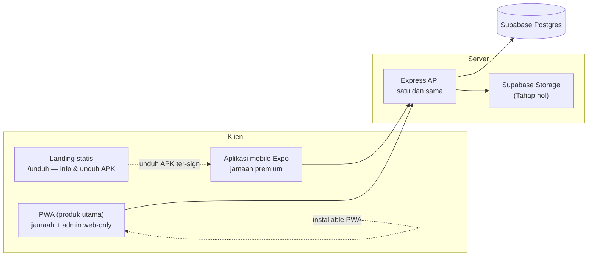

# Mobile & Content Protection

Rencana untuk tiga kebutuhan yang melampaui dokumen lain di folder ini: **(1)** audit pustaka — mana yang layak ditambah, mana yang sebenarnya sudah disediakan bawaan Node/platform, **(2)** proteksi konten premium dari tangkapan layar dan salin teks, **(3)** keputusan React Native vs Flutter + arsitektur pemisahan landing, aplikasi mobile, dan admin.

- Tanggal penyusunan: 22 Oktober 2026
- Basis kode: branch `Whatsaap-authenticator`, commit `2f2b769` (plus dependensi terverifikasi dari `package.json`)
- Posisi dokumen: pelengkap `Security-and-Fixing.md`, `Next-Feature.md`, dan `design-plan-improve.md` — membaca `README.md` folder ini tetap wajib

---

## 1. Ringkasan — jawaban langsung

| Pertanyaan | Jawaban singkat |
|---|---|
| Apakah ada library yang bisa menyelesaikan item rencana? | Ada, tetapi lebih sedikit dari yang diperkirakan. Sebagian besar item rencana (VULN dan desain) sengaja dirancang tuntas **tanpa** dependensi baru; hanya 4–5 pustaka kecil yang benar-benar layak ditambah, dan satu fitur (TTS) justru sudah tersedia sebagai API bawaan peramban. |
| Apakah ada yang sebenarnya bawaan Node tapi kita pakai library eksternal? | Ya, tapi sedikit dan semua terjustifikasi. Yang realistis diganti: `dotenv` → `node --env-file` (opsional), `dayjs` → `Intl` untuk sebagian besar format (opsional). Kode aplikasi sendiri **sudah tidak mengimpor `uuid`** (`crypto.randomUUID()` bawaan sudah jadi pola), dan `bcryptjs` punya alternatif bawaan `crypto.scrypt` bila suatu saat ingin menghapus dependensi. |
| Library anti-screenshot + anti-copy untuk halaman PDF premium? | **Untuk web: tidak ada.** Tidak ada API peramban yang bisa mencegah tangkapan layar OS — klaim sebaliknya adalah dongeng. Yang bisa dilakukan web adalah lapisan penghalang: nonaktifkan text layer PDF, watermark yang dibakar ke kanvas, blokir cetak/salin, dan grant unduh berumur pendek. **Untuk aplikasi native: bisa nyata** — Android `FLAG_SECURE` (layar hitam), iOS pembatas rekaman layar. Anda sendiri sudah benar: foto pakai HP lain tetap mustahil dicegah; yang bisa kita lakukan adalah **deteren jejak** lewat watermark identitas pengguna. |
| React Native atau Flutter? | **React Native via Expo** untuk proyek ini — satu bahasa dengan kode web yang ada, ekosistem Expo menutup semua kebutuhan (screen capture, secure store, push, OTA), dan fakta kunci: **Mobile SDK Midtrans resmi sudah deprecated**, jadi pembayaran di mobile tetap lewat WebView Snap — keputusan yang tidak menguntungkan maupun merugikan kedua framework, sehingga pemberatnya justru tinggal "seberapa banyak yang bisa dipakai ulang", dan itu jelas milik React Native. |
| Landing page .apk dipisah atau tidak? | **Pisahkan sebagai halaman statis** (bukan bagian bundle aplikasi), sedangkan **admin tetap web-only** — jangan dibuatkan versi mobile. |

---

## 2. Audit pustaka

### 2.1 Pustaka kecil yang layak ditambah (menyelesaikan item rencana)

| Kebutuhan | Pustaka | Ukuran | Menyelesaikan | Alternatif tanpa pustaka |
|---|---|---|---|---|
| Validasi magic byte unggahan | `sharp` — **sudah terpasang** (`sharp.metadata()`) | 0 (baru) | VULN-11, VULN-13, D-magic-byte | Manual 4 byte (`%PDF`, `\xFF\xD8\xFF`) di `server/lib/images.js` |
| 2FA TOTP admin (Next-Feature) | `otplib` | ~50 kB | Keamanan panel pembayaran | Implementasi RFC 6238 ±40 baris dengan `node:crypto` — sesuai etos repo, **ini yang saya rekomendasikan** |
| Penjadwal sweep kedaluwarsa & pengingat | `pg_cron` — ekstensi bawaan Supabase | 0 (platform) | VULN-12 sweep harian, pengingat perpanjangan, siaran agenda | `setInterval` berkoreksi drift di Node (fragil saat restart) |
| i18n 3 bahasa (Next-Feature, jauh) | `react-i18next` | ~40 kB | 53 kandidat #i18n | Kamus JSON custom + hook kecil — cukup untuk 2–3 locale |
| Uji e2e smoke (opsional) | `Playwright` (devDep) | devDep | Gerbang verifikasi `README.md` §6 jadi otomatis | Manual |
| EPUB (Next-Feature, jauh) | `epubjs` | ~150 kB | Renderer EPUB di reader | — |

Yang **bukan** pustaka: error tracking (Sentry dkk.) — untuk skala ini cukup endpoint `/api/client-errors` custom yang menyimpan ke tabel log (menghubungkan §2.12 `Next-Feature.md`); image/file hosting — Supabase Storage adalah fitur platform, bukan pustaka.

### 2.2 Ganti dengan bawaan Node/platform (rilis beban)

| Sekarang | Bawaan yang menggantikan | Keputusan |
|---|---|---|
| `dotenv` | `node --env-file=.env` (Node ≥ 20.6; repo pakai ≥ 22) | **Opsional.** Loader `server/env.js` memuat 3 jalur dengan `override` — perilaku itu butuh dotenv. Biarkan, catat saja. |
| `dayjs` | `Intl.DateTimeFormat`, `Intl.RelativeTimeFormat` | **Opsional.** dayjs hanya 7 kB dan dipakai luas; ganti hanya jika i18n Tahap berikutnya menuntut locale penuh. |
| `bcryptjs` | `crypto.scrypt` (memory-hard, tanpa dependensi) | **Jangan sekarang.** Ganti berarti migrasi semua hash; biayanya jauh melebihi manfaat. Catat sebagai opsi masa depan. |
| `jsonwebtoken` | Hand-rolled HMAC `node:crypto` | **Jangan.** Pustaka menutup celah alg-confusion dan edge case JWT; VULN-05/24 cukup diperbaiki di atasnya. |
| `uuid` (hanya `overrides`) | `crypto.randomUUID()` | **Sudah benar.** Kode aplikasi tidak mengimpor `uuid` sama sekali (terverifikasi) — override hanya menyematkan dependensi tak langsung. |

### 2.3 Pertahankan dengan alasan (audit yang lulus)

`midtrans-client` (dipakai `server/lib/midtrans.js:3`; walau pemanggilan Core API sebagian sudah `fetch` langsung, pustaka ini tipis dan berfungsi — pembersihan opsional), `google-auth-library` (3 pemakaian nyata: OAuth callback, XOAUTH2 SMTP di `mailer.js`, skrip gmail), `helmet`, `express-rate-limit`, `multer`, `sharp`, `exceljs`, `web-push`*, `zod`, `supabase-js`, `libphonenumber-js`, `flag-icons`, `qrcode.react`, `sonner`, `canvas-confetti`, `lucide-react`, `recharts` (2 grafik di admin — berat, tapi masih layak; kandidat pengganti SVG murni bila nanti ingin mengecilkan bundle).

> **Koreksi 2026-10-23:** `flag-icons` dicabut dari `package.json`. Seluruh 271 SVG sudah di-vendor di `public/flags/` dan dimuat lewat `FlagIcon.jsx` (`/flags/${flagKey}.svg`); tidak ada satu pun `import` yang memakai paketnya. Keputusan "pertahankan" di atas tidak lagi berlaku untuk paket ini.

\* `web-push` tercantum pada pembaruan fitur (commit `bfd7483`); kehadirannya di `package.json` perlu dicek saat eksekusi — kebutuhan VAPID di server sudah ada `server/lib/webpush.js`.

---

## 3. Proteksi konten premium — apa yang mungkin, apa yang mustahil

### 3.1 Matriks kelayakan yang jujur

| Lapisan | Web / PWA (sekarang) | Native (Expo/Flutter) |
|---|---|---|
| Blokir tangkapan layar oleh OS | **Tidak ada API.** Mustahil di web. | **Bisa.** Android: `FLAG_SECURE` → layar hitam + blank di app switcher. iOS: mencegah rekaman layar (dan tangkapan layar pada versi tertentu) lewat secure layer. |
| Deteksi tangkapan layar | Tidak ada | Android 14+ terbatas (lihat §3.4), iOS ada listener |
| Blokir salin teks | **Bisa** — nonaktifkan text layer PDF + CSS | **Bisa** |
| Blokir cetak (Ctrl+P / Save as PDF) | **Bisa** — `@media print` | **Bisa** |
| Watermark identitas pengguna | **Bisa** — dibakar ke kanvas render | **Bisa** |
| Cegah pengambilan byte PDF via devtools | **Tidak bisa.** Byte berada di memori peramban. | **Sebagian.** Unduhan terenkripsi + secure store; perangkat rooted tetap menang. |
| Foto dengan HP lain | **Mustahil dicegah** | **Mustahil dicegah** |
| DRM sungguhan (Widevine, Readium LCP) | Kategori yang memang dirancang untuk ini — tetapi butuh lisensi, infrastruktur, dan overkill untuk skripsi | Idem |

Kesimpulan yang perlu ditulis di naskah juga: **web memberi deteren, native memberi penghalang, keduanya memberi jejak.** Rumusan ini menjawab penguji yang bertanya "apakah bisa 100% aman?" dengan kerangka risiko, bukan janji.

### 3.2 Rencana M1 — proteksi lapisan web (tanpa pustaka baru)

Semua di `src/features/reader/PdfReaderScreen.jsx` + `server/routes/books.routes.js`:

1. **Nonaktifkan text layer pdf.js.** Render hanya ke kanvas; jangan pasang `
` teks yang bisa diseleksi. Tambahan CSS `user-select: none` pada area reader, `onContextMenu`/`onCopy`/`onCut`/`onDragStart` dibatalkan. Catatan aksesibilitas: TTS (fitur jangka panjang) nanti mengambil teks lewat jalur server tersendiri, bukan dari seleksi klien.
2. **Blokir cetak:** `@media print { .reader-protected { display: none } body::after { content: "Konten terlindungi hak cipta"; } }`.
3. **Watermark dibakar ke kanvas** (bukan overlay `
` yang bisa dihapus lewat devtools): setelah pdf.js merender halaman ke kanvas, gambar ulang di kanvas yang sama — diagonal, tipis, repetitif — berisi `nama depan • 3 digit akhir nomor HP • tanggal • id transaksi`. Overlay CSS menjadi lapisan kedua (lapisan ganda: satu terbakar, satu interaktif).
4. **Grant unduh berumur pendek:** `GET /api/books/:id/content` kini langsung menyajikan bytes. Tambahkan satu langkah: klien minta grant (JWT pendek, TTL 10 menit, terikat `user_id` + `book_id`) lalu menukarnya ke endpoint konten. Byte yang sudah diambil tetap ada di memori, tetapi tautan tidak bisa diulang/dibagikan, dan setiap pemberian grant **dicatat ke tabel audit akses** (siapa membuka kitab apa, kapan, dari perangkat apa) — inilah deteren jejak yang nyata dan bahan analitik keterbacaan (Next-Feature §2.9).
5. **Rate limit + harga MIME** pada endpoint konten sudah menjadi bagian VULN-15/13 — M1 hanya menyambungkannya, tidak menyalahinya.
6. **Pesan hak cipta** satu layar sebelum buka: nama pemilik hak, batas penggunaan pribadi, dan keterangan bahwa halaman berwatermark identitas pembaca. Deteren psikologis yang murah dan jujur.

### 3.3 Rencana M2 — proteksi lapisan native (Expo)

- **`expo-screen-capture`** (terverifikasi di dokumentasi Expo SDK 54): `preventScreenCaptureAsync()` memasang `FLAG_SECURE` di Android — tangkapan layar dan rekaman menghasilkan hitam, app switcher juga blank; iOS mencegah rekaman layar (dan tangkapan layar pada versi yang mendukung). `useScreenshotListener` untuk mendeteksi percobaan → catat ke audit + tampilkan peringatan.
- **Unduhan terkontrol:** PDF diunduh terenkripsi (kunci per perangkat) ke `expo-secure-store`/storage aplikasi dengan masa berlaku — pasangan dari "unduhan offline terkontrol" di `Next-Feature.md` §2.4. Reader native memakai `react-native-pdf` yang merender dari berkas lokal terenkripsi.
- **Watermark identitas** digambar di lapisan native di atas viewer — sama seperti web, digambar (bukan overlay view yang mudah dihapus).

### 3.4 Batasan teknis yang harus ditulis apa adanya

- **Android 14+**: API deteksi tangkapan layar sistem hanya menembak untuk kombinasi tombol tertentu, dan listener tidak menyala untuk tangkapan via ADB/instrumentasi (terdokumentasi pada isu expo/expo #31678). `FLAG_SECURE` sendiri tetap andal.
- **iOS**: tidak ada `FLAG_SECURE`; pembatasan memakai trik secure layer + deteksi. Screenshot tetap mungkin pada beberapa versi — deteren watermark tetap lapisan utama di iOS.
- **Foto HP lain** — selalu menang. Tapi foto itu membawa **watermark identitas** → kebocoran dapat ditelusuri ke akun pembaca → sanksi di syarat layanan. Ini model industri (buku/stok foto memakai pola yang sama).

---

## 4. React Native (Expo) vs Flutter

| Kriteria | React Native (Expo) | Flutter | Bobot untuk proyek ini |
|---|---|---|---|
| Bahasa & pengetahuan | **React — sama dengan kode web yang sudah ada** (React 19, hooks, pola `AppContext`/slice bisa ditiru) | Dart — mulai dari nol | **Menentukan.** Satu mahasiswa skripsi, waktu terbatas |
| Klien API & auth | `supabase-js` + `fetch` ke REST sendiri — **reuse hampir penuh** | Tulis ulang klien di Dart | Menentukan |
| Screen capture | **`expo-screen-capture` — modul resmi first-party** | `screen_secure` / `no_screenshot` — pustaka komunitas | Kuat |
| Push native | `expo-notifications` (FCM) resmi | `firebase_messaging` resmi | Setara |
| Secure store | `expo-secure-store` resmi | `flutter_secure_storage` komunitas | Kuat untuk RN |
| Update OTA tanpa review | **EAS Update** | Shorebird (pihak ketiga) | Kuat untuk RN |
| Pembayaran Midtrans | Sama-sama **WebView Snap** — Mobile SDK resmi Midtrans **deprecated** (pengumuman Sept 2026: pengembangan fitur baru dihentikan) | Idem | Netral — bukan pemberat |
| Performa render | Cukup untuk reader + list | Sedikit lebih unggul | Rendah — beban utama adalah dekode PDF, bukan UI |
| Rekrutmen/kelanjutan yayasan | Dev React lebih mudah dicari di Indonesia | Dev Flutter juga banyak | Setara |

**Rekomendasi: Expo (React Native).** Bukan karena RN lebih baik dari Flutter secara mutlak, melainkan karena pemberat satu-satunya yang nyata di proyek ini adalah jumlah pekerjaan baru, dan Expo menghapus sebagian terbesarnya. PWA tetap menjadi produk utama yang sudah jadi; aplikasi native adalah pelengkap yang memakai API yang sama.

---

## 5. Arsitektur pemisahan

Keputusan pemisahan:

1. **Satu backend, satu API** — aplikasi native TIDAK punya backend sendiri. Ia memanggil Express API yang sama dengan kredensial JWT yang sama (setelah VULN-03/24 beres, token native identik dengan web).
2. **Landing = halaman statis terpisah** — rekomendasikan subdomain atau jalur statis (mis. `unduh.wahidiyah…` atau `public/download/` yang di-deploy terpisah), bukan route di dalam bundle aplikasi: landing bebas desain, tidak membawa bundle JS aplikasi, bisa dipasang QR di majelis, dan tetap hidup saat aplikasi sedang di-update.
3. **Admin = web-only.** Dashboard admin (recharts, tabel, ekspor Excel) memang berguna di layar lebar; membuat versi mobile berarti dua kali pekerjaan untuk pengguna yang ada di balik meja. Admin tetap route ber-guard role di PWA untuk skripsi; saat produksi, opsional memindahkannya ke subdomain terpisah dengan CSP lebih ketat (defense in depth) plus **2FA TOTP** dari §2.1.
4. **PWA tetap dibangun terus** — ia produk utama (sudah jalan, installable, push hidup). Aplikasi native menargetkan jamaah yang butuh FLAG_SECURE dan notifikasi native, bukan menggantikan web.

---

## 6. Landing unduhan APK & distribusi

Isi minimum halaman landing (satu halaman, mode gelap, memakai identitas "Editorial Elegan" yang sama):

1. Nama + versi terkini + tanggal rilis + `versionCode`.
2. Tombol unduh APK **ter-sign** + tautan checksum **SHA-256** yang ditampilkan sebagai teks (agar pembanding manual bisa).
3. Changelog ringkas per versi.
4. Langkah pemasangan dengan tangkapan layar: izinkan "sumber tidak dikenal" → buka APK → masuk. Antisipasi **peringatan Play Protect** — jelaskan dengan copywriting tenang (ini normal untuk APK di luar Play Store).
5. QR code ke URL unduhan (memakai `qrcode.react` yang sudah ada).
6. Tautan ke PWA sebagai alternatif "tanpa pasang aplikasi".

Distribusi, dua jalur:

| Jalur | Biaya | Catatan |
|---|---|---|
| APK langsung dari landing | Gratis | Wajib: keystore konsisten dari build pertama (hilang = tidak bisa update), `versionCode` naik tiap rilis, checksum ditampilkan. Cocok untuk tahap skripsi & komunitas majelis. |
| Play Console — internal testing | USD 25 sekali | Update otomatis, tidak ada peringatan Play Protect, ikon terpercaya. Midtrans punya syarat aplikasi komersial di store — daftarkan setelah sandbox selesai. |

---

## 7. Urutan eksekusi

**Prasyarat (dari dokumen lain, jangan dilewati):** VULN-03 + VULN-24 (token) — aplikasi native memakai token yang sama; Tahap nol `Next-Feature.md` (object storage + penegakan kedaluwarsa VULN-12) — unduhan terkontrol bergantung padanya; Desain Tahap 1–2 (kontras + skala tipografi) supaya komponen reader baru lahir dengan skala yang benar.

| Tahap | Isi | Keluaran |
|---|---|---|
| M1 | Proteksi web: text layer off, watermark kanvas, `@media print`, grant 10 menit, tabel audit akses, pesan hak cipta | Reader web terlindungi tanpa satu pun dependensi baru |
| M2 | Keputusan + scaffold Expo: proyek baru, `expo-screen-capture`, `expo-secure-store`, `react-native-pdf`, auth memakai JWT yang sama, deep link | Aplikasi Android bisa login & membaca dengan FLAG_SECURE aktif |
| M3 | Pembayaran mobile: tombol "Bayar" membuka `redirect_url` Snap via Custom Tabs/WebView (bukan SDK — deprecated), kembali ke app via deep link, polling status memakai endpoint yang sama | Alur bayar ujung-ke-ujung di Android |
| M4 | Landing statis + distribusi: halaman unduh, signing, checksum, changelog; opsional Play internal testing | APK bisa didistribusikan ke jamaah |
| M5 | Admin: 2FA TOTP (`node:crypto`, RFC 6238) + audit akses konten masuk halaman log admin | Panel aman untuk produksi |

Estimasi bobot: M1 paling murah dan paling cepat terasa; M2–M3 adalah pekerjaan terbesar; M4 ringan; M5 sedang.

---

## 8. Prompt eksekusi untuk AI lain

> Salin blok berikut sebagai satu instruksi. M1 dikerjakan di repo web yang ada; M2–M4 membuat proyek baru — jangan mencampur build native ke repo web.

### Role and mission

You are a senior mobile/content engineer. Execute the content-protection plan for the Wahidiyah Book app. Work in two places: (1) the existing web repo at `E:\Wahidiyah Book + Real Midtrans Skripsi` (branch `improve/all-plans`), (2) a NEW Expo project in a sibling folder `wahidiyah-mobile` (do not touch the web repo's build). Report in **Indonesian**.

### Hard rules

- Never add a dependency for anything a Node/browser/expo built-in or already-installed package can do. Allowed new packages: `react-native-pdf` (and its transitive requirements) in the mobile project only. TOTP must be implemented with `node:crypto` (RFC 6238), not `otplib`.
- Preserve the visual identity (emerald/cream/gold tokens, Fraunces/Jakarta) in both web reader changes and the landing page.
- The web content endpoint must keep its existing response shape; add the grant flow as a new endpoint pair, update the client in the same commit.
- Never weaken the invariants in `ai-plan/README.md` §2 (no caching of paid content, server-side prices, RLS on new tables with explicit policies in `full_setup.sql`).
- Do not distribute or commit any keystore; document the signing workflow instead. Never `git push`.

### Stage M1 — web protection (no new deps)

1. `PdfReaderScreen`: disable pdf.js text layer; render to canvas only; `user-select: none`; block `copy`/`cut`/`contextmenu`/`dragstart` in the reader area; add `@media print` rules that blank the reader and show a copyright notice.
2. Burn a per-user watermark into the rendered canvas (repeat diagonal, low-alpha): first name + last 3 digits of phone + date + transaction id. Keep a CSS overlay as a second layer. Watermark data must come from the session user, never from client input.
3. Add `POST /api/books/:id/read-grant` returning a short-lived (10 min) signed grant bound to `user_id`+`book_id`; make `GET /api/books/:id/content` accept either it or the session JWT. Log every grant to a new `content_access_log` table (RLS on, explicit policies, update `full_setup.sql`).
4. Show a one-screen copyright notice before opening a locked book.

### Stage M2 — Expo scaffold (new project)

`npx create-expo-app` → bare-minimum navigation; `expo-screen-capture` (`preventScreenCaptureAsync` + `useScreenshotListener` → log to API + warning UI); `expo-secure-store` for the JWT; login via the existing API (`/api/auth/login` etc.); PDF via `react-native-pdf` from an encrypted download with per-device key and expiry. Android `FLAG_SECURE` must be verified on a real device.

### Stage M3 — mobile payment

"Bayar" opens the Snap `redirect_url` via Custom Tabs/WebView (Midtrans Mobile SDK is deprecated — do not use it). Return to app via deep link; status polling reuses the existing endpoints. Sandbox end-to-end proof required.

### Stage M4 — landing + distribution

Separate static landing (Indonesian, dark, brand tokens): latest version + `versionCode` + release date, signed-APK download with SHA-256 checksum shown as text, changelog, install steps with Play Protect copywriting, QR code to the download URL, and a link to the PWA alternative. Document the keystore workflow and `versionCode` bump process in `docs/`.

### Stage M5 — admin hardening

TOTP 2FA for admin login using `node:crypto` (RFC 6238), QR provisioning via the existing `qrcode.react`; surface `content_access_log` in the admin logs page.

### Definition of done

Web reader: no selectable text, print-blanked, watermarked per user, grants logged; new tables have RLS policies and appear in `full_setup.sql`. Mobile app: FLAG_SECURE verified, login+read works against the same API. Landing: live with checksum. Report in Indonesian mapping each stage to evidence (command + output), list new env values required (none should be needed beyond existing), and flag every product claim you had to leave as a decision for the owner.

---

## 9. Batasan

- Angka bobot pustaka dan nama paket diverifikasi saat penyusunan (22 Okt 2026); versi berikutnya bisa bergeser — cek ulang `pub.dev`/npm sebelum memasang.
- Perilaku `expo-screen-capture` di iOS dan keterbatasan listener Android 14+ didokumentasikan pada §3.4; verifikasi di perangkat fisik adalah bagian dari M2, bukan opsional.
- Rencana ini tidak menggantikan kebutuhan naskah: rumusan "deteren vs penghalang vs jejak" (§3.1) sengaja dibuat agar bisa dikutip langsung di bab pembahasan ketika menjawab pertanyaan penguji tentang keamanan konten.
- Biaya Play Console dan kebijakan Midtrans untuk aplikasi komersial dapat berubah; angka di §6 adalah keadaan saat penyusunan.
