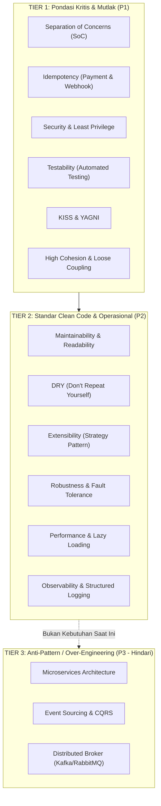
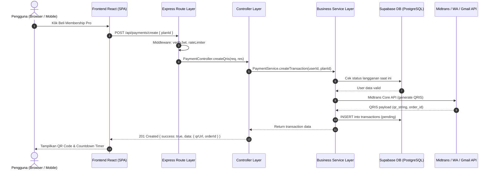
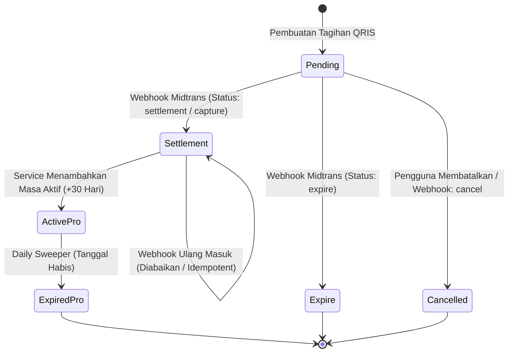

# Architecture & Engineering Guidelines
## Perpustakaan Digital Wahidiyah — E-Book & Midtrans QRIS Payment Gateway
> **Dokumen Panduan Teknis & Arsitektur Standar Industri untuk Pengembang & AI Assistant**  
> *Versi 1.0.0 — Terakhir Diperbarui: 25 Oktober 2026*

---

## 1. Ringkasan Eksekutif & Karakteristik Sistem

Dokumen ini merupakan cetak biru (*architectural blueprint*) dan standar rekayasa perangkat lunak untuk aplikasi **Perpustakaan Digital Wahidiyah**. Dokumen ini dirancang agar dapat dibaca, dipahami, dan dijadikan acuan kerja langsung oleh tim pengembang perangkat lunak, penguji sidang skripsi, maupun **model AI mutakhir** (seperti Claude 3.7/Opus, GPT-4o/o1, Gemini Pro) untuk melakukan pemeliharaan, refaktorisasi, maupun penambahan fitur baru dengan standar kualitas tertinggi.

### 1.1 Spesifikasi Domain Bisnis
- **Domain**: Perpustakaan digital e-book Islam, keanggotaan berbayar (*Membership Pro*), pembayaran digital real-time via QRIS Midtrans Core API, pembaca naskah continuous vertical scroll (PDF.js Canvas), dan panel admin operasional.
- **Tipe Arsitektur**: **Modular Layered Monolith** (Frontend SPA + Backend RESTful API terpadu).
- **Target Skalabilitas**: 1.000 – 50.000 pengguna aktif bulanan (MAU) dengan beban transaksional pembayaran QRIS deterministik.

### 1.2 Technology Stack
| Lapisan | Teknologi | Catatan Teknis |
| :--- | :--- | :--- |
| **Frontend Framework** | React 19 (`^19.3.1`) | Functional components, Hooks, Context + Slices pattern |
| **Build Tool & Bundler** | Vite 6 (`^6.4.3`) | Manual chunking (`pdfjs`, `excel`, `charts`, `supabase-sdk`) |
| **Styling & Design System** | Tailwind CSS 4 (`@tailwindcss/vite`) | 3-Color Key semantik (60-30-10) & WCAG AA $\ge 4.5:1$ |
| **PDF Rendering** | Mozilla PDF.js (`pdfjs-dist@^4.10.38`) | Continuous vertical canvas scroll, Scroll-Spy, HD Retina |
| **Backend Runtime** | Node.js 22+ (ES Module) | Native `fetch`, Async/Await, ESM syntax |
| **Web Server Framework** | Express.js 4 (`^4.21.2`) | Single-port dev middleware / production dual-mode |
| **Database & Auth Storage**| Supabase Cloud PostgreSQL | Service Role Client (Backend) & Row Level Security (RLS) |
| **Payment Gateway** | Midtrans Core API (`midtrans-client`) | QRIS Gopay acquirer, webhook notification listener |
| **WhatsApp Notifications** | Multi-Provider Gateway Pattern | Fonnte, Wablas, Whacenter, Twilio, Generic Webhook |
| **Email Gateway** | Google APIs (`google-auth-library`) | Gmail API OAuth2 Service Token |

---

## 2. Pemetaan & Evaluasi Kritis 30 Prinsip Kualitas Perangkat Lunak

Berikut adalah evaluasi mendalam terhadap 30 prinsip kualitas perangkat lunak yang disaring secara objektif sesuai karakteristik proyek ini:



### 2.1 Tier 1: Prinsip Kritis & Prioritas Utama (P1)

#### 1. Separation of Concerns (SoC) & High Cohesion
- **Masalah Saat Ini**: Route Express di `server/routes/auth.routes.js` (690 baris) dan `server/routes/payments.routes.js` (602 baris) memadukan penanganan HTTP request/response, validasi skema, logika bisnis perhitungan durasi, query SQL Supabase langsung, dan pemanggilan gateway pihak ketiga dalam satu fungsi route.
- **Aturan Standar**: Setiap layer hanya mengurusi satu domain tanggung jawab:
  - `Routes`: Routing URL, HTTP method, middleware otentikasi/rate-limiting.
  - `Controllers`: Ekstraksi DTO dari `req.body`/`req.params` dan pemformatan HTTP response (`200 OK`, `400 Bad Request`, `500 Internal Server Error`).
  - `Services`: Murni aturan bisnis (*business rules*). Menerima input data polos, mengembalikan data hasil. **Bebas dari objek `req` dan `res` Express** sehingga 100% testable secara unit.
  - `Repositories / DB`: Eksekusi query database Supabase Cloud.

#### 2. Idempotency (Operasi Bayar & Webhook)
- **Konteks**: Server Midtrans dapat mengirimkan callback webhook notifikasi status transaksi berkali-kali jika server merespons lambat (retry mechanism). Pengguna di frontend juga bisa mengklik tombol pembayaran berulang kali.
- **Aturan Standar**:
  - Webhook handler wajib memeriksa status transaksi saat ini sebelum mengubah status ke `settlement`. Jika transaksi sudah `active` atau `settlement`, jangan pernah menambahkan masa aktif Pro kedua kalinya (*prevent double fulfillment*).
  - Webhook wajib merespons `200 OK` segera setelah payload berhasil diverifikasi valid.

#### 3. Security by Design
- **Aturan Standar**:
  - Tidak ada SQL Injection: Semua query Supabase menggunakan PostgREST client berparameter.
  - Rate Limiting berlapis: Berdasarkan IP (`authRateLimiter`) dan berdasarkan identifier akun (`authIdentifierRateLimiter`).
  - Content Security Policy (CSP): Strict CSP dengan hash sha256 inline script yang terdaftar.
  - Origin Validation: Mengabaikan header `Host` dari request mentah; hanya menggunakan whitelist `ALLOWED_ORIGINS` dan `FRONTEND_ORIGIN`.
  - Sensitive Secrets: Kunci rahasia (`SUPABASE_SECRET_KEY`, `MIDTRANS_SERVER_KEY`, JWT secret) hanya boleh ada di environment backend dan haram masuk ke bundle client (`Vite`).

#### 4. Testability
- **Aturan Standar**: Logika penentuan status keanggotaan, kalkulasi kedaluwarsa tanggal, hashing password, dan verifikasi OTP wajib dapat diuji tanpa menyalakan server atau database nyata. Fungsi service dirancang *pure* / *dependency-injected*.

#### 5. KISS (Keep It Simple, Stupid) & YAGNI (You Aren't Gonna Need It)
- **Aturan Standar**: Hindari membuat abstraksi dinamis yang rumit jika kasus penggunaannya hanya satu. Gunakan solusi paling sederhana yang langsung menyelesaikan masalah dan mudah dipresentasikan pada sidang skripsi.

---

### 2.2 Tier 2: Prinsip Standar Kode & Operasional (P2)

| Prinsip | Implementasi Nyata di Proyek Ini |
| :--- | :--- |
| **Maintainability & Readability** | Penamaan variabel eksplisit, fungsi tidak melebihi 40-50 baris, komentar menerangkan *alasan bisnis* (*why*), bukan sintaks bahasa (*how*). |
| **DRY (Don't Repeat Yourself)** | Fungsi format mata uang Rupiah (`formatRupiah`), normalisasi data user (`normalizeUser`), dan penanganan token tersentralisasi di `src/lib/` atau `server/lib/`. |
| **Extensibility (Open/Closed)** | Menggunakan **Strategy Pattern** seperti pada `server/providers/base.js`. Bila ingin menambah gateway WhatsApp baru (misalnya *Twilio* atau *Wablas*), cukup membuat kelas turunan tanpa mengubah kode router pembayaran/auth yang memanggilnya. |
| **Robustness & Fault Tolerance** | Fallback otomatis: jika provider WhatsApp utama gagal (misal kuota habis atau timeout), sistem otomatis mencatat log dan tidak membuat server meledak (*crash*). Koneksi Supabase memiliki fungsi `isDatabaseHealthy` yang fail-safe. |
| **Performance** | Lazy loading modul PDF.js (`pdfjs-dist`) dan Excel (`exceljs`) melalui manual chunking Vite. Pada PDF Reader, menggunakan *lazy page rendering* (hanya halaman di sekitar viewport yang dirender ke canvas). |
| **Observability** | Structured logging di `server/logger.js` dengan tagging domain (`[AUTH]`, `[PAYMENT]`, `[DB]`, `[WHATSAPP]`) dan pencatatan request context. |

---

### 2.3 Tier 3: Anti-Pattern & YAGNI yang Wajib Dihindari (P3)

> [!CAUTION]
> **Larangan Arsitektur untuk Tahap Ini:**
> 1. **Dilarang memecah menjadi Microservices**: Menghindari overhead container orchestrator (Kubernetes/Docker Swarm), latency jaringan internal, dan masalah konsistensi data terdistribusi (*distributed transactions*).
> 2. **Dilarang menerapkan CQRS murni & Event Sourcing**: Memisahkan read/write database terpisah dan menyimpan log perubahan sebagai immutable event log adalah over-engineering masif untuk perpustakaan digital ini.
> 3. **Dilarang memasang Dedicated Message Broker (Kafka/RabbitMQ)**: Antrean pengiriman email OTP dan WhatsApp pengingat agenda cukup menggunakan promise queue asinkron di dalam Node.js.

---

## 3. Desain Arsitektur Target (Layered Clean Architecture)

### 3.1 Diagram Interaksi Komponen



### 3.2 Pola Struktur Direktori Backend Target

```text
server/
├── config.js               # Konfigurasi aplikasi & environment
├── db.js                   # Client Supabase & Health Check
├── server.js               # Inisialisasi Express & Middleware global
├── logger.js               # Structured logger
│
├── middleware/             # HTTP Interceptors
│   ├── security.js         # Helmet, CSP, CORS, Rate Limiters
│   ├── errors.js           # Global Error Handling & 404 handler
│   └── auth.js             # JWT verification & Role guards (Admin/Member)
│
├── controllers/            # HTTP Request/Response Orchestrator
│   ├── auth.controller.js  # Request validation & HTTP formatting
│   ├── payment.controller.js
│   └── book.controller.js
│
├── services/               # Pure Business Logic (100% Unit Testable)
│   ├── auth.service.js     # Registrasi, Login, Hashing, OTP flow
│   ├── payment.service.js  # Pembuatan order, Verifikasi webhook, Idempotency
│   └── membership.service.js # Perhitungan durasi, aktivasi, sweeping kadaluarsa
│
├── providers/              # Integration Gateway (Strategy Pattern)
│   ├── base.js             # BaseWhatsAppProvider interface
│   ├── fonnte.js
│   ├── wablas.js
│   └── index.js            # Provider factory & auto-detection
│
└── routes/                 # Endpoint Route Mapping
    ├── auth.routes.js      # Router definitions (calls controller methods)
    ├── payments.routes.js
    ├── books.routes.js
    └── index.js            # Mount all routes
```

---

## 4. Standar Implementasi & Aturan Teknis

### 4.1 Standar Service Layer (Pemisahan Total dari Express `req`/`res`)
Service function **TIDAK BOLEH** menerima objek `req` atau `res`. Parameter harus berupa objek data murni (*primitive object*).

```javascript
// CONTOH SALAH (Tercampur dengan Express context):
// server/services/payment.service.js
export async function createOrder(req, res) {
  const userId = req.user.id; // KOPLING KETAT! Sulit di-unit test
  // ...
  res.status(200).json({ ok: true });
}

// CONTOH BENAR (Pure Business Logic):
// server/services/payment.service.js
export async function createPaymentOrder({ userId, planId, userEmail, userName }) {
  if (!userId || !planId) {
    const error = new Error('User ID dan Paket langganan wajib diisi.');
    error.statusCode = 400;
    throw error;
  }
  // Logika bisnis murni...
  return { orderId, qrString, grossAmount, expiresAt };
}
```

### 4.2 Format Respons HTTP Terpusat (Predictability)
Semua endpoint REST API wajib mengembalikan format amplop JSON yang seragam:

```javascript
// Sukses
{
  "success": true,
  "message": "Transaksi berhasil dibuat.",
  "data": { ... }
}

// Gagal
{
  "success": false,
  "message": "Kode OTP verifikasi tidak valid atau telah kedaluwarsa.",
  "error": {
    "code": "INVALID_OTP",
    "details": null
  }
}
```

### 4.3 Idempotency State Machine Transaksi Midtrans


Aturan verifikasi Idempotency:
```javascript
// server/services/payment.service.js
export async function handleMidtransNotification(payload) {
  const { order_id, transaction_status, fraud_status } = payload;
  
  // 1. Ambil transaksi dari database
  const { data: tx } = await supabaseServer
    .from('transactions')
    .select('*')
    .eq('order_id', order_id)
    .single();

  if (!tx) {
    throw new Error(`Transaksi dengan Order ID ${order_id} tidak ditemukan.`);
  }

  // 2. IDEMPOTENCY CHECK: Jika sudah settlement/active, jangan proses ulang!
  if (tx.status === 'settlement' || tx.status === 'success') {
    logger.info('PAYMENT', `Notifikasi duplikat diabaikan untuk Order ${order_id}`);
    return { status: 'already_processed', tx };
  }

  // 3. Update status dan aktifkan paket
  if (transaction_status === 'settlement' || (transaction_status === 'capture' && fraud_status === 'accept')) {
    await activateMembership({ userId: tx.user_id, planDurationDays: 30 });
    await supabaseServer
      .from('transactions')
      .update({ status: 'settlement', updated_at: new Date().toISOString() })
      .eq('id', tx.id);
  }

  return { status: 'processed', tx };
}
```

---

## 5. Standar Desain Frontend & Rendering Dokumen

### 5.1 Continuous Vertical Scroll PDF (HTML5 Canvas via PDF.js)
- **Komponen Utama**: `src/features/reader/ContinuousPdfViewer.jsx` dan `PdfReaderScreen.jsx`.
- **Aturan Render**:
  - Halaman mengalir secara vertikal (continuous scroll ke bawah).
  - Menggunakan `IntersectionObserver` (*Scroll-Spy*) untuk mendeteksi nomor halaman yang sedang aktif di viewport secara real-time.
  - Halaman di luar viewport di-render secara malas (*lazy rendering*) untuk menjaga konsumsi memori browser di perangkat mobile tetap di bawah 100 MB.
  - Resolusi canvas dikalikan dengan `window.devicePixelRatio` untuk memastikan tulisan Arab (khot/harakat) tampil tajam sempurna (Retina Display).

### 5.2 Standar Kepatuhan Warna & Aksesibilitas
- Mengikuti dokumen `DESIGN.md` seksi 1.5.
- Wajib menggunakan token semantik: `brand-*`, `cream-*`, `ink-*`, `gold-*`, `ui-*`, `semantic-*`.
- Dilarang keras menggunakan warna mono mentah (`bg-white`, `text-black`) tanpa alasan whitelist cetak kwitansi.
- Rasio kontras teks wajib memenuhi standar **WCAG AA $\ge 4.5:1$** (diuji otomatis oleh `scripts/check-contrast.js`).

---

## 6. Protokol Khusus untuk Model AI (AI Operational Rules)

Bagi model AI (Claude, GPT, Gemini, dsb.) yang melanjutkan pekerjaan pada repositori ini:

1. **Dilarang Melakukan Git Push**:
   - Seluruh instruksi commit hanya dilakukan secara lokal: `git add <berkas>` dan `git commit -m "..."`.
   - Tidak diperkenankan menjalankan `git push origin ...`.

2. **Verifikasi Wajib Sebelum Mengakhiri Tugas**:
   - Setiap selesai mengedit berkas backend atau frontend, wajib menjalankan gerbang verifikasi:
     ```bash
     npm run check
     ```
   - Skrip ini memverifikasi:
     - 56 berkas backend lolos verifikasi sintaks Node.js.
     - Seluruh berkas `src/` konsisten terhadap 3 Color Key (0 palet mentah).
     - 17 pasang kontras warna lolos gerbang WCAG AA.
     - Vite build produksi berhasil 100% tanpa galat modul.

3. **Integritas Dokumentasi & Docstrings**:
   - Pertahankan seluruh komentar dan docstring yang sudah ada di codebase.
   - Gunakan Bahasa Indonesia baku dan profesional dalam komunikasi dengan pengguna maupun dalam pesan commit.

---

## 7. Rencana Tindakan Bertahap (Action Roadmap)

| Fase | Target Kerja | Fokus Prinsip Kualitas | Status |
| :---: | :--- | :--- | :---: |
| **Fase 1** | Implementasi Continuous Vertical Scroll & Real-Time Zoom pada PDF Reader | *Performance, Usability, Mobile Responsiveness* | **SELESAI (Commit `3d5b646`)** |
| **Fase 2** | Pemisahan Service Layer untuk Modul Pembayaran (`payments`) & Webhook Idempotency | *Separation of Concerns, Idempotency, Robustness* | Siap Dikerjakan |
| **Fase 3** | Pemisahan Service Layer untuk Modul Otentikasi (`auth`) & Standardisasi Respon | *High Cohesion, Maintainability, Security* | Direncanakan |
| **Fase 4** | Pemasangan Unit Test Harness (Vitest) untuk Logika Membership & Payment Parsing | *Testability, Reliability, Deterministic* | Direncanakan |
| **Fase 5** | Pemecahan Komponen Inline pada `AdminDashboard.jsx` ke Sub-tab Terisolasi | *Composability, Loose Coupling, Readability* | Direncanakan |

---
*Dokumen ini adalah aset panduan resmi proyek skripsi Aplikasi Perpustakaan Digital Wahidiyah.*
